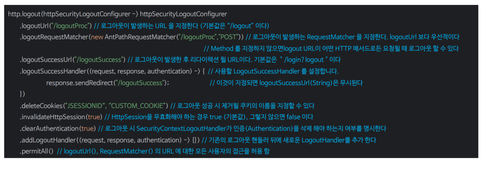
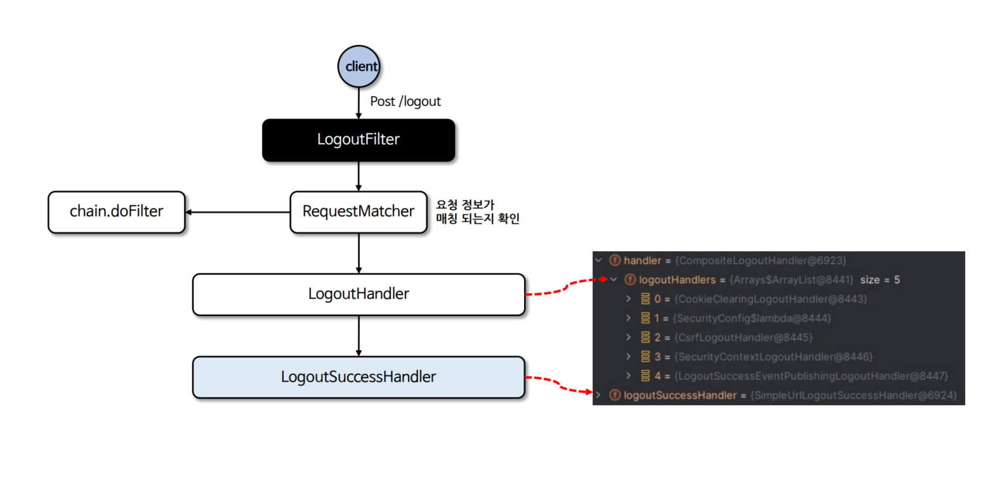

# **로그아웃**

- 스프링 시큐리티는 기본적으로 `DefaultLogoutPageGeneratingFilter` 를 통해 로그아웃 페이지를 제공하며 `GET /logout` URL로 접근이 가능하다.
- 로그아웃 실행은 기본적으로 `POST /logout` 으로만 가능하나 CSRF 기능을 비활성화 할 경우 혹은 `RequestMatcher` 를 사용할 경우 GET, PUT, DELETE 모두 가능하다 
- 로그아웃 필터를 거치지 않고 스프링 MVC에서 커스텀 하게 구현할 수 있으며 로그인 페이지가 커스텀하게 생성될 경우 로그아웃 기능도 커스텀하게 구현해야 한다 

# **logout() API**

# **LogoutFilter**


