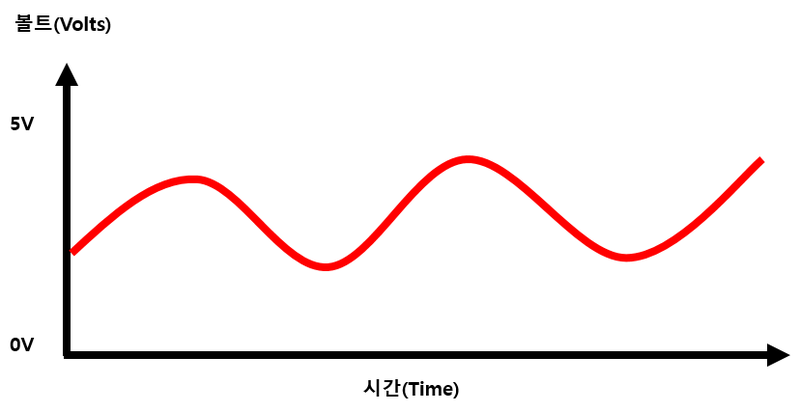
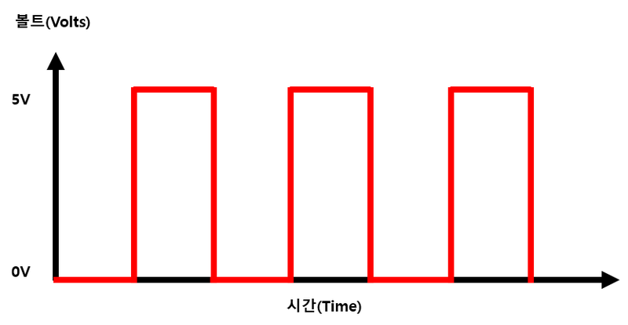
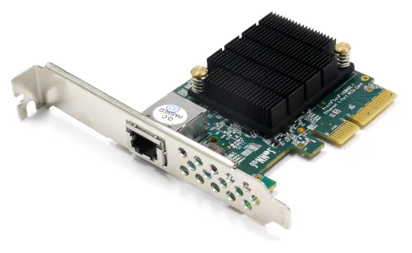

OSI 7 계층에서 최하위에 위치한 물리 계층은 컴퓨터들을 물리적으로 연결하거나 데이터를 전기 신호로 변환하고 제어하는 역할을 담당한다.

**전기 신호란?** 

전압이 일정한 패턴으로 변하여 생기는 일련의 흐름이다. 즉, 전압의 변화에 의한 신호이다. 2대의 컴퓨터는 전기 신호들을 주고받음으로써 사진이나 문서 등을 주고받을 수 있다.

### **전기 신호의 종류**

**아날로그 신호**

- 빛, 소리 등과 같이 연속적으로 변하는 물결 모양의 신호
- 유선 전화나 라디오 방송에서 사용

**디지털 신호**

- 특정한 값을 기준으로 불연속적으로 변하는 막대 모양의 신호
- 컴퓨터나 스마트폰에서 사용

우리는 주로 디지털 신호를 사용한다. 디지털 신호를 이용해서 어떻게 데이터를 전달할까? 

물리 계층의 데이터는 비트이다. 비트란 컴퓨터가 데이터를 처리하는 최소 단위로서 0과 1로 구성된다.

올라가는 막대를 1로 표현하고 평면인 곳을 0으로 표현한다.

### 예시

송신자가 수신자에게 “network.docx 파일을 보내줘” 메시지를 보내고 싶으면 해당 문장을 0과 1의 비트로 변환하고 해당 비트를 전기 신호로 변환한 후 수신자에게 디지털 신호로 전달한다. 마지막으로 수신자 측에서는 전기 신호가 다시 0과 1의 비트로 변환된다.

**그렇다면 해당 메시지는 어떻게 그리고 어디서 전기 신호로 변환되는 것일까?** 

이 역할을 하는 것이 **랜 카드(LAN Card, NIC Network Interface Card)**라는 장치다. 

2대 이상의 컴퓨터가 통신하기 위해서는 LAN 네트워크 환경이 필요하고, 랜 카드는 내 컴퓨터와 인터넷을 연결하는 필수 장치다. 그리고 랜 카드에는 랜 케이블을 연결할 수 있는 구멍(랜 포트)가 있다.

따라서 랜 카드는 데이터가 물리적 전기 신호로 내 컴퓨터 밖으로 나가는 출발점이라고 할 수 있다.


