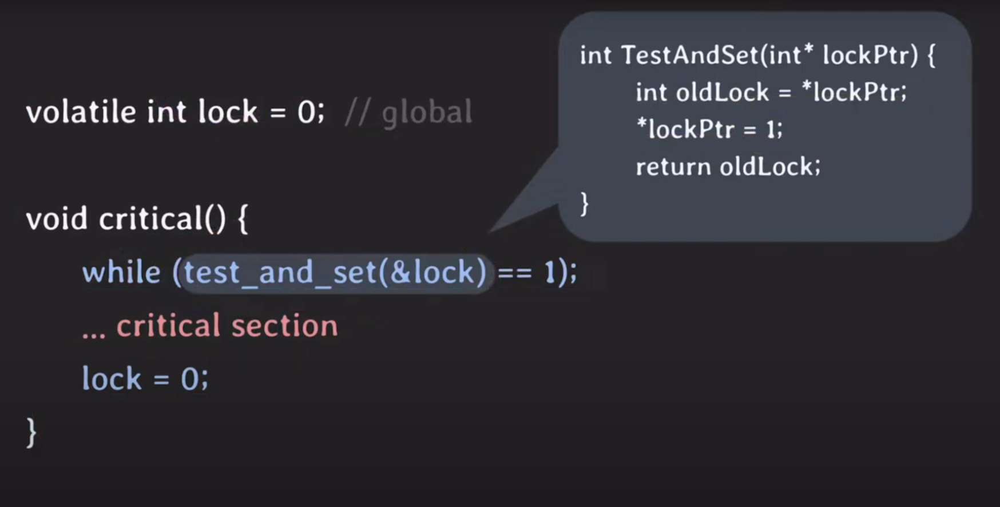
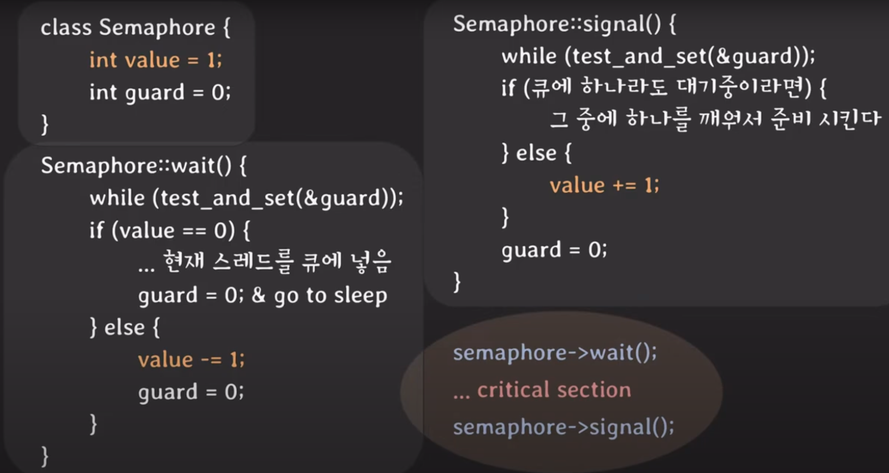
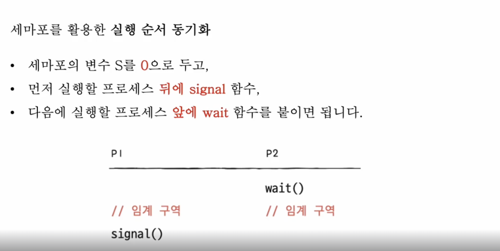

### **✅ 스핀락(Spinlock)**

**스핀락은 CPU를 계속 점유하면서 락을 확인하는 방식 → Busy Waiting**



**✅ TestAndSet** 

- **TestAndSet 함수 호출은 무조건 lock을 1로 만든다.**
- **이전 lock 값에 따라서 0 또는 1을 반환한다.**

**✅ 의문점** 

- **만약 스레드1, 스레드2가 동시에 TestAndSet 함수 호출을 한다면 oldLock은 0으로 스레드1, 스레드2 모두 critical section에 들어가지 않나?**

**✅ TestAndSet = CPU atomic 명령어** 

- **실행 중간에 간섭받거나 중단되지 않는다** 
- **같은 메모리 영역에 대해 동시에 실행되지 않는다** 
- **이해를 돕기 위한 코드이지 실제 TestAndSet 명령어 기계어가 아니다.**

**⚠️ Busy-Waiting으로 인해 CPU 사용량이 높을 수 있음**

---

### **✅ 뮤텍스(Mutex) 락** 

**뮤텍스는 CPU를 양보하고 블로킹(wait)하는 방식** 


- **guard 같은 경우 atomic 연산(test_and_set)을 통해 획득**
- **스핀락과 다르게 CPU를 양보하고 블로킹 상태로 대기 큐에서 락 해제를 기다린다.**

### **뮤텍스(Mutex) 락은 priority inheritance(우선순위 상속) 특성을 가질 수 있다.** 

**Priority Inheritance란?**

- 우선순위 역전(priority inversion) 문제를 해결하기 위한 메커니즘
- 낮은 우선순위(low priority) 쓰레드가 뮤텍스를 소유하고 있을 때, 높은 우선순위(high priority) 쓰레드가 뮤텍스가 풀릴 때까지 기다려야 하는 경우가 발생할 수 있다.
- 이때 낮은 우선순위 쓰레드가 CPU를 배정받지 못하면, 높은 우선순위 쓰레드는 계속 대기하게 되는데, 이게 **우선순위 역전** 문제다.

**뮤텍스의 Priority Inheritance 특성**

- 뮤텍스를 소유한 낮은 우선순위 쓰레드가 **더 높은 우선순위를 임시로 부여받는 것**이 Priority Inheritance
- 이렇게 하면 낮은 우선순위 쓰레드가 빠르게 실행되어 락을 해제할 수 있고, 높은 우선순위 쓰레드는 불필요하게 대기하지 않게 된다.
- 락을 해제하면 원래 우선순위로 돌아간다.
- 기본적으로 모든 뮤텍스가 priority inheritance를 지원하는 건 아니다.
- OS 및 커널 설정에 따라 다르고, 일반적인 환경에서는 기본적으로 비활성화된 경우가 많다.

### **뮤텍스 락 VS 스핀 락 비교** 

|  | **스핀락(Spinlock)** | **뮤텍스(Mutex)** |
| --- | --- | --- |
| **대기 방식** | 계속 루프 돌며 락 확인 (Busy-Waiting) | 컨텍스트 스위칭 후 Block 상태 |
| **CPU 낭비** | 높음 (계속 CPU 사용) | 없음 (대기 상태) |
| **임계 구역 짧을 때** | ✅ 효율적 | ❌ 비효율적 (컨텍스트 스위칭 오버헤드) |
| **임계 구역 길 때** | ❌ 비효율적 (CPU 낭비) | ✅ 효율적 |

**스핀락과 뮤텍스 락 모두 atomic 연산을 통해 상호 배제를 제공하지만 락을 걸고 사용하려고 할 때 내부적으로 로우 레벨에서 차이점이 존재한다. 뮤텍스 같은 경우 자원에 이미 락이 걸려 있을 경우 락이 풀릴 때까지 기다리며 컨텍스트 스위칭을 하고 대기 큐에서 기다리지만 스핀락 같은 경우 CPU를 양보하지 않고 무한 루프에서 계속 락 획득 시도를 한다. 하지만 모든 상황에서 뮤텍스 락이 효율적인 것은 아니고 임계 구간의 작업이 컨텍스트 스위칭 보다 작다면 즉, 락 필요 기간이 작다면 스핀락을 통해 컨텍스트 스위칭에 대한 오버헤드를 줄일 수 있다.** 

**멀티 코어 환경이고 critical section 작업이 컨텍스트 스위칭보다 더 빨리 끝난다면 스핀락이 뮤텍스보다 더 이점이 있다.** 

### **✅ 세마포어 (Semaphore)** 

**signal mechanism을 가진, 하나 이상의 프로세스/스레드가 critical section에 접근 가능하도록 하는 장치** 



- **value = 1: 이진 세마포어** 
- **value ≥ 2: 카운팅 세마포어** 
- **세마포어는 실행 순서에 대한 동기화가 가능하다.** 



```c
목표: 실행 순서 동기화 P1이 항상 P2 보다 먼저 실행 

시나리오1 P1이 먼저 실행 
S = 0
P1: 임계 구역에 진입
P1: signal() S = 1
P2: wait() S = 1
P2는 바로 임계 구역에 진입 

시나리오2 P2가 먼저 실행 
S = 0
P2: wait() S = 0
P2: 대기 큐 삽입 또는 스핀락과 같이 CPU 양보를 하지 않고 무한 요청 
P1: 임계 구역에 진입 
P1: signal() S = 1
P2: wait() S = 1 
P2: 임계 구역에 진입 
```

### ✅ **뮤텍스 vs 세마포어**

| **특징** | **뮤텍스 (Mutex)** | **세마포어 (Semaphore)** |
| --- | --- | --- |
| **목적** | 상호 배제 (Mutual Exclusion) | 실행 순서 동기화 및 자원 제한 |
| **자원 접근 가능 개수** | 1개 | N개 |
| **CPU 효율성** | 대기 시 블로킹 (CPU 양보) | 대기 시 블로킹 가능 or 바쁜 대기 가능 |
| **락 획득 / 해제** | **같은 스레드만 해제 가능** | **다른 스레드가 해제 가능** |
| **사용 예시** | 임계 구역 보호 (ex. 파일 쓰기) | 제한된 자원 관리 (ex. DB 커넥션 풀, 쓰레드 풀) |

✅ **핵심 차이점**

- **뮤텍스**는 "내가 락을 걸었으면 나만 해제 가능"
- **세마포어**는 "A 스레드가 락을 걸고, B 스레드가 해제 가능"

✅ **뮤텍스 vs 이진 세마포어**

- 뮤텍스는 락을 가진 자만 락을 해제 할 수 있지만 이진 세마포어는 그렇지 않다 
- 뮤텍스는 priority inheritance 속성을 가진다 이진 세마포어는 그 속성이 없다. 

### ✅ 모니터 

매번 임계구역 앞뒤로 wait(), signal() 호출해야 하나? 

→ 개발자가 실수를 한다면?

→ 모니터 등장, 개발자가 다루기에 편한 동기화 도구 

상호 배제를 위한 동기화, 실행 순서를 위한 동기화 모두 제공한다. 

상호 배제를 위한 동기화 

- 인터페이스를 위한 큐 
- 공유자원에 접근하고자 하는 프로세스를 (인터페이스를 위한) 큐에 삽입
- 큐에 삽입된 순서대로(FIFO) 한 번에 하나의 프로세스만 공유 자원 이용 


실행 순서 제어를 위한 동기화

- 조건 변수를 이용
- 프로세스나 스레드의 실행 순서를 제어하기 위해 사용되는 특별한 변수
- 조건변수.wait(): 대기 상태로 변경, 조건 변수에 대한 큐에 삽입
- 조건변수.signal(): wait()으로 대기 상태로 접어든 조건변수를 실행 상태로 변경 
- 특정 프로세스가 아직 실행될 조건이 되지 않았을 때에는 wait를 통해 실행을 중단 → 조건변수 큐에 삽입
- 특정 조건변수를 가지는 프로세스가 실행이 끝나면 signal을 통해 조건변수 큐에 있던 프로세스를 깨워 실행을 재개한다. 

### 모니터에 대한 예제 코드 및 정리 

[https://github.com/jeus1998/CS/blob/main/src/EasyCodeCS/OperatingSystem/6-monitor.md](https://github.com/jeus1998/CS/blob/main/src/EasyCodeCS/OperatingSystem/6-monitor.md)

