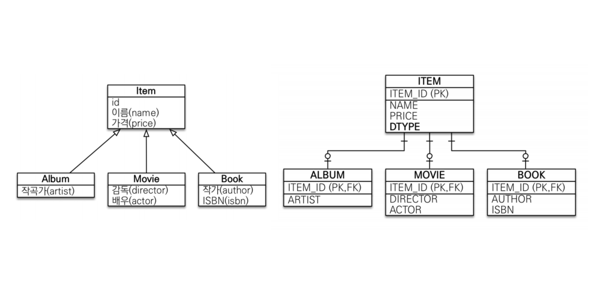
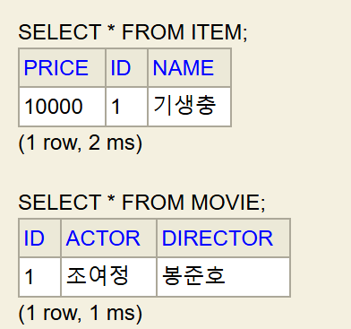
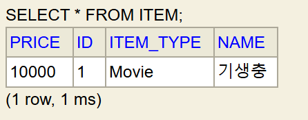
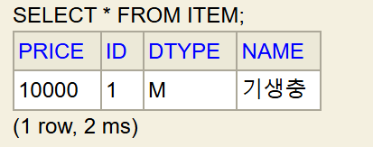
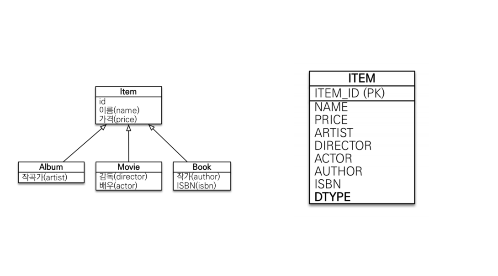
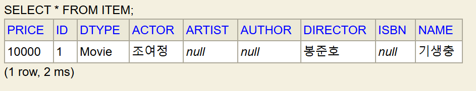
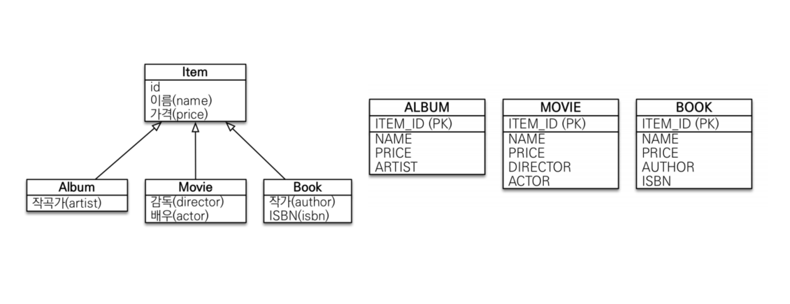
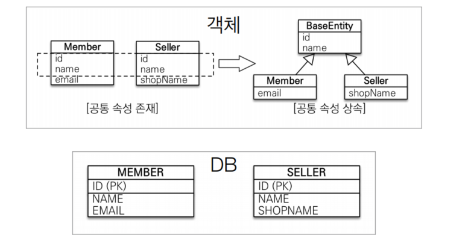
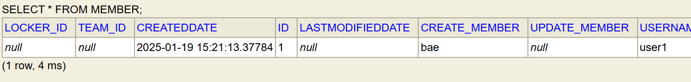

# *상속관계 매핑*

- *객체에는 상속관계 개념이 존재하지만 관계형 데이터베이스에는 상속관계가 존재하지 않는다.*
- *관계형 데이터베이스에서는 상속관계와 유사한 슈터타입 서브타입 모델링이 존재한다.*
- *각각 테이블로 변환  → 조인 전략* 
  - *통합 테이블로 변환 → 단일 테이블 전략* 
  - *서브타입 테이블로 변환 → 구현 클래스마다 테이블 전략*

***주요 애노테이션***

- ***@Inheritance, @DiscriminatorColumn, @DiscriminatorValue***

# ***조인 전략***



- ***왼쪽은 논리 모델 오른쪽은 물리 모델***

***조인전략: CREATE, ALTER 쿼리 확인하기*** 

```java
@Entity
@Inheritance(strategy = InheritanceType.JOINED)
public class Item {
    @Id @GeneratedValue(strategy = GenerationType.IDENTITY)
    private Long id;
    private String name;
    private int price;
}

@Entity
public class Album extends Item{
    private String artist;
}

@Entity
public class Movie extends Item{
    private String director;
    private String actor;
}

@Entity
public class Book extends Item{
    private String author;
    private String isbn;
}

----------------------------------------------------------------------------------------
Hibernate: 
    create table Item (
        price integer not null,
        id bigint generated by default as identity,
        name varchar(255),
        primary key (id)
    )
Hibernate: 
    create table Album (
        id bigint not null,
        artist varchar(255),
        primary key (id)
    )    
Hibernate: 
    alter table if exists Album 
       add constraint FKcve1ph6vw9ihye8rbk26h5jm9 
       foreign key (id) 
       references Item    

Hibernate: 
    create table Book (
        id bigint not null,
        author varchar(255),
        isbn varchar(255),
        primary key (id)
    )
Hibernate: 
    alter table if exists Book 
       add constraint FKbwwc3a7ch631uyv1b5o9tvysi 
       foreign key (id) 
       references Item    
    
Hibernate: 
    create table Movie (
        id bigint not null,
        actor varchar(255),
        director varchar(255),
        primary key (id)
    )    
Hibernate: 
    alter table if exists Movie 
       add constraint FK5sq6d5agrc34ithpdfs0umo9g 
       foreign key (id) 
       references Item    
```

- ***@Inheritance(strategy = InheritanceType.JOINED)***
- *JOINED: 조인 전략 선택*

***INSERT***

```java
Movie movie = new Movie();
movie.setDirector("봉준호");
movie.setActor("조여정");
movie.setName("기생충");
movie.setPrice(10000);

em.persist(movie);
tx.commit();

----------------------------------------------------------------------------------------
Hibernate: 
    /* insert for
        hellojpa.domain.Movie */insert 
    into
        Item (name, price, ITEM_ID) 
    values
        (?, ?, default)
Hibernate: 
    /* insert for
        hellojpa.domain.Movie */insert 
    into
        Movie (actor, director, ITEM_ID) 
    values
        (?, ?, ?)
```

- *ITEM, MOVIE 테이블 2곳에 INSERT 쿼리가 날아간다.*



***SELECT***

```java
Movie movie = new Movie();
movie.setDirector("봉준호");
movie.setActor("조여정");
movie.setName("기생충");
movie.setPrice(10000);

em.persist(movie);
em.flush();
em.clear();

Movie findMovie = em.find(Movie.class, movie.getId());

----------------------------------------------------------------------------------------

Hibernate: 
    select
        m1_0.id,
        m1_1.name,
        m1_1.price,
        m1_0.actor,
        m1_0.director 
    from
        Movie m1_0 
    join
        Item m1_1 
            on m1_0.id=m1_1.id 
    where
        m1_0.id=?
```

- *MOVIE, ITEM 테이블을 INNER 조인해서 가져온다.*

*단순히 상속 관계를 매핑했을 뿐인데 JPA가 데이터 저장 시 INSERT 쿼리를 각각 날리고 데이터 조회 시 조인도 알아서 한다.*

*이번에는 아이템 테이블 컬럼에* ***DTYPE****을 넣어보자*

*객체 입장에서는 어떤 객체를 데이터 저장을 하는지 알지만 애플리케이션이 아닌 데이터베이스에서 조회를 할 때 ITEM 테이블에 있는 컬럼으로만 해당 데이터가 어떤 데이터인지 구분하지 못한다.*

*하지만 DTYPE 컬럼이 있으면 저장된 데이터가 어떤 데이터인지 쉽게 구분이 가능하다.*

***@DiscriminatorColumn***

```java
@Entity
@Getter @Setter
@Inheritance(strategy = InheritanceType.JOINED)
@DiscriminatorColumn(name = "ITEM_TYPE")
public class Item {
    @Id @GeneratedValue(strategy = GenerationType.IDENTITY)
    private Long id;
    private String name;
    private int price;
}
```

- ***@DiscriminatorColumn default 속성 → DTYPE***



***@DiscriminatorValue***

- ***@DiscriminatorColumn****에 저장되는 이름*

```java
@Entity
@Setter @Getter
@DiscriminatorValue("M")
public class Movie extends Item{
    private String director;
    private String actor;
}
```



- ***default: Entity name***

개인적으로***@DiscriminatorColumn****도 기본값인 DTYPE을 사용하고* ***@DiscriminatorValue*** *또한 마찬가지로 기본값인 엔티티 명을 사용하는 게 좋아 보인다.* 

*거의 대부분 간단함보단 모호함을 없애는 편이 좋다고 생각한다.*

***조인 전략 정리***

- *장점*
- *테이블 정규화* 
  - *외래 키 참조 무결성 제약조건 활용가능*
  - *저장공간 효율화*
- *단점*
- *조회시 조인을 많이 사용 → 성능 저하* 
  - *데이터 저장시 INSERT SQL 2번 호출*
  - *조회 쿼리가 복잡하다*

# *단일 테이블 전략* 



- ***왼쪽은 논리 모델 오른쪽은 물리 모델***

***단일 테이블 전략: CREATE, ALTER 쿼리 확인하기*** 

```java
@Entity
@Getter @Setter
@Inheritance(strategy = InheritanceType.SINGLE_TABLE)
@DiscriminatorColumn
public class Item {
    @Id @GeneratedValue(strategy = GenerationType.IDENTITY)
    private Long id;
    private String name;
    private int price;
}

// 나머지 Album, Movie, Book Entity: 조인 전략과 동일하다.

----------------------------------------------------------------------------------------
Hibernate: 
    create table Item (
        price integer not null,
        id bigint generated by default as identity,
        DTYPE varchar(31) not null,
        actor varchar(255),
        artist varchar(255),
        author varchar(255),
        director varchar(255),
        isbn varchar(255),
        name varchar(255),
        primary key (id)
    )
```

- *전략 이름처럼 하나의 테이블에 모든 부모, 자식 테이블의 컬럼들을 넣는다. 구분은 DTYPE 컬럼으로 한다.*
- ***@Inheritance(strategy = InheritanceType.SINGLE_TABLE)***
- *단일 테이블 전략*

***INSERT, SELECT*** 

```java
Movie movie = new Movie();
movie.setDirector("봉준호");
movie.setActor("조여정");
movie.setName("기생충");
movie.setPrice(10000);

em.persist(movie);
em.flush();
em.clear();

Movie findMovie = em.find(Movie.class, movie.getId());

----------------------------------------------------------------------------------------
Hibernate: 
    /* insert for
        hellojpa.domain.Movie */insert 
    into
        Item (name, price, actor, director, DTYPE, id) 
    values
        (?, ?, ?, ?, 'Movie', default)
Hibernate: 
    select
        m1_0.id,
        m1_0.name,
        m1_0.price,
        m1_0.actor,
        m1_0.director 
    from
        Item m1_0 
    where
        m1_0.DTYPE='Movie' 
        and m1_0.id=?
```



- *Movie 데이터를 조회하면 Movie에 해당하는 컬럼 데이터만 조회해서 가져온다.* 
- *WHERE 조건을 보면 DTYPE = ‘Movie’ and ID*  
- *조인 전략과 다르게 INSERT도 한번 SELECT도 조인 없이 실행한다.*

*단일 테이블 전략은* ***@DiscriminatorColumn****을 생략해도 DTYPE이 들어간다.*

*조인 전략과 다르게 단일 테이블 전략에서 DTYPE 컬럼이 없으면 어떤 데이터인지 구분이 불가능하기 때문이다.*

***단일 테이블 전략 정리***

- *장점*
- *조인 필요 없다 일반적인 조회 성능이 빠르다* 
  - *조회 쿼리가 단순하다*
- *단점*
- *자식 엔티티가 매핑한 컬럼은 모두 null 허용*
  - *단일 테이블에 모든 것을 저장하므로 테이블이 커질 수 있다.
상황에 따라서 조회 성능이 오히려 느려질 수 있다.*

# ***구현 클래스마다 테이블 전략***



***TABLE CREATE*** 

```java
@Entity
@Getter @Setter
@Inheritance(strategy = InheritanceType.TABLE_PER_CLASS)
public abstract class Item {
    @Id @GeneratedValue
    private Long id;
    private String name;
    private int price;
}

// 나머지 Album, Movie, Book Entity: 조인 전략과 동일하다.
----------------------------------------------------------------------------------------
Hibernate: 
    create table Book (
        price integer not null,
        id bigint not null,
        author varchar(255),
        isbn varchar(255),
        name varchar(255),
        primary key (id)
    )

Hibernate: 
    create table Album (
        price integer not null,
        id bigint not null,
        artist varchar(255),
        name varchar(255),
        primary key (id)
    )
Hibernate: 
    create table Movie (
        price integer not null,
        id bigint not null,
        actor varchar(255),
        director varchar(255),
        name varchar(255),
        primary key (id)
    )    
```

- *구현 클래스 마다 테이블 전략에서는: @DiscriminatorColumn가 의미가 없다. 그래서 넣어도 동작하지 않는다.*
- *이전 조인 전략, 단일 테이블 전략에서 Item을 추상 클래스로 만들지 않았는데 추상 클래스로 만드는 편이 좋다.*
- *직접적으로 객체 생성하지 않도록 보장할 수 있다.*
- ***@Inheritance(strategy = InheritanceType.TABLE_PER_CLASS)***
- ***해당 전략에서는 @GeneratedValue(strategy = GenerationType.IDENTITY) 사용이 불가능하다? → 이유는 모름***

***INSERT, SELECT***

```java
Movie movie = new Movie();
movie.setDirector("봉준호");
movie.setActor("조여정");
movie.setName("기생충");
movie.setPrice(10000);

em.persist(movie);
em.flush();
em.clear();

Movie findMovie = em.find(Movie.class, movie.getId());
----------------------------------------------------------------------------------------
Hibernate: 
    /* insert for
        hellojpa.domain.Movie */insert 
    into
        Movie (name, price, actor, director, id) 
    values
        (?, ?, ?, ?, ?)
Hibernate: 
    select
        m1_0.id,
        m1_0.name,
        m1_0.price,
        m1_0.actor,
        m1_0.director 
    from
        Movie m1_0 
    where
        m1_0.id=?
```

***구현 클래스마다 테이블 전략 정리***

- *장점*
- *서브 타입을 명확하게 구분해서 처리할 때 효과적*
  - *not null 제약조건 사용 가능*
- *단점*
- *여러 자식 테이블을 함께 조회할 때 성능이 느리다(UNION SQL 필요)*
  - *자식 테이블을 통합해서 쿼리하기 어렵다*
- *정리*
- ***사용 금지***

# *단일 테이블 VS 조인 전략* 

*기본은 조인 전략을 사용하자* 

*하지만 너무 단순하면 단일 테이블 전략을 사용하자* 

# *@Mapped Superclass*

*공통 매핑 정보가 필요할 때 사용한다.*



***시나리오***

*회사 DBA가 모든 테이블에 누가 생성했는지 언제 생성했는지 누가 수정했는지 언제 수정했는지에 대한 정보의 기록을 요구한다.*

```java
  private String createdBy;
  private LocalDateTime createdDate;
  private String lastModifiedBy;
  private LocalDateTime lastModifiedDate;
```

- *하이버네이트 최신 버전부터는 자바 8 LocalDateTime을 지원한다. → @Temporal 필요 X*
- *이런 모든 정보를 엔티티에 하나하나 넣긴 너무 힘들다 → @MappedSuperclass*
- ***@MappedSuperclass는 상속 관계 매핑이 아닌 공통 속성 매핑이다.*** 

***BaseEntity, BaseEntity 적용 example***

```java
@MappedSuperclass
@Getter @Setter
public abstract class BaseEntity {
    @Column(name = "CREATE_MEMBER")
    private String createdBy;
    private LocalDateTime createdDate;
    @Column(name = "UPDATE_MEMBER")
    private String lastModifiedBy;
    private LocalDateTime lastModifiedDate;
}

@Entity
@Getter @Setter
public class Member extends BaseEntity{
    @Id @GeneratedValue(strategy = GenerationType.IDENTITY)
    private Long id;
    @Column(name = "USERNAME")
    private String name;

    @ManyToOne
    @JoinColumn(name = "TEAM_ID", insertable = false, updatable = false)
    private Team team;

    @OneToOne
    @JoinColumn(name = "LOCKER_ID", unique = true)
    private Locker locker;
}

@Entity
@Getter @Setter
public class Team extends BaseEntity{
    @Id @GeneratedValue(strategy = GenerationType.IDENTITY)
    private Long id;

    private String name;

    @OneToMany
    @JoinColumn(name = "TEAM_ID")
    private List<Member> members = new ArrayList<>();
}

-------------------------------------------------------------------------------------
Hibernate: 
    create table Member (
        LOCKER_ID bigint unique,
        TEAM_ID bigint,
        createdDate timestamp(6),
        id bigint generated by default as identity,
        lastModifiedDate timestamp(6),
        CREATE_MEMBER varchar(255),
        UPDATE_MEMBER varchar(255),
        USERNAME varchar(255),
        primary key (id)
    )
Hibernate: 
    create table Team (
        createdDate timestamp(6),
        id bigint generated by default as identity,
        lastModifiedDate timestamp(6),
        CREATE_MEMBER varchar(255),
        UPDATE_MEMBER varchar(255),
        name varchar(255),
        primary key (id)
    )    
```

- *MEMBER, TEAM 모두 BaseEntity에서 매핑 한 공통 컬럼이 생성되었다.*

***사용 example***

```java
Member member = new Member();
member.setName("user1");
member.setCreatedBy("bae");
member.setCreatedDate(LocalDateTime.now());

em.persist(member);

tx.commit();
```



***@MappedSuperclass 정리***

- ***상속관계 매핑이 아니다. → 단순히 엔티티가 공통으로 사용하는 매핑 정보를 모으는 역할***
- *엔티티가 아니다, 테이블과 매핑 X*
- *부모 클래스를 상속 받는 자식 클래스에 매핑 정보만 제공*
- 당연히 엔티티가 아니기 때문에 조회가 불가능하다 
- *em.find(BaseEntity.class)*
- *직접 생성해서 사용할 일이 없으므로 추상 클래스를 권장*
- *주로 등록일, 수정일, 등록자, 수정자 같은 전체 엔티티에서 공통으로 적용하는 정보를 모을 때 사용한다.*
- ***참고: @Entity 클래스는 엔티티나 @MappedSuperclass로 지정한 클래스만 상속이 가능하다.***

