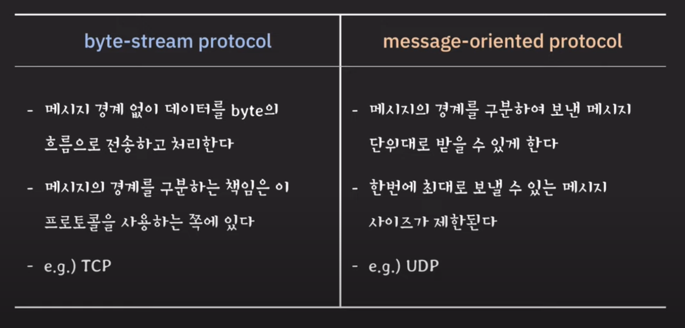

TCP는 byte-stream protocol 이라고 하고 UDP는 message-oriented protocol 이라고 한다

UDP는 메시지 자체를 보낸다. 그래서 message-oriented protocol이라고 부른다.

TCP는 원본 메시지를 byte stream으로 바꿔서 전송한다. TCP는 신뢰할 수 있는(reliable) 데이터 전송을 실현하는 것이 목적이기 때문에, 애플리케이션에서 보낸 메시지와는 독립적으로, 특정 크기가(MSS, Maximum Segmenet Size) 구분되는 별도의 전송 단위를 통해 데이터를 전송하는데 이때 전송 단위를 TCP segment라고 부른다.

**UDP를 통해 max UDP datagram size 보다 큰 메시지를 전송하려고 하면 어떻게 되는가?**

→ 실패하고 에러를 받는다. 에러 처리는 application layer protocol 또는 개발자가 구현한다.

**TCP를 통해 MSS(Max Segment Size) 보다 큰 메시지를 전송하려고 하면 어떻게 되는가?** 

→ TCP가 알아서 MSS에 맞는 TCP setment들로 나워서 전송한다.

**byte-stream protocol을 사용하는 쪽에서 메시지를 구분하는 방법은 어떤 것들이 있나?** 

1. 메시지 사이즈를 고정한다.
1. 메시지의 사이즈를 먼저 보낸 후 메시지를 보낸다.
1. 메시지 사이에 구분자를 넣어서 전송한다. ex) CRLF

**TCP가 byte-stream protocol 이라면 TCP 위에서 동작하는 HTTP는 자체적으로 HTTP message의 경계를 구분하는 방법을 가지고 있다는 말인가?**

→ yes 하지만 버전마다 다르다.

---

[https://www.youtube.com/watch?v=lLb2lMQpKbY&list=PLcXyemr8ZeoSGlzhlw4gmpNGicIL4kMcX&index=7](https://www.youtube.com/watch?v=lLb2lMQpKbY&list=PLcXyemr8ZeoSGlzhlw4gmpNGicIL4kMcX&index=7)

