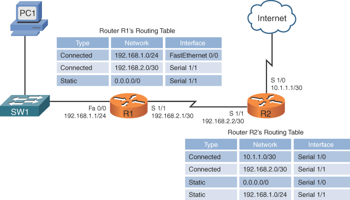

**라우터(Router)는 데이터의 전송을 위해 가장 빠른 길을 찾아 네트워크 간의 경로(Route)를 설정하는 장비**

**스위치의 한계 되짚어보기**

스위치는 같은 네트워크의 컴퓨터끼리만 통신이 가능한 장비. 즉, 서로 다른 네트워크 간의 통신은 불가능한 단점이 있다. 정확히 말하면 네트워크 주소가 다른 네트워크에서는 통신이 불가능하다.

**그래서 서로 다른 네트워크 간의 통신을 위해서는 라우터를 사용해야 한다.**

예를 들어 172.16.1.0/24 네트워크는 172.16.2.0/24 네트워크는 서로 다른 네트워크이다.

이 둘 간에 통신이 가능하려면 라우터가 필요하다.

**그런데 서로 다른 네트워크 간에는 중간에 1개 이상의 라우터가 있을 수 있다.** 

이러한 경우, 어떤 경로로 이용해야 빠른 통신이 가능한지 확인해야 한다. **즉 네트워크와 네트워크 간의 경로(Route)를 설정해야 하는데, 이것을 라우팅(Routing)이라고 한다.** 다시 말해 라우팅은 한 네트워크에서 다른 네트워크로 데이터를 전달하는 과정이다.

**그런데 경로는 어떻게 설정할까?** 

스위치에서 MAC 테이블을 이용했던 것과 같이 라우터에서는 라우팅 테이블이라는 것을 이용한다.

**라우팅 테이블은(Routing Table)은 데이터를 목적지까지 보내기 위한 거리와 방법등을 명시한 테이블이다.**

라우팅 테이블에는 데이터를 목적지까지 전달하기 위해 어떤 방향으로 가야 하는지에 대한 정보를 가지고 있다.

따라서 라우터가 데이터를 목적지로 보내려고 하면 먼저 라우팅 테이블을 찾아보게 된다.

예를 들어 컴퓨터A(172.16.1.3)가 컴퓨터B(172.16.2.12)에게 데이터를 보내려고 하는 상황을 가정해 보자.

먼저 라우터 A는 컴퓨터 B의 네트워크 주소 172.16.2.0을 확인한다. 그리고 172.16.2.0으로 가는 길이 정의되어 있는지 라우팅 테이블을 검색한다.

그랬더니 라우팅 테이블에 172.16.2.0 네트워크로 가려면 E1으로 가라는 내용이 검색되었다.

그럼 이제 라우터 A는 라우터 B에게 컴퓨터 B의 IP 주소가 무엇인지 물어보기만 하면 된다.

라우팅 테이블은 주기적으로 업데이트해야 한다.

네트워크 상황이 계속 변경되기 때문이다. 업데이트는 수동으로 할 수도 있고 자동으로 할 수도 있다.

보통은 라우팅 프로토콜을 이용하여 자동으로 업데이트를 진행한다.

---

