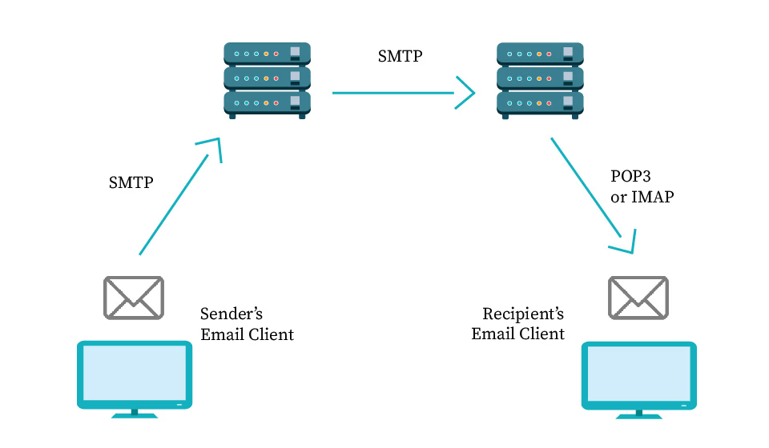
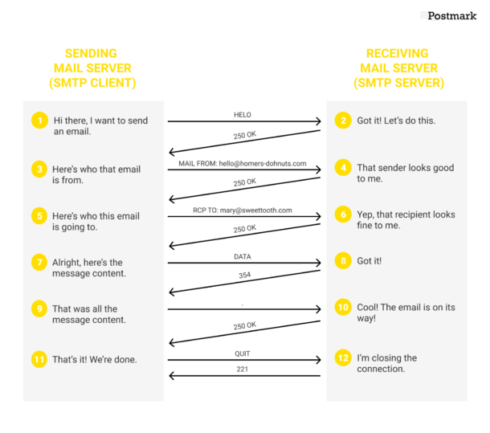

이메일을 주고받을 때 사용하는 프로토콜은 **SMTP(Simple Mail Transfer Protocol)**, POP3이다.

**송신자가 사용하는 프로토콜은 SMTP, 수신자가 이메일을 받을 때 사용하는 프로토콜은 POP3 프로토콜이다.**

### 1. 송신자와 메일 서버 간의 통신

사용자가 메일 서버에 이메일을 보내는 과정

1. 사용자 컴퓨터는 메일 서버에 25번 포트(SMTP 프로토콜)로 통신을 하겠다고 알린다. 그럼 메일 서버는 OK 신호와 함께 자신의 이름을 알려준다.
1. 통신을 위한 준비가 끝나면 내가 누구인지 알려준다. 이름을 알리면 메일 서버는 역시 OK로 응답한다.
1. 내 이메일 주소를 메일 서버에 알려주면, 메일 서버는 OK로 응답한다.
1. 이번에는 상대방에 대한 이메일 주소를 알려주고 OK를 응답으로 받는다.
1. 메일 서버에 이메일 본문을 전달하면, 메일 서버는 OK로 응답한다.
1. 마지막으로 연결을 종료하겠다고 메일 서버에 전달하면 메일 서버는 연결을 종료한다.

### 2. 메일 서버 간의 통신

메일 서버 간에 이메일을 주고받는 과정 역시 SMTP 프로토콜을 사용한다.

단지 그 과정이 조금 다를 뿐이다.

1. 송신자 측 메일 서버는 해당 이메일을 수신자 측 메일 서버에 전달한다. 이때 25번 포트를 사용하고 SMTP 프로토콜을 사용한다. 이것으로 송신자 측 메일 서버의 역할은 끝난다.
1. 이후 수신자 측 메일 서버는 사용자 A가 보낸 이메일을 사용자 B의 편지함에 저장한다.

### 3. 메일 서버와 수신자 간의 통신

1. 이메일 수신자는 110번 포트, POP3 프로토콜로 메일 서버에 연결을 시도한다.
1. 연결이 수립되면 사용자가 누구인지 밝힌다.
1. 내 편지함에서 이메일을 확인하기 위한 패스워드를 알려준다. 즉, 인증된 사용자인지 확인하는 과정이다.
1. 수신자는 메일 서버에 이메일이 있다는 것을 확인할 수 있다.
1. 이후 해당 이메일을 컴퓨터로 내려받는다.
1. 이메일을 내려받았으면 메일 서버와의 연결을 종료한다.

**POP3는 편지함에서 이메일을 가져오면 서버에서 이메일이 삭제된다. 삭제되는 것을 원하지 않을 때는 IMAP(Internet Access Message Protocol)을 사용하면 된다.**

| **구분** | **IMAP (Internet Message Access Protocol)** | **POP3 (Post Office Protocol 3)** |
| --- | --- | --- |
| **저장 위치** | 이메일이 서버에 저장됨 | 이메일이 클라이언트(PC, 폰 등)로 다운로드됨 |
| **동기화** | 서버와 클라이언트 간 양방향 동기화 | 다운로드 후 서버에서 삭제(기본값, 설정 변경 가능) |
| **접근성** | 여러 기기에서 동일한 메일함 동기화 및 관리 가능 | 한 기기에서만 이메일 확인 및 관리가 일반적 |
| **폴더 관리** | 서버에서 폴더 생성·삭제·이동 등 가능 | 폴더 관리 불가, 모든 메일이 받은편지함에 저장 |
| **오프라인** | 인터넷 필요(읽기 전까지 전체 다운로드 안 됨) | 한 번 다운로드하면 오프라인에서도 읽기 가능 |
| **용도** | 여러 기기에서 이메일을 자주 확인할 때 적합 | 한 기기에서만 이메일 관리할 때 적합 |

---

