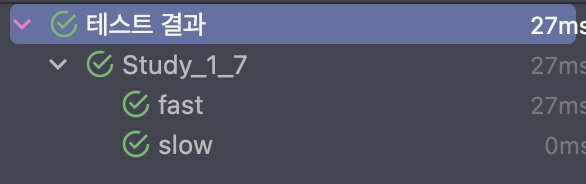
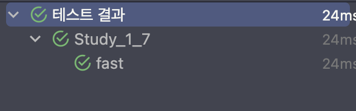

```java
/**
 * JUnit 5 태깅과 필터링
 */
public class Study_1_7 {
    @Test
    @DisplayName("fast")
    @Tag("fast")
    void fast() {
        var study = new Study(100);
        assertThat(study).isNotNull();
    }
    @Test
    @DisplayName("slow")
    @Tag("slow")
    void slow() {
        var study = new Study(100);
        assertThat(study).isNotNull();
    }
}
```

**build.gradle → excludeTags 적용** 

```java
tasks.named('test') {
	useJUnitPlatform{
		// excludeTags("slow")
	}
}
```



```java
tasks.named('test') {
	useJUnitPlatform{
		 excludeTags("slow")
	}
}
```



