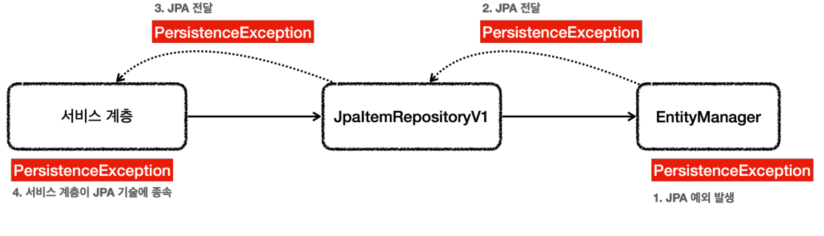
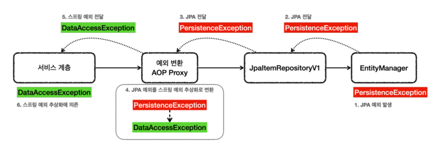

# ***JPA 설정***

***build.gradle*** 

```java
implementation 'org.springframework.boot:spring-boot-starter-data-jpa'
```

- ***spring-boot-starter-data-jpa****,* ***mybatis-spring-boot-starter****는 s****pring-boot-starter-jdbc****도 함께 포함한다. 따라서 제거해도 된다.*
- ***추가되는 라이브러리*** 
- *jakarta.persistence-api: JPA 인터페이스*
  - *hibernate-core: JPA 구현체인 하이버네이트 라이브러리*
  - *spring-data-jpa: 스프링 데이터 JPA 라이브러리*

 ***spring boot 3.0 미만 - application.properties -main,test***

```yaml
logging.level.org.hibernate.SQL=DEBUG
logging.level.org.hibernate.type.descriptor.sql.BasicBinder=TRACE
```

- *logging.level.org.hibernate.SQL=DEBUG*
- *하이버네이트가 생성하고 실행하는 SQL을 확인할 수 있다.*
- *logging.level.org.hibernate.type.descriptor.sql.BasicBinder=TRACE*
- SQL에 바인딩 되는 파라미터를 확인할 수 있다
- *spring.jpa.show-sql=true*
- *이런 설정도 있다. 이전 설정은 logger를 통해서 출력된다. 이 설정은 System.out 콘솔을 통해서 SQL이 출력된다.*

 ***spring boot 3.0 이상 - application.properties -main,test***

```yaml
logging.level.org.hibernate.SQL=DEBUG
logging.level.org.hibernate.orm.jdbc.bind=TRACE
```

- *하이버네이트 6버전이 사용되는데, 로그 설정 방식이 달라졌다.*

# ***JPA 적용1 - 개발***

```java
@Data
@Entity
public class Item {
    @Id @GeneratedValue(strategy = GenerationType.IDENTITY)
    private Long id;

    @Column(name = "item_name", length = 10)
    private String itemName;
    private Integer price;
    private Integer quantity;

    public Item() {
    }

    public Item(String itemName, Integer price, Integer quantity) {
        this.itemName = itemName;
        this.price = price;
        this.quantity = quantity;
    }
}
```

- *@Entity: JPA가 사용하는 객체라는 뜻이다. 이 에노테이션이 있어야 JPA가 인식할 수 있다. 
이렇게 @Entity 가 붙은 객체를 JPA에서는 엔티티라 한다.*
- *@Column(name = "item_name", length = 10) → VARCHAR 10*

*JPA는 public 또는 protected 기본 생성자가 필수이다.*

```java
public Item() {}
```

- *아마 프록시 기술을 사용하는 데 상속을 통한 프록시 기술이어서 부모 클래스의 생성자에 접근을 가능하게 해야 동작하기 때문인듯하다.*

```java
@Repository
@Transactional
@RequiredArgsConstructor
public class JpaItemRepository implements ItemRepository {
    
    private final EntityManager em;
    
    @Override
    public Item save(Item item) {
        em.persist(item);
        return item;
    }

    @Override
    public void update(Long itemId, ItemUpdateDto updateParam) {
        Item findItem = em.find(Item.class, itemId);
        findItem.setItemName(updateParam.getItemName());
        findItem.setPrice(updateParam.getPrice());
        findItem.setQuantity(updateParam.getQuantity());
    }

    @Override
    public Optional<Item> findById(Long id) {
        Item item = em.find(Item.class, id);
        return Optional.ofNullable(item);
    }

    @Override
    public List<Item> findAll(ItemSearchCond cond) {
        String jpql = "select i from Item i";

        Integer maxPrice = cond.getMaxPrice();
        String itemName = cond.getItemName();

        if(StringUtils.hasText(itemName) || maxPrice != null){
            jpql += " where";
        }

        boolean andFlag = false;
        if(StringUtils.hasText(itemName)){
            jpql += " i.itemName like concat('%',:itemName,'%')";
            andFlag = true;
        }

        if(maxPrice != null){
            if(andFlag){
                jpql += " and";
            }
            jpql += " i.price <= :maxPrice";
        }

        TypedQuery<Item> query = em.createQuery(jpql, Item.class);
        if(StringUtils.hasText(itemName)){
            query.setParameter("itemName", itemName);
        }
        if(maxPrice != null){
            query.setParameter("maxPrice", maxPrice);
        }

       return query.getResultList();
    }
}
```

- *EntityManager* 
- *JPA의 모든 동작은 엔티티 매니저를 통해서 이루어진다.*
  - *엔티티 매니저는 내부에 데이터소스를 가지고 있고, 데이터베이스에 접근할 수 있다.*
- *@Transactional*
- *JPA의 모든 데이터 변경(등록, 수정, 삭제)은 트랜잭션 안에서 이루어져야 한다.*
  - *조회는 트랜잭션이 없어도 가능하다.*
  - *변경의 경우 일반적으로 서비스 계층에서 트랜잭션을 시작하기 때문에 문제가 없다. 
꼭 서비스 계층에 트랜잭션을 걸어주자.*

*스프링 부트는 자동으로 JPA 관련 설정을 자동화 해준다.*

- *자세한 내용은* ***JpaBaseConfiguration****를 참고*

# ***JPA 적용2 - 리포지토리 분석***

***save() - 저장***

```java
@Override
public Item save(Item item) {
    em.persist(item);
    return item;
}
```

- *JPA가 만들어서 실행한 SQL을 보면 id 에 값이 빠져있는 것을 확인할 수 있다.* 
- *PK 키 생성 전략을 IDENTITY로 사용했기 때문에 JPA가 이런 쿼리를 만들어서 실행한 것이다.*
- *JPA가 INSERT SQL 실행 이후에 생성된 ID 결과를 받아서 넣어준다.*

***update() - 수정 JPA - DirtyChecking***

```java
@Override
public void update(Long itemId, ItemUpdateDto updateParam) {
    Item findItem = em.find(Item.class, itemId);
    findItem.setItemName(updateParam.getItemName());
    findItem.setPrice(updateParam.getPrice());
    findItem.setQuantity(updateParam.getQuantity());
}
```

- *em.update() 같은 메소드를 전혀 호출하지 않았다.*
- *JPA는 트랜잭션이 커밋되는 시점에, 변경된 엔티티 객체가 있는지 확인한다.*
- *특정 엔티티 객체가 변경된 경우에는 UPDATE SQL을 실행한다.*
- *테스트의 경우 마지막에 트랜잭션이 롤백되기 때문에 JPA는 UPDATE SQL을 실행하지 않는다.*

***findById() - 단건 조회***

```java
@Override
public Optional<Item> findById(Long id) {
    Item item = em.find(Item.class, id);
    return Optional.ofNullable(item);
}
```

- *JPA에서 엔티티 객체를 PK 기준으로 조회할 때 find()를 사용하고 조회 타입과 PK 값을 주면 된다.*

***findAll - 목록 조회***

```java
public List<Item> findAll(ItemSearchCond cond) {
	 String jpql = "select i from Item i";
	 
	 //동적 쿼리 생략
	 
	 TypedQuery<Item> query = em.createQuery(jpql, Item.class);
	 
	 if(StringUtils.hasText(itemName)){
      query.setParameter("itemName", itemName);
   }
   if(maxPrice != null){
      query.setParameter("maxPrice", maxPrice);
   }
	 
	 return query.getResultList();
}
```

***JPQL***

- *JPA는* ***JPQL(Java Persistence Query Language)****이라는 객체지향 쿼리 언어를 제공한다.*
- *주로 여러 데이터를 복잡한 조건으로 조회할 때 사용한다.*
- *SQL이 테이블을 대상으로 한다면, JPQL은 엔티티 객체를 대상으로 SQL을 실행한다 생각하면 된다.*
- *엔티티 객체를 대상으로 하기 때문에 from 다음에 Item 엔티티 객체 이름이 들어간다. 
엔티티 객체와 속성의 대소문자는 구분해야 한다.*
- *결과적으로 JPQL을 실행하면 그 안에 포함된 엔티티 객체의 매핑 정보를 활용해서 SQL을 만들게 된다.*

# ⭐ ***JPA 적용3 - 예외 변환*** 

*JPA의 경우 예외가 발생하면 JPA 예외가 발생하게 된다.*

*EntityManager는 순수한 JPA 기술이고, 스프링과는 관계가 없다. 
따라서 엔티티 매니저는 예외가 발생하면 JPA 관련 예외를 발생시킨다.*

*JPA는 PersistenceException과 그 하위 예외를 발생시킨다.*

- *추가로 JPA는 IllegalStateException, IllegalArgumentException을 발생시킬 수 있다.*

*그렇다면 JPA 예외를 스프링 예외 추상화(DataAccessException)로 어떻게 변환할 수 있을까?*

*→ @Repository*

***예외 변환 전***



***@Repository의 기능***

- *@Repository가 붙은 클래스는 컴포넌트 스캔의 대상*
- *@Repository가 붙은 클래스는 예외 변환 AOP의 적용 대상*
- *스프링과 JPA를 함께 사용하는 경우 스프링은 JPA 예외 변환기
(PersistenceExceptionTranslator)를 등록한다.*
  - *예외 변환 AOP 프록시는 JPA 관련 예외가 발생하면 JPA 예외 변환기를 통해 발생한 예외를 스프링 데이터 접근 예외로 변환한다.*

***예외 변환 후***



*정리하면 @Repository 애노테이션만 있으면 스프링이 예외 변환 처리하는 AOP를 만들어준다.*

***참고*** 

- *스프링 부트 @Repository를 AOP 프록시로 만드는 빈 후처리기*
- *PersistenceExceptionTranslationPostProcessor*
  - *여기서 @Repository AOP를 프록시로 만드는 어드바이스가 등록*
-  *실제 JPA 예외를 변환하는 코드*
- *EntityManagerFactoryUtils.convertJpaAccessExceptionIfPossible()*

