# ***기본값 타입***

### ***JPA의 데이터 타입 분류***

- ***엔티티 타입***
- *@Entity로 정의하는 객체*
  - *데이터가 변해도 식별자로 지속해서 추적이 가능하다*
  - *ex) 회원 엔티티의 키나 나이 값을 변경해도 식별자로 인식 가능하다*
- ***값 타입*** 
- *int, Integer, String 처럼 단순히 값으로 사용하는 자바 기본 타입이나 객체*
  - *식별자가 없고 값만 있으므로 변경시 추적이 불가능하다.*
  - *ex) 숫자 100 → 200 변경*

### ***값 타입 분류***

- ***기본값 타입*** 
- *자바 기본 타입(int , double)*
  - *래퍼 클래스(Integer, Long)*
  - *String*
- ***임베디드 타입(embedded type, 복합 값 타입)***
- ***컬렉션 값 타입(collection value type)***

### ***기본값 타입*** 

- *ex) String name, int age*
- ***생명주기를 엔티티에 의존한다.***
- *ex) 회원을 삭제하면 이름, 나이 필드도 함께 삭제된다.*
- *값 타입은 공유하면 안된다.*
- *ex) 회원 이름 변경시 다른 회원의 이름도 함께 변경되면 X*

### ***자바의 기본 타입은 절대 공유 X***

- *int, double 같은 기본 타입(primitive type)은 절대 공유 X*
- *기본 타입은 항상 값을 복사한다.*
- *Integer 같은 래퍼 클래스나 String 같은 특수 클래스는 공유 가능한 객체이지만 변경 X*

```java
int a = 10;
int b = a;
a= 20;
System.out.println("a = " + a);
System.out.println("b = " + b);

------------------------------------------------------------------------------------
a = 20
b = 10
```

- *기본타입인 a,b는 공유되지 않는다.* 
- *즉, 값을 변경해도 side effect가 없다.*

*Integer 같은 래퍼 클래스나  String 같은 특수한 클래스는 공유 가능한 객체이지만*

*값을 변경할 방법이 없기 때문에 변경되지 않는다. 
→* ***String과 Wrapper 클래스의 불변성 (Immutable)***

```java
String s1 = "Hello";
String s2 = s1; 
s1 = "World";   

System.out.println(s1); 
System.out.println(s2); 
------------------------------------------------------------------------------------
 World
 Hello
```

- *변경 시 새로운 값을 생성하는 방식이다.*
- *즉, s1 = “World”는 s1 참조는 “World”를 가리키고 s2는 여전히 “Hello”를 가리킨다.*
- *당연한 내용이다.*

# ***임베디드 타입(복합 값 타입)***

- *새로운 값 타입을 직접 정의할 수 있다.*
- *주로 기본 값 타입을 모아서 만들어서 복합 값 타입이라고도 한다.*
- *int, String 같은 타입*

### ***임베디드 타입 예시*** 

*회원 엔티티는 이름, 근무 시작일, 근무 종료일, 주소 도시, 주소 번지, 주소 우편번호를 가진다.*

*→ 회원 엔티티는 이름, 근무 기간(근무 시작일, 근무 종료일), 집 주소(주소 도시, 주소 번지, 주소 우편번호)를 가진다.*

*여기서 근무 기간, 집 주소가 임베디드 타입이 된다.*

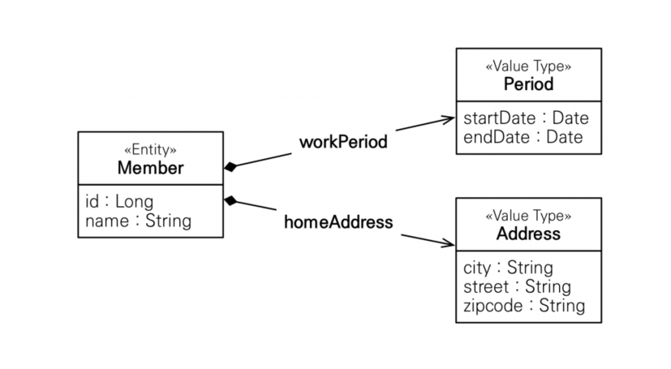

### ***임베디드 타입 사용법***

- *@Embeddable: 값 타입을 정의하는 곳에 표시 (임베디드 클래스)*
- *@Embedded: 값 타입을 사용하는 곳에 표시 (엔티티 필드)*
- ***주의: 기본 생성자 필수***

### ***임베디드 타입 장점***

- *임베디드 클래스 재사용*
- *높은 응집도* 
- *해당 값 타입만 사용하는 의미 있는 메소드를 만들 수 있다.*
- *ex: Period.isWork() → 근무 기간에 속하는지?*
- *임베디드 타입을 포함한 모든 값 타입은, 값 타입을 소유한 엔티티의 생명주기를 의존한다*

### ***임베디드 타입과 테이블 매핑***

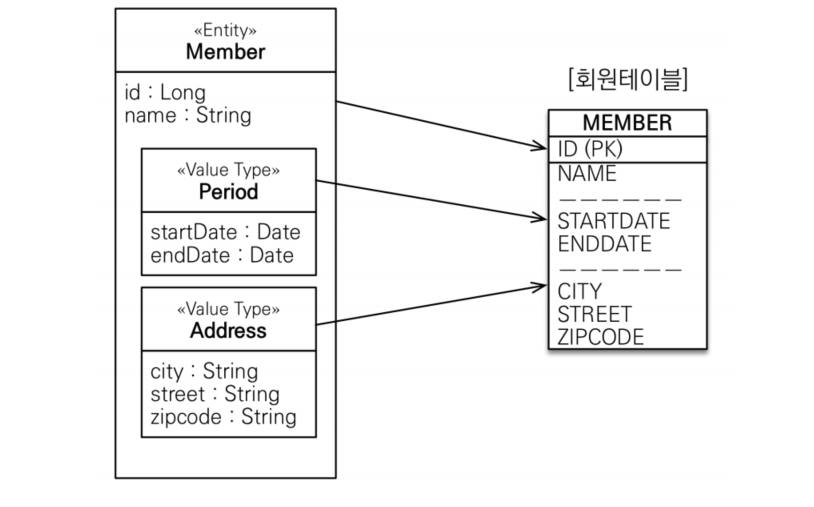

- *임베디드 타입은 엔티티의 값일 뿐이다.*
- ***임베디드 타입을 사용하기 전과 후에 매핑하는 테이블은 같다.***
- *데이터베이스 테이블 물리적 구조는 동일하다.*
- *객체와 테이블을 아주 세밀하게 매핑하는 것이 가능하다.*
- ***잘 설계한 ORM 애플리케이션은 매핑한 테이블 수보다 클래스의 수가 더 많다***
- *클래스 상속: @Inheritance*
  - *공통 엔티티: BaseEntity - @MappedSuperclass*
  - *임베디드 타입: @Embeddable*

### ***임베디드 타입 적용 예제*** 

***임베디드 타입 Before***

```java
@Entity
@Getter @Setter
public class Member{
    @Id @GeneratedValue(strategy = GenerationType.IDENTITY)
    private Long id;
    @Column(name = "USERNAME")
    private String name;

    @ManyToOne(fetch = FetchType.LAZY)
    @JoinColumn(name = "TEAM_ID")
    private Team team;
		
		// Adress
    private String city;
    private String street;
    private String zipcode;
    
    // Period
    private LocalDateTime startDate;
    private LocalDateTime endDate;
}
```

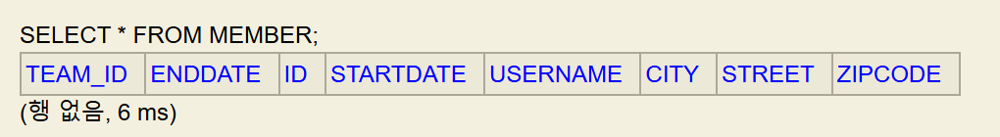

***임베디드 타입 After***

```java
@Entity
@Getter @Setter
public class Member{
    @Id @GeneratedValue(strategy = GenerationType.IDENTITY)
    private Long id;
    @Column(name = "USERNAME")
    private String name;

    @ManyToOne(fetch = FetchType.LAZY)
    @JoinColumn(name = "TEAM_ID")
    private Team team;

    @Embedded
    private Address address;
    @Embedded
    private Period workPeriod;
}

@Getter @Setter
@Embeddable
@NoArgsConstructor(access = AccessLevel.PUBLIC)
public class Period {
    private LocalDateTime startDate;
    private LocalDateTime endDate;
}

@Getter @Setter
@Embeddable
@NoArgsConstructor(access = AccessLevel.PUBLIC)
@AllArgsConstructor
public class Address {
    private String city;
    private String street;
    @Column(name = "ZIP_CODE")
    private String zipcode;
}
```

- ***Member Entity → @Embedded 적용***
- ***Embedded Class → @Embeddable 적용***
- *@Column(name = "ZIP_CODE") → 컬럼명 재정의도 가능하다.*

***임베디드 예제 - 테스트*** 

```java
Member member = new Member();
member.setName("배제우");
member.setAddress(new Address("city", "street", "10000"));
member.setWorkPeriod(new Period());
em.persist(member);
```

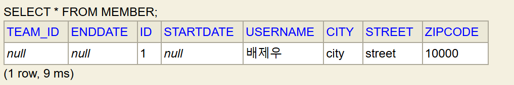

### ***@AttributeOverride: 속성 재정의***

***적용 BEFORE → 에러 발생*** 

```java
@Entity
@Getter @Setter
public class Member{
    @Id @GeneratedValue(strategy = GenerationType.IDENTITY)
    private Long id;
    @Column(name = "USERNAME")
    private String name;

    @ManyToOne(fetch = FetchType.LAZY)
    @JoinColumn(name = "TEAM_ID")
    private Team team;

    @Embedded
    private Address homeAddress;

    @Embedded
    private Address workAddress;

    @Embedded
    private Period workPeriod;
}
```

***한 엔티티에서 이렇게 같은 값 타입을 사용하고 싶을 수 있다.***

*→ adress: 집 주소, 회사 주소*

*이렇게 사용하면 컬럼 명이 중복된다. → 에러 발생* 

***@AttributeOverrides, @AttributeOverride를 사용해서 컬럼 명 속성을 재정의하면 된다.***

***적용 After*** 

```java
@Entity
@Getter @Setter
public class Member{
    @Id @GeneratedValue(strategy = GenerationType.IDENTITY)
    private Long id;
    @Column(name = "USERNAME")
    private String name;

    @ManyToOne(fetch = FetchType.LAZY)
    @JoinColumn(name = "TEAM_ID")
    private Team team;

    @Embedded
    @AttributeOverrides({
            @AttributeOverride(name = "city",    column = @Column(name = "HOME_CITY")),
            @AttributeOverride(name = "street",  column = @Column(name = "HOME_STREET")),
            @AttributeOverride(name = "zipcode", column = @Column(name = "HOME_ZIPCODE"))
    })
    private Address homeAddress;
    @Embedded
    @AttributeOverrides({
        @AttributeOverride(name = "city",    column = @Column(name = "EMP_CITY")),
        @AttributeOverride(name = "street",  column = @Column(name = "EMP_STREET")),
        @AttributeOverride(name = "zipcode", column = @Column(name = "EMP_ZIPCODE"))
    })
    private Address workAddress;

    @Embedded
    private Period workPeriod;
}
```

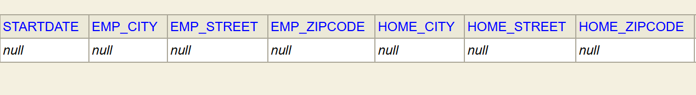

***임베디드 타입과 NULL***

- *임베디드 타입의 값이 null이면 매핑한 컬럼 값은 모두 null*

# ***값 타입과 불변 객체***

*값 타입은 복잡한 객체 세상을 조금이라도 단순화하려고 만든 개념이다.*

*따라서 값 타입은 단순하고 안전하게 다룰 수 있어야 한다.*

### *값 타입 공유 참조*

- *임베디드 타입 같은 값 타입을 여러 엔티티에서 공유하면 위험하다*
- *부작용(side effect) 발생*

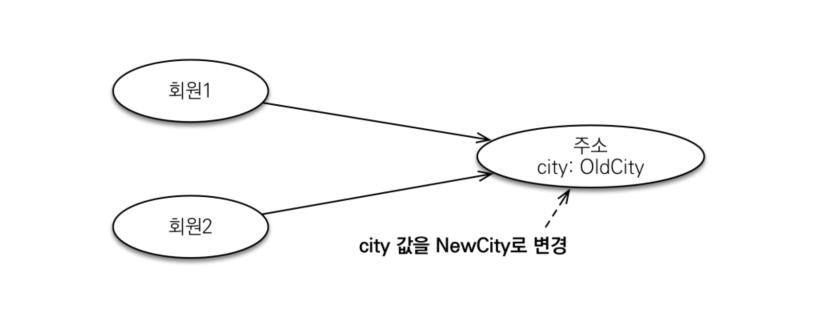

- *값 타입의 실제 인스턴스인 값을 복사하는 행위는 위험하다*
- ***대신 값(인스턴스)를 복사해서 사용해야 한다.***

### ***값 타입 side effect 발생 예제***

```java
Address address = new Address("city", "street", "10000");

Member member = new Member();
member.setName("배제우");
member.setHomeAddress(address);
em.persist(member);

Member member2 = new Member();
member2.setName("배제우2");
member2.setHomeAddress(address);
em.persist(member2);

member.getHomeAddress().setCity("newCity");

tx.commit();
```

- *의도는 member(배제우) 객체만 도시 이름을 “newCity”로 변경*
- *update 쿼리가 2번 날아가고 member, member2 모두 도시 이름이 “newCity”로 바뀌었다.*
- *값 타입 공유로 인하여 side effect 발생*

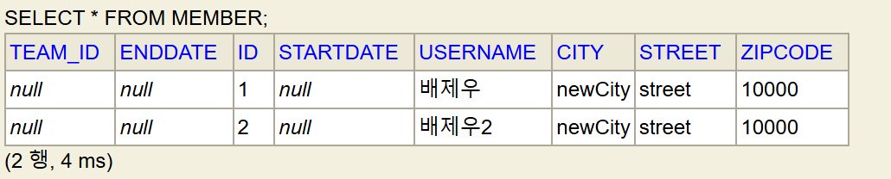

### ***값(인스턴스)를 복사해서 사용하기***

```java
Address address = new Address("city", "street", "10000");

Member member = new Member();
member.setName("배제우");
member.setHomeAddress(address);
em.persist(member);

Address copyAddress = 
		new Address(address.getCity(), address.getStreet(), address.getZipcode());

Member member2 = new Member();
member2.setName("배제우2");
member2.setHomeAddress(copyAddress);
em.persist(member2);

member.getHomeAddress().setCity("newCity");
```

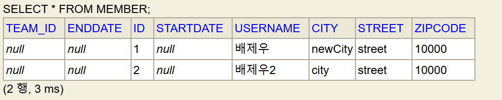

- *값을 복사해서 사용해서 side effect가 사라졌다.*

### ***객체 타입의 한계***

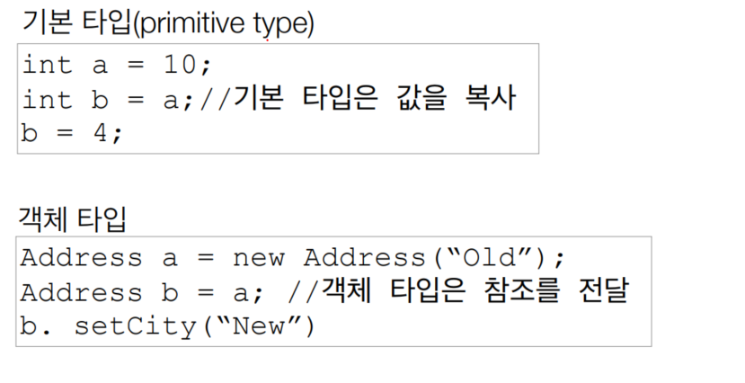

- *객체 타입은 참조 값을 직접 대입하는 것을 막을 방법이 없다.*
- *즉, 객체의 공유 참조는 피할 수 없다.*

### ***객체 타입 한계 극복 - 불변 객체***

- *객체 타입을 수정할 수 없게 만들면 부작용을 원천 차단할 수 있다.*
- ***값 타입은 불변 객체(immutable object)로 설계해야 한다***
- *생성 시점 이후 절대 값을 변경할 수 없는 객체*
- ***생성자로만 값을 설정하고 수정자(setter)를 만들지 않으면 된다.***
- *참고: Integer, String → 자바가 제공하는 대표적인 불변 객체*
- *no setter*

***Address → Setter 삭제***

```java
@Getter
@Embeddable
@NoArgsConstructor(access = AccessLevel.PUBLIC)
@AllArgsConstructor
public class Address {
    private String city;
    private String street;
    private String zipcode;
}
```

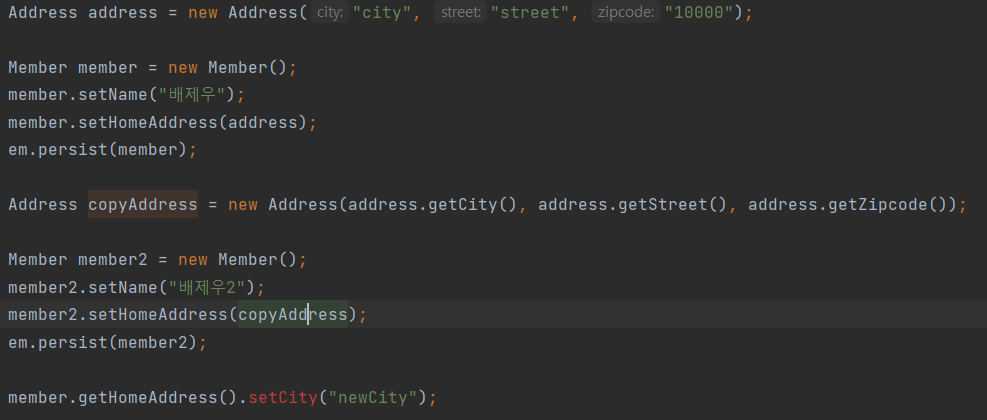

- *값 변경이 불가능하다.*
- *member 객체의 Address를 update 하려면* ***새로운*** ***immutable 객체의 생성이 필요하다.***

## ***불변이라는 작은 제약으로 부작용이라는 큰 재앙을 막을 수 있다***

# ***값 타입의 비교***

*값 타입: 인스턴스가 달라도 그 안에 값이 같으면 같은 것으로 봐야 한다*

***동일성(identity) 비교:*** *인스턴스의 참조 값을 비교*

- *== 사용*

***동등성(equivalence) 비교:*** *인스턴스의 값을 비교*

- *equals() 사용*

*값 타입은 a.equals(b)를 사용해서 동등성 비교를 해야한다*

*→* ***값 타입의 equals() 메소드를 적절하게 재정의하자, 당연히 hashCode() 또한 재정의***

***@EqualsAndHashCode***

***@EqualsAndHashCode(callSuper = true)****로 설정시 부모 클래스 필드 값들도 동일한지 체크하며, false(기본값)일 경우 자신 클래스의 필드 값만 고려한다.*

# *값 타입 컬렉션*

### ***값 타입 컬렉션?***

- *값 타입을 하나 이상 저장할 때 사용한다.*
- *데이터베이스는 컬렉션을 같은 테이블에 저장할 수 없다.* 
*즉, 컬렉션을 저장하기 위한 별도의 테이블이 필요하다*

  - *즉, 1:N 연관관계 매핑*
- ***@ElementCollection, @CollectionTable 사용***

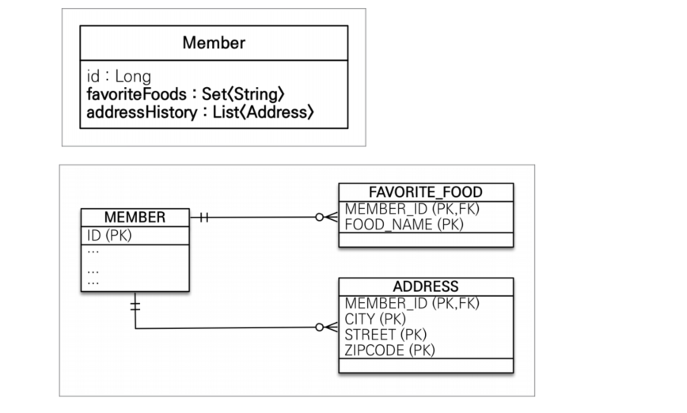

***Member Entity***

```java
@Entity
@Getter @Setter
public class Member{
    @Id @GeneratedValue(strategy = GenerationType.IDENTITY)
    private Long id;
    @Column(name = "USERNAME")
    private String name;

    @Embedded
    private Address homeAddress;

    @ElementCollection
    @CollectionTable(name = "FAVORITE_FOOD"
            , joinColumns = @JoinColumn(name = "MEMBER_ID"))
    @Column(name = "FOOD_NAME")
    private Set<String> favoriteFoods = new HashSet<>();

    @ElementCollection
    @CollectionTable(name = "ADDRESS",
            joinColumns = @JoinColumn(name = "MEMBER_ID"))
    private List<Address> addressHistory = new ArrayList<>();
}

--------------------------------------------------------------------------------------
Hibernate: 
    create table Member (
        id bigint generated by default as identity,
        USERNAME varchar(255),
        city varchar(255),
        street varchar(255),
        zipcode varchar(255),
        primary key (id)
    )

Hibernate: 
    create table ADDRESS (
        MEMBER_ID bigint not null,
        city varchar(255),
        street varchar(255),
        zipcode varchar(255)
    )
    
Hibernate: 
    create table FAVORITE_FOOD (
        MEMBER_ID bigint not null,
        FOOD_NAME varchar(255)
    )    
    
// FK add constraint 생략     
```

- ***@JoinColumn: 외래 키(FK) 지정***

### *값 타입 컬렉션 사용, 특성*

***값 타입 컬렉션 INSERT***

```java
Member member = new Member();
member.setName("MEMBER1");
member.setHomeAddress(new Address("homeCity", "street", "10000"));

member.getFavoriteFoods().add("치킨");
member.getFavoriteFoods().add("족발");
member.getFavoriteFoods().add("피자");

member.getAddressHistory().add(new Address("old1", "street", "10000"));
member.getAddressHistory().add(new Address("old2", "street", "10000"));

em.persist(member);

tx.commit();

-------------------------------------------------------------------------------------

Hibernate: 
    /* insert for
        hellojpa.domain.Member */insert 
    into
        Member (city, street, zipcode, USERNAME, id) 
    values
        (?, ?, ?, ?, default)
Hibernate: 
    /* insert for
        hellojpa.domain.Member.addressHistory */insert 
    into
        ADDRESS (MEMBER_ID, city, street, zipcode) 
    values
        (?, ?, ?, ?)
Hibernate: 
    /* insert for
        hellojpa.domain.Member.addressHistory */insert 
    into
        ADDRESS (MEMBER_ID, city, street, zipcode) 
    values
        (?, ?, ?, ?)
Hibernate: 
    /* insert for
        hellojpa.domain.Member.favoriteFoods */insert 
    into
        FAVORITE_FOOD (MEMBER_ID, FOOD_NAME) 
    values
        (?, ?)
Hibernate: 
    /* insert for
        hellojpa.domain.Member.favoriteFoods */insert 
    into
        FAVORITE_FOOD (MEMBER_ID, FOOD_NAME) 
    values
        (?, ?)
Hibernate: 
    /* insert for
        hellojpa.domain.Member.favoriteFoods */insert 
    into
        FAVORITE_FOOD (MEMBER_ID, FOOD_NAME) 
    values
        (?, ?)
```

- *em.persist(Member(엔티티)) 한번에 값 타입들이 각 테이블에 INSERT 쿼리가 날아간다.*
- ***값 타입 컬렉션도 하나의 값 타입처럼 라이프 사이클이 Member 엔티티에 의존된다.***
  - ***즉, 값 타입 컬렉션은 영속성 전이(Cascade ALL) + 고아 객체 제거 기능을 필수로 가진다.***

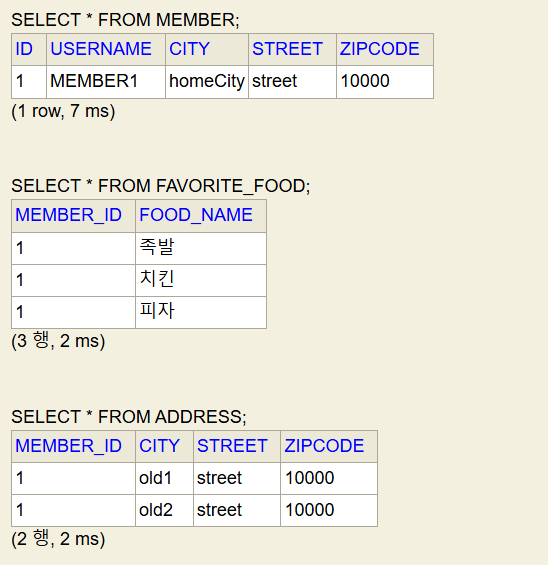

***값 타입 컬렉션 조회:*** ***값 타입 컬렉션도 지연 로딩 전략을 사용한다.***

```java
Member member = new Member();
member.setName("MEMBER1");
member.setHomeAddress(new Address("homeCity", "street", "10000"));

member.getFavoriteFoods().add("치킨");
member.getFavoriteFoods().add("족발");
member.getFavoriteFoods().add("피자");

member.getAddressHistory().add(new Address("old1", "street", "10000"));
member.getAddressHistory().add(new Address("old2", "street", "10000"));

em.persist(member);
em.flush();
em.clear();

Member findMember = em.find(Member.class, member.getId());
System.out.println("============START====================");
for (Address address : findMember.getAddressHistory()) {
    System.out.println("address = " + address);
}

tx.commit();
-----------------------------------------------------------------------------------
Hibernate: 
    select
        m1_0.id,
        m1_0.city,
        m1_0.street,
        m1_0.zipcode,
        m1_0.USERNAME 
    from
        Member m1_0 
    where
        m1_0.id=?
============START====================
Hibernate: 
    select
        ah1_0.MEMBER_ID,
        ah1_0.city,
        ah1_0.street,
        ah1_0.zipcode 
    from
        ADDRESS ah1_0 
    where
        ah1_0.MEMBER_ID=?
address = hellojpa.domain.Address@8641327f
address = hellojpa.domain.Address@86414018
```

- *Member 조회 → “START” 출력 → ADDRESS 조회*
- *→ 지연 로딩*

***값 타입 컬렉션 중간 정리***

- *값 타입 컬렉션도 지연 로딩 전략 사용*
- *값 타입 컬렉션은 Cascade.ALL, 고아 객체 제거 기능을 가진다.*

***값 타입 컬렉션 수정 - feat Set 자료구조*** 

```java
Member member = new Member();
member.setName("MEMBER1");
member.setHomeAddress(new Address("homeCity", "street", "10000"));

member.getFavoriteFoods().add("치킨");
member.getFavoriteFoods().add("족발");
member.getFavoriteFoods().add("피자");

member.getAddressHistory().add(new Address("old1", "street", "10000"));
member.getAddressHistory().add(new Address("old2", "street", "10000"));

em.persist(member);
em.flush();
em.clear();

Member findMember = em.find(Member.class, member.getId());
// 치킨 -> 한식
findMember.getFavoriteFoods().remove("치킨");
findMember.getFavoriteFoods().add("한식");

tx.commit();
---------------------------------------------------------------------------------------

Hibernate: 
    select
        m1_0.id,
        m1_0.city,
        m1_0.street,
        m1_0.zipcode,
        m1_0.USERNAME 
    from
        Member m1_0 
    where
        m1_0.id=?
Hibernate: 
    select
        ff1_0.MEMBER_ID,
        ff1_0.FOOD_NAME 
    from
        FAVORITE_FOOD ff1_0 
    where
        ff1_0.MEMBER_ID=?
Hibernate: 
    /* delete for hellojpa.domain.Member.favoriteFoods */delete 
    from
        FAVORITE_FOOD 
    where
        MEMBER_ID=? 
        and FOOD_NAME=?
Hibernate: 
    /* insert for
        hellojpa.domain.Member.favoriteFoods */insert 
    into
        FAVORITE_FOOD (MEMBER_ID, FOOD_NAME) 
    values
        (?, ?)
```

- *값 타입 컬렉션만 변경했는데 FAVORITE_FOOD 테이블에 DELETE, INSERT 쿼리가 날아간다.*
- *→ 영속성 전이(CASCADE) 같이 동작*

***값 타입 컬렉션 수정 - feat List자료구조*** 

```java
Member member = new Member();
member.setName("MEMBER1");
member.setHomeAddress(new Address("homeCity", "street", "10000"));

member.getFavoriteFoods().add("치킨");
member.getFavoriteFoods().add("족발");
member.getFavoriteFoods().add("피자");

member.getAddressHistory().add(new Address("old1", "street", "10000"));
member.getAddressHistory().add(new Address("old2", "street", "10000"));

em.persist(member);%
em.flush();
em.clear();

Member findMember = em.find(Member.class, member.getId());

findMember.getAddressHistory().remove(new Address("old1", "street", "10000"));
findMember.getAddressHistory().add(new Address("newCity1", "street", "10000"));

tx.commit();

------------------------------------------------------------------------

Hibernate: 
    /* one-shot delete for hellojpa.domain.Member.addressHistory */delete 
    from
        ADDRESS 
    where
        MEMBER_ID=?
Hibernate: 
    /* insert for
        hellojpa.domain.Member.addressHistory */insert 
    into
        ADDRESS (MEMBER_ID, city, street, zipcode) 
    values
        (?, ?, ?, ?)
Hibernate: 
    /* insert for
        hellojpa.domain.Member.addressHistory */insert 
    into
        ADDRESS (MEMBER_ID, city, street, zipcode) 
    values
        (?, ?, ?, ?)

```

- *MEMBER_ID를 기준으로 ADDRESS 테이블 전체를 삭제를 하고 2개의 값을 넣는다.* 
- *내가 예상한 쿼리는 1개의 ROW에 대한 DELETE와 INSERT 였다.* 

***값 타입 컬렉션의 제약사항***

- *값 타입은 엔티티와 다르게 식별자 개념이 없다.*
- *값은 변경하면 추적이 어렵다.*
- *값 타입 컬렉션에 변경 사항이 발생하면, 주인 엔티티와 연관된 모든 데이터를 삭제하고, 값 타입 컬렉션에 있는 현재 모든 값을 다시 저장한다.*
- ***이를 해결하려면*** ***값 타입 컬렉션을 매핑하는 테이블은 모든 컬럼을 묶어서 기본키(PK)로 구성해야 한다.***
- *nullable fale, unique true*

***값 타입 컬렉션 자료구조 차이***

- *SET* 
- *데이터 변경시 새로 추가된 요소는* ***INSERT****되고, 삭제된 요소만* ***DELETE***
- *LIST* 
- *모든 데이터를 삭제하고 컬렉션에 남아있는 데이터를 다시* ***INSERT***

***값 타입 컬렉션 대안***

- ***실무에서는 상황에 따라 값 타입 컬렉션 대신에 일대다 관계를 고려***
- *일대다 관계를 위한 엔티티를 만들고, 여기에 값 타입을 사용한다.*
- *영속성 전이(Cascade) + 고아 객체 제거를 사용해서 값 타입 컬렉션처럼 엔티티를 사용한다.*

***값 타입 컬렉션 → 엔티티로 승격***

```java
@Entity
@Getter @Setter
public class Member{
    @Id @GeneratedValue(strategy = GenerationType.IDENTITY)
    private Long id;
    @Column(name = "USERNAME")
    private String name;

    @Embedded
    private Address homeAddress;

    @OneToMany(mappedBy = "member", orphanRemoval = true, cascade = CascadeType.ALL)
    private List<AddressHistory> addressHistories = new ArrayList<>();
    
    // 연관관계 편의 메소드 
    public void addHistory(AddressHistory addressHistory){
        addressHistories.add(addressHistory);
        addressHistory.setMember(this);
    }
}

@Entity
@Getter @Setter
@Table(name = "ADDRESS")
public class AddressHistory {
    @Id @GeneratedValue(strategy = GenerationType.IDENTITY)
    private Long id;

    @ManyToOne(fetch = FetchType.LAZY)
    @JoinColumn(name = "MEMBER_ID")
    private Member member;

    @Embedded
    private Address address;
}
```

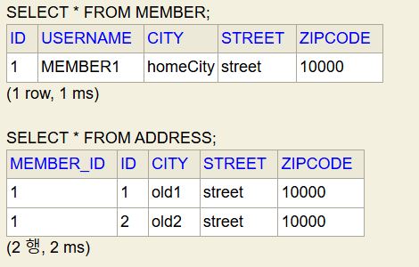

- *이제 ADDRESS 엔티티로 승격했기 때문에 식별자로 조회해서 편하게 수정하면 된다.*

