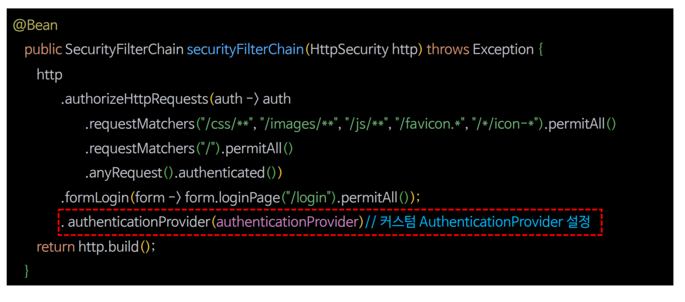
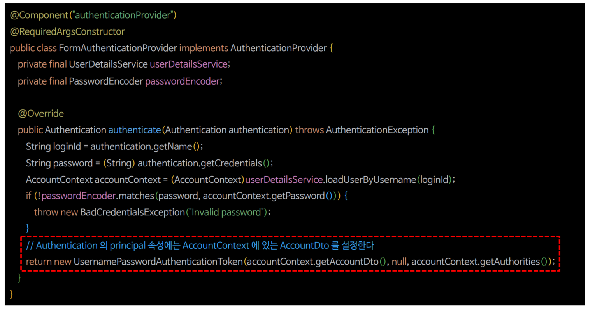

# ***AuthenticationProvider 설정***

***AuthenticationFilter → AuthenticatonManager → AuthenticationProvider → UserDetailsService***

- *이전 custom 에서는 UserDetailsService만 custom 했다.* 
- *이번에는 AuthenticationProvider를 custom 한다.*
- *AuthenticationProvider는 UserDetailsService를 참조해서 사용하기 때문에 SecurityConfig 즉, SecurityFilterChain 에서 AuthenticationProvider 설정만 해주면 끝이다.* 



# ***AuthenticationProvider 구현***



# *코드*

***FormAuthenticationProvider***

```java
@Component("authenticationProvider")
@RequiredArgsConstructor
public class FormAuthenticationProvider implements AuthenticationProvider {
    private final PasswordEncoder passwordEncoder;
    private final UserDetailsService userDetailsService;
    @Override
    public Authentication authenticate(Authentication authentication) throws AuthenticationException {
        AccountContext accountContext = (AccountContext) userDetailsService.loadUserByUsername(authentication.getName());
        if(!passwordEncoder.matches((String) authentication.getCredentials(), accountContext.getPassword())){
            throw new BadCredentialsException("Invalid password");
        }
        return new UsernamePasswordAuthenticationToken(
                accountContext.getAccountDto(), null, accountContext.getAuthorities());
    }
    @Override
    public boolean supports(Class<?> authentication) {
        return authentication.isAssignableFrom(UsernamePasswordAuthenticationToken.class);
    }
}

```

***SecurityConfig***

```java
@EnableWebSecurity
@Configuration
@RequiredArgsConstructor
public class SecurityConfig {
    private final AuthenticationProvider authenticationProvider;
    @Bean
    public SecurityFilterChain securityFilterChain(HttpSecurity http) throws Exception{
        http
                .authorizeHttpRequests(authorize -> authorize
                        .requestMatchers("/css/**", "/images/**",
                                "/js/**", "/favicon.*", "/*/icon/-*").permitAll()
                        .requestMatchers("/", "/signup").permitAll()
                        .anyRequest().authenticated())

                .authenticationProvider(authenticationProvider)
                .formLogin(form -> form.loginPage("/login").permitAll());

        return http.build();
    }
}
```

