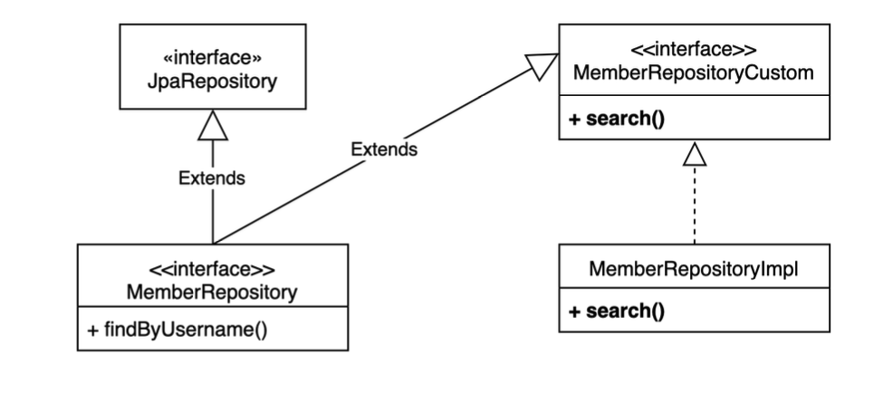

### *사용자 정의 리포지토리 사용법* 

1. *사용자 정의 인터페이스 작성*
1. *사용자 정의 인터페이스 구현* 
1. *스프링 데이터 리포지토리에 사용자 정의 인터페이스 상속* 

***사용자 정의 리포지토리 구성*** 



***사용자 정의 인터페이스 작성*** 

```java
public interface MemberRepositoryCustom {
    List<MemberTeamDto> search(MemberSearchCondition condition);
}
```

***사용자 정의 인터페이스 구현*** 

```java
@RequiredArgsConstructor
public class MemberRepositoryCustomImpl implements MemberRepositoryCustom {

    private final JPAQueryFactory queryFactory;

    @Override
    public List<MemberTeamDto> search(MemberSearchCondition condition) {
        return queryFactory
                .select(Projections.constructor(MemberTeamDto.class,
                        member.id.as("memberId"),
                        member.username,
                        member.age,
                        team.id.as("teamId"),
                        team.name.as("teamName")
                ))
                .from(member)
                .leftJoin(member.team, team)
                .where(
                        ageGoe(condition.getAgeGoe()),
                        ageLoe(condition.getAgeLoe()),
                        usernameEq(condition.getUsername()),
                        teamNameEq(condition.getTeamName())
                )
                .fetch();
    }

    private BooleanExpression teamNameEq(String teamName){
        if(StringUtils.hasText(teamName)){
            return team.name.eq(teamName);
        }
        return null;
    }
    private BooleanExpression usernameEq(String username){
        if(StringUtils.hasText(username)){
            return member.username.eq(username);
        }
        return null;
    }
    private BooleanExpression ageLoe(Integer age){
        if(age != null){
            return member.age.loe(age);
        }
        return null;
    }
    private BooleanExpression ageGoe(Integer age){
        if(age != null){
            return member.age.goe(age);
        }
        return null;
    }
}
```

***스프링 데이터 리포지토리에 사용자 정의 인터페이스 상속*** 

```java
public interface MemberRepository extends 
							JpaRepository<Member, Long>, MemberRepositoryCustom {
							
    List<Member> findByUsername(String username);
}
```

