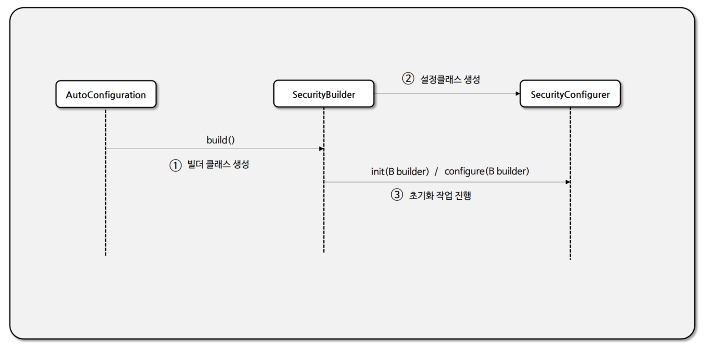
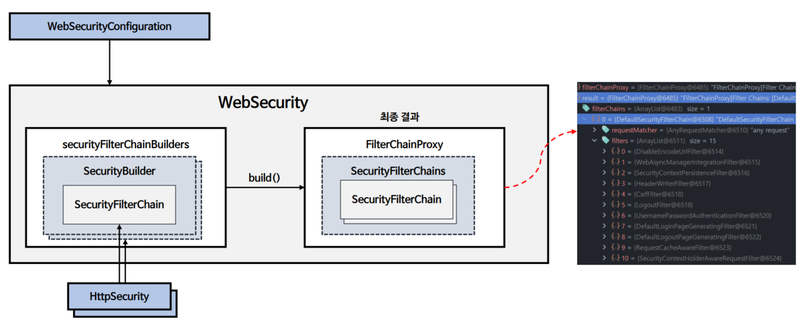

서버가 기동되면 스프링 시큐리티의 초기화 작업 및 보안 설정이 이루어진다

별도의 설정이나 코드를 작성하지 않아도 기본적인 웹 보안 기능이 현재 시스템에 연동되어 작동한다 

  - 모든 요청 경로에 대해 인증여부를 검증하고 인증이 승인되어야 자원에 접근이 가능 
  - 인증 방식은 폼 로그인 방식과 httpBasic 로그인 방식을 제공 
  - 인증을 시도할 수 있는 로그인 페이지와 로그아웃 페이지가 자동적으로 생성되어 렌더링 
  - 인증 승인이 이루어질 수 있도록 계정 하나가 기본적으로 제공된다 
- **SecurityProperties** 설정 클래스에서 생성 
    - username: user
    - password: [REDACTED] 문자열

### **SpringBootWebSecurityConfiguration**

자동 설정에 의한 기본 보안 설정 클래스 생성

```java
@Configuration(proxyBeanMethods = false)
@ConditionalOnDefaultWebSecurity
static class SecurityFilterChainConfiguration {

	@Bean
	@Order(SecurityProperties.BASIC_AUTH_ORDER)
	SecurityFilterChain defaultSecurityFilterChain(HttpSecurity http) throws Exception {
		http.authorizeHttpRequests((requests) -> requests.anyRequest().authenticated());
		http.formLogin(withDefaults());
		http.httpBasic(withDefaults());
		return http.build();
	}

}
```

**SpringBootWebSecurityConfiguration** 클래스 내부(static)클래스 **SecurityFilterChainConfiguration**

**SecurityFilterChain** 타입의 빈을 등록한다.  

어떤 조건에 맞으면 동작하는지 알아보자 

**@ConditionalOnDefaultWebSecurity**

```java
@Target({ ElementType.TYPE, ElementType.METHOD })
@Retention(RetentionPolicy.RUNTIME)
@Documented
@Conditional(DefaultWebSecurityCondition.class)
public @interface ConditionalOnDefaultWebSecurity {

}
```

**DefaultWebSecurityCondition**

```java
class DefaultWebSecurityCondition extends AllNestedConditions {
	DefaultWebSecurityCondition() {
		super(ConfigurationPhase.REGISTER_BEAN);
	}
	@ConditionalOnClass({ SecurityFilterChain.class, HttpSecurity.class })
	static class Classes {
	}
	@ConditionalOnMissingBean({ SecurityFilterChain.class })
	static class Beans {
	}
}
```

**@ConditionalOnClass({ SecurityFilterChain.class, HttpSecurity.class })**

특정 클래스가 클래스패스(Classpath)에 존재할 때만 해당 조건이 만족되도록 설정하는 데 사용된다

즉, SecurityFilterChain 클래스와 HttpSecurity 클래스가 모두 클래스패스에 존재할 때만 활성화 

**@ConditionalOnMissingBean({ SecurityFilterChain.class })**

SecurityFilterChain 타입의 빈이 스프링 컨테이너에 없으면 조건 통과

**SecurityBuilder** 

  - 빌더 클래스로서 웹 보안을 구성하는 빈 객체와 설정클래스들을 생성하는 역할을 한다 
  - WebSecurity, HttpSecurity 
  - SecurityBuilder는 SecurityConfigurer를 참조하고 있으며 인증 및 인가 초기화 작업은 SecurityConfigurer에 의해 진행된다 

**SecurityConfigurer**

  - Http 요청과 관련된 보안처리를 담당하는 필터들을 생성하고 여러 초기화 설정에 관여 


**초기화 작업 순서** 



AutoConfiguration SpringBoot 자동 구성 SecurityBuilder 클래스 생성 

SecurityBuilder(ex: HttpSecurity)를 통해서 여러가지 필터를 생성하는 SecurityConfigurer 생성 

SecurityBuilder build() 메소드가 호출되면 init(), configure()를 통해 초기화 작업이 진행 


```java
@Configuration(proxyBeanMethods = false)
class HttpSecurityConfiguration {

		@Bean(HTTPSECURITY_BEAN_NAME)
		@Scope("prototype")
		HttpSecurity httpSecurity() throws Exception {
			// 생략 ... 
			http
				.csrf(withDefaults())
				.addFilter(webAsyncManagerIntegrationFilter)
				.exceptionHandling(withDefaults())
				.headers(withDefaults())
				.sessionManagement(withDefaults())
				.securityContext(withDefaults())
				.requestCache(withDefaults())
				.anonymous(withDefaults())
				.servletApi(withDefaults())
				.apply(new DefaultLoginPageConfigurer<>());
			http.logout(withDefaults());
		
			applyCorsIfAvailable(http);
			applyDefaultConfigurers(http);
			return http;
		}

}
```

**http.csrf() 메소드** 

```java
public HttpSecurity csrf(Customizer<CsrfConfigurer<HttpSecurity>> csrfCustomizer) throws Exception {
		ApplicationContext context = getContext();
		csrfCustomizer.customize(getOrApply(new CsrfConfigurer<>(context)));
		return HttpSecurity.this;
	}
```

CsrfConfigurer 즉, SecurityConfigurer 인터페이스를 구현한 클래스가 설정된다. 

[자동 설정 기본 보안 작동](/26b7d6692ca881d58171ea4e3ca046c6)

SecurityBootWebSecurityConfiguration 클래스에서는 여기서 생성하는 

HttpSecurity 빈을 주입받게 된다. 

defaultSecurityFilterChain 메소드에서 

3개의 Configurer를 추가하고 

http.build()가 호출된다. 

SecurityBuilder(인터페이스) 

AbstractConfiguredSecurityBuilder(추상클래스)

HttpSecurity(클래스)

AbstractConfiguredSecurityBuilder에 정의된 doBuild() 호출

```java
@Override
protected final O doBuild() throws Exception {
	synchronized (this.configurers) {
		this.buildState = BuildState.INITIALIZING;
		beforeInit();
		init();
		this.buildState = BuildState.CONFIGURING;
		beforeConfigure();
		configure();
		this.buildState = BuildState.BUILDING;
		O result = performBuild();
		this.buildState = BuildState.BUILT;
		return result;
	}
}
```

configurers(설정 클래스들) for문을 돌면서 init(), configure() 호출

# HttpSecurity

  - HttpSecurityConfiguration에서 HttpSecurity를 생성하고 초기화를 진행한다 
  - HttpSecurity는 보안에 필요한 각 설정 클래스와 필터들을 생성하고 최종적으로 SecurityFilterChain 타입의 빈을 생성한다 


# SecurityFilterChain


**SecurityFilterChain matches(HttpServletRequest)**

SecurityFilterChain은 FilterChainProxy가 1개 이상을 가질 수 있다. 

이때 현재 요청이 SecurityFilterChain에 의해 처리되어야 하는지 여부를 결정한다 

이는 다중 보안(SecurityFilterChain ≥2)에서 중요하다 


# WebSecurity

  - WebSecurityConfiguration에서 WebSecurity를 생성하고 초기화를 진행 
  - WebSecurity는 HttpSecurity에서 생성한 SecurityFilterChain 빈을 SecurityBuilder에 저장 
  - WebSecurity가 build()를 실행하면 SecurityBuilder에서 SecurityFilterChain을 꺼내서 FilterChainProxy 생성자에게 전달한다 



# **Filter**

  - 서블릿 필터는 웹 애플리케이션에서 클라이언트의 요청과 서버의 응답을 가공하거나 검사하는데 사용되는 구성 요소 
  - 서블릿 필터는 클라이언트의 요청이 서블릿에 도달하기 전이나 서블릿이 응답을 클라이언트에게 보내기 전에 특정 작업을 수행할 수 있다. 
  - 서블릿 필터는 서블릿 컨테이너(WAS)에서 생성되고 실행되고 종료된다 


[디자인 패턴: 책임 연쇄 패턴](https://20240228.tistory.com/381)

# **DelegatingFilterProxy**

  - DelegatingFilterProxy는 스프링에서 사용되는 특별한 서블릿 필터로, 서블릿 컨테이너와 스프링 애플리케이션 컨텍스트 간의 연결고리 역할을 하는 필터이다. 
  - 서블릿 필터의 기능을 수행하는 동시에 스프링의 의존성 주입 및 빈 관리 기능과 연동되도록 설계한 필터라 할 수 있다 
  - springSecurityFilterChain 이름으로 생성된 빈을 AppicationContext에서 찾아 요청을 위임한다 그래서 이름이 Delegating이 붙는다. 
  - 실제 보안 처리를 수행하지 않고 단순히 요청을 위임한다 


# **FilterChainProxy**

  - springSecurityFilterChain 이름으로 생성되는 필터 빈으로서 DelegatingFilterProxy으로 부터 요청을 위임 받고 보안 처리 역할을 한다 
  - 내부적으로 하나 이상의 SecurityFilterChain 객체들을 가지고 있으며 요청 URL 정보를 기준으로 적절한 SecurityFilterChain을 선택하여 필터들을 호출한다 
  - HttpSecurity를 통해서 API 추가 시 관련 필터들이 추가된다 
  - 사용자의 요청을 필터 순서대로 호출함으로 보안 기능을 동작시키고 필요 시 직접 필터를 생성해서 기존의 필터 전.후로 추가 가능하다 


한 개 이상의 SecurityFilterChain 타입의 빈을 정의한 후 인증 API / 인가 API를 설정한다 

빈을 정의하지 않으면 자동으로 SecurityFilterChain 빈 생성해서 등록 


# **기본 구현 코드** 

```java
@EnableWebSecurity(debug = false) // default: false
@Configuration
public class SecurityConfig {
    @Bean
    public SecurityFilterChain securityFilterChain(HttpSecurity http) throws Exception {
        http
                .authorizeHttpRequests(auth -> auth.anyRequest().authenticated())
                .formLogin(Customizer.withDefaults());

        return http.build();
    }
}   
```

모든 설정 코드는 람다 형식으로 작성해야 한다 (스프링 시큐리티 7 버전부터는 람다 형식만 지원 할 예정)

SecurityFilterChain 을 빈으로 정의하게 되면 자동설정에 의한 SecurityFilterChain 빈은 생성되지 않는다

# 사용자 추가 설정 

**application.yaml** 

```yaml
spring:
  security:
    user:
      name: user
      password: [REDACTED]
      roles: USER
```

**자바 설정 클래스에 직접 정의**

```java
@Bean
public InMemoryUserDetailsManager inMemoryUserDetailsManager(){
		UserDetails user = User.withUsername("user")
			.password("{noop}1111")
			.authorities("ROLE_USER")
			.build();
		return new InMemoryUserDetailsManager(user);
}
```

설정 파일이랑 설정 클래스에 직접 정의 모두 하면 설정 클래스에 직접 정의하는 게 우선권을 가진다.

**InMemoryUserDetailsManager (UserDetailsService)**

유저 정보를 DB가 아닌 메모리에 저장하는 방식 

애플리케이션이 종료되면 날라간다. 

즉, 토이 프로젝트/ 테스트 환경에만 사용 가능

