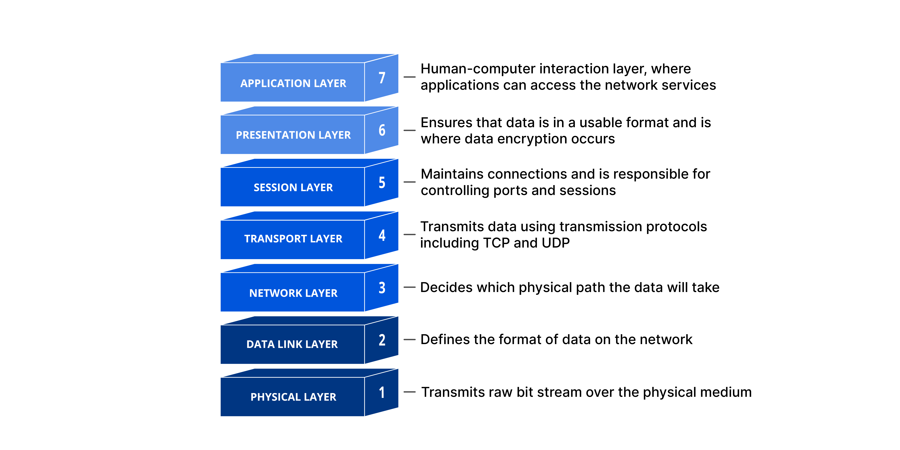
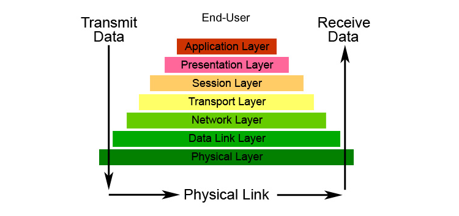

## OSI 7계층 등장 배경

**OSI 7계층(Open Systems Interconnection 7 Layer) 모델**은 국제 표준화 기구(ISO)가 1970년대 후반~1980년대 초에 발표한 네트워크 통신 표준 모델이다.

- **다양한 네트워크 시스템의 난립**
1980년대 초, 통신 기술이 발달하고 개인용 컴퓨터가 보급되면서, 서로 다른 제조사와 시스템 간에 네트워크 통신이 필요해졌다. 하지만 각 업체가 독자적으로 네트워크 장비와 프로토콜을 개발해, 시스템 간 호환성 문제가 심각했다.
- **표준화의 필요성 대두**
네트워크 장비와 컴퓨터 간의 충돌과 비호환 문제를 해결하고, 다양한 시스템이 원활하게 통신할 수 있도록 하는 표준화된 모델의 필요성이 커졌다.
- **ISO의 표준 모델 제안**
이에 따라 ISO는 네트워크 구조의 호환성을 높이고, 네트워크 간 통신 시스템을 통합하기 위한 표준 모델로 OSI 7계층을 제정했다. 이 모델은 네트워크 통신 과정을 7개의 계층으로 분리해 각 계층이 특정 기능을 담당하도록 설계되었다.

---

## OSI 7계층 

**OSI 7계층은 컴퓨터와 컴퓨터가 통신하는 구조를 7개의 계층으로 정의해둔 약속, 즉 프로토콜이다.**

| 계층  | 설명 |
| --- | --- |
| **7계층 / 응용 계층 (Application Layer)** | 사용자와 애플리케이션 간의 소통(이메일 보내기, 웹 사이트 방문) |
| **6계층 / 표현 계층 (Presentation Layer)** | 데이터를 어떻게 표현할지 정의(데이터의 압축, 데이터 암호화) |
| **5계층 / 세션 계층 (Session Layer)** | 통신을 설정, 관리, 종료(일반적으로 통신을 위한 세션을 체결) |
| **4계층 / 전송 계층 (Transport Layer)** | 신뢰성 있는 정확한 데이터 전달 |
| **3계층 / 네트워크 계층(Network Layer)** | 네트워크 장치 간의 경로 선택과 데이터 전송 |
| **2계층 / 데이터 링크 계층(Data Link Layer)** | 물리적인 연결을 통해 오류 없는 데이터 전달 |
| **1계층 / 물리 계층(Physical Layer)** | 전기 신호를 이용해서 통신 케이블로 데이터를 전송  |

송신자 관점에서 보면 7계층인 응용 계층에서 시작된 통신은 1계층인 물리 계층에서 끝난다.

반대로 수신자 관점에서는 물리 계층에서 시작하여 응용 계층에서 끝나는 흐름을 갖는다.

OSI 7 계층은 이론적인 표준안이다. 현실에 적용하기에는 계층이 너무 많다.

그래서 OSI 7 게층을 효율적으로 사용하기 위해 등장한 것이 TCP/IP 4 계층이다. 

따라서 **TCP/IP 4 계층을 사실상의 표준(De Facto Standard)이라고도 한다.**

---

## TCP/IP 4 계층

| **계층** | **설명** |
| --- | --- |
| 4계층 / 응용 계층  | 사용자와 애플리케이션 간의 소통 |
| 3계층 / 전송 계층  | 데이터의 전송 및 흐름에 있어 신뢰성 보장 |
| 2계층 / 인터넷 계층  | 물리적으로 데이터가 네트워크를 통해 어떻게 전송되는지를 정의 |
| 1계층 / 네트워크 인터페이스 계층 | 데이터를 전기 신호로 변환한 뒤 데이터 전송 |

---

