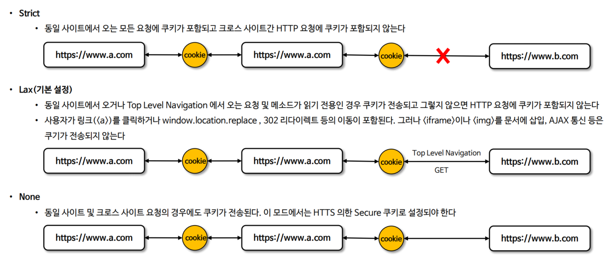
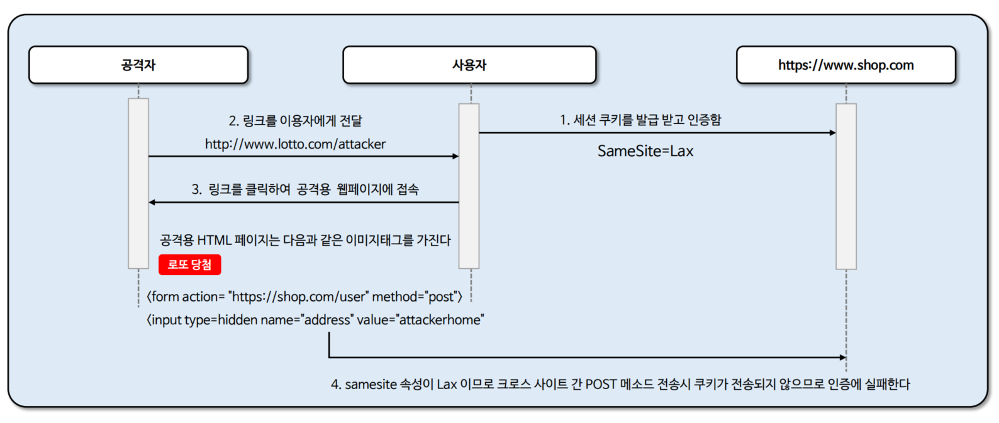
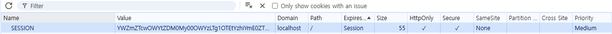

# **개요**

- `SameSite`는 최신 방식의 CSRF 공격 방어 방법 중 하나로서 서버가 쿠키를 설정할 때 `SameSite`속성을 지정하여 크로스 사이트 간 쿠키 전송에 대한 제어를 핸들링 할 수 있다 
- `Spring Security`는 세션 쿠키의 생성을 직접 제어하지 않기 때문에 `SameSite` 속성에 대한 지원을 제공하지 않지만 `Spring Session` 은 `SameSite` 속성을 지원한다 

# **Samesite 속성**



# **SameSite 예시**



- 대부분의 현대 브라우저는 `SameSite` 속성을 지원하지만, 여전히 사용 중인 오래된 브라우저는 지원하지 않을 수 있다 
- `SameSite`를 CSRF 공격에 대한 유일한 방어 수단으로서가 아니라 심층적으로 강화된 방어의 일환으로 사용하는 것을 권장하고 있다

# **Spring Session 으로 SameSite 적용하기**

**build.gragle 추가** 

```java
dependencies {
		implementation 'org.springframework.session:spring-session-core'
}	
```

**HttpSessionConfig** 

```java
@Configuration
@EnableSpringHttpSession
public class HttpSessionConfig {
    @Bean
    public CookieSerializer cookieSerializer(){
        DefaultCookieSerializer serializer = new DefaultCookieSerializer();
        serializer.setUseHttpOnlyCookie(true); // default: true
        serializer.setUseSecureCookie(true);   // default: true
        serializer.setSameSite("None");        // default: Lax
        return serializer;
    }
    @Bean
    public SessionRepository<MapSession> sessionRepository(){
        return new MapSessionRepository(new ConcurrentHashMap<>());
    }
}
```

- 이제 세션 관리를 `HttpSession`을 통해서 한다 



- 이제 세션 쿠키 이름이 `JSESSIONID`가 아니라 `SESSION`이다 
- `CookieSerializer` 를 통해서 설정했던 값들이 정상적으로 설정되었다.
- `HttpOnly`: true
  - `Secure`: true
  - `SameSite`: None

