# *기본 구성*

***의존 관계 설정 - build.gradle***

```java
implementation 'org.springframework.boot:spring-boot-starter-security'
implementation 'org.springframework.boot:spring-boot-starter-web'
implementation group: 'org.springframework.boot', name: 'spring-boot-starter-thymeleaf', version: '3.2.2'
compileOnly 'org.projectlombok:lombok'
runtimeOnly 'org.postgresql:postgresql'
annotationProcessor 'org.springframework.boot:spring-boot-configuration-processor'
annotationProcessor 'org.projectlombok:lombok'
testImplementation 'org.springframework.boot:spring-boot-starter-test'
testImplementation 'org.springframework.security:spring-security-test'
developmentOnly 'org.springframework.boot:spring-boot-devtools'
```

  - *View Template: Thymeleaf*
  - *DB: PostgreSQL*

```java
@EnableWebSecurity
@Configuration
public class SecurityConfig {
    @Bean
    public SecurityFilterChain securityFilterChain(HttpSecurity http) throws Exception{
        http
                .authorizeHttpRequests(authorize -> authorize
                        .requestMatchers("/").permitAll()
                        .anyRequest().authenticated())
                .formLogin(Customizer.withDefaults());

        return http.build();
    }
    @Bean
    public UserDetailsService userDetailsService(){
        UserDetails user = User.withUsername("user").password("{noop}1111").roles("USER").build();
        return new InMemoryUserDetailsManager(user);
    }
}
```

# ***커스텀 로그인 페이지 설정***

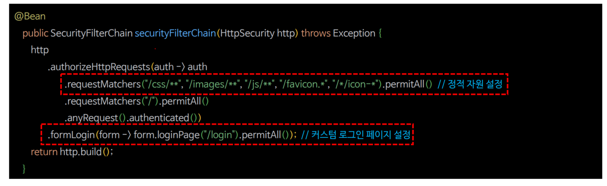

# ***CSRF 코드 자동 생성 ­Thymeleaf 폼 태크***

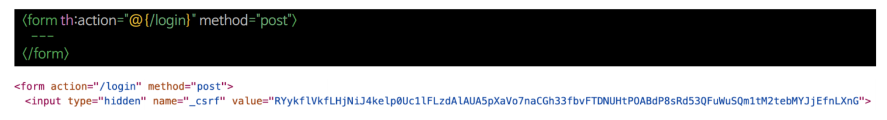

# ***코드***

***SecurityConfig***

```java
@EnableWebSecurity
@Configuration
public class SecurityConfig {
    @Bean
    public SecurityFilterChain securityFilterChain(HttpSecurity http) throws Exception{
        http
                .authorizeHttpRequests(authorize -> authorize
                        .requestMatchers("/css/**", "/images/**",
                                "/js/**", "/favicon.*", "/*/icon/-*").permitAll()
                        .requestMatchers("/").permitAll()
                        .anyRequest().authenticated())
                .formLogin(form -> form.loginPage("/login").permitAll());

        return http.build();
    }
    @Bean
    public UserDetailsService userDetailsService(){
        UserDetails user = User.withUsername("user").password("{noop}1111").roles("USER").build();
        return new InMemoryUserDetailsManager(user);
    }
}
```

```java
.requestMatchers("/css/**", "/images/**", "/js/**", "/favicon.*", "/*/icon/-*").permitAll()
```

  - *정적 자원 permitAll*

```java
.formLogin(form -> form.loginPage("/login").permitAll());
```

  - *Custom 로그인 페이지* 
  - *loginPrcessingUrl 관련 설정은 하지 않았다 → default* *`POST "/login"`* 

***LoginController***

```java
@Controller
public class LoginController {
    @GetMapping("/login")
    public String login(){
        return "/login/login";
    }
}
```

***현재 CSRF 필터 설정은 on 이다. → SpringSecurity default***

→ *따라서 POST 요청이면 CSRF 토큰을 넣어줘야 한다.* 

***login.html 일부***

```html
<form th:action="@{/login}" method="post">
    <div class="form-group">
        <label for="username">Username</label>
        <input type="text" class="form-control" id="username" name="username" required>
    </div>
    <div class="form-group">
        <label for="password">Password</label>
        <input type="password" class="form-control" id="password" name="password" required>
    </div>
    <button type="submit" class="btn btn-primary">Login</button>
</form>
```

  - *Spring Security가 활성화된 상태에서* *`thymeleaf-spring`**을 사용하면,* *`th:action`**을 통해* *`POST`* *요청을 보낼 때 Spring Security가 자동으로 CSRF 토큰을 추가한다.* 
  - *이 동작은 Thymeleaf 템플릿 엔진이 Spring Security의 CSRF 설정을 인식하기 때문이다.*

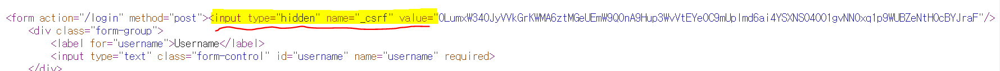

***login.html 일부***

```html
<div th:if="${param.error}" class="form-group">
    <span th:text="${exception}?: '잘못된 아이디나 암호입니다'" class="alert alert-danger"></span>
</div>
```

  - *잘못된 회원 username or password 입력을 하면* *`/login?error`* 

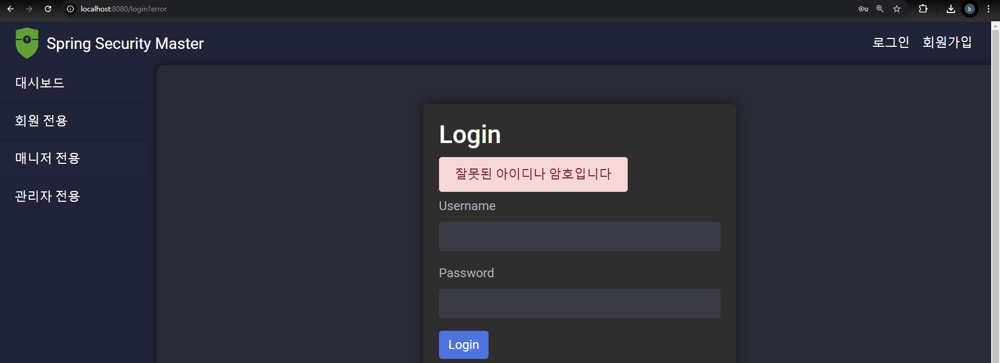

# ***PasswordEncoder***

  - *스프링 시큐리티의 PasswordEncoder 인터페이스는 비밀번호를 안전하게 저장하기 위해 비밀번호의 단방향 변환을 수행하는 데 사용된다*
  - *일반적으로 PasswordEncoder는 사용자의 비밀번호를 암호화하여 저장하거나 인증 시 검증을 위해 입력한 비밀번호와 암호화 되어 저장된 비밀번호를 서로 비교해야 할 때 사용된다*

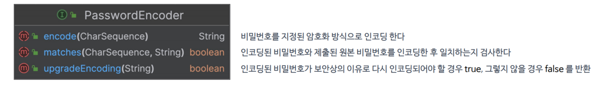

# ***DelegatingPasswordEncoder***

  - *DelegatingPasswordEncoder는 {id} 형식의 접두사를 사용하여 비밀번호가 어떤 방식으로 인코딩되었는지 식별하는 클래스로 예를 들어 {bcrypt} 접두사는 비밀번호가 BCrypt 방식으로 인코딩되었음을 나타낸다.*


  - *DelegatingPasswordEncoder는 어플리케이션에서 사용하는 기본 인코딩 방식을 변경할 수 있도록 해주며 새로운 인코딩 방식이 권장되거나 필요할 때 비밀번호 인코딩 전략을 유연하게 유지할 수 있다*

# ***DelegatingPasswordEncoder 빈 정의***

***기본 생성***

```java
@Bean
public PasswordEncoder passwordEncoder() {
		return PasswordEncoderFactories.createDelegatingPasswordEncoder(); 
}
```

  - *기본적으로 bcrypt 암호화 알고리즘의* ***BCryptPasswordEncoder*** *객체를 생성하고 사용하게 된다*

***PasswordEncoderFactories.createDelegatingPasswordEncoder()***

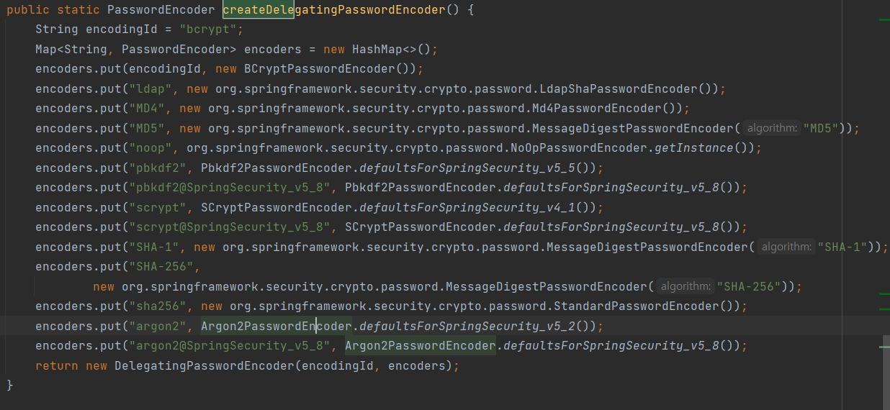

  - *많은 암호화 알고리즘의 PasswordEncoder를 생성하지만 default는 BCryptPasswordEncoder*
  - *시큐리티는 이렇게 많은 암호화 알고리즘을 지원한다.* 

***알고리즘 지정 생성***

```java
@Bean
public PasswordEncoder passwordEncoder() {
		 String encodingId = "pbkdf2";
		 Map<String, PasswordEncoder> encoders = new HashMap<>();
		 encoders.put(encodingId, Pbkdf2PasswordEncoder.defaultsForSpringSecurity_v5_8());
		 DelegatingPasswordEncoder delegatingPasswordEncoder = new DelegatingPasswordEncoder(encodingId, encoders);
		 return delegatingPasswordEncoder;
}
```

# ***사용자 생성과 비밀번호 암호화***

```java
@PostMapping(value="/signup")
public String signup(AccountDto accountDto) {
		ModelMapper mapper = new ModelMapper();
		Account account = mapper.map(accountDto, Account.class);
		account.setPassword(passwordEncoder.encode(accountDto.getPassword()));
		userService.createUser(account);
		return "redirect:/";
}
```

# *ModelMapper*

*ModelMapper는 객체 매핑 라이브러리* 

*주로 객체 간의 데이터를 변환하는 데 사용되며, 특히 DTO(Data Transfer Object)와 엔티티 간의 매핑을 간편하게 수행할 수 있도록 도와준다.*

***특징***

  - ***간결한 매핑****: 소스 객체와 대상 객체 간에 필드 이름이 일치하면 자동으로 매핑해준다.*
  - ***유연한 매핑****: 이름이 다르거나 복잡한 구조의 객체를 매핑할 때도 별도의 설정으로 지원한다.*
  - ***재사용 가능****: 매핑 규칙을 정의하면 여러 곳에서 재사용할 수 있다.*

# *설정* 

***application.yaml***

```java
spring:
  datasource:
    driver-class-name: com.mysql.cj.jdbc.Driver
    url: jdbc:mysql://127.0.0.1:3306/securitymaster
    username: "cos"
    password: [REDACTED]
  jpa:
    hibernate:
      ddl-auto: update
    properties:
      hibernate:
        format_sql: true
        jdbc:
          lob:
            non_contextual_creation: true
  thymeleaf:
    cache: false
```

- ModelMapper

# *UserDetailsService 설정*

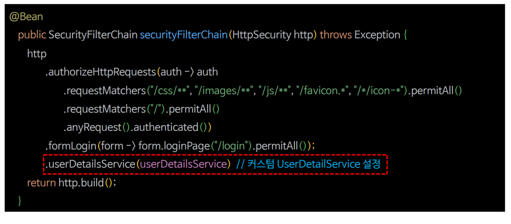

# ***UserDetailsService 구현***

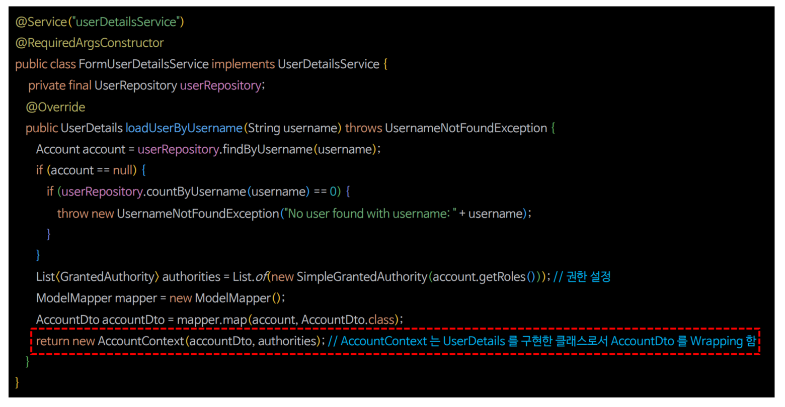

# *구현*

***AccountContext - implements UserDetails***

```java
@RequiredArgsConstructor
public class AccountContext implements UserDetails {
    private final AccountDto accountDto;
    private final List<GrantedAuthority> authorities;
    @Override
    public boolean isAccountNonExpired() {
        return true;
    }
    @Override
    public boolean isAccountNonLocked() {
        return true;
    }
    @Override
    public boolean isCredentialsNonExpired() {
        return true;
    }
    @Override
    public boolean isEnabled() {
        return true;
    }
    @Override
    public Collection<? extends GrantedAuthority> getAuthorities() {
        return authorities;
    }
    @Override
    public String getPassword() {
        return accountDto.getPassword();
    }
    @Override
    public String getUsername() {
        return accountDto.getUsername();
    }
}
```

***FormUserDetailsService - implements UserDetailsService***

```java
@Service
@RequiredArgsConstructor
public class FormUserDetailsService implements UserDetailsService {
    private final UserRepository userRepository;
    @Override
    public UserDetails loadUserByUsername(String username) throws UsernameNotFoundException {
        Account account = userRepository.findByUsername(username)
                .orElseThrow(() -> new UsernameNotFoundException("Cant find User with username" + username));

        List<GrantedAuthority> authorities = List.of(new SimpleGrantedAuthority(account.getRoles()));
        ModelMapper modelMapper = new ModelMapper();
        AccountDto accountDto = modelMapper.map(account, AccountDto.class);

        return new AccountContext(accountDto, authorities);
    }
}
```

***SecurityConfig***

```java
@EnableWebSecurity
@Configuration
@RequiredArgsConstructor
public class SecurityConfig {
    private final FormUserDetailsService userDetailsService;
    @Bean
    public SecurityFilterChain securityFilterChain(HttpSecurity http) throws Exception{
        http
                .authorizeHttpRequests(authorize -> authorize
                        .requestMatchers("/css/**", "/images/**",
                                "/js/**", "/favicon.*", "/*/icon/-*").permitAll()
                        .requestMatchers("/", "/signup").permitAll()
                        .anyRequest().authenticated())

                .userDetailsService(userDetailsService)
                .formLogin(form -> form.loginPage("/login").permitAll());

        return http.build();
    }
    
    @Bean
    public PasswordEncoder passwordEncoder(){
        return PasswordEncoderFactories.createDelegatingPasswordEncoder();
    }
}
```

  - *`.userDetailsService(userDetailsService)`*  *→ customUserDetailsService 설정*

# ***AuthenticationProvider 설정***

***AuthenticationFilter → AuthenticatonManager → AuthenticationProvider → UserDetailsService***

  - *이전 custom 에서는 UserDetailsService만 custom 했다.* 
  - *이번에는 AuthenticationProvider를 custom 한다.*
  - *AuthenticationProvider는 UserDetailsService를 참조해서 사용하기 때문에 SecurityConfig 즉, SecurityFilterChain 에서 AuthenticationProvider 설정만 해주면 끝이다.* 

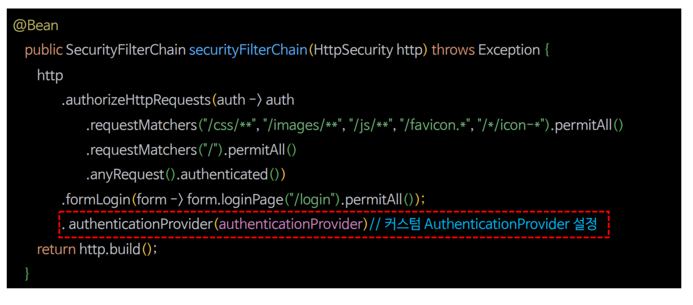

# ***AuthenticationProvider 구현***

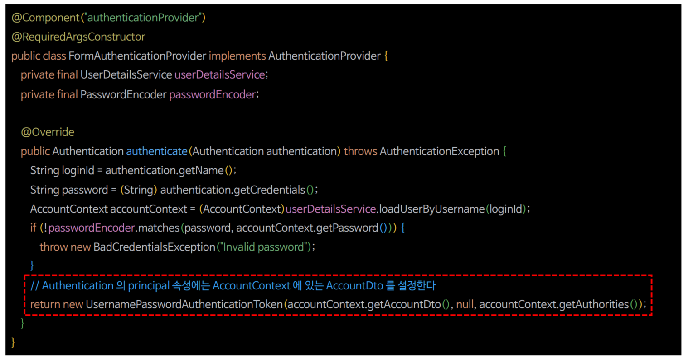

# *코드*

***FormAuthenticationProvider***

```java
@Component("authenticationProvider")
@RequiredArgsConstructor
public class FormAuthenticationProvider implements AuthenticationProvider {
    private final PasswordEncoder passwordEncoder;
    private final UserDetailsService userDetailsService;
    @Override
    public Authentication authenticate(Authentication authentication) throws AuthenticationException {
        AccountContext accountContext = (AccountContext) userDetailsService.loadUserByUsername(authentication.getName());
        if(!passwordEncoder.matches((String) authentication.getCredentials(), accountContext.getPassword())){
            throw new BadCredentialsException("Invalid password");
        }
        return new UsernamePasswordAuthenticationToken(
                accountContext.getAccountDto(), null, accountContext.getAuthorities());
    }
    @Override
    public boolean supports(Class<?> authentication) {
        return authentication.isAssignableFrom(UsernamePasswordAuthenticationToken.class);
    }
}

```

***SecurityConfig***

```java
@EnableWebSecurity
@Configuration
@RequiredArgsConstructor
public class SecurityConfig {
    private final AuthenticationProvider authenticationProvider;
    @Bean
    public SecurityFilterChain securityFilterChain(HttpSecurity http) throws Exception{
        http
                .authorizeHttpRequests(authorize -> authorize
                        .requestMatchers("/css/**", "/images/**",
                                "/js/**", "/favicon.*", "/*/icon/-*").permitAll()
                        .requestMatchers("/", "/signup").permitAll()
                        .anyRequest().authenticated())

                .authenticationProvider(authenticationProvider)
                .formLogin(form -> form.loginPage("/login").permitAll());

        return http.build();
    }
}
```

# ***LoginController***

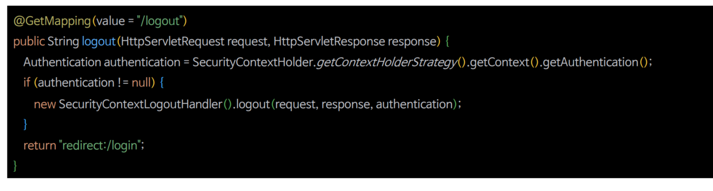

# ***build.gradle & header.html***

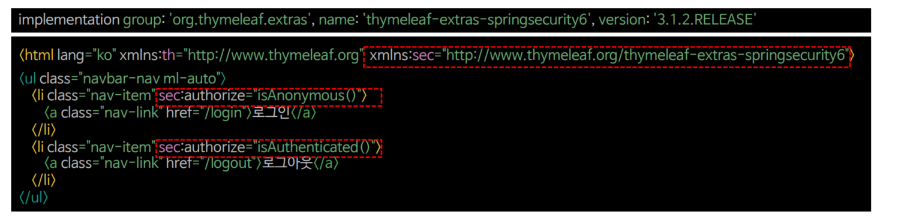

***build.gradle dependency 추가*** 

```java
implementation group: 'org.thymeleaf.extras', name: 'thymeleaf-extras-springsecurity6', version: '3.1.2.RELEASE'
```

  - *`thymeleaf-extras-springsecurity6`* *: Thymeleaf와 Spring Security 통합하기 위해 사용되는 추가 기능 모듈* 
  - *Spring Security 태그 지원* 
```html
<sec:authorize access="hasRole('ROLE_ADMIN')">
<p>관리자만 볼 수 있는 콘텐츠입니다.</p>
</sec:authorize>
```
  - *표현식 지원* 
```html
<p>현재 사용자: <span th:text="${#authentication.name}">사용자 이름</span></p>
```
  - *로그인 로그아웃 상태 확인* 
```html
<sec:authorize access="isAuthenticated()">
    <p>로그인 상태입니다.</p>
</sec:authorize>
<sec:authorize access="isAnonymous()">
    <p>비로그인 상태입니다.</p>
</sec:authorize>
```

# ***Thymeleaf 보안 표현식 종류***

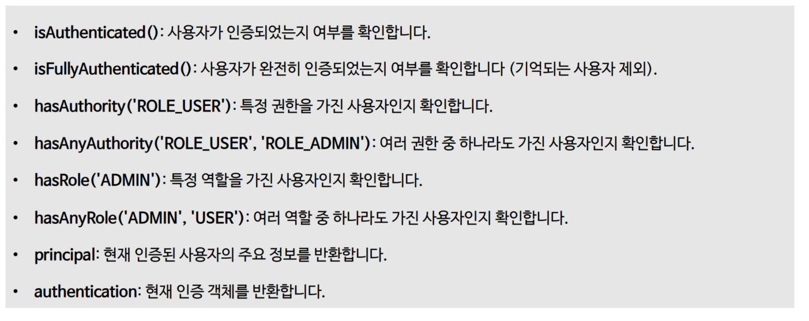

***example***

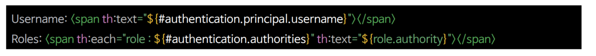

# *구현하기*

***header.html***

```html
<!DOCTYPE html>
<html lang="ko" xmlns:th="http://www.thymeleaf.org"
      xmlns:sec="http://www.thymeleaf.org/thymeleaf-extras-springsecurity6">
<header th:fragment="header">
    <nav class="navbar navbar-expand-lg navbar-custom">
         <a class="navbar-brand" href="#">Spring Security Master</a>
        <div class="collapse navbar-collapse" id="navbarSupportedContent">
            <ul class="navbar-nav ml-auto">
                <li class="nav-item" sec:authorize="isAnonymous()">
                    <a class="nav-link" href="/login">로그인</a>
                </li>
                <li class="nav-item" sec:authorize="isAuthenticated()">
                    <a class="nav-link" href="/logout">로그아웃</a>
                </li>
                <li class="nav-item" sec:authorize="isAnonymous()">
                    <a class="nav-link" href="/signup">회원가입</a>
                </li>
            </ul>
        </div>
    </nav>
</header>
```

  - *`<li class="nav-item" sec:authorize="isAuthenticated()">`* 
- *인증 상태이면 나타난다.*
  - *`<li class="nav-item" sec:authorize="isAnonymous()">`* 
- *익명 사용자면 나타난다.*

***LoginController***

```java
@GetMapping("/logout")
public String logout(HttpServletRequest request, HttpServletResponse response){
    Authentication authentication = SecurityContextHolder.getContextHolderStrategy().getContext().getAuthentication();
    if(authentication != null){
        new SecurityContextLogoutHandler().logout(request, response, authentication);
    }
    return "redirect:/login";
}
```

# *나만의 Custom*

*Spring Security가 제공하는 기본* *`POST /logout`* *활용하기*

*굳이 LoginController 에서 로그아웃 API를 만들 필요 없이 SpringSecurity가 제공하는 default 로그아웃 동작을 사용한다.*

```html
<ul class="navbar-nav ml-auto">
    <li class="nav-item" sec:authorize="isAnonymous()">
        <a class="nav-link" href="/login">로그인</a>
    </li>
    <li class="nav-item" sec:authorize="isAuthenticated()">
        <form th:action="@{/logout}" method="post">
            <button type="submit" class="btn btn-primary">로그아웃</button>
        </form>
    </li>
    <li class="nav-item" sec:authorize="isAnonymous()">
        <a class="nav-link" href="/signup">회원가입</a>
    </li>
</ul>
```

  - *`<form th:action="@{/logout}" method="post">`*  *→ Spring Security 로그아웃 경로, HTTP method*

- Thymeleaf + SpringSecurity 통합 

# *WebAuthenticationDetails*

  - *HTTP 요청과 관련된 인증 세부 정보를 포함하는 클래스로서 기본적으로 사용자의* ***IP 주소와 세션 ID****와 같은 정보를 가지고 있다*
  - *특정 인증 메커니즘에서 요청의 추가적인 정보를 인증 객체에 추가할 때 사용할 수 있으며 Authentication 객체와 함께 사용된다*

# ***AuthenticationDetailsSource***

  - *인증 과정 중에 Authentication 객체에 세부 정보를 제공하는 소스 역할을 한다*
  - *WebAuthenticationDetails 객체를 생성하는 데 사용되며 인증 필터에서 참조한다*

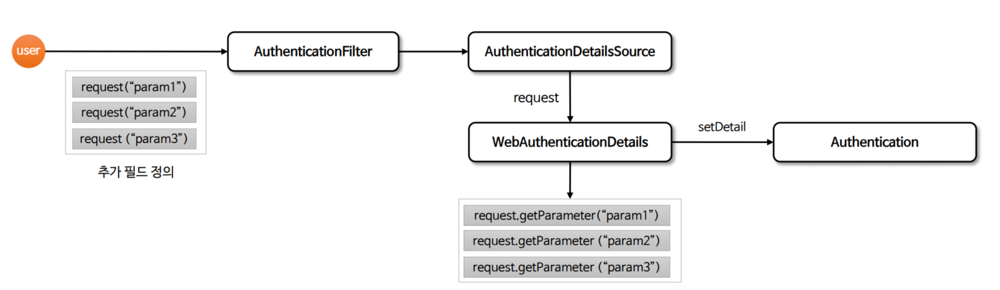

# ***AuthenticationDetailsSource 설정***

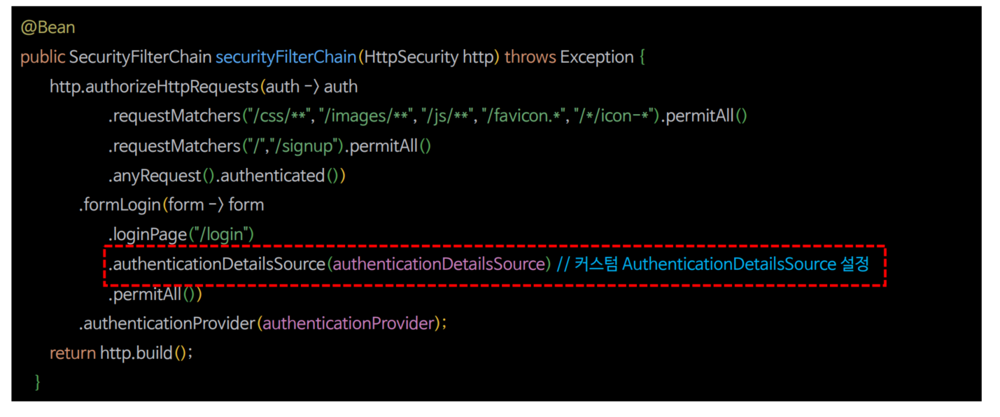

# *사용 예시*

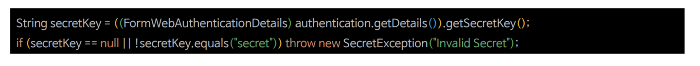

# ***구현 하기***

***login.html 일부 <form> 태그*** 

```html
<form th:action="@{/login}" method="post">
    <input type="hidden" th:value="secret" th:name="secret_key"/>
    <div class="form-group">
        <label for="username">Username</label>
        <input type="text" class="form-control" id="username" name="username" required>
    </div>
    <div class="form-group">
        <label for="password">Password</label>
        <input type="password" class="form-control" id="password" name="password" required>
    </div>
    <button type="submit" class="btn btn-primary">Login</button>
</form>
```

  - `<input type="hidden" th:value="secret" th:name="secret_key"/>`


***SecretException***

```java
import org.springframework.security.core.AuthenticationException;

public class SecretException extends AuthenticationException {
    public SecretException(String message) {
        super(message);
    }
}
```

  - *extends AuthenticaionException(인증 예외) is RuntimeException*
  - *동일한 클래스명(AuthenticationException)이 많이 존재한다. → 주의하자*  


***FormAuthenticationDetails***

```java
@Getter
public class FormAuthenticationDetails extends WebAuthenticationDetails{
    private String secretKey;
    public FormAuthenticationDetails(HttpServletRequest request) {
        super(request);
        this.secretKey = request.getParameter("secret_key");
    }
}
```

  - *extends WebAuthenticationDetails*
  - *Authentication getDetails() → FormAuthenticationDetails*
- *인증 객체 내부의 추가적인 정보 is WebAuthenticaionDetails*
    - *host information*
    - *JSESSIONID → 세션 ID*

***FormWebAuthenticationDetailsSource*** 

```java
@Component
public class FormWebAuthenticationDetailsSource implements AuthenticationDetailsSource<HttpServletRequest, FormAuthenticationDetails> {
    @Override
    public FormAuthenticationDetails buildDetails(HttpServletRequest request) {
        return new FormAuthenticationDetails(request);
    }
}
```

  - *extends AuthenticationDetailsSource<HttpServletRequest, FormAuthenticationDetails>*
  - *역할: 인증 Filter가 Authentication에 details 객체를 생성하고 set하기 위해 참조하는 클래스*
- *details 생성의 역할을 담당한다.*

***FormAuthenticationProvider***

```java
@Component("authenticationProvider")
@RequiredArgsConstructor
public class FormAuthenticationProvider implements AuthenticationProvider {
    private final PasswordEncoder passwordEncoder;
    private final UserDetailsService userDetailsService;
    @Override
    public Authentication authenticate(Authentication authentication) throws AuthenticationException {
        AccountContext accountContext = (AccountContext) userDetailsService.loadUserByUsername(authentication.getName());

        if(!passwordEncoder.matches((String) authentication.getCredentials(), accountContext.getPassword())){
            throw new BadCredentialsException("Invalid password");
        }

        FormAuthenticationDetails details = (FormAuthenticationDetails) authentication.getDetails();
        String secretKey = details.getSecretKey();
        if(secretKey == null || !secretKey.equals("secret")){
            throw new SecretException("Invalid secret");
        }

        return new UsernamePasswordAuthenticationToken(
                accountContext.getAccountDto(), null, accountContext.getAuthorities());
    }
    @Override
    public boolean supports(Class<?> authentication) {
        return authentication.isAssignableFrom(UsernamePasswordAuthenticationToken.class);
    }
}
```

  - *extends AuthenticationProvider*
  - *AuthenticationFilter(ex: UsernamePasswordAuthenticationFilter) → AuthenticationManager → AuthenticationProvider(실제 인증 처리)*
  - *Authentication 객체에서 getDetails()를 통해서*  ***FormAuthenticationDetails*** *꺼내고 정상적인 Details에  “secret”이 있는지 확인하고 없으면 인증 예외인* ***SecretException****을 던진다.*
  - *supports method의 결과가 true가 되는 조건은 UsernamePasswordAuthenticationFilter에서 생성하는 UsernamePasswordAuthenticationToken 뿐이다.*

***SecurityConfig***

```java
@EnableWebSecurity
@Configuration
@RequiredArgsConstructor
public class SecurityConfig {
    private final AuthenticationProvider authenticationProvider;
    private final AuthenticationDetailsSource authenticationDetailsSource;
    @Bean
    public SecurityFilterChain securityFilterChain(HttpSecurity http) throws Exception{
        http
                .authorizeHttpRequests(authorize -> authorize
                        .requestMatchers("/css/**", "/images/**",
                                "/js/**", "/favicon.*", "/*/icon/-*").permitAll()
                        .requestMatchers("/", "/signup").permitAll()
                        .anyRequest().authenticated())
                .authenticationProvider(authenticationProvider)
                .formLogin(form -> form
                        .loginPage("/login")
                        .authenticationDetailsSource(authenticationDetailsSource)
                        .permitAll());

        return http.build();
    }
}
```

  - *formLogin → UsernamePasswordAuthenticationFilter 사용* 
  - *UsernamePasswordAuthenticationFilter는 AuthenticationDetailsSource로 내가 만든 FromAuthenticationDetailsSource를 참조하게 된다.* 
  - *또한 HttpSecurity.authenticationProvider 통해서 내가 custom한 AuthenticationProvider를 사용한다.*

- WebAuthenticationDetails / AuthenticationDetailsSource

# ***AuthenticationSuccessHandler 설정***

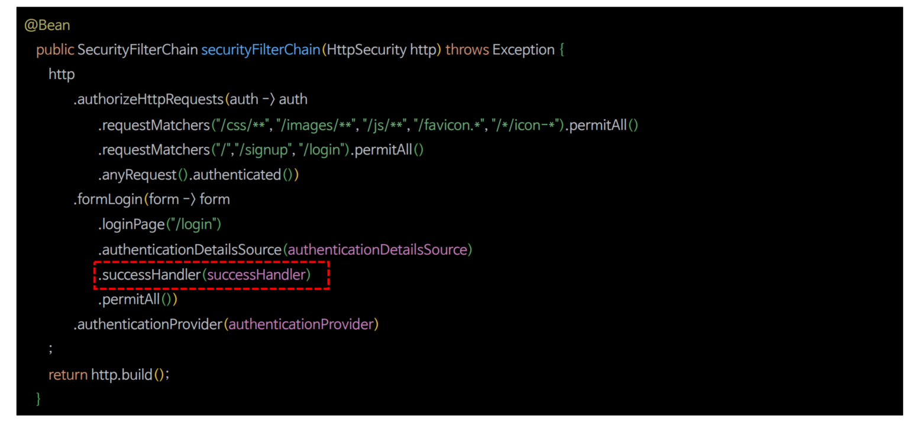

# ***FormAuthenticationSuccessHandler***

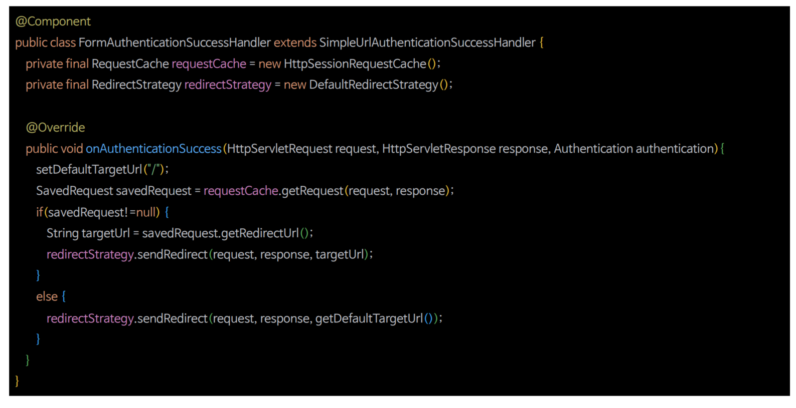

# *구현*

***FormAuthenticationSuccessHandler***

```java
@Component
public class FormAuthenticationSuccessHandler extends SimpleUrlAuthenticationSuccessHandler {
    private final RequestCache requestCache = new HttpSessionRequestCache();
    private final RedirectStrategy redirectStrategy = new DefaultRedirectStrategy();
    @Override
    public void onAuthenticationSuccess(HttpServletRequest request, HttpServletResponse response, Authentication authentication) throws IOException, ServletException {
        setDefaultTargetUrl("/");
        SavedRequest savedRequest = requestCache.getRequest(request, response);
        if(savedRequest!=null){
            String redirectUrl = savedRequest.getRedirectUrl();
            redirectStrategy.sendRedirect(request, response, redirectUrl);
            return;
        }
        redirectStrategy.sendRedirect(request, response, getDefaultTargetUrl());
    }
}
```

  - *extends SimpleUrlAuthenticationSuccessHandler*
  - *인증에 성공하면 동작하는 handler 이다.*
  - *HttpSessionRequestCache 클래스를 통해서 이전 요청에 대한 기록(SavedRequest)이 있으면 이전 요청 url로 리다이렉트하고 없으면 defaultTargetUrl로 리다이렉트 한다.* 

***SecurityConfig***

```java
@EnableWebSecurity
@Configuration
@RequiredArgsConstructor
public class SecurityConfig {
    private final AuthenticationProvider authenticationProvider;
    private final AuthenticationDetailsSource authenticationDetailsSource;
    private final AuthenticationSuccessHandler successHandler;
    @Bean
    public SecurityFilterChain securityFilterChain(HttpSecurity http) throws Exception{
        http
                .authorizeHttpRequests(authorize -> authorize
                        .requestMatchers("/css/**", "/images/**",
                                "/js/**", "/favicon.*", "/*/icon/-*").permitAll()
                        .requestMatchers("/", "/signup").permitAll()
                        .anyRequest().authenticated())
                .authenticationProvider(authenticationProvider)
                .formLogin(form -> form
                        .loginPage("/login")
                        .authenticationDetailsSource(authenticationDetailsSource)
                        .successHandler(successHandler)
                        .permitAll());
        return http.build();
    }
}

```

- AuthenticationSuccessHandler

# ***AuthenticationFailureHandler 설정***

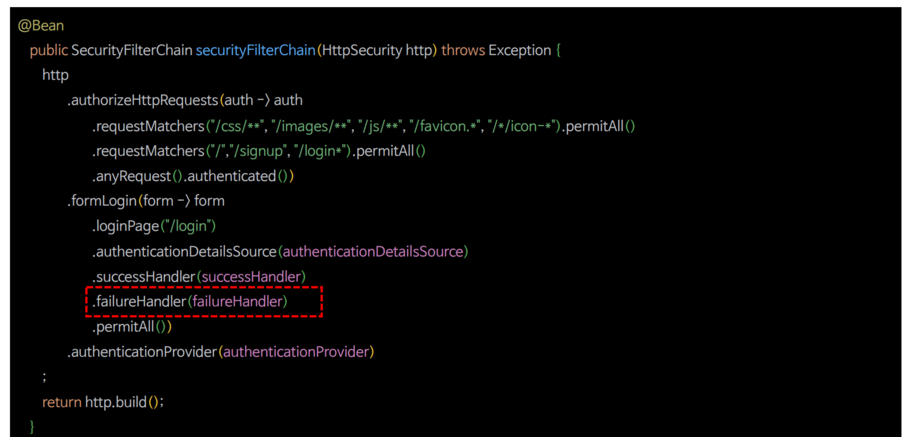

# ***FormAuthenticationFailureHandler***

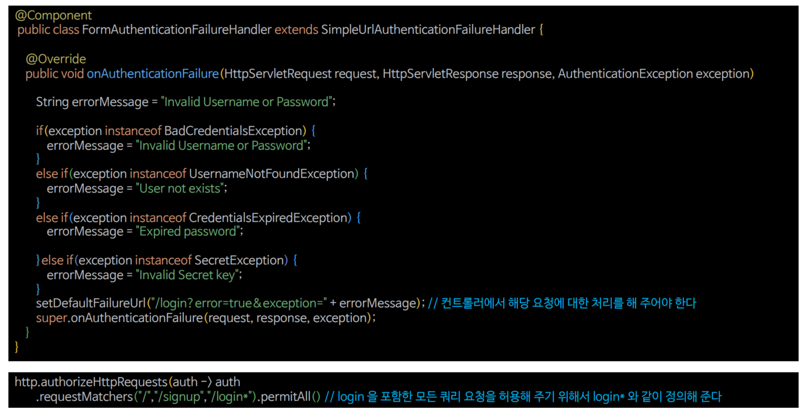

# ***구현***

***SecurityConfig***

```java
@EnableWebSecurity
@Configuration
@RequiredArgsConstructor
public class SecurityConfig {
    private final AuthenticationProvider authenticationProvider;
    private final AuthenticationDetailsSource authenticationDetailsSource;
    private final AuthenticationSuccessHandler successHandler;
    private final AuthenticationFailureHandler failureHandler;
    @Bean
    public SecurityFilterChain securityFilterChain(HttpSecurity http) throws Exception{
        http
                .authorizeHttpRequests(authorize -> authorize
                        .requestMatchers("/css/**", "/images/**",
                                "/js/**", "/favicon.*", "/*/icon/-*").permitAll()
                        .requestMatchers("/", "/signup").permitAll()
                        .anyRequest().authenticated())
                .authenticationProvider(authenticationProvider)
                .formLogin(form -> form
                        .loginPage("/login")
                        .authenticationDetailsSource(authenticationDetailsSource)
                        .successHandler(successHandler)
                        .failureHandler(failureHandler)
                        .permitAll());
        return http.build();
    }
}
```

***FormAuthenticationFailureHandler***

```java
@Component
public class FormAuthenticationFailureHandler extends SimpleUrlAuthenticationFailureHandler {
    @Override
    public void onAuthenticationFailure(HttpServletRequest request, HttpServletResponse response, AuthenticationException exception) throws IOException, ServletException {
        String errorMessage = "Invalid Username or Password";
        if(exception instanceof BadCredentialsException) {
            errorMessage = "Invalid Username or Password";
        }
        else if(exception instanceof UsernameNotFoundException) {
            errorMessage = "User not exists";
        }
        else if(exception instanceof CredentialsExpiredException) {
            errorMessage = "Expired password";
        }
        else if(exception instanceof SecretException) {
            errorMessage = "Invalid Secret key";
        }
        setDefaultFailureUrl("/login?error=true&exception=" + errorMessage);
        super.onAuthenticationFailure(request, response, exception);
    }
}
```

  - *현재 onAuthenticationFailure 메소드는 thread safe 하지 않다.* 
  - *`String errorMessage`**는 스레드의 지역 변수여서 thread safe 하지만 문제는*  *`setDefaultFailureUrl("/login?error=true&exception=" + errorMessage)`**에서 발생한다.* 
*부모 클래스의 String defaultFailureUrl 필드에 set 하기 때문에 thread not safe 하다..*
  - ***강의니까 그냥 빠르게 진행.. ㅎㅎ***

***LoginController***

```java
@GetMapping(value="/login")
public String login(@RequestParam(value = "error", required = false) String error,
                    @RequestParam(value = "exception", required = false) String exception, Model model){
    System.out.println("error = " + error);
    System.out.println("exception = " + exception);
    model.addAttribute("error", error);
    model.addAttribute("exception", exception);
    return "/login/login";
}
```

  - *login view에서 ux를 위해 로그인 에러 정보를 model 통해서 넘겨준다.*  

***login.html 일부*** 

```java
<div th:if="${param.error}" class="form-group">
    <span th:text="${exception}?: '잘못된 아이디나 암호입니다'" class="alert alert-danger"></span>
</div>
```

- AuthenticationFailureHandler

# ***AccessDeniedHandler 설정***

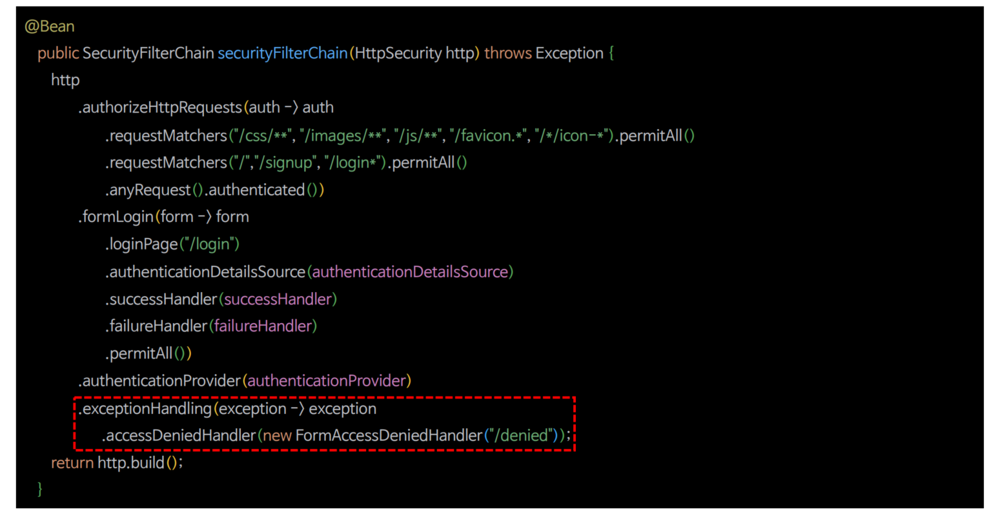

# ***FormAccessDeniedHandler***

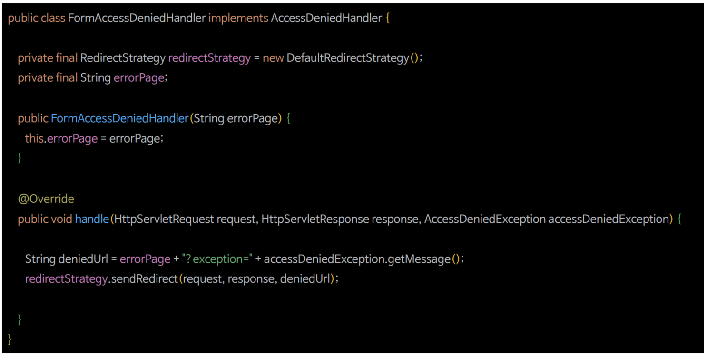

# *구현*

***SecurityConfig***

```java
@EnableWebSecurity
@Configuration
@RequiredArgsConstructor
public class SecurityConfig {
    private final AuthenticationProvider authenticationProvider;
    private final AuthenticationDetailsSource authenticationDetailsSource;
    private final AuthenticationSuccessHandler successHandler;
    private final AuthenticationFailureHandler failureHandler;
    @Bean
    public SecurityFilterChain securityFilterChain(HttpSecurity http) throws Exception{
        http
                .authorizeHttpRequests(authorize -> authorize
                        .requestMatchers("/css/**", "/images/**",
                                "/js/**", "/favicon.*", "/*/icon/-*").permitAll()
                        .requestMatchers("/", "/signup", "/login*").permitAll()
                        .requestMatchers("/user").hasRole("USER")
                        .requestMatchers("/admin").hasRole("ADMIN")
                        .requestMatchers("/manager").hasRole("MANAGER")
                        .anyRequest().authenticated())
                .authenticationProvider(authenticationProvider)
                .formLogin(form -> form
                        .loginPage("/login")
                        .authenticationDetailsSource(authenticationDetailsSource)
                        .successHandler(successHandler)
                        .failureHandler(failureHandler)
                        .permitAll())
                .exceptionHandling(ex -> ex.accessDeniedHandler(
                        new FormAccessDeniedHandler("/denied")));
        return http.build();
    }
}
```

***FormAccessDeniedHandler***

```java
public class FormAccessDeniedHandler implements AccessDeniedHandler {
    private final RedirectStrategy redirectStrategy = new DefaultRedirectStrategy();
    private final String errorPage;
    public FormAccessDeniedHandler(String errorPage) {
        this.errorPage = errorPage;
    }
    @Override
    public void handle(HttpServletRequest request, HttpServletResponse response, AccessDeniedException accessDeniedException) throws IOException, ServletException {
        String deniedUrl = errorPage + "?exception=" + accessDeniedException.getMessage();
        redirectStrategy.sendRedirect(request, response, deniedUrl);
    }
}
```

***LoginController***

```java
@GetMapping(value="/denied")
public String accessDenied(@RequestParam(value = "exception", required = false) String exception,
                           @AuthenticationPrincipal AccountDto accountDto, Model model) {
    model.addAttribute("username", accountDto.getUsername());
    model.addAttribute("exception", exception);
    return "login/denied";
}
```

  - `@AuthenticationPrincipal AccountDto accountDto` 
- *Authentication 내부의 Principal을 가져온다.*

***denied.html 일부***

```html
<div>
  <h3 th:text="${exception}"></h3>
  <br />
  <span th:text="${username} != null ? ${username} + ' 님은 접근 권한이 없습니다' : '비 정상적인 접근입니다'"></span>
</div>
```

- AccessDeniedHandler

