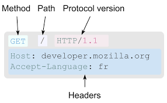
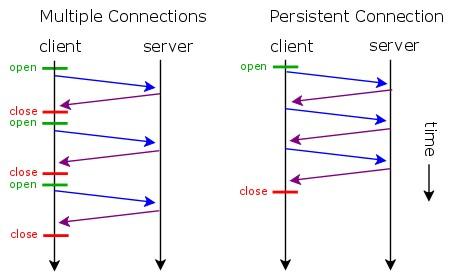
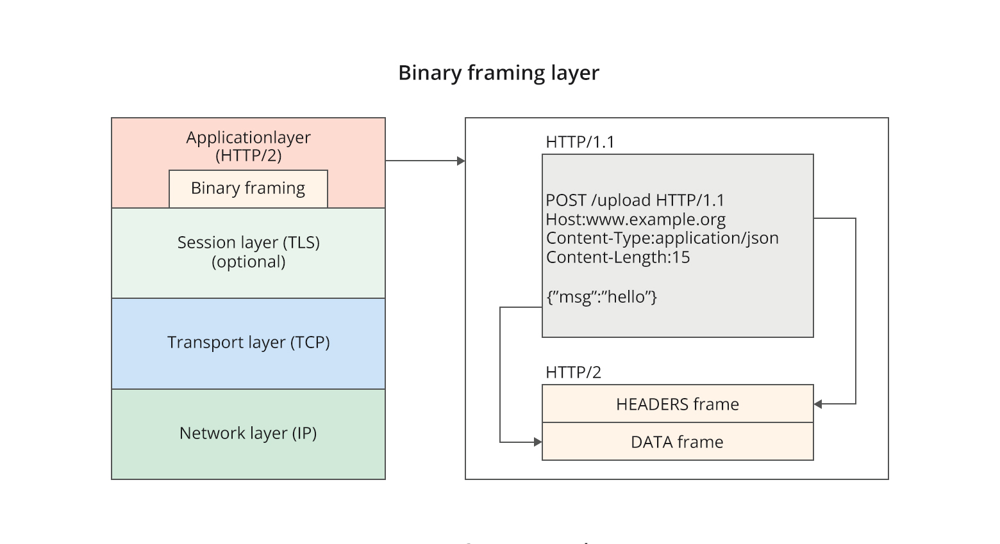
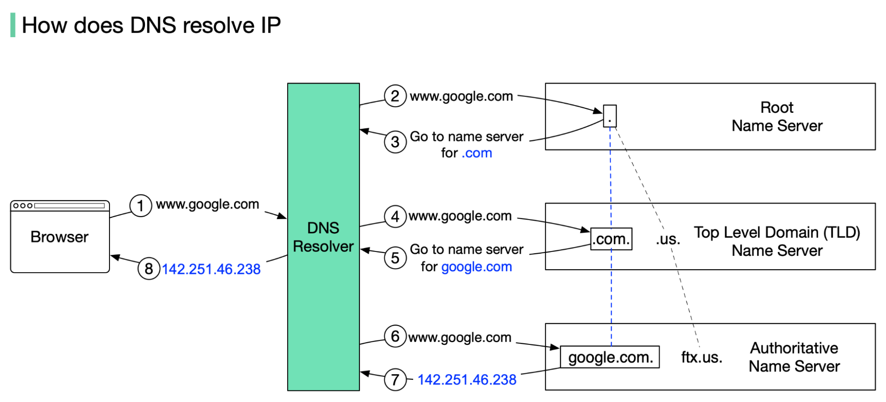
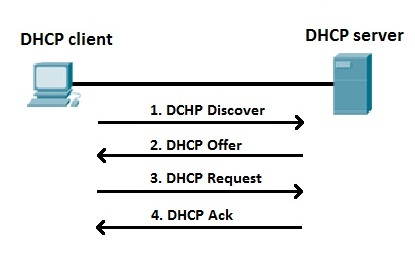
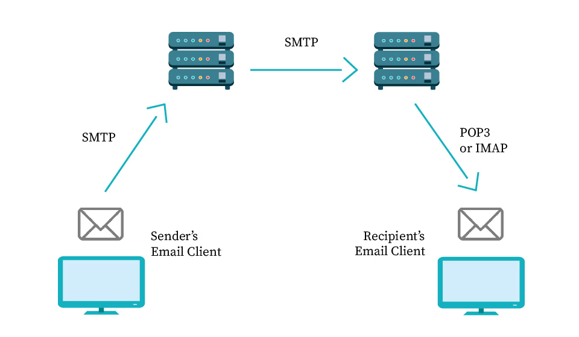
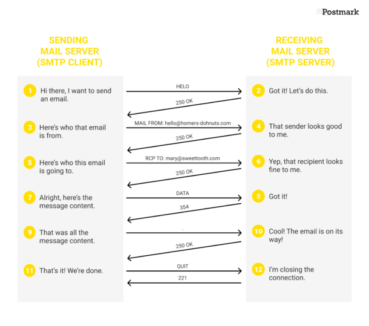

응용 계층은 애플리케이션에서 데이터를 교환하는 역할을 한다.

프로토콜을 이용한 애플리케이션 통신 방법에 대해 알아본다.

**키워드**

- 응용 계층
- HTTP
- DNS
- DHCP
- SMTP/POP3

목표 

- 응용 계층의 역할 이해
- 웹 서버의 구조 이해
- DNS, DHCP 구조 이해
- 이메일의 송수신 구조 이해

---

## 내용정리

서비스를 요청하는 측을 클라이언트(Client), 서비스를 제공하는 측은 서버(Server)라고 한다.

응용 계층은 사용자가 사용하는 애플리케이션(응용 프로그램)이 동작하는 곳이다.

클라이언트에서 서버로 데이터를 보내기 위해서는 프로토콜을 사용한다.

애플리케이션마다 사용해야 하는 포트 번호가 다르고 프로토콜도 따로 있다.

| 프로토콜 | 내용 | 포트 번호 |
| --- | --- | --- |
| HTTP | 웹 사이트 접속  | 80 |
| DNS | 이름 해석 | 53 |
| FTP | 파일 전송 | 20(데이터 전송)<br>21(명령과 응답 제어) |
| SMTP | 이메일 송신 | 25 |
| POP3 | 이메일 수신 | 110 |

---

사용자가 웹 브라우저에 www.google.com을 입력하면 원하는 페이지가 나온다. 사용자는 단순히 URL을 입력하면 되지만 내부적으로는 많은 처리가 이루어진다. 사용자가 URL을 입력하는 행위를 요청(request)이라고 하며, 서버는 사용자의 요청에 응답(response)을 한다.

요청과 응답을 위해 HTTP 프로토콜을 사용하는데, **HTTP(HyperText Transfer Protocol)는 클라이언트와 서버가 어떻게 데이터를 교환할지 정해놓은 규칙으로, 80번 포트를 사용한다.**

HTTP는 문자 형태로 데이터가 전송되기 때문에 필요한 부분을 파싱(parsing) 해주어야 하므로 다음과 같은 구조를 사용한다.

**HTTP 구조** 


**그림과 같이 HTTP 구조는 Status Line(시작 라인), Headers(헤더), Empty Line(공백 1줄), Body(바디)로 구성된다.** 

**HTTP Status Line & Headers**



시작 라인은 HTTP 메서드, 경로, HTTP 버전으로 이루어져 있다.

HTTP 메서드는 데이터를 수신하는 서버에서 어떤 작업을 해야 하는지 알려주는 용도로 사용된다.

  - **GET: 데이터 획득**
  - **POST: 데이터 추가, 생성**
  - **PUT: 서버의 데이터 갱신**
  - **PATCH: PUT과 유사하게 요청된 데이터를 수정(update)할 때 사용하지만, PUT은 데이터 전체를 갱신하고 PATCH는 일부만 갱신한다.**
  - **DELETE: 데이터 삭제**

HTTP 버전은 1.0, 1.1, 2.0 순서로 진화했다. HTTP 프로토콜에는 자체적으로 정의한 헤더가 있어서 HTTP 버전 정보, 상태 정보 등 여러 정보를 서버로 보낼 수 있게 되었다. 하지만 매 요청마다 연결을 수립하는 과정을 반복하다 보니 이것을 처리하는 서버의 성능이 저하되는 문제점이 있었다.

그래서 등장한 것이 HTTP 1.1이며 현재 가장 많이 사용하는 버전?이다.

**HTTP 1.1부터는 Keep-Alive 기능이 추가되어 연결이 한 번 수립되면 데이터 교환을 마칠 때까지 연결을 유지하고 데이터 교환이 끝나면 연결을 끊는 구조이다.**

**HTTP 1.0 vs HTTP 1.1의 연결 방식**

| **버전** | **연결 방식 설명** |
| --- | --- |
| HTTP 1.0 | 매 요청마다 새로운 TCP 연결을 맺고, 응답 후 연결을 끊음. |
| HTTP 1.1 | **Keep-Alive** 기능이 기본 적용. 한 번 연결을 맺으면 여러 요청/응답에 재사용. |

HTTP 1.1의 Keep-Alive 덕분에, 매번 3-way handshake를 반복하지 않아도 되어 서버와 네트워크의 부하가 크게 줄었다.



  - open: 연결 수립 → 3-way handshake
  - close: 연결 종료

**HTTP 2.0부터는 응용 계층에 바이너리 프레임(Binary Frame)을 추가하여 기존의 일반 텍스트 데이터를 바이너리로 변환한 후 데이터를 분할하여 보낸다.** 이렇게 하면 전송 속도가 빨라지고 오류 발생 가능성도 낮아진다.



여기까지가 클라이언트에서 서버로 HTTP 요청을 할 때 전달하는 정보였다.

서버에서도 응답을 해야 하는데, 응답에 대한 시작 라인은 간단하다.

HTTP 버전, 응답 메시지로 구성된다.

응답 메시지의 상태코드는 아래와 같다.

| 1xx | 정보 | 요청을 받았으며 처리가 되고 있음을 나타낸다. |
| --- | --- | --- |
| 2xx | 성공 | 요청이 성공했음을 나타낸다.  |
| 3xx | 리다이렉션 | 클라이언트가 요청한 컨텐츠가 다른 곳에 있다는 의미이다.  |
| 4xx | 클라이언트 오류 | 클라이언트가 잘못된 요청을 했음을 의미한다. |
| 5xx | 서버 오류 | 서버측 오류로 인해 요청이 실패했음을 의미한다. |

헤더에는 클라이언트와 서버가 통신하기 위한 다음과 같은 부가적인 정보가 포함된다.

  - 호스트(Host): 서버의 도메인 이름과 포트 번호
  - 연결(Connection): 현재의 작업이 끝난 후에도 네트워크를 연결 상태로 둘지 여부를 제어
  - 언어(Language): 서버가 응답에 사용할 언어

---

사람이 웹 브라우저에 www.google.com과 같은 도메인 이름을 입력하면, 실제로는 네트워크에서 통신을 위해 IP 주소와 MAC 주소가 사용된다. **사람이 숫자로 된 IP 주소를 일일이 기억하거나 입력하기 어렵기 때문에, 도메인 이름(Domain Name)을 사용한다.**

**맥북 구글 IP 주소 확인하기**

```bash
traceroute www.google.com
```

**도메인 주소를 IP 주소로 변경해주는 것이 DNS(Domain Name System)서버이다.**

  1. 사용자는 www.google.com을 웹 브라우저에 입력
  1. 사용자의 요청은 DNS 서버로 전달된다. DNS 서버는 www.google.com에 해당하는 IP 주소인 142.250.206.228을 전달한다.
  1. 사용자는 142.250.206.228 IP 주소를 이용하여 웹 사이트에 접속한다.
  1. 웹 서버는 사용자의 요청에 응답한다.

그런데 이때 DNS 서버가 www.google.com의 IP 주소를 모를 수도 있다. 이럴 때는 또 다른 DNS 서버에 질의해서 IP 주소를 전달받는다.

DNS 서버는 게층적으로 구성되어 있다. 즉, 단계별로 질의를 하는데, 루트에서 시작해서 .com에 대한 2단계 질의가 이루어지고 마지막으로 최종 www.google.com에 대한 IP 주소를 얻게 되는 3단계 질의를 하게 된다.

1단계 질의는 루트가 되고, 2단계 질의를 통해 요청하려는 웹사이트가 .com인지 .net인지 확인하고, 마지막 3단계에서 요청하고자 하는 IP 주소를 질의한다.



---

일반적으로 인터넷을 사용하거나 WAN 환경에서 다른 컴퓨터와 통신하기 위해서는 IP 주소가 필요하다

그리고 IP는 명시적으로 내 컴퓨터에 할당되어 있어야 한다.

하지만 관리자가 모든 컴퓨터를 찾아다니면서 일일이 IP 주소를 입력해주는 것은 매우 비효율적이다. 또한 IP 주소는 반납되어야 하는데, 이것 역시 관리하기 어렵다.

그래서 자동으로 IP 주소 설정 및 네트워크 설정 정보(서브넷 마스크, DNS 서버 주소)제공을 하는 DHCP 서버가 등장했다. **DHCP(Dynamic Host Configuration Protocol)서버는 사용자들에게 IP 주소를 할당하거나 회수하는 것을 자동으로 해주는 서버이다.**



DHCP 서버가 IP를 할당해주는 방식은 다음과 같다.

  1. **먼저 사용자 컴퓨터는 DHCP 서버를 찾는다.**
  1. **DHCP 서버는 사용자에게 IP 주소 할당 여부를 묻는다.**
  1. **사용자가 IP 주소가 필요하다고 요청을 한다.**
  1. **DHCP 서버는 IP 주소를 할당해준다.**

**IP 임대 시간은 DHCP 서버 측에서 결정한다.**

이메일을 주고받을 때 사용하는 프로토콜은 **SMTP(Simple Mail Transfer Protocol)**, POP3이다.

**송신자가 사용하는 프로토콜은 SMTP, 수신자가 이메일을 받을 때 사용하는 프로토콜은 POP3 프로토콜이다.**



### 1. 송신자와 메일 서버 간의 통신

사용자가 메일 서버에 이메일을 보내는 과정

  1. 사용자 컴퓨터는 메일 서버에 25번 포트(SMTP 프로토콜)로 통신을 하겠다고 알린다. 그럼 메일 서버는 OK 신호와 함께 자신의 이름을 알려준다.
  1. 통신을 위한 준비가 끝나면 내가 누구인지 알려준다. 이름을 알리면 메일 서버는 역시 OK로 응답한다.
  1. 내 이메일 주소를 메일 서버에 알려주면, 메일 서버는 OK로 응답한다.
  1. 이번에는 상대방에 대한 이메일 주소를 알려주고 OK를 응답으로 받는다.
  1. 메일 서버에 이메일 본문을 전달하면, 메일 서버는 OK로 응답한다.
  1. 마지막으로 연결을 종료하겠다고 메일 서버에 전달하면 메일 서버는 연결을 종료한다.



### 2. 메일 서버 간의 통신

메일 서버 간에 이메일을 주고받는 과정 역시 SMTP 프로토콜을 사용한다.

단지 그 과정이 조금 다를 뿐이다.

  1. 송신자 측 메일 서버는 해당 이메일을 수신자 측 메일 서버에 전달한다. 이때 25번 포트를 사용하고 SMTP 프로토콜을 사용한다. 이것으로 송신자 측 메일 서버의 역할은 끝난다.
  1. 이후 수신자 측 메일 서버는 사용자 A가 보낸 이메일을 사용자 B의 편지함에 저장한다.

### 3. 메일 서버와 수신자 간의 통신

  1. 이메일 수신자는 110번 포트, POP3 프로토콜로 메일 서버에 연결을 시도한다.
  1. 연결이 수립되면 사용자가 누구인지 밝힌다.
  1. 내 편지함에서 이메일을 확인하기 위한 패스워드를 알려준다. 즉, 인증된 사용자인지 확인하는 과정이다.
  1. 수신자는 메일 서버에 이메일이 있다는 것을 확인할 수 있다.
  1. 이후 해당 이메일을 컴퓨터로 내려받는다.
  1. 이메일을 내려받았으면 메일 서버와의 연결을 종료한다.

**POP3는 편지함에서 이메일을 가져오면 서버에서 이메일이 삭제된다. 삭제되는 것을 원하지 않을 때는 IMAP(Internet Access Message Protocol)을 사용하면 된다.**

| **구분** | **IMAP (Internet Message Access Protocol)** | **POP3 (Post Office Protocol 3)** |
| --- | --- | --- |
| **저장 위치** | 이메일이 서버에 저장됨 | 이메일이 클라이언트(PC, 폰 등)로 다운로드됨 |
| **동기화** | 서버와 클라이언트 간 양방향 동기화 | 다운로드 후 서버에서 삭제(기본값, 설정 변경 가능) |
| **접근성** | 여러 기기에서 동일한 메일함 동기화 및 관리 가능 | 한 기기에서만 이메일 확인 및 관리가 일반적 |
| **폴더 관리** | 서버에서 폴더 생성·삭제·이동 등 가능 | 폴더 관리 불가, 모든 메일이 받은편지함에 저장 |
| **오프라인** | 인터넷 필요(읽기 전까지 전체 다운로드 안 됨) | 한 번 다운로드하면 오프라인에서도 읽기 가능 |
| **용도** | 여러 기기에서 이메일을 자주 확인할 때 적합 | 한 기기에서만 이메일 관리할 때 적합 |

---

응용 계층에서의 로드 밸런서는 전송 계층의 로드 밸런서 기능까지 포함하고 있다. 

따라서 IP 주소나 포트 외에도 URI(Uniform Resource Indentifier), HTTP 헤더, 쿠키 등의 내용을 기준으로 부하를 분산시켜주는 것이 응용 계층의 로드 밸런서이다.

전송 계층의 로드 밸런서가 IP나 포트 번호를 기준으로 분산시키는 것만 가능했다면 응용 계층의 로드 밸런서는 서비스별로 부하를 분산시켜주는 것이 가능하다.

---

---

## 복습하기

1. SMTP, POP3/IMAP
1. 요청, 응답
1. GET, POST, PUT, PATCH, DELETE
1. 1.0, 1.1, 2.0 
1. 리다이렉션
1. 로드 밸런서
1. 삭제

**GET:** HTTP 메서드는 메시지 중 서버로부터 데이터를 취득할 때 사용

**파싱:** 어떤 페이지(문서, HTML)에서 내가 원하는 데이터를 특정 패턴이나 순서로 추출하여 정보를 가공

**Keep-Alive:** 연결이 한번 수립되면 데이터 교환을 마칠 때까지 유지하고, 데이터 교환이 끝나면 연결을 끊는 구조

- HTTP 1.1 버전 등장
- 3-way handshake 반복 문제 해결

**DNS(Domain Name System) 서버:** 도메인 주소를 IP 주소로 변경해주는 서버 

- 계층형: 1단계 질의 .root → 2단계 질의 .net/.com → 3단계 질의 www.google.com

**DHCP(Dynamic Host Configuration Protocol):** DHCP 서버는 사용자들에게 IP 주소를 자동으로 할당하거나 회수하는 것을 해주는 서버이다. from ISP

**HTTP(Hyper Text Transfer Protocol):** 클라이언트와 서버가 어떻게 데이터를 교환할지 정해 놓은 규칙으로 80번 포트를 사용

---

