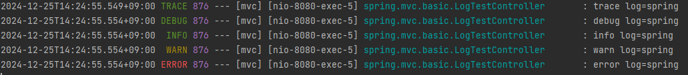
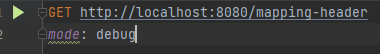
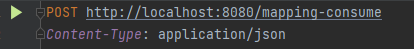
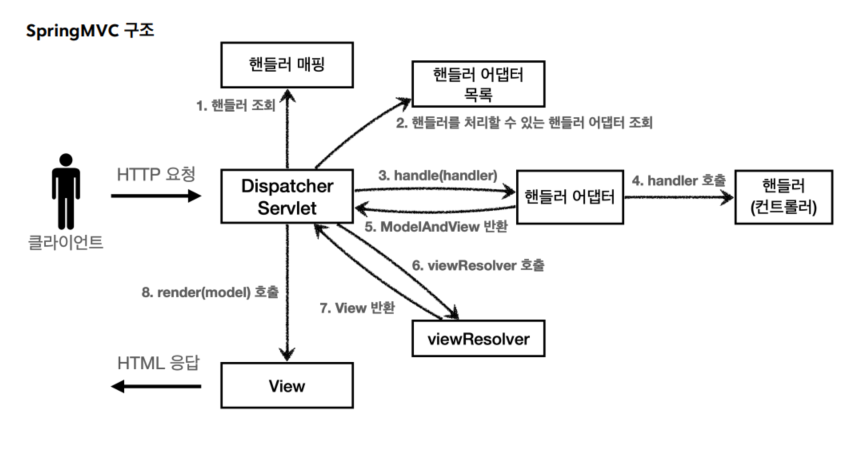
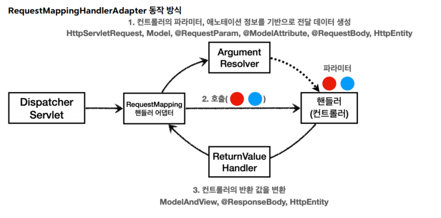
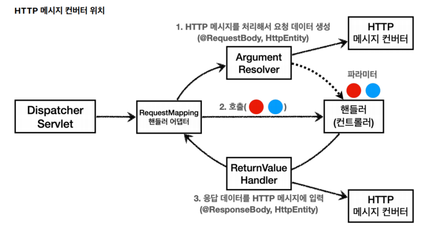

### Welcome Page

- *환경: SpringBoot + 배포 방식(Jar)*
- */resources/static/index.html → 자동으로 Welcome 페이지* 

# ***로깅***

***개요***

- *스프링 부트 라이브러리를 사용하면 스프링 부트 로깅 라이브러리가 함께 포함된다.*
- *spring-boot-starter-logging*

***스프링 부트 로깅 라이브러리*** 

- *SLF4J, Logback*
- *실무에서는 Logback 대부분 사용* 

***로그 라이브러리*** 

- *Logback, Log4J, Log4J2 등등 많은 라이브러리 존재* 
- *많은 로깅 라이브러리를 통합해서 인터페이스(SLF4J)로 제공* 

***로그 생성 방법 2가지***

```java
public class LogTestController {
		 private final Logger log = LoggerFactory.getLogger(getClass());
		 // 생략 ..
}

@Slf4j
public class LogTestController {
	   // 생략 ..
}  
```

1. *LoggerFactory.getLogger(Class<?> clazz)* 
1. *@Slf4j* 

***로그 레벨*** 

- *LEVEL: TRACE > DEBUG > INFO > WARN > ERROR*

```java
@GetMapping("/log-test")
public String logTest(){
    String name = "spring";
    log.trace("trace log={}", name);
    log.debug("debug log={}", name);
    log.info("info log={}", name);
    log.warn("warn log={}", name);
    log.error("error log={}", name);
    return "ok";
}
```



- ***출력 포멧:*** *시간, 로그 레벨, 프로세스 ID, 스레드 명, 클래스명, 로그 메시지* 

***로그 레벨 설정 예시 - application.properties***

```java
logging.level.root=info

logging.level.spring.mvc=trace
```

- *logging.level.root=info → 전체 로그 레벨 설정 default: info level*
- *logging.level.spring.mvc=trace → spring.mvc 패키지 및 하위 패키지 로그 레벨 trace 설정* 

***로그 사용시 장점***

- *쓰레드 정보, 클래스 이름 같은 부가 정보를 함께 볼 수 있고, 출력 모양을 조정할 수 있다*
- *상황에 맞게 로그 레벨이 조정 가능하다.* 
- *콘솔에만 출력하는 것이 아닌, 파일이나 네트워크 등 별도의 위치에 남길 수 있다.* 
- *성능도 일반 System.out 보다 좋다*

# ***요청 매핑***

### *@RequestMapping*

***스프링 부트 3.0 이후***

- *매핑: /hello-basic  → URL 요청: /hello-basic*
- *매핑: /hello-basic/ → URL 요청: /hello-basic/*

***HTTP 메서드 매핑***

```java
@RequestMapping(value = "/mapping-get-v1", method = RequestMethod.GET)
public String mappingGetV1() {
		 return "ok";
}
```

 

***HTTP 405 상태코드(Method Not Allowed)를 반환***

- *매핑된 HTTP 메소드가 아닌 HTTP 요청을 하면 405 반환* 

***HTTP 메서드 매핑 축약***

- *@GetMapping*
- *@PostMapping*
- *@PutMapping*
- *@DeleteMapping*
- *@PatchMapping*

### ***PathVariable - 경로 변수*** 

***data ≠ userId***

```java
@GetMapping("/mapping/{userId}")
public String mappingPath(@PathVariable("userId") String data) {
		 return "ok";
}
```

- *@PathVariable 이름: userId와 파라미터 data가 달라서 생략이 불가능하다* 

***생략 버전*** 

```java
@GetMapping("/mapping/{userId}")
public String mappingPath(@PathVariable("userId") String userId) {
		 return "ok";
}
```

***PathVariable 사용 - 다중***

```java
@GetMapping("/mapping/users/{userId}/orders/{orderId}")
public String mappingPath(@PathVariable String userId, @PathVariable Long orderId) {
		 return "ok";
}
```

### ***특정 파라미터 조건 매핑*** 

```java
@GetMapping(value = "/mapping-param", params = "mode=debug")
public String mappingParam() {
     log.info("mappingParam");
     return "ok";
}
```

- *GET http://localhost:8080/mapping-param?mode=debug → 200 status*
- *GET http://localhost:8080/mapping-param?mode=debugs → 400 status Bad Request*
- *UnsatisfiedServletRequestParameterException: Parameter conditions "mode=debug" not met for actual request parameters: mode={debugs}*

### ***특정 헤더 조건 매핑*** 

```java
@GetMapping(value = "/mapping-header", headers = "mode=debug")
public String mappingHeader(){
    return "ok";
}
```

- *요청 파라미터와 똑같은 메커니즘이다.* 

***인텔리제이 HTTP Client 테스트*** 



- *200 status return body → ok*


- *404 status NOT FOUND*
- *Header 값 자체가 없다.* 

### ***미디어 타입 조건 매핑 - HTTP 요청 Content-Type, consume***

```java
@PostMapping(value = "/mapping-consume", consumes = "application/json")
public String mappingConsumes() {
	  return "ok";
}
```

- *여러가지 표현식이 적용 가능하다.* 
- `consumes="application/*"` 
  - `consumes="!application/json"`



- 200 status

***MediaType 상수 사용하기*** 

```java
@PostMapping(value = "/test", consumes = MediaType.APPLICATION_JSON_VALUE)
public String jsonConsumes(){
	  return "ok";
}
```

***Unsupported Media Type***

- *HTTP 요청의 Content-Type 헤더를 기반으로 미디어 타입으로 매핑*
- *맞지 않으면 HTTP 415 상태코드(Unsupported Media Type)을 반환*

### ***미디어 타입 조건 매핑 - HTTP 요청 Accept, produce***


***HTTP 요청에서 Accept 헤더는 클라이언트가 서버에 요청할 때 원하는 응답 데이터의 타입(Media Type)을 지정하는 데 사용***


```java
@PostMapping(value = "/mapping-produce", produces = "text/html")
public String mappingProduces() {
    return "ok";
}
```

- *HTTP 요청의 Accept 헤더를 기반으로 미디어 타입으로 매핑*

***Not Acceptable***

- *클라이언트가 원하는 응답 데이터 타입에 맞는 매핑이 없으면 HTTP 406 상태코드(Not Acceptable)을 반환한다.*

# ***HTTP 요청 - 기본, 헤더 조회***

### ***헤더 조회***

```java
@RequestMapping("/headers")
public String headers(HttpServletRequest request,
                      HttpServletResponse response,
                      HttpMethod httpMethod,
                      Locale locale,
                      @RequestHeader MultiValueMap<String , String> headerMap,
                      @RequestHeader("host") String host,
                      @CookieValue(value = "myCookie", required = false) String cookie){

    log.info("request={}", request);
    log.info("response={}", response);
    log.info("httpMethod={}", httpMethod);
    log.info("locale={}", locale);
    log.info("headerMap={}", headerMap);
    log.info("header host={}", host);
    log.info("myCookie={}", cookie);

    return "ok";
}
```

- *HttpMethod : HTTP 메서드를 조회*
- *Locale*
- ***Accept-Language****: ko-KR, en-US;q=0.8, ja;q=0.6*
  - *ko-KR이 가장 우선순위가 높다.* 
  - *Locale → ko-KR*
- *@RequestHeader MultiValueMap<String, String> headerMap*
- *모든 HTTP 헤더를* ***MultiValueMap*** *형식으로 조회*
- *@RequestHeader("host") String host*
- *특정 HTTP 헤더를 조회*
  - *속성*
- *필수 값 여부: required*
    - *기본 값 속성: defaultValue*
- *@CookieValue(value = "myCookie", required = false) String cookie*
- *특정 쿠키를 조회*
  - *속성은 @RequestHeader와 동일*

# ***HTTP 요청 파라미터 - 쿼리 파라미터, HTML Form***

### ***요청 파라미터 조회*** 

```java
@Controller
public class RequestParamController {
    @RequestMapping("/request-param-v1")
    public void requestParamV1(HttpServletRequest request, HttpServletResponse response) throws IOException{
        String username = request.getParameter("username");
        int age = Integer.parseInt(request.getParameter("age"));
        log.info("username = {}, age= {}", username, age);
        response.getWriter().write("ok");
    }
```

- *@Controller & 반환타입 void → VIEW 조회를 하지 않는다.* 
- *HttpServletRequest  직접 가져오기* 

### ***HTTP 요청 파라미터 - @RequestParam***

```java
@RequestMapping("/request-param-v2")
public String requestParamV2(
		 @RequestParam("username") String username,
		 @RequestParam("age") int memberAge) {
		 
		 log.info("username={}, age={}", username, memberAge);
		 return "ok";
}
```

- *@RequestParam : 파라미터 이름으로 바인딩*
-  *@RequestParam("username") String username →  @RequestParam String username*
- *HTTP 파라미터 이름이 변수 이름과 같으면 생략 가능*
- *String, Integer, int 같은 단순 값 타입이면 @RequestParam도 생략 가능하다.* 
- *생략하면 스프링 MVC는 내부에서 required=false를 적용*
  - *나는 과하다고 생각한다. → @RequestParam 까지는 있어야 한다고 생각*

### ***파라미터를 Map으로 조회하기 - requestParamMap***

```java
@ResponseBody
@RequestMapping("/request-param-map")
public String requestParamMap(@RequestParam Map<String, Object> paramMap){
        log.info("username = {}, age = {}", paramMap.get("username"), paramMap.get("age"));
        return "ok";
}
```

- *파라미터를 Map, MultiValueMap으로 조회할 수 있다*

# ***HTTP 요청 파라미터 - @ModelAttribute***

***요청 파라미터를 바인딩 받을 객체***

```java
@Data
public class HelloData {
    private String username;
    private int age;
}
```

***@Data***

- ***@Getter*** 
- ***@Setter*** 
- ***@ToString*** 
- ***@EqualsAndHashCode*** 
- ***@RequiredArgsConstructor***

```java
@ResponseBody
@RequestMapping("/model-attribute-v1")
public String modelAttributeV1(@ModelAttribute HelloData helloData){
    log.info("hello data = {}", helloData);
    log.info("username = {}, age = {}", helloData.getUsername(), helloData.getAge());
    return "ok";
}
```

- *@ModelAttribute 또한 생략이 가능하다.*

***스프링MVC는 @ModelAttribute 동작 방식*** 

1. *HelloData 객체를 생성*
1. *요청 파라미터의 이름으로 HelloData 객체의 프로퍼티를 찾는다*
1. *해당 프로퍼티의 setter를 호출해서 파라미터의 값을 입력(바인딩) 한다*

# ***HTTP 요청 메시지 - 단순 텍스트***

- *요청 파라미터와 다르게, HTTP 메시지 바디를 통해 데이터가 직접 넘어오는 경우는 @RequestParam ,@ModelAttribute를 사용할 수 없다.*
-  *HTML Form 형식으로 전달되는 경우는 요청 파라미터로 인정*

### *HttpServletRequest, HttpServletResponse*

```java
@PostMapping("/request-body-string-v1")
public void requestBodyString(HttpServletRequest request, HttpServletResponse response) throws IOException{
    ServletInputStream inputStream = request.getInputStream();
    String message = StreamUtils.copyToString(inputStream, StandardCharsets.UTF_8);
    response.getWriter().write("ok");
}
```

1. *HttpServletRequest: getInputStream() → ServeletInputStream*
1. *StreamUtils.copyToString(inputStream, StandardCharsets.UTF_8) → String*
- *인코딩된 바이트 코드를 UTF-8로 디코딩 작업*

### ***InputStream, Writer***

```java
@PostMapping("/request-body-string-v2")
public void requestBodyStringV2(InputStream inputStream, Writer responseWriter) throws IOException{
    String message = StreamUtils.copyToString(inputStream, StandardCharsets.UTF_8);
    responseWriter.write("ok");
}
```

- *InputStream(Reader): HTTP 요청 메시지 바디의 내용을 직접 조회*
- *OutputStream(Writer): HTTP 응답 메시지의 바디에 직접 결과 출력*

### ***HttpEntity - (RequestEntity, ResponseEntity)***

```java
`@PostMapping("/request-body-string-v3")
  public HttpEntity<String> requestBodyStringV3(HttpEntity<String> httpEntity) throws IOException{
      String message = httpEntity.getBody();
      log.info("message = {}", message);
      return new HttpEntity<>("ok");
  }
```

- *HttpEntity는 요청 파라미터로 받을 수 있고 응답으로도 사용이 가능하다.*
- *클라이언트 요청 메시지 바디를 getBody()를 통해 가져올 수 있다.* 

***RequestEntity***

- *HttpEntity를 상속받은 클래스*
- *HttpMethod, url 정보가 추가, 요청에서 사용*

***ResponseEntity***

- *HttpEntity를 상속받은 클래스*
- *HTTP 상태 코드 설정 가능, 응답에서 사용*

### *@RequestBody, @ResponseBody*

```java
@ResponseBody
@PostMapping("/request-body-string-v4")
public String requestBodyStringV4(@RequestBody String message){
    log.info("message = {}", message);
    return "ok";
}
```

***@RequestBody***

- HTTP 메시지 바디 정보를 편리하게 조회할 수 있다. 
- 요청 헤더 정보가 필요하면 HttpEntity, RequestEntity, @RequestHeader를 사용하자

***@ResponseBody***

- *@ResponseBody를 사용하면 응답 결과를 HTTP 메시지 바디에 직접 담아서 전달할 수 있다*

***요청 파라미터 vs HTTP 메시지 바디***

- *요청 파라미터를 조회하는 기능: @RequestParam , @ModelAttribute*
- *HTTP 메시지 바디를 직접 조회하는 기능: @RequestBody*

# ***HTTP 요청 메시지 - JSON***

### ***ObjectMapper***

```java
private ObjectMapper objectMapper = new ObjectMapper();
```

- *스프링 부트 기본 제공 ObjectMapper (Jackson 라이브러리)*

### ***HttpServletRequest, HttpServletResponse***

```java
@PostMapping("/request-body-json-v1")
public void requestBodyJsonV1(HttpServletRequest request, HttpServletResponse response) throws IOException{
    ServletInputStream inputStream = request.getInputStream();
    String messageBody = StreamUtils.copyToString(inputStream, StandardCharsets.UTF_8);

    log.info("messageBody = {}", messageBody);

    HelloData helloData = objectMapper.readValue(messageBody, HelloData.class);
    log.info("username = {}, age = {}", helloData.getUsername(), helloData.getAge());

    response.getWriter().write("ok");
}
```

### ***@RequestBody - String & ObjectMapper***

```java
@ResponseBody
@PostMapping("/request-body-json-v2")
public String requestBodyJsonV2(@RequestBody String messageBody) throws IOException{
    log.info("messageBody = {}", messageBody);
    HelloData helloData = objectMapper.readValue(messageBody, HelloData.class);
    log.info("username = {}, age = {}", helloData.getUsername(), helloData.getAge());
    return "ok";
}
```

### ***@RequestBody - Object***

```java
@ResponseBody
@PostMapping("/request-body-json-v3")
public String requestBodyJsonV3(@RequestBody HelloData helloData){
    log.info("username = {}, age = {}", helloData.getUsername(), helloData.getAge());
    return "ok";
}
```

- *@RequestBody 생략이 불가능하다. 생략하면 자동으로 @ModeAttribute가 적용*

###  ***HttpEntity***

```java
@PostMapping("/request-body-json-v4")
public HttpEntity<String> requestBodyJsonV4(HttpEntity<HelloData> httpEntity){
    HelloData helloData = httpEntity.getBody();
    log.info("username = {}, age = {}", helloData.getUsername(), helloData.getAge());
    return new HttpEntity<>("ok");
}
```

### ***@ResponseBody***

```java
@ResponseBody
@PostMapping("/request-body-json-v5")
public HelloData requestBodyJsonV5(@RequestBody HelloData helloData){
    log.info("username = {}, age = {}", helloData.getUsername(), helloData.getAge());
    return helloData;
}
```

### ***주의***

*HTTP 요청시에 content-type 헤더가 application/json인지 꼭 확인해야 한다.* 

*→ 그래야 JSON을 처리할 수 있는 HTTP 메시지 컨버터가 실행된다.*

# ***HTTP 응답 - 정적 리소스, 뷰 템플릿***

### ***리소스 경로***

*src/main/resources 는 리소스를 보관하는 곳이고, 또 클래스패스의 시작 경로*

***정적 리소스 경로***

*src/main/resources/static*

***뷰 템플릿 경로***

*src/main/resources/templates*

### ***Thymeleaf 스프링 부트 설정***

***build.gradle***

```java
`implementation 'org.springframework.boot:spring-boot-starter-thymeleaf`
```

- *스프링 부트가 자동으로 ThymeleafViewResolver와 필요한 스프링 빈들을 등록한다.* 

***application.properties***

```java
spring.thymeleaf.prefix=classpath:/templates/
spring.thymeleaf.suffix=.html
```

- *default 설정이다.*

# *⭐HTTP 메시지 컨버터* 

### ***@ResponseBody 사용***

- *HTTP의 BODY에 문자 내용을 직접 반환*
- *viewResolver 대신에 HttpMessageConverter가 동작*
- *기본 문자처리: StringHttpMessageConverter*
- *기본 객체처리: MappingJackson2HttpMessageConverter*
- *byte 처리 등등 기타 여러 HttpMessageConverter가 기본으로 등록되어 있음*

*클라이언트의 HTTP Accept 헤더와 서버의 컨트롤러 반환 타입 정보 둘을 조합해서* 

*HttpMessageConverter가 선택된다.*

### ***HttpMessageConverter - interface***

```java
public interface HttpMessageConverter<T> {
		boolean canRead(Class<?> clazz, @Nullable MediaType mediaType);
		
		boolean canWrite(Class<?> clazz, @Nullable MediaType mediaType);
		
		List<MediaType> getSupportedMediaTypes();
		
		T read(Class<? extends T> clazz, HttpInputMessage inputMessage) throws IOException, HttpMessageNotReadableException;
		
		void write(T t, @Nullable MediaType contentType, HttpOutputMessage outputMessage) throws IOException, HttpMessageNotWritableException;
}
```

***HTTP 메시지 컨버터는 HTTP 요청, HTTP 응답 둘 다 사용된다.***

- *canRead() , canWrite() : 메시지 컨버터가 해당 클래스, 미디어타입을 지원하는지 체크*
- *read() , write() : 메시지 컨버터를 통해서 메시지를 읽고 쓰는 기능*

***스프링 부트 기본 메시지 컨버터***

```java
0 = ByteArrayHttpMessageConverter
1 = StringHttpMessageConverter 
2 = MappingJackson2HttpMessageConverter
```

### ***ByteArrayHttpMessageConverter***

- *byte[] 데이터를 처리*
- *요청 예) @RequestBody byte[] data*
- *응답 예) @ResponseBody return byte[] / 쓰기 / 미디어타입* ***application/octet-stream***

### ***StringHttpMessageConverter***

- *String 문자로 데이터를 처리*
- *클래스 타입: String*
- *요청 예) @RequestBody String data*
- *응답 예) @ResponseBody return "ok" 쓰기  /미디어타입* ***text/plain***

### ***MappingJackson2HttpMessageConverter***

- *클래스 타입: 객체 또는 HashMap , 미디어타입* ***application/json 관련***
- *요청 예) @RequestBody HelloData data*
- *응답 예) @ResponseBody return helloData 쓰기 / 미디어타입* ***application/json 관련***

# ***요청 매핑 헨들러 어뎁터 구조***





### ***ArgumentResolver***

*애노테이션 기반의 컨트롤러는 매우 다양한 파라미터를 사용할 수 있다.*

*이렇게 파라미터를 유연하게 처리할 수 있는 이유가 바로 ArgumentResolver 덕분이다.*

*애노테이션 기반 컨트롤러를 처리하는* ***RequestMappingHandlerAdapter****는 ArgumentResolver를 호출해서 컨트롤러(핸들러)가 필요로 하는 다양한 파라미터의 값(객체)을 생성한다.*

*그리고 파리미터의 값이 모두 준비되면 컨트롤러를 호출하면서 값을 넘겨준다.*

*스프링은 30개가 넘는 ArgumentResolver를 기본으로 제공한다*

*정확히는 HandlerMethodArgumentResolver인데 줄여서 ArgumentResolver라고 부른다.*

### ***HandlerMethodArgumentResolver - interface***

```java
public interface HandlerMethodArgumentResolver {
		boolean supportsParameter(MethodParameter parameter);
		
		@Nullable
		Object resolveArgument(MethodParameter parameter, @Nullable ModelAndViewContainer mavContainer,
			      NativeWebRequest webRequest, @Nullable WebDataBinderFactory binderFactory) throws Exception;
}
```

***동작 설명***

*ArgumentResolver의 supportParameter()를 호출해서 해당 파라미터를 지원하는지 체크하고, 지원하면 resolveArgument()를 호출해서 실제 객체를 생성한다. 생성된 객체는 핸들러 어뎁터가 컨트롤러 호출시 넘어간다.*

***ReturnValueHandler***

***HandlerMethodReturnValueHandler****를 줄여서 ReturnValueHandler 라 부른다*

*ArgumentResolver 와 비슷한데, 이것은 응답 값을 변환하고 처리한다.*

# ***HTTP 메시지 컨버터***



***요청을 예시***

1. *@RequestBody가 필요한 컨트롤러에 요청이 온다.*
1. *해당 파라미터 처리가 가능한 ArgumentResolver는 요청 파라미터 객체 생성을 위해 HTTP 메시지 컨버터를 사용한다.*
1. *메시지 컨버터가 객체를 생성해서 반환한다.*
1. *HandlerAdapter는 필요한 파라미터 객체가 모두 생성되면 핸들러를 호출한다.*

# ***확장***

*스프링은 다음을 모두 인터페이스로 제공한다. 따라서 필요하면 언제든지 기능을 확장할 수 있다*

- *HandlerMethodArgumentResolver*
- *HandlerMethodReturnValueHandler*
- *HttpMessageConverter*

***WebMvcConfigurer 확장***

```java
@Bean
public WebMvcConfigurer webMvcConfigurer() {
		 return new WebMvcConfigurer() {
					 @Override
					 public void addArgumentResolvers(List<HandlerMethodArgumentResolver> resolvers) {
							 //...
					 }
					 @Override
					 public void extendMessageConverters(List<HttpMessageConverter<?>> converters) {
					 //...
					 }
		 };
}
```

