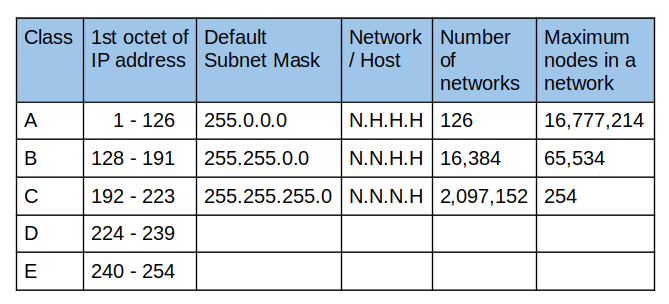

### IP 주소의 구조

IP 주소는 아래와 같은 형태이다.

→ 192.168.2.124

IP 주소에는 많은 정보가 포함되어 있다. IP 주소에는 다음과 같이 네트워크 ID와 호스트 ID로 구분할 수 있다.

호스트 ID는 라우터에 연결된 개별 컴퓨터들을 관리하기 위해 사용된다. 즉, 호스트 ID는 개발 컴퓨터들이 사용하는 것이고, 네트워크 ID는 컴퓨터가 많을 경우 관리의 어려움이 있기 때문에 네트워크의 범위를 지정해 관리를 쉽게 하기 위해 사용한다.

**192.168.2.****124**

- 파란색: 네트워크 ID
- 주황색: 호스트 ID

예를 들어 네트워크 A에 포함된 컴퓨터 A, 컴퓨터 B, 컴퓨터 C의 IP 주소가 다음과 같다.

- 컴퓨터 A: 192.168.1.2
- 컴퓨터 A: 192.168.1.3
- 컴퓨터 C: 192.168.1.4

이때 컴퓨터 A의 네트워크 ID와 호스트 ID는 아래와 같다.

컴퓨터 A: **192.168.1****.2**

- 파란색: 네트워크 ID
- 주황색: 호스트 ID

---

### IP 주소의 클래스

공인 IP 주소에는 A부터 E까지 5개의 클래스가 있다. 하지만 D, E는 일반인을 위한 것이 아니기 때문에 A, B, C 클래스만 유효하다.

A 클래스는 하나의 네트워크가 가질 수 있는 호스트 ID가 가장 많은 클래스이다. A 클래스에 속한 컴퓨터에 할당해줄 수 있는 IP의 개수는 16,777,214개이다. (2^24 - 2(브로드 캐스트, 네트워크 주소))

첫 8비트는 네트워크 ID를 의미하고 나머지 24비트는 호스트 ID를 의미한다.

B 클래스는 처음 16비트가 네트워크 ID, 나머지 16비트는 호스트 ID

C 클래스는 마지막 8비트만 호스트 ID, 나머지 24비트는 네트워크 ID이다.

**전 세계의 IP 주소를 관리하는 기관은 IANA(Internet Assigned Numbers Authority)**이다.

우리나라의 경우 **KISA(Korea Internet & Security Agency, 한국인터넷진흥원)**에서 IANA으로부터 IP 대역을 할당받아온다. 이후 KISA는 IP 주소를 인터넷 서비스 제공업체(ISP, ex: KT, SKT)에게 다시 할당해주면 인터넷 서비스 제공업체가 개인이나 학교/기업에 다시 할당해주는 구조이다.

IANS → KISA → ISP(SKT, LG U+, KT) → 개인/학교/회사

---

