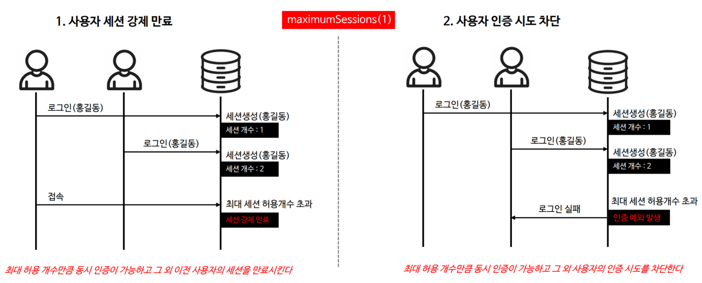
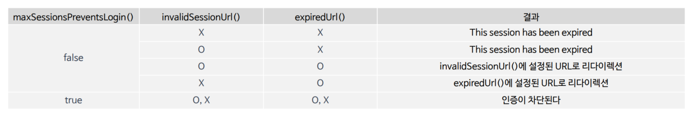
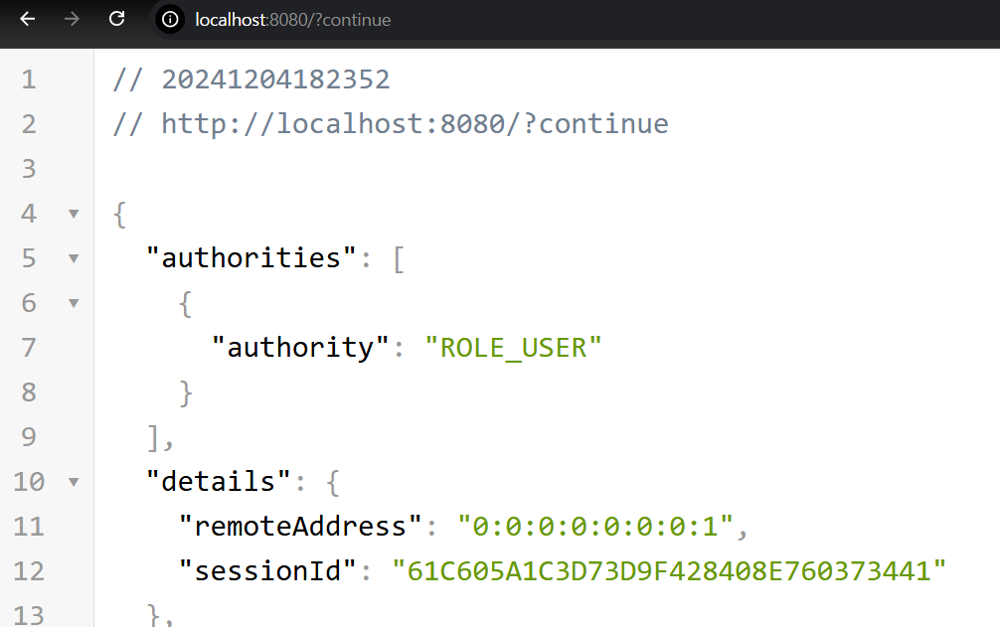
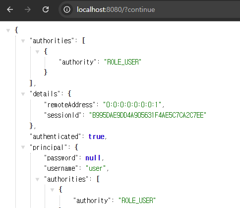
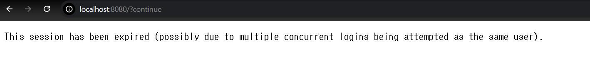
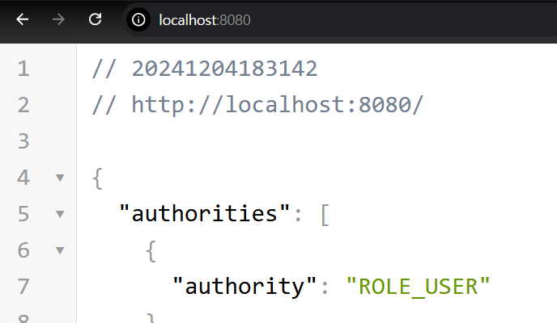
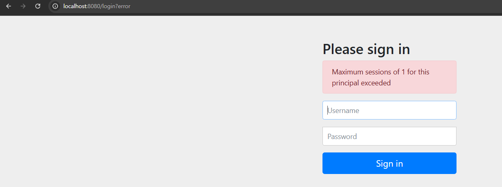
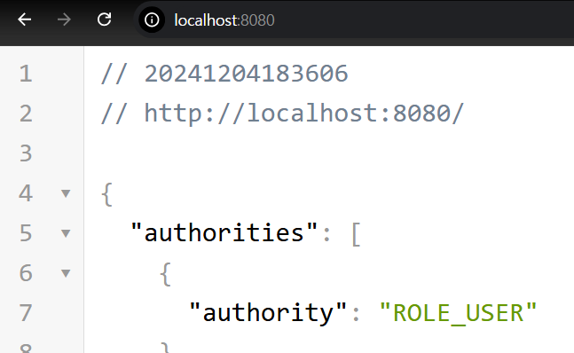
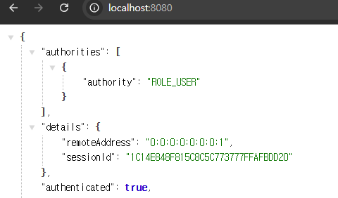
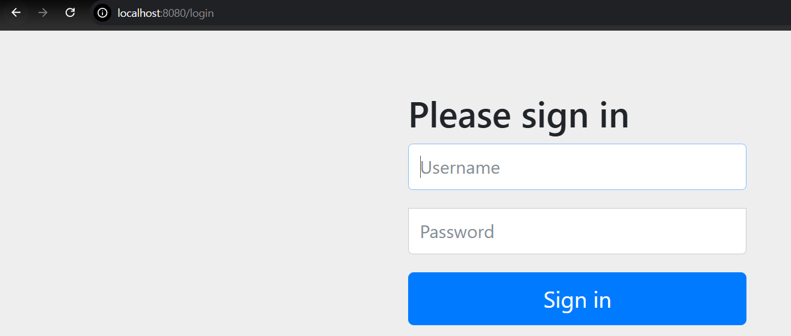

# **개요** 

- 동시 세션 제어는 사용자가 동시에 여러 세션을 생성하는 것을 관리하는 전략이다 
- 이 전략은 사용자의 인증 후에 활성화된 세션의 수가 설정된 `maximumSessions` 값과 비교하여 제어 여부를 결정한다 

# **동시 세션 제어 2 가지 유형**



# **sessionManagement() API ­ 동시 세션 제어**

```java
@Bean
public SecurityFilterChain securityFilterChain(HttpSecurity http) throws Exception {
	 http.sessionManagement(session -> session
				   .invalidSessionUrl("/invalidSessionUrl") 
					 .maximumSessions(1) 
					 .maxSessionsPreventsLogin(true) 
					 .expiredUrl("/expired") 
	 );
	 return http.build();
}
```

- **invalidSessionUrl(String url)**
- 이미 만료된 세션으로 요청을 하는 사용자를 특정 엔드포인트로 리다이렉션 할 Url을 지정한다
- **maximumSessions(int sessionCount)**
- 사용자당 최대 세션 수를 제어한다 
  - default: 무제한 세션을 허용
- **maxSessionPreventsLogin(boolean)**
- `true`: 최대 세션 수(maximumSessions(int))에 도달했을 때 사용자의 인증을 차단한다
  - `false(default)`: 인증하는 사용자에게 접근을 허용하고 기존 사용자의 세션은 만료된다
- **expiredUrl(String url)**
- 세션을 만료하고 나서 리다이렉션 할 Url을 지정한다

# **세션 만료 후 리다이렉션 전략**



`invalidSessionUrl`, `expiredUrl` API는 인증을 차단하는 전략과 관계가 없다. 

그래서 `maxSessionPreventsLogin(true)` 설정이면 항상 결과는 인증 차단이다 

만약 내가 인증 만료 방식을 사용하고 설정한다고 하면 `expiredUrl()`만 설정해서 

`expiredUrl()` 에 설정한 엔드 포인트로 리다이렉션 하도록 해야겠다 

# **테스트1**

**maxSession = 1, 인증 만료 전략** 

```java
@EnableWebSecurity
@Configuration
@Slf4j
public class SecurityConfig {
    @Bean
    public SecurityFilterChain securityFilterChain(HttpSecurity http, AuthenticationConfiguration configuration) throws Exception{
        http
                .authorizeHttpRequests(auth -> auth
                        .anyRequest().authenticated());
        http
                .formLogin(Customizer.withDefaults());

        http
                .sessionManagement(session -> session
                        .maximumSessions(1)
                        .maxSessionsPreventsLogin(false)
                );

        return  http.build();
    }
    @Bean
    public UserDetailsService userDetailsService(){
        UserDetails user = User
                .withUsername("user")
                .password("{noop}1111")
                .roles("USER")
                .build();
        return new InMemoryUserDetailsManager(user);
    }
}

@Slf4j
@RestController
@RequiredArgsConstructor
public class IndexController {
    @GetMapping("/")
    public  Authentication index(){
        Authentication authentication = SecurityContextHolder.getContextHolderStrategy().getContext().getAuthentication();
        log.info("authentication={}", authentication);
        return authentication;
    }
}
```

**사용자1**



현재 1개의 세션이 생성

**사용자2**



세션 최대 허용 개수는 1을 초과하는 상태 

**사용자1**



→ 처음 세션을 만들었던 크롬창을 새로고침 하니까 나오는 결과 

**사용자2**

크롬창을 새로고침해도 인증이 유지되어 있다 

# **테스트2**

**maxSession = 1, 인증 차단 전략** 

**Security Config 수정** 

```java
http
          .sessionManagement(session -> session
                  .maximumSessions(1)
                  .maxSessionsPreventsLogin(true)
          );
```

**사용자1**



**사용자2**



로그인 시도를 했지만 인증 차단 전략이기 때문에 로그인에 실패한다 

# **테스트3**

**maxSession = 1, 인증 만료 전략, 인증이 만료되면 로그인 페이지로 리다이렉트**

```java
@EnableWebSecurity
@Configuration
@Slf4j
public class SecurityConfig {
    @Bean
    public SecurityFilterChain securityFilterChain(HttpSecurity http, AuthenticationConfiguration configuration) throws Exception{
        http
                .authorizeHttpRequests(auth -> auth
                        .anyRequest().authenticated());
        http
                .formLogin(Customizer.withDefaults());

        http
                .sessionManagement(session -> session
                        .maximumSessions(1)
                        .maxSessionsPreventsLogin(false)
                        .expiredUrl("/login")
                );

        return  http.build();
    }
    @Bean
    public UserDetailsService userDetailsService(){
        UserDetails user = User
                .withUsername("user")
                .password("{noop}1111")
                .roles("USER")
                .build();
        return new InMemoryUserDetailsManager(user);
    }
}
```

**사용자1**



**사용자2**



세션 허용 개수 초과 → 사용자1: 세션 만료 

**사용자1**



새로고침 하니까 `expiredUrl("/login")` 경로로 리다이렉트 된다 

만약 실제 서비스에서 세션 만료 전략을 사용한다면 “다른 사용자가 계정에 접속했습니다” 같은 메시지를 만료된 사용자에게 보여줘야 할듯 싶다

