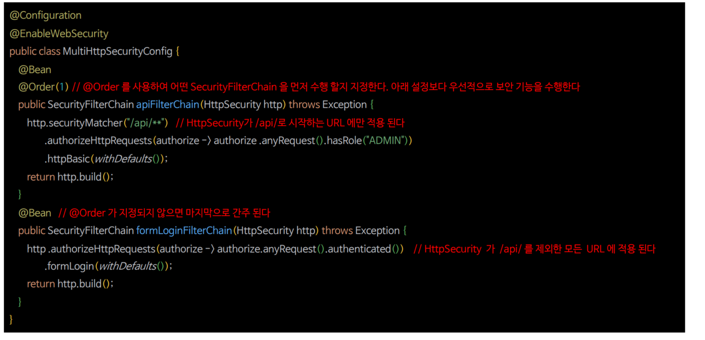
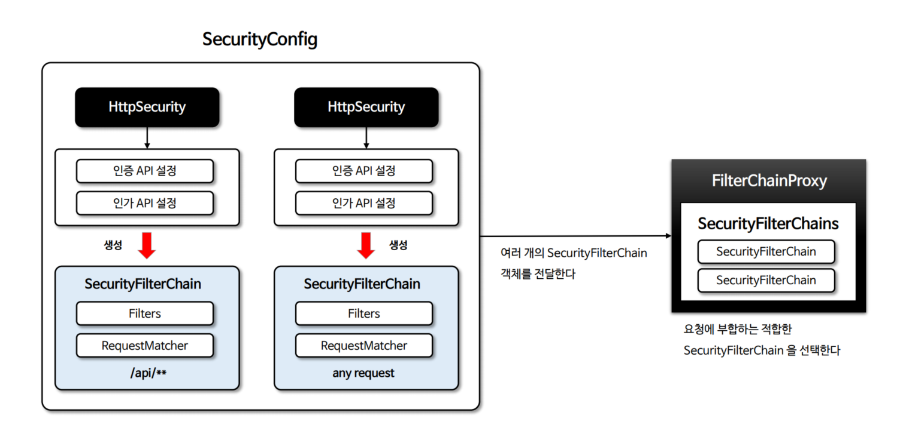
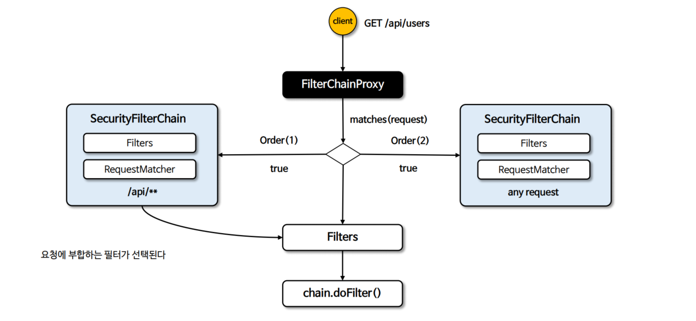
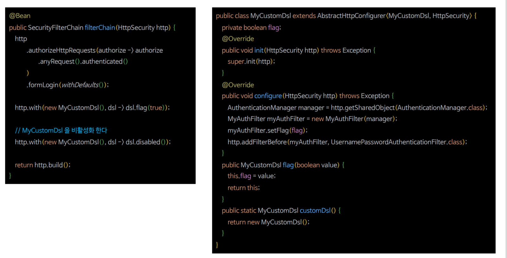
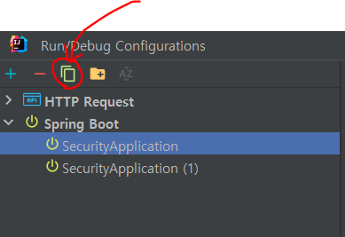
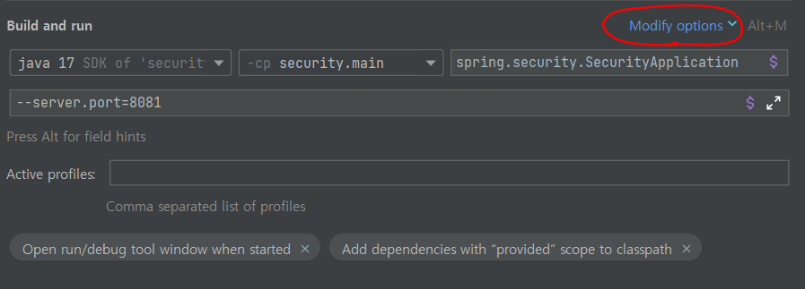

# ***개요***

  - *Spring Security는 여러 SecurityFilterChain @Bean을 등록해서 다중 보안 기능을 구성 할 수 있다*



  - *@Order → FilterChainProxy 내부에 SecurityFilterChains 우선순위를 정한다.*
  - *@Order 숫자가 낮을수록 우선순위가 높다.*
  - *@Order가 지정되지 않으면 우선순위가 가장 낮다.*

# ***다중 보안 설정 초기화 구성***



# ***다중 보안 설정 요청 흐름도***



  - *요청에 따라 RequestMatcher와 매칭되는 필터가 작동된다*
  - *매칭 순위는 @Order를 통해서 정한다.*
  - *HttpSecurity 인스턴스 별로 보안 기능이 작동 한다*
- *HttpSecurity.build() → SecurityFilterChain*

```java
@EnableWebSecurity
@Configuration
public class SecurityConfig {
    @Bean
    public WebSecurityCustomizer webSecurityCustomizer() {
        return webSecurity -> webSecurity.ignoring().requestMatchers(PathRequest.toStaticResources().atCommonLocations());
    }
    @Bean
    @Order(2)
    public SecurityFilterChain securityFilterChain2(HttpSecurity http) throws Exception {
        http
                .authorizeHttpRequests(authorize -> authorize
                        .anyRequest().authenticated())
                .formLogin(Customizer.withDefaults());
        return http.build();
    }
    @Bean
    @Order(1)
    public SecurityFilterChain securityFilterChain1(HttpSecurity http) throws Exception {
        http
                .securityMatcher("/api/**")
                .authorizeHttpRequests(authorize -> authorize
                        .anyRequest().permitAll());

        return http.build();
    }
    @Bean
    public UserDetailsService userDetailsService(){
        UserDetails user = User.withUsername("user").password("{noop}1111").roles("USER").build();
        UserDetails db = User.withUsername("db").password("{noop}1111").authorities("ROLE_DB").build();
        UserDetails admin = User.withUsername("admin").password("{noop}1111").roles("ADMIN","SECURE").build();
        return  new InMemoryUserDetailsManager(user, db, admin);
    }
}
```

  - *WebSecurityCustomizer까지 총 3개의 SecurityFilterChain이 등록된다.*
  - *해당 설정은 정적 자원에 대한 접근 허용이다.*

***SecurityBuilder & Configurer***

  - *Spring Security 초기화 작업에 사용*
  - ***SecurityBuilder 인터페이스 구현체 WebSecurity, HttpSecurity***
- ***WebSecurity → FilterChainProxy***
    - ***HttpSecurity → SecurityFilterChain***
  - ***Configurer***
- ***인증, 인가 프로세스에서 사용하는 필터들을 생성 목적***

# ***개요***

  - *Spring Security는 사용자 정의 DSL을 구현할 수 있도록 지원한다*
  - *DSL을 구성하면 필터, 핸들러, 메서드, 속성 등을 한 곳에 정의하여 처리할 수 있는 편리함을 제공한다*

***What is DSLs?***

  - *API 단위로 어떤 특정한 기능을 만들어 놓고 개발 시 아주 간단하고 편리하게 각 API로 접근할 수 있도록 만든 체계*

# **AbstractHttpConfigurer<AbstractHttpConfigurer, HttpSecurityBuilder>**

*사용자 DSL 을 구현하기 위해서 상속받는 추상 클래스로서 구현 클래스는 두 개의 메서드를 오버라이딩 한다*

  - *init(B builder) ­ HttpSecurity 의 구성요소를 설정 및 공유하는 작업* 
  - *configure(B builder) ­ 공통클래스를 구성 하거나 사용자 정의 필터를 생성하는 작업* 

# ***API***

*HttpSecurity.with(C configurer, Customizer<C> customizer)*

  - *configurer는 AbstractHttpConfigurer을 상속하고 DSL을 구현한 클래스가 들어간다*
  - *customizer는 DSL 구현 클래스에서 정의한 여러 API를 커스트 마이징한다*
  - *동일한 클래스를 여러 번 설정하더라도 한번 만 적용 된다*

# ***코드 구현***



# ***코드*** 

***MyCustomFilter***

```java
@Slf4j
public class MyCustomFilter extends OncePerRequestFilter {
    private boolean flag;
    @Override
    protected void doFilterInternal(HttpServletRequest request, HttpServletResponse response, FilterChain filterChain) throws ServletException, IOException {
        if(flag){
            try {
                String username = request.getParameter("username");
                String password = [REDACTED];
                request.login(username, password);
            }
            catch (Exception e){
                log.info(e.getMessage());
            }
        }
        filterChain.doFilter(request, response);
    }
    public void setFlag(boolean flag){
        this.flag = flag;
    }
}
```

  - 인증 처리를 하는 필터이다.
  - 서블릿에서도 서블릿 API의 보안 메소드를 사용할 수 있도록 ***SecurityContextHolderAwareRequestFilter****에서는* ***HttpServletRequest*** *래퍼 클래스****SecurityContextHolderAwareRequestWrapper를 적용한다.*** 
  - 그래서 *현재* ***MyCustomFilter*** *서블릿 API를 통해 인증 처리를 하기 때문에* ***SecurityContextHolderAwareRequestFilter*** *이후에 있어야 한다.*
- [Servlet API 통합](https://app.notion.com/p/26b7d6692ca881d193fdf136f2042e47)
  - *설정에서 해당 필터의 인증 과정을 진행 여부 설정을 setFlag를 통해서 할 수 있다.* 

***MyCustomDsl - extends AbstractHttpConfigurer***

```java
public class MyCustomDsl extends AbstractHttpConfigurer<MyCustomDsl, HttpSecurity> {
    private boolean flag;
    @Override
    public void init(HttpSecurity http) throws Exception {
        super.init(http);
    }
    @Override
    public void configure(HttpSecurity http) throws Exception {
        MyCustomFilter myCustomFilter = new MyCustomFilter();
        myCustomFilter.setFlag(flag);
        http.addFilterAfter(myCustomFilter, SecurityContextHolderAwareRequestFilter.class);
        super.configure(http);
    }
    public boolean setFlag(boolean value){
        return flag = value;
    }
    public static MyCustomDsl customDsl(){
        return new MyCustomDsl();
    }
}
```

  - *SpringSecurity에서는 사용자 정의 설정 인증/인가 설정을 편하게 하도록 하였다.*
  - *개발자는 AbstractHttpConfigurer 클래스를 상속해서 구현체를 만들고 HttpSecurity 객체에 with API를 통해서 추가하면 된다.* 
  - *그럼 SpringSecurity는 초기화 과정에서  AbstractHttpConfigurer 클래스 메소드 init, configurer 통해 초기화를 한다.* 
  - ***MyCustomDsl*** *클래스에서는 configure 메소드에서* ***MyCustomFilter****를 추가하고 있다.*
  - ***MyCustomFilter*** *설명에서 말했듯이* ***MyCustomFilter****는 서블릿 보안 API를 사용하기 때문에* ***HttpServletRequest*** *객체의 래퍼인* ***SecurityContextHolderAwareRequestWrapper*** *객체가 필요하다. 따라서* ***SecurityContextHolderAwareRequestFilter*** *이후에 필터를 추가하고 있다.*

***SecurityConfig*** 

```java
@EnableWebSecurity
@Configuration
public class SecurityConfig {
    @Bean
    public WebSecurityCustomizer webSecurityCustomizer() {
        return webSecurity -> webSecurity.ignoring().requestMatchers(PathRequest.toStaticResources().atCommonLocations());
    }
    @Bean
    public SecurityFilterChain securityFilterChain(HttpSecurity http) throws Exception {
        http
                .authorizeHttpRequests(authorize -> authorize
                        .requestMatchers("/user").hasAuthority("ROLE_USER")
                        .requestMatchers("/db").hasAuthority("ROLE_DB")
                        .requestMatchers("/admin").hasAuthority("ROLE_ADMIN")
                        .anyRequest().authenticated());
    
        http    .with(MyCustomDsl.customDsl(), dsl -> dsl.setFlag(true));

        return http.build();
    }
    @Bean
    public UserDetailsService userDetailsService(){
        UserDetails user = User.withUsername("user").password("{noop}1111").roles("USER").build();
        UserDetails db = User.withUsername("db").password("{noop}1111").authorities("ROLE_DB").build();
        UserDetails admin = User.withUsername("admin").password("{noop}1111").roles("ADMIN","SECURE").build();
        return  new InMemoryUserDetailsManager(user, db, admin);
    }
}
```

  - *사용자 설정 DSL을 HttpSecurity.with API를 통해서 설정한다.* 
  - *MyCustomDsl static method customDsl 통해서 인스턴스를 생성한다.* 
  - *MyCustomDsl은 람다 표현식으로 미리 만들어둔 해당 클래스에 있는 API를 통해 간편하게 설정이 가능하다.* 
  - *MyCustomFilter가 인증 처리를 하도록 flag를 true로 설정하고 있다.*
  - *MyCustomDsl 비활성화* 
- `http.with(MyCustomDsl.`*`customDsl`*`(), AbstractHttpConfigurer::disable);`

# ***개요***

  - *이중화는 시스템의 부하를 분산하고,* ***단일 실패 지점(Single Point of Failure, SPOF)*** *없이 서비스를 지속적으로 제공하는 아키텍처를 구현하는 것을 목표로 하며 스프링 시큐리티는 이러한 이중화 환경에서 인증, 권한 부여, 세션 관리 등의 보안 기능을 제공한다*
  - *스프링 시큐리티는 사용자 세션을 안전하게 관리하며 이중화된 환경에서 세션 정보를 공유할 수 있는 메커니즘을 제공하며 대표적으로 레디스 같은 분산 캐시를 사용하여 세션 정보를 여러 서버 간에 공유할 수 있다*

# *테스트* 

***개요(시나리오)***

*동일한 스프링 애플리케이션을 2개 띄우고 하나의 원격 세션 서버(레디스)를 사용하자* 

*클라이언트는 1번 서버에서 인증 처리를 하고 이후 1번 서버를 강제로 종료하고 똑같은 클라이언트로 2번 서버에 인증이 필요한 경로에 접속해서 인가되는지 테스트해보자*

***build.gradle 추가***

```java
implementation 'org.springframework.session:spring-session-data-redis'
implementation 'org.springframework.boot:spring-boot-starter-data-redis'
```

***application.yaml***

```java
spring:
  data:
    redis:
      host: localhost
      port: 6379
```

***SecurityConfig***

```java
@EnableWebSecurity
@Configuration
public class SecurityConfig {
    @Bean
    public WebSecurityCustomizer webSecurityCustomizer() {
        return (webSecurity) -> {
            webSecurity.ignoring().requestMatchers(PathRequest.toStaticResources().atCommonLocations());
        };
    }
    @Bean
    public SecurityFilterChain securityFilterChain(HttpSecurity http) throws Exception {

        http
                .authorizeHttpRequests(authorize -> authorize
                        .requestMatchers("/user").hasAuthority("ROLE_USER")
                        .requestMatchers("/db").hasAuthority("ROLE_DB")
                        .requestMatchers("/admin").hasAuthority("ROLE_ADMIN")
                        .anyRequest().authenticated())
                .formLogin(Customizer.withDefaults());
        return http.build();
    }
    @Bean
    public UserDetailsService userDetailsService(){
        UserDetails user = User.withUsername("user").password("{noop}1111").roles("USER").build();
        UserDetails db = User.withUsername("db").password("{noop}1111").roles("DB").build();
        UserDetails admin = User.withUsername("admin").password("{noop}1111").roles("ADMIN","SECURE").build();
        return  new InMemoryUserDetailsManager(user, db, admin);
    }
}
```

***RedisConfig***

```java
@Configuration
@EnableRedisHttpSession
public class RedisConfig {
    @Value("${spring.data.redis.host}")
    private String host;
    
    @Value("${spring.data.redis.port}")
    private int port;
    @Bean
    public RedisConnectionFactory redisConnectionFactory(){
        return new LettuceConnectionFactory(host, port);
    }
}
```

***Copy Configuration*** 



  - *각각 port만 다르게 해서 2개 띄우자 (8080 / 8081)*

***port 변경***



  - *modify options → program arguments →* *`--server.port=8081`* *추가* 

***테스트***

  1. *8080 user 로그인*
  1. *8080 서버 종료*
  1. *8081 서버 인증이 필요한 페이지 접근 (이때 8080 서버에서 인증 받은 클라이언트 그대로)*
  1. *8081 서버 접근 성공* 

 *즉, 1개의 서버가 죽어도 각 서버는 해당 원격 서버(레디스)를 통해서 관리하기 때문에* 

*사용자는 재인증 할 필요가 없다.*

