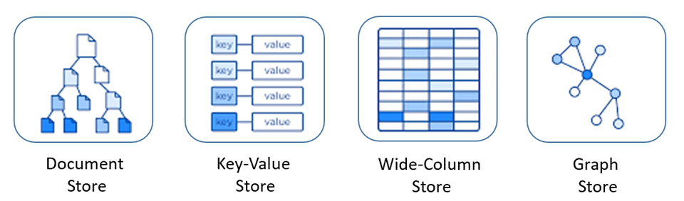
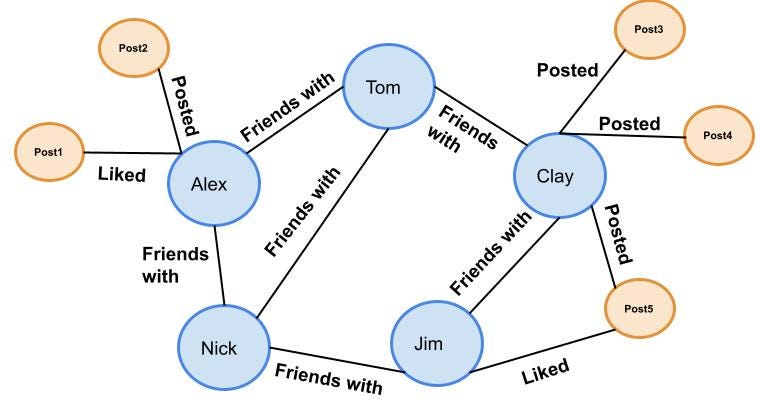
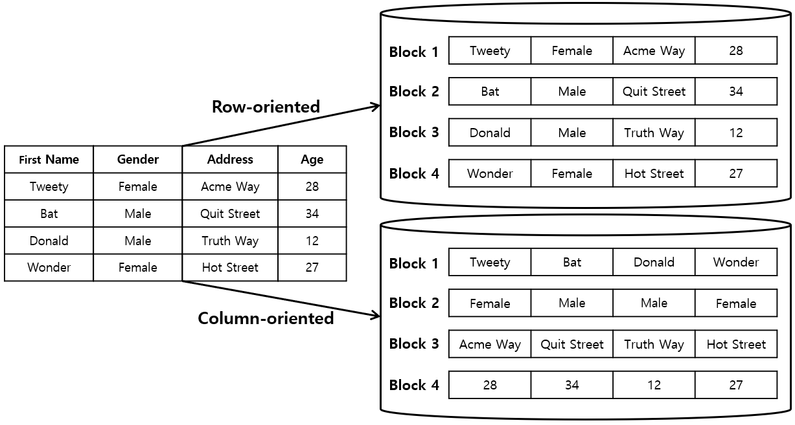
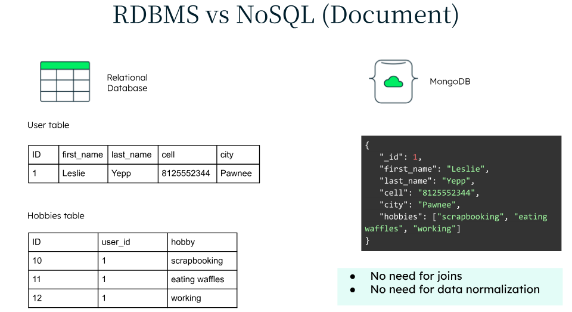
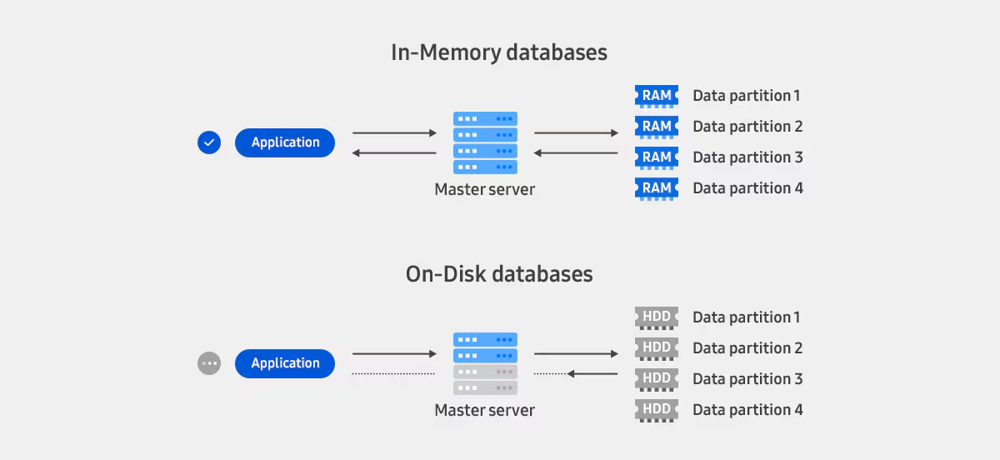
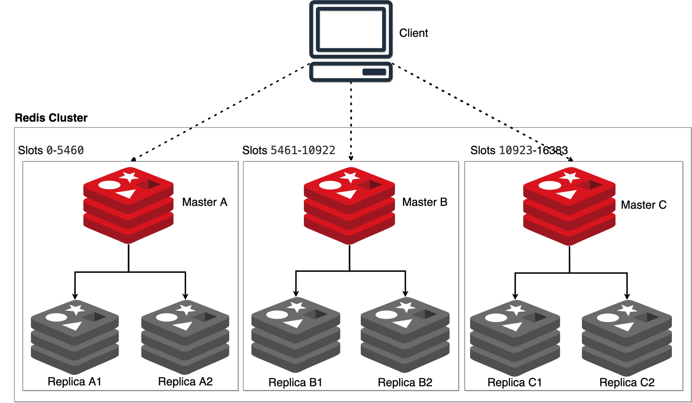

# NoSQL 등장 배경

모놀리틱 서비스에서 애플리케이션 개발을 위해 가장 많이 사용된 데이터베이스는 Oracle, SQL Server, MySQL 등의 RDBMS이다.

관계형 데이터베이스는 고정된 스키마를 갖고 있다. 모든 데이터를 행과 열로 구성된 테이블에 저장하여 각 테이블 간의 관계를 정확하게 규정한다.

이러한 관계는 애플리케이션이 커질수록 매우 복잡해지며 복잡성으로 인해 쿼리의 성능 문제가 발생하며 성능 향상을 위해 쿼리, 인덱스, 테이블 구조를 자추 최적화해야 한다.

최근의 서비스에서는 **비정형 데이터가 증가하고 있다**.

이러한 비정형 데이터는 관계형 데이터베이스의 정형화된 테이블에서는 관리하기가 어렵다.

그래프, JSON 데이터의 복잡성, 실시간 로그 데이터 및 시계열 데이터는 실시간으로 데이터를 저장해야 하기 때문에 쓰기 성능 이슈가 발생할 수 있다.

---

# NoSQL이란?

NoSQL이란 용어는 No SQL또는 Not Only SQL을 의미한다.

NoSQL에서도 여러 타입이 존재하는데, 관계형 데이터베이스와는 다르게 **관계가 정의돼 있지 않은 데이터를 저장**한다는 공통적인 특징이 있다.

### NoSQL 특징

1. 실시간 응답(매우 빠르게 응답)
1. 확장성(트랜잭션 증가에 의해 유연하게 확장될 수 있다)
1. 고가용성(장애 상황에서 신속하게 복구돼 항상 사용할 수 있는 상태를 유지)
1. 클라우드 네이티브 DBaas(Elastic Cache, DynamoDB …)
1. 단순성
1. 유연성(다양한 방식으로 비정형 데이터를 저장할 수 있다)

---

# NoSQL 데이터 저장소 유형

NoSQL 저장소별로 다양한 방식으로 데이터를 저장하며, 대표적인 방식으로 **그래프, 칼럼, 문서, 키-값** 유형이 있다.

### 그래프 유형

그래프 유형의 데이터베이스는 엔티티 간의 관계를 효율적으로 저장하도록 설계됐다.

다양한 데이터 간의 관계를 그래프로 나타낸다.

그래프 유형의 데이터베이스는 관계를 저장하고 표현할 때 유용하지만 저장되는 속성의 크기가 크거나 혹은 너무 많으면 적합하지 않은 경우가 많다.

**그래프 유형 데이터베이스는 추천 서비스에서 유용하게 사용**될 수 있다. 예를들어 유저간 친구 관계를 이용해 새로운 친구를 추천해주는 서비스를 구현할 수 있다.

### 칼럼 유형

**칼럼 유형의 NoSQL은 테이블을 행이 아닌 열을 기준으로 저장한다는 철학으로 설계**됐다.

데이터는 하나의 열에 중첩된 형태로 저장될 수 있기 때문에 관계형 데이터베이스보다 유연한 스키마를 저장할 수 있다.

### 문서 유형

**문서 유형의 경우 JSON 형태로 데이터가 저장**돼, 개발자들이 편하게 사용할 수 있는 구조다.

스키마가 따로 정해져 있지 않기 때문에 애플리케이션에 맞게 데이터를 그대로 저장할 수 있어 유연성이 크다.

모든 값은 항상 키와 연결되는 계층적 트리와 가은 구조를 갖는다.

**ex: MongoDB, CouchDB, AWS DocumentDB, Elastic Search**

### 키-값 유형

키-값 유형은 가장 단순하고 빠르다. 키는 관계형 데이터베이스의 PK라고도 생각할 수 있다.

**모든 값은 키에 연결돼 있으며, 키 자체도 유의미한 데이터**다.

키를 사용해 값을 검색할 수 있으며, 키를 삭제하면 값도 삭제된다.

키-값 유형의 데이터베이스는 데이터의 저장이 간단하기 때문에 다른 유형보다 구평적 확장이 쉽다.

**ex: Redis, AWS ElasticCache, AWS DynamoDB, Oracle NoSQL Database, Memcached**

---

# 레디스란?

**레디스(Redis, Remote dictionary server)는 고성능 키-값 유형의 인메모리 NoSQL 데이터베이스**로, 오픈 소스 기반의 데이터 저장소다. 

## 레디스의 특징

### 실시간 응답(빠른 성능)

인메모리 데이터베이스와 온디스크 데이터베이스의 가장 큰 차이점은 데이터의 위치이다.

온디스크 형태의 데이터베이스에서 데이터는 영구적으로 디스크에 저장된다. 자중 사용되는 데이터는 캐싱(MySQL InnoDB 버퍼 풀)돼 메모리에 올라와 있는 경우도 있지만 그렇지 않은 데이터를 찾고 할 때에는 직접 디스크에 가서 데이터를 검색하는 과정을 거쳐야 한다.

이때 디스크에 저장된 데이터는 바로 찾을 수 없으며, 디스크의 데이터를 페이지 단위로 메모리에 올린뒤 메모리에서 데이터를 찾고, 없는 경우 다른 페이지를 디스크에서 가져와 메모리에 올린 뒤 찾는 과정을 반복한다.

메모리와 저장장치(SSD, HDD)의 속도차이는 매우 크다. 즉, 디스크에 접근하는 빈도가 증가할수록 시스템의 성능은 저하된다.

**인메모리 형태의 데이터베이스는 모든 데이터가 메모리에서 관리된다.**

디스크에 접근하는 과정이 없기 때문에 처리 성능이 매우 빠르다.

### 단순성

레디스는 키-값 형태로 데이터를 관리할 수 있는 저장소이다. 키에 매핑되는 값에는 **문자열뿐만 아니라 Hash, Set등 복잡하고 다양한 데이터 구조를 저장할 수 있도록 지원**한다.

이런 데이터 구조의 지원은 **임피던스 불일치 문제(관계형 데이터베이스와 프로그래밍 언어 간 데이터 구조, 기능 차이로 발생하는 충돌)**를 해소하고 개발을 편리하게 할 수 있도록 지원한다.

레디스는 싱글 스레드로 동작한다. 정확히는 **메인 스레드 1개와 싱글 스레드 3개, 총 4개의 스레드로 동작**한다.

하나의 스레드가 여러 클라이언트의 커맨드를 이벤트 루프 기반으로 처리하며, 하나의 코어만 있어도 레디스를 사용할 수 있어 배포가 간편하다. 또한 싱글 스레드로 커맨드를 처리하기 때문에 동기화나 잠금 메커니즘 없이 안정적이게 요청을 처리할 수 있다.

만약 한 사용자가 오래 걸리는 커맨드(KEYS, FLUSALL)를 수행한다면 다른 사용자는 완료될 때까지 대기할 수밖에 없다.

### 고가용성

레디스는 **자체적으로 HA(High Availability)기능을 제공**한다. 

**복제를 통해 데이터를 여러 서버에 분산**시킬 수 있으며, **센티널(Sentinel)은 장애 상황을 탐지해 자동으로 Failover** 시켜준다.

애플리케이션이 센티널을 이용해 레디스에 연결하는 구조에서는 마스터에 장애가 발생하더라도 레디스로의 엔드포인트를 변경할 필요 없이 페일오버가 완료돼 정상화된 마스터 노드를 사용할 수 있다.

### 확장성

레디스에서 클러스터 모드를 사용하면 손쉬운 수평적 확장이 가능하다.

데이터는 레디스 클러스터 내에서 자동으로 샤딩된 후 저장되며, 여러 개의 복제본이 생성될 수 있다.

**애플리케이션에서는 대상 데이터가 어떤 샤드에 있는지 신경 쓰지 않아도 된다.**

**싱글 레디스를 사용할 때와 동일하게 데이터를 가져오고 저장할 수 있다.**

**클러스터 구조에서는 모든 레디스 인스턴스는 클러스트 버스라는 프로토콜을 이용해 서로 감시하며, 마스터 노드에 문제가 발생하면 자동으로 페일오버를 시켜 고가용성을 유지할 수 있다.**

### 클라우드 네이티브 - 멀티 클라우드

**클라우드 네이티브는 클라우드 환경에 특화된 애플리케이션의 개발 및 운영 방식을 의미**한다.

**멀티 클라우드는 여러 클라우드 제공업체의 서비스를 동시에 혹은 혼합해서 활용하는 전략**을 의미한다.

이 전략은 다일 클라우드 환경의 장애나 제한된 자원에 대한 의존성을 줄이며, 각 클라우드 서비스의 강점을 활용할 수 있게 해준다.

국내외 주요 클라우드 벤더들은 레디스를 상품화해 다양한 서비스를 제공하고 있다.

**AWS: Amazone ElastiCache for Redis**

**Google Cloud: Cloud Memory store for Redis**

**NHN CLOUD: EasyCache**

**Naver CLOUD: Cloud DB for Redis**

---

# 마이크로서비스 아키텍처와 레디스

### 데이터 저장소로서의 레디스

레디스는 설치가 간편하고 사용이 간단하기 때문에 마이크로서비스의 요구 사황에 맞는 데이터를 저장하기에 간편하다. 또한 **고가용성을 위해 별도의 로드밸런서나 프록시 등 추가적인 서비스를 설치할 필요가 없어** 하나의 튼튼한 저장소로서의 역할을 수행하기에 충분하다.

또한 **AOF(Append Only File), RDB(Redis DataBase)형식으로 영속화를 지원**한다.

레디스에 장애가 발생해 데이터가 유실되더라도 백업 파일을 이용하면 다시 복구할 수 있다.

### 메시지 브로커로서의 레디스

마이크로서비스 아키텍처에서 각 서비스는 지속적인 통신이 필요하다.

메시징 큐 혹은 stream 같은 메시지 브로커를 이용해 서비스들 간에 비동기적으로 데이터를 전달할 수 있는 통신 채널을 구현하는 것이 좋다.

레디스는 서비스 간 메시지를 전달할 때 유용하게 사용할 수 있다.

레디스의 **pub/sub 기능은 가장 간단한 메시징 기능**으로, 굉장히 빠르게 동작하며 간단하게 사용할 수 있다.

1개의 채널에 데이터를 던지면 이 채널을 듣고 있는 모든 소비자는 데이터를 빠르게 가져갈 수 있다.

pub/sub에서 모든 데이터는 전달된 뒤 삭제되는 일회성으로, 모든 메시징 상황에 적합하진 않지만 간단한 알림 서비스에서는 유용하게 사용할 수 있다.

레디스의 **list 자료 구조는 메시징 큐로 사용하기 알맞다**. list에서 데이터를 빠르게 push/pop을 할 수 있으며, 애플리케이션에서는 매번 확인할 필요 없이 대기하다가 list에 새로운 데이터가 들어오면 읽어 갈 수 있는 블로킹 기능을 사용할 수도 있다.

**레디스 stream 자료 구조는 아파치 카프카 시스템에서 영감을 받았으며, 데이터는 계속해서 추가되는 방식으로 저장된다(append-only).**

카프카처럼 저정되는 데이터를 읽을 수 있는 소비자와 소비자 그룹이 존재해 데이터의 분산 처리도 가능하며, 저장된 데이터를 시간대별로 검색하는 것도 가능하다.

---

