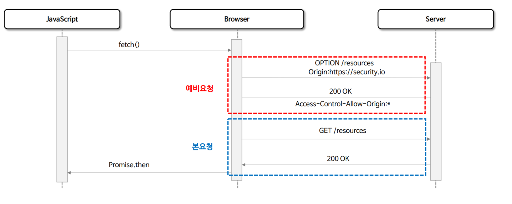

**CORS(교차 출처 리소스 공유)**

- 웹에서는 보안을 위해 기본적으로 한 웹페이지 (출처 A)에서 다른 웹 페이지(출처 B)의 데이터를 직접 불러오는 것을 제한하는데 이를 `동일 출처 정책(Same-Origin-Policy)` 이라고 한다 
- 만약 다른 출처의 리소스를 안전하게 사용하고자 할 경우 `CORS`가 등장하며 `CORS` 는 특별한 HTTP 헤더를 통한 한 웹페이지가 다른 출처의 리소스에 접근할 수 있도록 허가를 구하는 방법이라 할 수 있다 
- 웹 애플리케이션이 다른 출처의 데이터를 사용하고자 할 때, 브라우저가 그 요청을 대신해서 해당 데이터를 사용해도 되는지 다른 출처에게 물어보는 것이라 할 수 있다 
- 출처를 비교하는 로직은 서버에 구현된 스펙이 아닌 브라우저에 구현된 스펙 기준으로 처리되며 브라우저는 클라이언트의 요청 헤더와 서버의 응답 헤더를 비교해서 최종 응답을 결정한다 
- 두개의 출처를 비교하는 방법은 URL 구성요소 중 `Protocol`, `Host`, `Port` 이 세가지가 동일한지 확인하면 되고 나머지는 틀려도 상관없다


# **CORS 종류**

## 1. Simple Request

**Simple Request?**

`Simple Request`는 예비 요청(Preflight) 과정 없이 자동으로 `CORS` 가 작동하여 서버에 본 요청을 한 후, 서버가 응답 헤더에 `Access-Control-Allow-Origin` 과 같은 값을 전송하면 브라우저는 서로 비교 후 CORS 정책 위반여부를 검사하는 방식이다 

**제약 사항** 

- GET, POST, HEAD 중의 한가지 Method를 사용해야 한다 
- 헤더는 Accept, Accept-Language, Content-Language, Content-Type, DPR, Downlink, Save-Data, Viewport-Width Width 만 가능하고 Custom Header 는 허용되지 않는다
- Content-type 은 application/x-www-form-urlencoded, multipart/form-data, text/plain 만 가능하다


## 2. Preflight Request (예비요청)

**Preflight Request?**

- 브라우저는 요청을 한번에 보내지 않고, 예비 요청과 본 요청으로 나누어 서버에 전달하는데 브라우저가 예비요청을 보내는 것을 `Preflight` 라고 하며 이 예비요청의 메소드에는 `OPTIONS`가 사용된다 
- 예비 요청의 역할은 본 요청을 보내기 전에 브라우저 스스로 안전한 요청인지 확인하는 것으로 요청 사양이 `Simple Request` 에 해당하지 않을 경우 브라우저가 `Preflight Request`을 실행한다 



# **Preflight Request (예비요청)**


# **동일 출처 기준**


# **CORS 해결 - 서버에서 Access-Control-Allow-* 세팅**

- **Access-Control-Allow-Origin**
- 헤더에 작성된 출처만 브라우저가 리소스를 접근할 수 있도록 허용한다 
  - `*`, `https://security.io`
- **Access-Control-Allow-Methods**
- **preflight request**에 대한 응답으로 실제 요청중에 사용할 수 있는 메소드를 나타낸다 
  - `기본값: GET, POST, HEAD, OPTIONS` , `*`
- **Access-Control-Allow-Headers**
- **preflight request**에 대한 응답으로 실제 요청중에 사용할 수 있는 헤더 필드 이름을 나타낸다 
  - `기본값:Origin, Accept, X-Requested-With, Content-Type, Access-Control-Request-Method, Access-Control-Request-Headers` , `CustomHeader`, `*`
- **Access-Control-Allow-Credentials**
- 실제 요청에 쿠키나 인증 등의 사용자 자격 증명이 포함될 수 있음을 나타낸다
- A**ccess-Control-Max-Age**
- preflight 요청 결과를 캐시 할 수 있는 시간을 나타내는 것으로 해당 시간동안은 preflight 요청을 다시 하지 않게 된다

# **cors() & CorsFilter**

- CORS의 사전 요청(pre-flight request)에는 쿠키(JSESSIONID)가 포함되어 있지 않기 때문에 SpringSecurity 이전에 처리되어야 한다 
- 사전 요청에 쿠키가 없고 Spring Security가 가장 먼저 처리되면 요청은 사용자가 인증되지 않았다고 판단하고 거부할 수 있다
- CORS가 먼저 처리되도록 하기 위해서 `CorsFilter`를 사용할 수 있으며 `CorsFilter`에 `CorsConfigurationSource`를 제공함으로써 Spring Security와 통합 할 수 있다 

```java
@Bean
SecurityFilterChain defaultSecurityFilterChain(HttpSecurity http) throws Exception {
	 http.cors(cors -> cors.configurationSource(corsConfigurationSource()));
	 return http.build();
}

@Bean
public CorsConfigurationSource corsConfigurationSource() {
	 CorsConfiguration configuration = new CorsConfiguration();
	 configuration.addAllowedOrigin("https://example.com"));
	 configuration.addAllowedMethod("GET","POST"));
	 configuration.setAllowCredentials(true);
	 UrlBasedCorsConfigurationSource source = new UrlBasedCorsConfigurationSource();
	 source.registerCorsConfiguration("/**", configuration);
	 return source;
}
```

- 커스텀하게 사용할 `CorsConfigurationSource`를 설정한다.
- `CorsConfigurationSource`를 설정하지 않으면 Spring MVC 의 CORS 구성을 사용한다

[https://imbf.github.io/spring/2020/10/01/CORS-with-Spring.html](https://imbf.github.io/spring/2020/10/01/CORS-with-Spring.html)

