# 35.1 오류의 종류

오류의 종류를 대표적인 오픈소스 프로그램 MySQL, Apache, Mozilla, OpenOffice를 통해 분석하자.

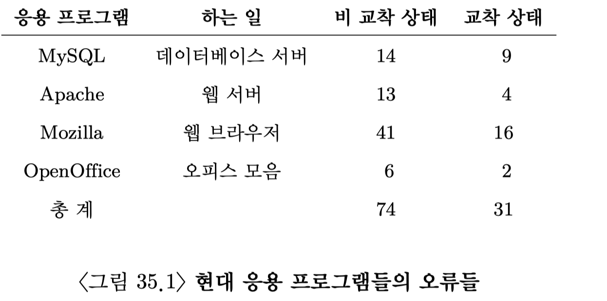

보면 총 105개의 병행성 오류가 있고 교착 상태에 대한 오류는 31개다. 나머지 74개는 전부 비 교착 상태 오류이다. 

---

# 35.2 비 교착 상태 오류

책에서 보여주는 연구 결과에 따르면 비 교착 상태 오류가 병행성 관련 오류의 과반수를 차지한다.

비 교착 상태 오류의 분류 중 대표적인 **원자성 위반(atomicity violation)** 오류와 **순서 위반(order violation)** 오류를 살펴보자.

### 원자성 위반 오류

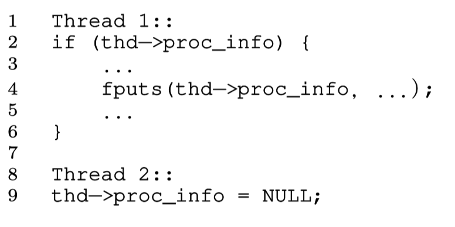

```
해당 예제는 MySQL이다.
이 예제에서는 thd 자료 구조의 proc_info 필드를 2개의 쓰레드가 접근한다.

첫 번째 쓰레드는 그 값이 NULL인지 검사하고 값을 출력한다.
두 번째 쓰레드는 값을 NULL로 설정한다. 

첫 번째 쓰레드가 NULL check가 끝나고 컨텍스트 스위칭이 발생하여 
두 번째 쓰레드가 proc_info 필드를 NULL로 바꾸고 다시 컨텍스트 스위칭 발생
그럼 첫 번째 쓰레드가 fputs 함수를 실행하면 NULL 포인터 참조를 하여 
프로그램은 크래시된다. 
```

이런 문제가 발생하는 이유는 proc_info 필드의 NULL 값 검사와 fputs() 호출이 원자적으로 실행되지 않아서다.

락을 추가하여 어느 쓰레드든 proc_info 필드 접근 시, “proc_info_lock” 이라는 락 변수를 획득하도록 한다.

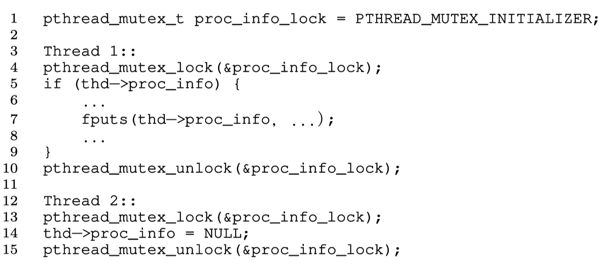

### 순서 위반 오류

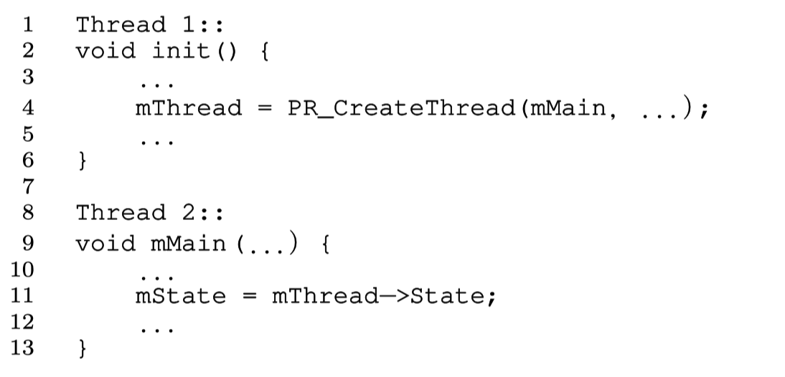

```
쓰레드2의 코드는 mThread 변수가 이미 초기화(not null)가 된 것을 가정하고 있다.
하지만, 만약 쓰레드1이 먼저 실행되지 않으면 쓰레드2는 NULL 포인터를 사용하기 때문에
크래시될 것이다. 
```

현재 문제는 변수 사용이 변수 초기화보다 먼저 동작해서 그렇다.

즉, A가 항상 B보다 먼저 실행되어야 하지만 실행 중에 그 순서가 지켜지지 않았다.

이러한 오류를 수정하는 방법은 컨디션 변수를 활용하여 순서를 강제하는 것이다.

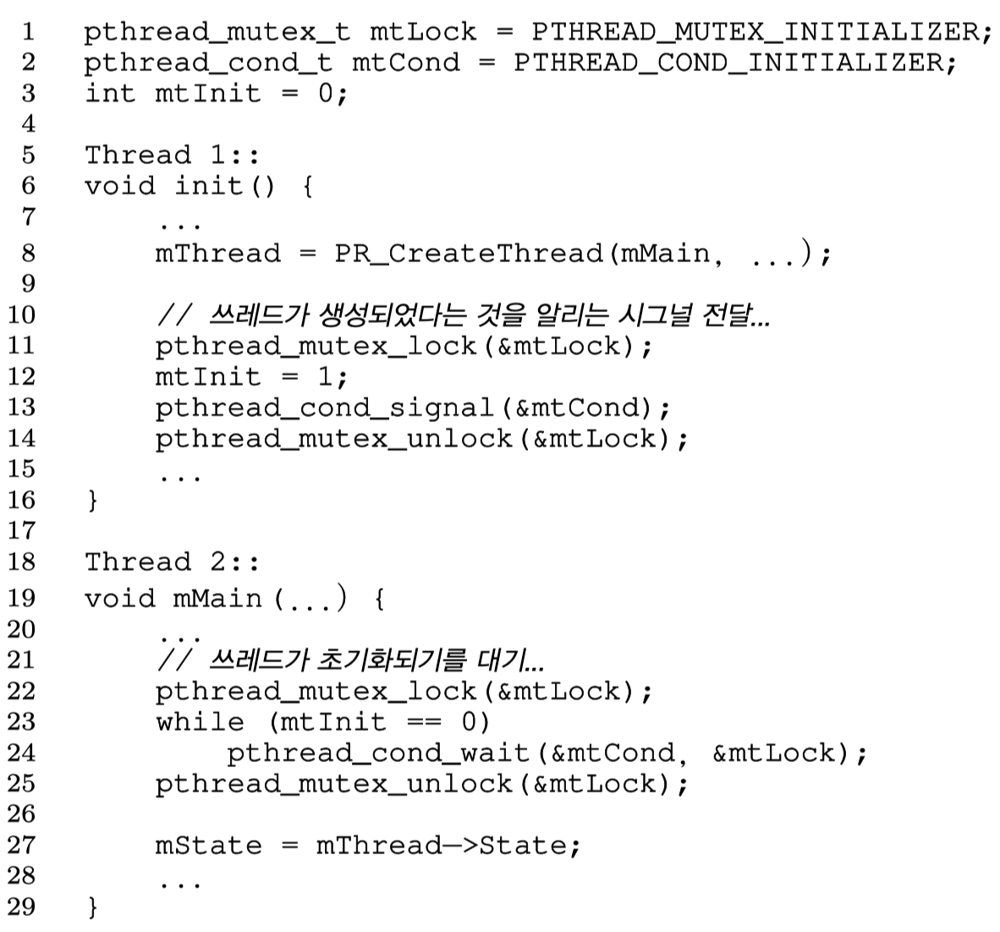

이렇게 쓰레드 간의 순서가 문제가 된다면 컨디션 변수 또는 세마포어를 사용하여 해결할 수 있다.

```
뮤텍스가 필요한 이유 (뮤텍스가 없다면 아래 같은 상황이 발생 가능)
쓰레드2에서 myInit == 0 검사를 마치고 컨텍스트 스위칭
이후 쓰레드1은 myInit = 1 변경 & 시그널 컨텍스트 스위칭
쓰레드2는 다음 라인 con_wait()하지만 
이미 쓰레드1이 시그널을 보냈기 때문에 영원히 wait
```

---

# 35.3 교착 상태 오류

복잡한 락 프로토콜을 사용하는 다수의 병행 시스템에서 **교착 상태(deadlock)**라는 고전적 문제가 발생한다.

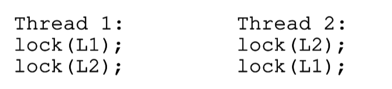

각 쓰레드가 상대방이 소유하고 있는 락을 기다리기 때문에 교착 상태가 발생한다.

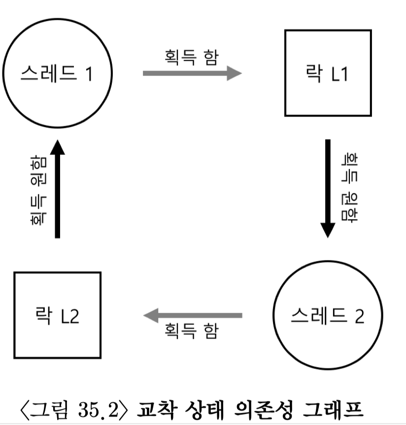

그래프를 보면 사이클(cycle)이 존재한다.

### 교착 상태 발생 조건

- **상호 배제(Mutual Exclusion)****: 쓰레드가 자신이 필요로 하는 자원에 대한 독단적인 제어권을 주장**
- **점유 및 대기(Hold-and-wait)****: 쓰레드가 자신에게 할당된 자원을 점유한 채로 다른 자원을 대기**
- **비 선점(No preemption)****: 자원을 점유하고 있는 쓰레드로부터 자원을 강제적으로 빼앗을 수 없다.** 
- **환형 대기(Circular wait)****: 각 쓰레드는 다음 쓰레드가 요청한 하나 또는 그 이상의 자원 락을 갖고 있는 쓰레드들의 순환 고리가 있다.**

이 네 조건 중에 하나라도 만족시키지 않는다면 교착 상태는 발생하지 않는다.

### 순환 대기(Circular Wait)

가장 실용적이고 자주 사용되는 교착 상태 예방 기법은 순환 대기가 절대 발생하지 않도록 락 코드를 작성하는 것이다. 가장 간단한 방법은 락 획득을 하는 **전체 순서(total ordering)**를 정하는 것이다.

예를 들어 L1, L2라는 두 개의 락만이 시스템에 존재하면 L1을 무조건 L2 전에 획득하도록 하면 교착 상태를 피할 수 있다.

더 복잡한 시스템의 경우, 두 개 이상의 락이 존재할 것이고 전체 락의 요청 순서를 정의하는 것이 어려울 수 있다.

교착 상태를 피하기 위해 **부분 순서(partial ordering)**를 제공하는 것이 락 획득 구조를 만드는 데 유용할 것이다. 

**팁: 락 주소를 사용하여 락 요청 순서 강제하기**

```
주소의 값을 사용하여 락 획득의 순서를 정한다.
오름차순이나 내림차순으로 주소를 정렬하여 락의 획득 순서를 정하면 락의 획득 순서는 변하지 않는다.

if (m1 > m2) {
		pthread_mutex_lock(m1); 
		pthread_mutex_lock(m2); 
		return;
}
pthread_mutex_lock(m2); 
pthread_mutex_lock(m1); 

해당 코드는 락을 주소의 내림차순 기준으로 획득하는 예제이다.
당연히 m1 != m2 즉, 서로 같은 락이 아니다

이 간단한 기법을 사용하면 개발자는 멀티 락 획득 상태에서 간단하고 효율적으로 교착 상태를 방지할 수 있다. 
```

### 점유 및 대기(Hold-and-Wait)

교착 상태가 발생하는 조건인 점유 및 대기는 원자적으로 모든 락을 단번에 획득하도록 하면 예방할 수 있다.

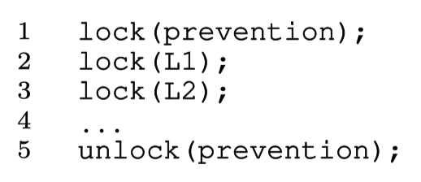

제일 먼저 prevention 락을 획득하여, 락을 획득하는 과정 중에 쓰레드의 문백 교환을 방지한다.

결과적으로, 교착 상태의 발생 가능성을 차단한다.

쓰레드가 락(L1,L2)를 획득하려면 전역 prevention 락을 먼저 획득해야 한다.

쓰레드가 L1과 L2를 다른 순서로 획득하려고 해도 괜찮다. prevention 락을 획득한 후에 나머지 락을 요청하기 때문이다.

하지만 이 방식은 문제가 많다. 먼저 필요한 락들을 정확히 파악해야 하고 그 락들을 미리 획득해야 한다.

또한 락이 실제 필요할 때 요청하는게 아닌 미리 모든 락을 획득하기 때문에 병행성이 저하된다.

### 비선점(No Preemption)

락을 해제하기 전까지는 락을 보유하고 있는 것으로 보기 때문에 여러 락을 획득하는 것에는 문제의 소지가 있다.

많은 쓰레드 라이브러리는 이러한 상황을 피할 수 있도록 유연한 인터페이스 집합을 제공한다

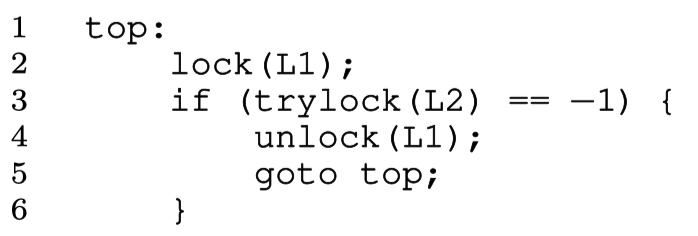

예제의 trylock() 루틴 같은 경우 획득 가능하면 락을 획득하고 점유된 상태면 -1 값을 리턴한다.

L1 락을 보유한 상태에서 L2 락 획득 시도(trylock)에 실패하면 L2를 기다리는 게 아닌 해당 쓰레드로부터 L1락을 선점(빼앗아)하여 해제한다. 그리고 재시도 하도록 한다.

이렇게 락을 선점하여 교착 상태 발생을 막을 수 있다.

하지만 **무한반복(livelock)**이라는 새로운 문제가 생긴다. 여러 쓰레드가 해당 시도를 반복하면서 락 획득에 실패할 수 있다. 교착 상태는 아니지만 실제 진척이 있는 상황도 아니다.

이런 경우 락 획득에 실패하면 지연 시간을 무작위로 주고 특정 쓰레드가 다른 쓰레드보다 짧은 지연 시간을 가져서 

2개의 락을 획득하는 방식으로 해결할 수 있다. 

### 상호 배제 (Mutual Exclusion)

상호 배제 자체를 없애는 방법이다. 

일반적 코드는 모두 임계 영역을 포함하고 있기 때문에 어려운 일이다.

Herlihy는 **대기없는(wait-free)** 자료 구조를 고안했다. 

명시적 락이 필요 없는 하드웨어 명령어를 사용하여 자료 구조를 만들면 된다는 내용이다.

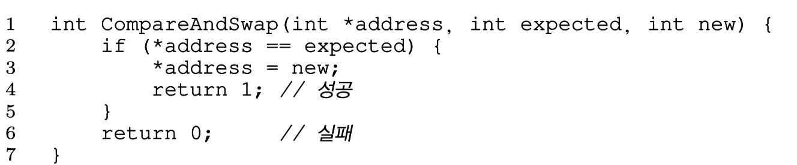

해당 예제는 **Compare-And-Swap** 하드웨어 명령어이다.

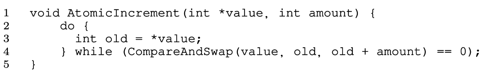

어떤 한 값을 원자적으로 임의의 크기만큼 증가하는 예제이다.

별도의 락 없이 단순히 CompareAndSwap 명령어를 통해 갱신하도록 한다. 

물론 무한반복은 여전히 발생 가능하다.

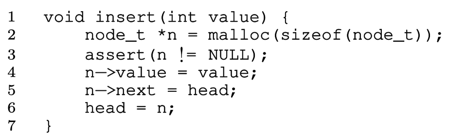

해당 예제는 리스트 헤드에 개체를 삽입하는 코드이다

이 코드가 여러 쓰레드들에 의해 동시에 호출이 되면 경쟁 조건이 발생된다

```
어디서 경쟁 조건이 발생할까?

정답은 헤드이다.
node_t{
	 int value
	 int next 
}
이렇게 구현으로 예상
head는 해당 리스트의 전역 변수(제일 앞 노드를 가리키는 포인터)이다.

그런데 여러 쓰레드가 insert해서 
n->next = head; 코드가 2번 실행된다고 하면 

1번 노드 
        - 기존 노드 - 기존 노드 -
2번 노드 

이렇게되고 2번 노드를 만드는 쓰레드가 더 늦게 실행되었다고 가정하면 
head는 2번 노드를 가리킨다.
그럼 1번 노드는 고립된 노드이고 이는 참조되지 않는 노드이다.
```

이는 삽입문 앞뒤에 락의 획득과 해제 코드를 두어 해결하는 방법이 있다.

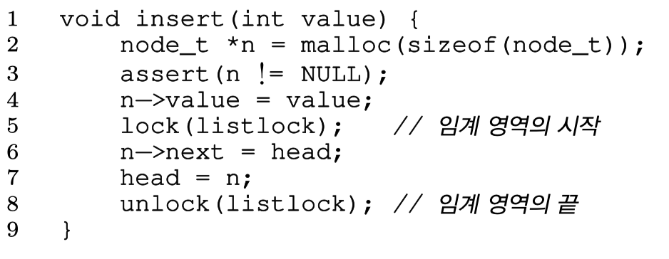

이 예제에서는 리스트 삽입의 레이스 컨디션을 전형적인 방식으로 락을 사용하고 있다.

```c
void insert(int value) {
		node_t *n = malloc(sizeof(node_t)); 
		assert(n ! = NULL);
		n−>value = value; 
		do { 
				n−>next = head; 
		} 
		while (CompareAndSwap(&head , n−>next , n) == 0);
}
```

이 코드는 리스트 삽입에 lock-free를 적용한 예제이다.

next 포인터가 현재의 헤드를 가리키도록 갱신하고 새로 생성된 노드는 리스트의 헤드가 되도록 동작하고 있다. 

만약 n→next = nead; 도중에 어떤 쓰레드가 새로운 헤드를 성공적으로 추가하였다면, 이 Compare-And-Swap은 실패한다. 쓰레드는 삽입과정을 재시도한다.

### 스케줄링으로 교착 상태 회피하기 (교착 상태 회피)

어떤 시나리오에서는 교착 상태를 예방하는 대신 회피하는 것이 더 유용할 때가 있다.

회피하기 위해서는 **실행 중인 여러 쓰레드가 어떤 락을 획득하게 될 것인지에 대해 전반적으로 파악**하고 있어야 하며 그것을 바탕으로 스케줄링하여 교착 상태가 발생하지 않도록 그때그때 런타임에 보장한다.

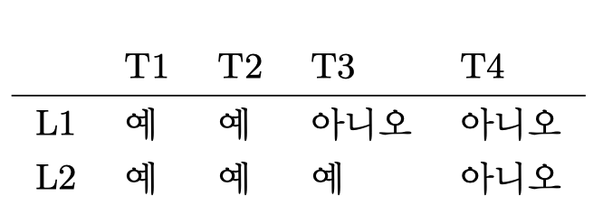

쓰레드 4개, 프로세서 2개에서 스케줄링된다고 해 보자.

T1(L1, L2) T2(L1, L2) T3(L2) T4()각 쓰레드가 필요한 락 

T1, T2가 동시에 실행만 하지 않는다면 교착 상태가 절대로 발생하지 않도록 할 수 있다.

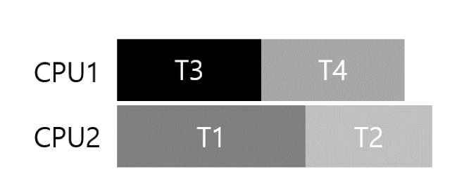

(T3, T1), (T3, T2)는 겹쳐서 실행이 되도 괜찮다. T3는 단 하나의 락만 필요하기 때문이다.

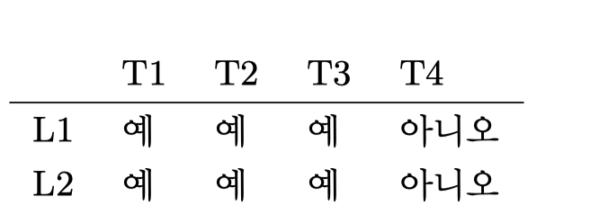

또 다른 예제 

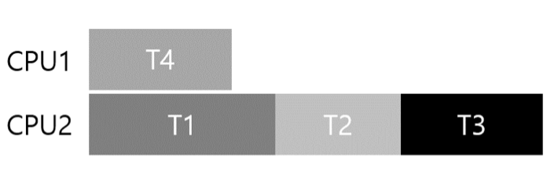

교착 상태가 절대 발생하지 않는 스케줄링이다.

T1, T2, T3 모두 한 프로세서에서 실행되도록 보수적인 방법을 택했기 때문에 전체 작업이 끝나기까지 오랜 시간이 소요된다. 병행이 가능할 수도 있겠지만, 교착 상태가 발생할 수 있기 때문에 그렇게 할 수 없으며, 성능이 떨어진다.

유명한 예로 은행원 알고리즘이 존재한다.

하지만 상당히 제한적인 환경에서만 유용한 방법들이다. CPU 스케줄링에서 학습했지만 CPU에서 미래에 어떤 쓰레드 또는 프로세스가 실행될지는 알 수 없다. 그래서 현대 OS CPU 스케줄링 기법들은 과거 정보를 바탕으로 스케줄링 한다.(LRU, MRU, MLFQ, MLQ)

임베디드 시스템 같은 작업은 동작이 항상 일정하기 때문에 그래도 미래를 예측이 가능하고 사용할 수 있다.

또한 스케줄링 한다고 해서 성능이 좋은 것도 아니다. 병행성이 떨어진다. 

이런 문제점 때문에 교착 상태를 회피하는 것은 보편적으로 사용되는 방법이 아니다

### 발견 및 복구

교착 상태 발생을 허용하고, 교착 상태를 발견하면 복구토록 하는 방법이다.

예를 들어 운영체제가 일 년에 한 번 멈춘다고 가정했을 때 재부팅을 하고 다시 작업을 처리하는 방식이다.

교착 상태가 아주 가끔 발생한다면 이 방법도 꽤 유용하다.

많은 데이터베이스 시스템들이 교착 상태를 발견하고 회복하는 기술을 사용한다.

교착 상태 발견은 주기적으로 실행되며 자원 할당 그래프를 그려서 사이클이 생겼는지를 검사한다.

실제로 MySQL에는 교착 상태 감지용 백그라운드 쓰레드가 존재한다.

---

| 해결 방법 | 설명 | 장점 | 단점 |
| --- | --- | --- | --- |
| 1. 예방 (Prevention) | 교착 상태 4가지 조건 중 하나 이상을 **사전에 불가능하게** 만듦 | 설계 단계에서 간단하게 회피 가능 | 자원 활용도 낮음, 유연성 부족 |
| 2. 회피 (Avoidance) | 자원의 상태와 요청을 분석하여 **안전한 상태일 때만 자원 할당** | 교착 상태 발생 방지 | 알고리즘 복잡 (예: 은행가 알고리즘) |
| 3. 발견 (Detection) | 교착 상태가 발생한 후, **탐지 알고리즘으로 상태 감지** | 시스템 자원 효율적 사용 가능 | 복구 알고리즘 필요, 처리 비용 발생 |
| 4. 회복 (Recovery) | 교착 상태 발생 후, **프로세스 종료 또는 자원 회수로 복구** | 동적 대처 가능 | 작업 손실 가능성, 시스템 불안정 가능성 |

