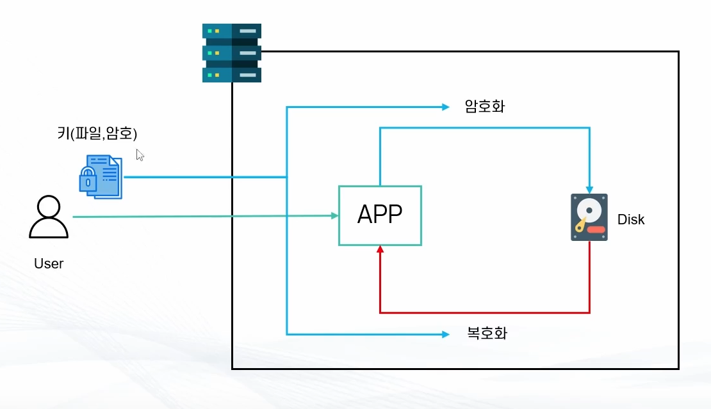
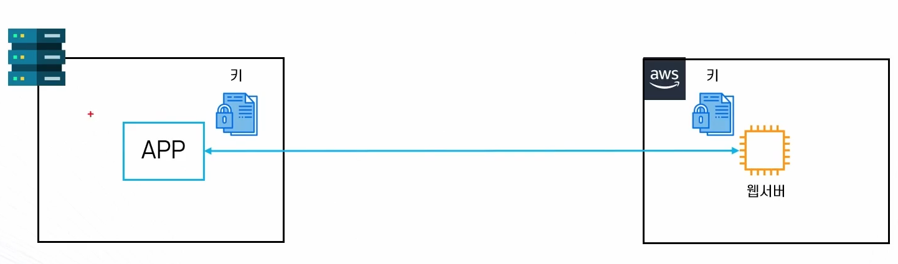
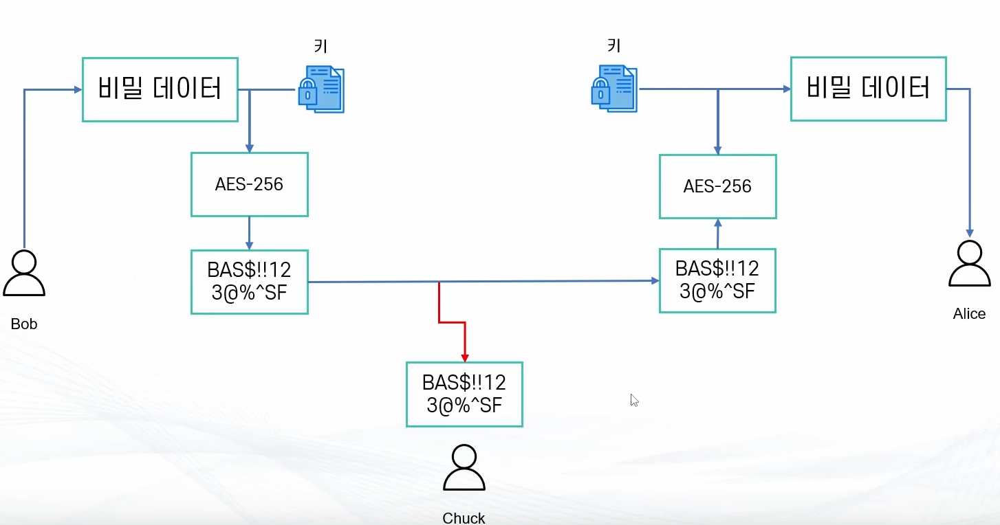
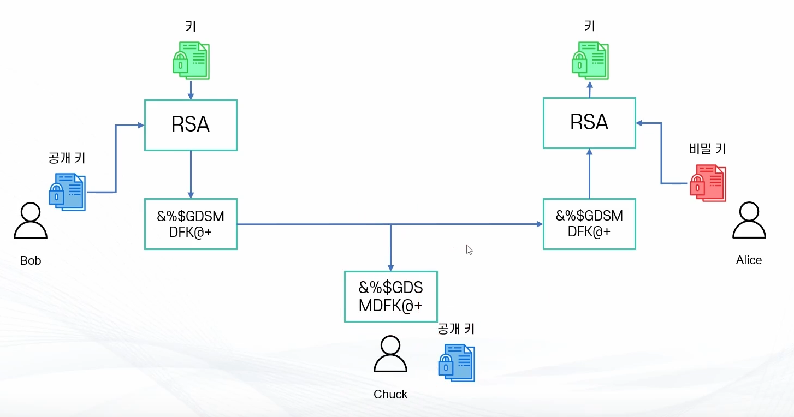
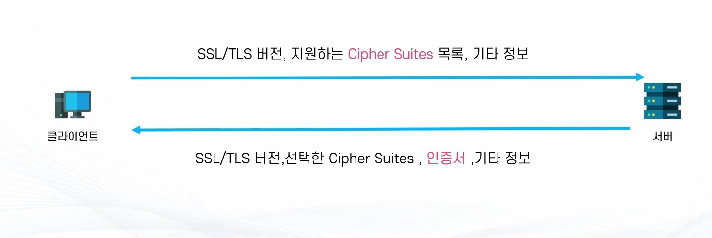
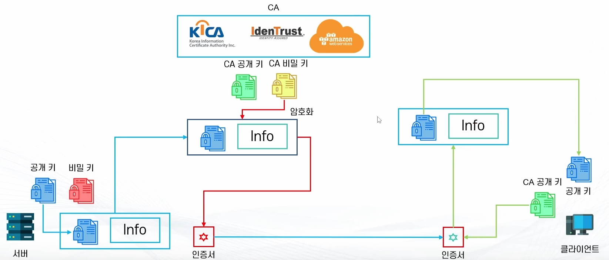
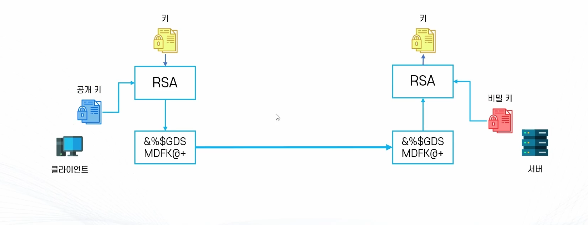

### 암호화 

- 암호화: 수학적인 과정으로 어떤 정보를 읽을 수 없는 데이터로 변환하는 행위
- 복원이 가능 ↔ Hash 복원 불가능
- 암호화의 종류
- 암호화 기술을 사용하는 상황에 따라
- 저장된 데이터 보호(Encryption At Rest)
    - 전송 중 데이터 보호(Encryption At Transit)
  - 암호화 방법에 따라
- 대칭키 암호화
    - 비대칭키 암호화

### 암호화 용어 

- 평문(Planetext): 암호화 하기 전의 데이터
- 암호문(Ciphertext): 평문을 암호 키와 알고리즘을 사용해 암호화 한 데이터
- 암호화(Encryption): 평문에 암호화 알고리즘과 키를 적용하여 키를 소유한 주체가 아니면 알아볼 수 없는 암호문으로 만드는 과정
- 복호화(Decryption): 암호문에 키와 복호화 알고리즘을 적용하여 평문으로 되돌리는 과정
- 키(Key): 평문을 암호화하거나 암호문을 평문으로 돌리기 위한 알고리즘에 핵심 가변정보 값
- 암호 알고리즘: 암호화/복호화를 위해 사용되는 알고리즘
- AES, DES ..

### 저장된 데이터 보호(Encryption At Rest)

- 데이터를 저장할 때 암호화하고 필요할 때 복호화 해서 사용하는 방식
- 주로 하나의 물리적인 기기에 보안을 적용하기 위해 사용
- 예: 기기를 탈취당했을 때 데이터 보호

### 전송 중 데이터 보호(Encryption At Transit)

- 데이터의 전송 중 암호화를 적용하여 데이터가 탈취 당하지 않도록 보호
- 주로 여러 시스템/기기 간에 보안을 적용하기 위해 사요
- 예: SSH/TLS, HTTPS 등

### 대칭키 암호화(Symmetric Encryption)

- 하나의 키로 암호화, 복호화를 하는 알고리즘
- 비교적 연산이 빠름

대칭키 암호화 치명적인 단점은 암호화 및 복호화에 사용할 키의 전달이다.

결국 키는 평문으로 전달하는데 이또한 해커에게 탈취당할 수 있다.

### 비대칭키 암호화(Asymmetric Encryption)

- 한 쌍의 키를 활용한 암호화, 단 하나의 암호는 암호화만 가능하며, 다른 하나는 복호화만 가능
- 연산이 비교적 복잡하지만 키 전달이 쉽다
- 공개 키 / 비밀 키: 각각 암호화 복호화만 할 수 있는 키쌍
- 공개키로 암호화하면 비밀 키로 복호화 가능
  - 비밀키로 암호화하면 공개 키로 복호화 가능

### 암호화 서명(Signing)

- 키를 사용해서 데이터의 생성자가 데이터를 생성했음을 보장하는 방법
- Private 키를 사용하여 Public 키로 검증 가능한 데이터의 서명(Signature)을 생성
  - Private 키를 가진 주체가 데이터를 생성했음을 보장할 수 있는 방법이다.

**암호화 서명의 2가지 방식**

| **구분** | **목적/원리** | **대표적 사용 예시** |
| --- | --- | --- |
| **무결성/위조 방지 (서명)** | JWT처럼 해시와 비밀키(혹은 개인키)로 서명 생성, 데이터가 변조되지 않았음을 검증 | JWT, 디지털 서명(전자서명) |
| **데이터 암호화/복호화** | 비대칭키(공개키/개인키)로 데이터 암호화 및 복호화, 데이터의 비밀성 보장 | HTTPS, 이메일 암호화, 파일 암호화 |

### SSL(Security Socket Layer)/ TLS(Transport Layer Security)

- 클라이언트와 서버간에 데이터의 무결성과 기밀성을 보장할 수 있는 프로토콜
- 상호간의 통신은 암호화 되어 전달되며 중간에서 데이터를 탈취당해도 안전하다
- HTTPS 등 다양한 프로토콜에 활용
- 일반 HTTP의 경우 연결이 안전하지 않기 때문에 보안적으로 취약하다
- 3단계 과정으로 진행

### 1. Cipher Suites 교환

**Cipher Suites:** TLS에서 활용하는 보안 알고리즘들

### 2. 인증

인증서: 믿을 수 있는 인증 기관(Certificate Authority, CA)에서 배포하는 서버 신원에 대한 검증 확인

**CA 필요성**

클라이언트가 [google.com](http://google.com/) 접속하려고 하는데 해당 서버가 실제 구글 서버인지 가짜 서버인지 클라이언트는 구별할 방법이 없다. 이런 문제를 해결하기 위해서 인증 기관에서 해당 서버에 대한 인증을 인증서를 통해 보장한다.

**서버 ↔ CA**

서버는 먼저 기관의 인증을 받기 위해서 서버의 공개 키, 비밀 키를 발급하고 공개 키와 함께 서버 정보를 인증 기관에 제공한다. 인증 기관은 해당 서버를 확인하고 인증 기관의 비밀 키를 통해 해당 서버의 공개 키와 정보를 바탕으로 인증서를 만든다. 서버는 해당 인증서를 가진다.

**클라이언트 ↔ 서버** 

먼저 1번 과정을 진행한다 클라이언트는 SSL/TLS 버전 및, 보안 알고리즘 목록을 서버로 보내고 서버는 선택한 보안 알고리즘과 인증서를 보낸다.

**클라이언트** 

인증서를 받은 클라이언트는 CA에서 제공한 공개 키를 통해 서버의 공개 키와 서버 정보를 획득한다.

이렇게 클라이언트는 서버를 신뢰할 수 있게된다.

### 3. 키 교환

클라이언트는 본인의 키를 서버의 공개키를 통해 암호화하고 서버는 암호화된 클라이언트의 키를 서버의 비밀 키를 통해 뽑아낸다. 이렇게 비대칭키 → 대칭키로 바꾸는 이유는 비대칭키 방식이 너무 느리기 때문이다.

이렇게 키 교환이 끝나면 클라이언트와 서버는 보안 걱정 없이 대칭키(세션키)로 암호화하고 복호화하여 통신이 가능하다.

***참고로 이 과정은 3-way handshake 이후 TLS handshake 과정으로 진행한다***

