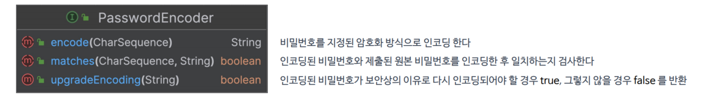
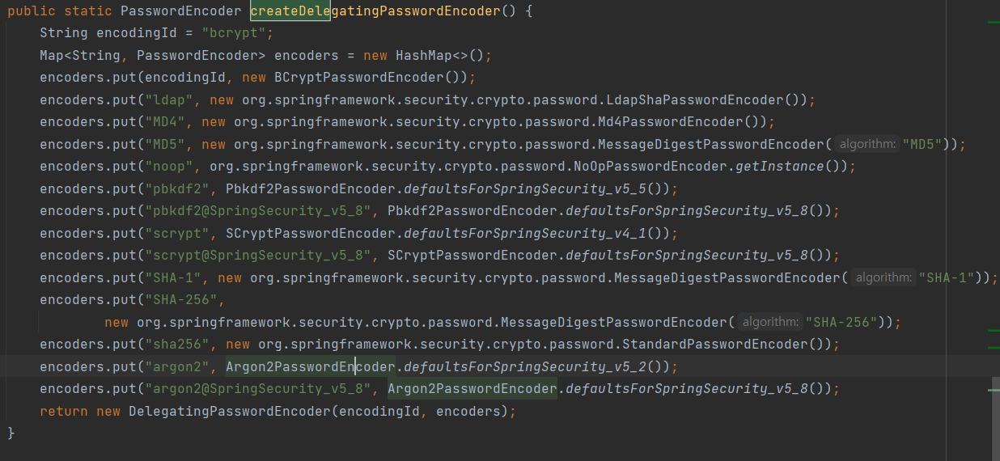

# ***PasswordEncoder***

- *스프링 시큐리티의 PasswordEncoder 인터페이스는 비밀번호를 안전하게 저장하기 위해 비밀번호의 단방향 변환을 수행하는 데 사용된다*
- *일반적으로 PasswordEncoder는 사용자의 비밀번호를 암호화하여 저장하거나 인증 시 검증을 위해 입력한 비밀번호와 암호화 되어 저장된 비밀번호를 서로 비교해야 할 때 사용된다*



# ***DelegatingPasswordEncoder***

- *DelegatingPasswordEncoder는 {id} 형식의 접두사를 사용하여 비밀번호가 어떤 방식으로 인코딩되었는지 식별하는 클래스로 예를 들어 {bcrypt} 접두사는 비밀번호가 BCrypt 방식으로 인코딩되었음을 나타낸다.*


- *DelegatingPasswordEncoder는 어플리케이션에서 사용하는 기본 인코딩 방식을 변경할 수 있도록 해주며 새로운 인코딩 방식이 권장되거나 필요할 때 비밀번호 인코딩 전략을 유연하게 유지할 수 있다*

# ***DelegatingPasswordEncoder 빈 정의***

***기본 생성***

```java
@Bean
public PasswordEncoder passwordEncoder() {
		return PasswordEncoderFactories.createDelegatingPasswordEncoder(); 
}
```

- *기본적으로 bcrypt 암호화 알고리즘의* ***BCryptPasswordEncoder*** *객체를 생성하고 사용하게 된다*

***PasswordEncoderFactories.createDelegatingPasswordEncoder()***



- *많은 암호화 알고리즘의 PasswordEncoder를 생성하지만 default는 BCryptPasswordEncoder*
- *시큐리티는 이렇게 많은 암호화 알고리즘을 지원한다.* 

***알고리즘 지정 생성***

```java
@Bean
public PasswordEncoder passwordEncoder() {
		 String encodingId = "pbkdf2";
		 Map<String, PasswordEncoder> encoders = new HashMap<>();
		 encoders.put(encodingId, Pbkdf2PasswordEncoder.defaultsForSpringSecurity_v5_8());
		 DelegatingPasswordEncoder delegatingPasswordEncoder = new DelegatingPasswordEncoder(encodingId, encoders);
		 return delegatingPasswordEncoder;
}
```

# ***사용자 생성과 비밀번호 암호화***

```java
@PostMapping(value="/signup")
public String signup(AccountDto accountDto) {
		ModelMapper mapper = new ModelMapper();
		Account account = mapper.map(accountDto, Account.class);
		account.setPassword(passwordEncoder.encode(accountDto.getPassword()));
		userService.createUser(account);
		return "redirect:/";
}
```

# *ModelMapper*

*ModelMapper는 객체 매핑 라이브러리* 

*주로 객체 간의 데이터를 변환하는 데 사용되며, 특히 DTO(Data Transfer Object)와 엔티티 간의 매핑을 간편하게 수행할 수 있도록 도와준다.*

***특징***

- ***간결한 매핑****: 소스 객체와 대상 객체 간에 필드 이름이 일치하면 자동으로 매핑해준다.*
- ***유연한 매핑****: 이름이 다르거나 복잡한 구조의 객체를 매핑할 때도 별도의 설정으로 지원한다.*
- ***재사용 가능****: 매핑 규칙을 정의하면 여러 곳에서 재사용할 수 있다.*

# *설정* 

***application.yaml***

```java
spring:
  datasource:
    driver-class-name: com.mysql.cj.jdbc.Driver
    url: jdbc:mysql://127.0.0.1:3306/securitymaster
    username: "cos"
    password: [REDACTED]
  jpa:
    hibernate:
      ddl-auto: update
    properties:
      hibernate:
        format_sql: true
        jdbc:
          lob:
            non_contextual_creation: true
  thymeleaf:
    cache: false
```

