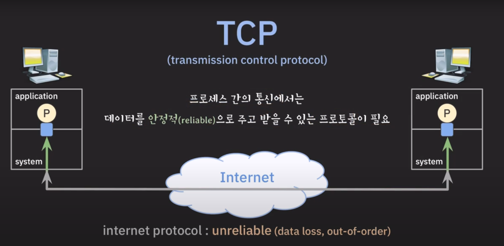



### TCP 

**TCP(Transmission Control Protocol) Connection** 

- 프로세스 간의 안정적이고 **논리적인 통신 경로**
- **connection을 열고(3-way handshake)** → 데이터를 주고 받고 -> **connection을 닫는다(4-way handshake)**
- connection-oriented, 연결형 프로토콜

**인터넷 상에서 어떻게 port를 유니크하게 식별할까**

- port(number) 정의: 16 bits로 이루어진 숫자 (0 ~ 65535)
- port number 만으로는 유니크하게 식별할 수 없다
- internet address로 각 host를 유니크하게 식별할 수 있다.
- **internet address + port number → 유니크하게 식별할 수 있다.**
- **소켓 = internet address + port number 즉, 유니크하게 식별하기 위한 주소이다.** 

**Connection & Socket** 

- 각 connection을 유니크하게 식별할 수 있어야 한다
- 한 쌍의 socket은 connection을 유니크하게 식별한다
- **<source socket, destination socket>** 
- **<source internet addr, source port, destination internet addr, destination port>**
- **하나의 socket은 동시에 여러 connection들에서 사용될 수 있다.**

### UDP 

**UDP(User Datagram Protocol)**

- connectionless: 연결을 맺지 않고 바로 데이터를 주고 받는다, 비연결형 프로토콜
- internet protocol을 거의 그대로 사용한다.
- **마찬가지로 Socket 개념이 사용된다. Socket은 인터넷 주소 + 포트 번호 조합**
- 최종적으로 <protocol, ip address, port number>로 유니크하게 식별

### 정리 

| **프로토콜** | **전송 계층** | **소켓 종류** | **주요 용도/특징** |
| --- | --- | --- | --- |
| HTTP/1,2 | TCP | TCP 소켓 | 웹, API, 채팅 등 |
| HTTP/3 | UDP(QUIC) | UDP 소켓 | 최신 웹, 실시간성 강화 |
| 일반 소켓통신 | TCP | TCP 소켓 | 채팅, 파일전송 등 신뢰성 중요 서비스 |
| 실시간/스트리밍 | UDP | UDP 소켓 | 게임, 영상/음성 스트리밍 등 |

일반적으로 말하는 소켓통신은 TCP 소켓을 말한다.

---

[https://www.youtube.com/watch?v=X73Jl2nsqiE&list=PLcXyemr8ZeoSGlzhlw4gmpNGicIL4kMcX&index=4](https://www.youtube.com/watch?v=X73Jl2nsqiE&list=PLcXyemr8ZeoSGlzhlw4gmpNGicIL4kMcX&index=4)

