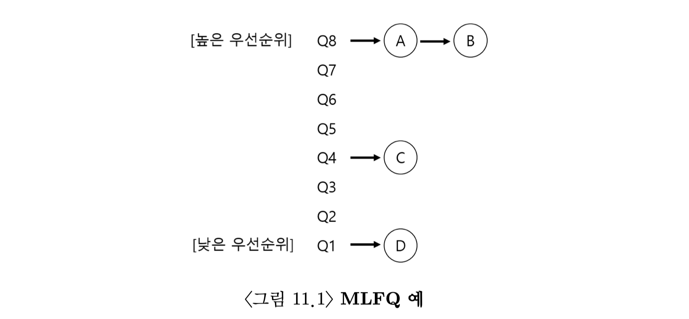
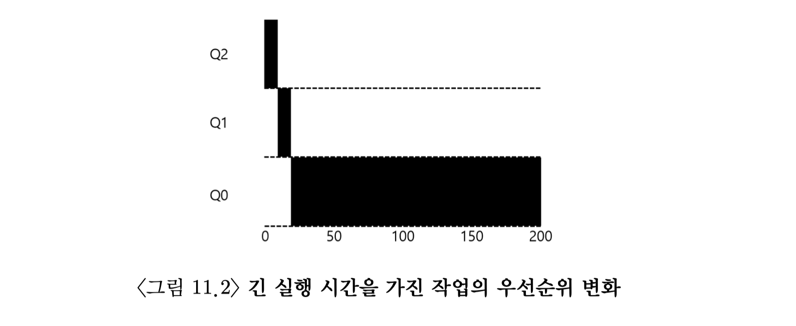
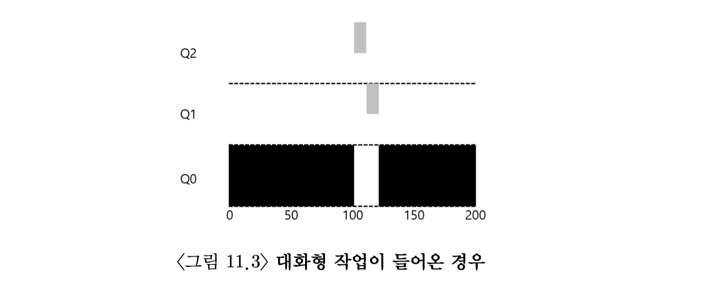
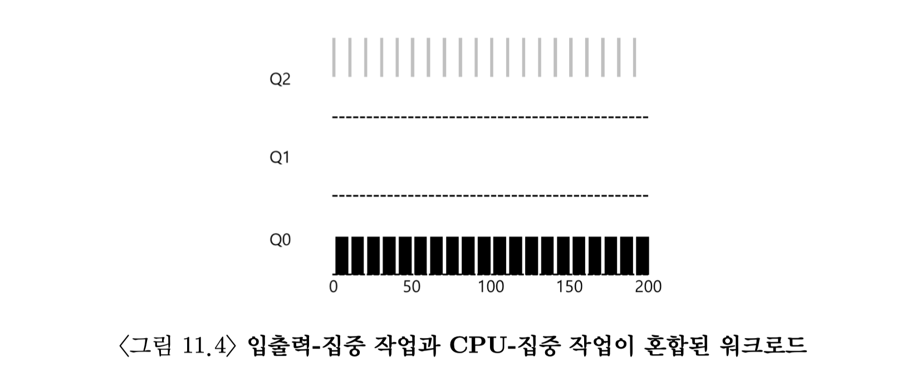
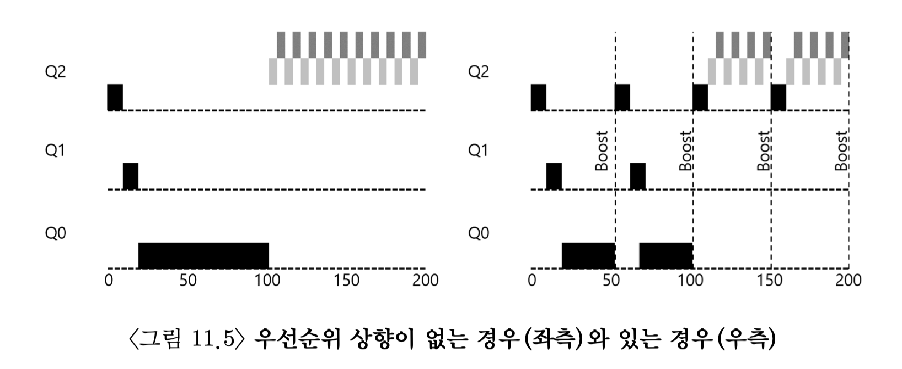
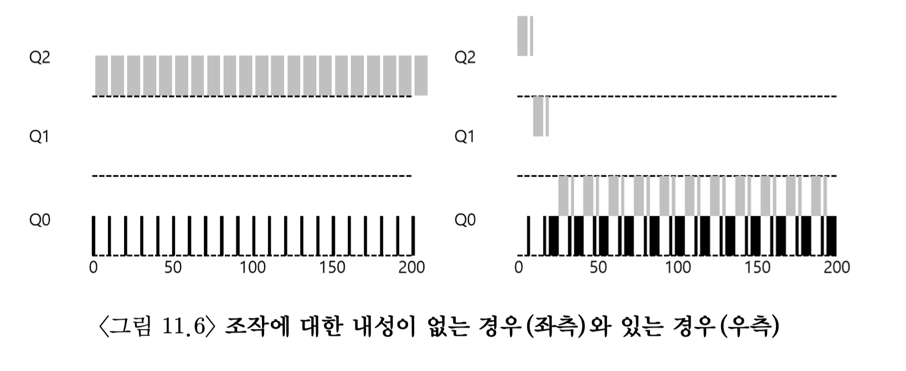
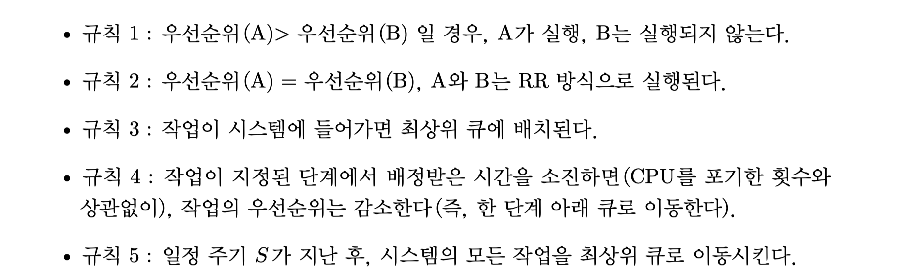

## 알면 좋은 사전 지식 

**CPU Bound(CPU 중심 작업) VS I/O Bound (입출력 중심 작업)**

| 작업 | 유형 | 병목 원인 |
| --- | --- | --- |
| 비디오 인코딩 | CPU Bound | 연산량 |
| DB에서 데이터 읽고 화면에 출력 | I/O Bound | DB 쿼리 및 네트워크 |
| 파일 압축 | CPU Bound | 연산 |
| 로그 파일 분석 (파일이 클 경우) | I/O Bound | 디스크 읽기 속도 |

**핵심: I/O Bound Process는 waiting queue 에서 하드웨어 인터럽트를 기다리며 대기하는 시간이 많다.** 

**왜 I/O Bound Process를 먼저 처리하면 성능이 좋을까?** 

- I/O 작업을 먼저 시작하면, 외부 장치가 처리되는 동안 CPU는 다른 작업 (ex. CPU Bound 작업)을 처리할 수 있다. 
- 결과적으로 **자원을 놀리지 않고 계속 활용**하는 구조가 된다. 

## 11.1  MLFQ: 기본 규칙

MLFQ: Multi-Level FeedBack Queue 

여러 개의 큐로 구성, 큐는 각각 다른 우선순위가 배정 

실행 준비가 된 프로세스(ready status) → 이중 하나의 큐에 존재 

큐에는 둘 이상의 작업이 존재할 수 있다. (모두 같은 우선순위)

이 작업들 사이에는 라운드 로빈 스케줄링 알고리즘이 사용 

MLFQ는 각 작업에 고정된 우선순위를 부여하는 것이 아니라 각 작업의 특성에 따라 동적으로 우선순위를 부여한다. 

**작업의 특징으로 우선순위** 

- 어떤 작업이 키보드 입력을 기다리며 반복적으로 CPU 양보 → I/O Bound Process → 해당 작업은 MLFQ 우선순위 높게 유지 
- 어떤 작업이 긴 시간 동안 CPU를 집중적으로 사용 → CPU Bound Process → 해당 작업은 MLFQ 우선순위를 낮춘다. 

CPU는 프로세스의 실행 방식을 예측하지 못한다. 즉 쉽게 말해서 미래를 모른다. 

MLFQ는 작업이 진행되는 동안 작업의 정보를 얻고, 이 정보(과거 실행 기록)이용하여 미래 행동을 예측한다. 

✅  **MLFQ의 두 가지 기본 규칙**

```
규칙1: Priority(A) > Priority(B) 이면, A가 실행된다 (B 는 실행되지 않는다).
규칙2: Priority(A) = Priority(B) 이면, A와 B는 RR 방식으로 실행된다.
```

우선순위가 다르다 ⇒ 서로 다른 큐에 존재한다. 



그림 11.1은 임의의 시간에 MLFQ 스냅샷이다. 

현재까지 알고 있는 MLFQ 동작을 고려하면 가장 높은 우선순위 큐의 A, B 작업만 번갈아 실행할 것이다. 

즉 C, D는 실행되지도 않는다. → 기아 현상 

이런 동작 메커니즘은 MLQ라고 부른다. Multi-Level Queue는 작업이 한번 특정 큐에 정해지면 큐 ↔ 큐 사이에 이동하지 않는다. 

## 11.2  시도 1: 우선순위의 변경

작업의 우선순위 변경 = 작업이 존재할 큐를 결정하는 것 

작업의 특성: I/O Bound Process VS CPU Bound Process 

✅  **MLFQ의 규칙3, 4**

```
규칙3: 작업이 시스템에 진입하면, 가장 높은 우선순위, 즉 맨 위의 큐에 놓여진다. 
규칙4a: 주어진 타임 슬라이스를 모두 사용하면 우선순위는 낮아진다. (CPU를 양도하지 않고 끝까지 사용) 즉, 한 단계 아래 큐로 이동 
규칙4b: 타임 슬라이스를 소진하기 전에 CPU를 양도하면 같은 우선순위를 유지
```

### **example 1: 한 개의 긴 실행 시간을 가진 작업**



 

그림 11.2 에서 보이는 작업은 단 하나의 작업이다. 

해당 작업은 매우 긴 CPU 실행 시간을 가지는 작업이다.

Q2에서 주어진 타임 슬라이스를 다 사용하고 우선순위가 내려간다. → Q1 이동 

Q1에서 주어진 타임 슬라이스를 다 사용하고 우선순위가 내려간다. → Q0 이동 

이후에는 Q0에서 계속 머무르게 된다. 



핵심: MLFQ가 어떻게 SJF에 근접할 수 있는지 이해 

검은색 작업: A(CPU Bound) 긴 작업 

회색 작업: B(I/O Bound) 짧은 작업

MLFQ는 SJF와 근사하게 동작해서 B를 선호할 것인가? 

그림 11.3을 보면 B는 2번의 타임 슬라이스를 선호하면 바닥의 큐에 도착하기 전에 종료된다. 

그런 후 A는 낮은 우선순위에서 실행을 재개한다. 

✅  **MLFQ: SJF 근사 방식** 

```
스케줄러는 작업이 짧은 작업인지 긴 작업인지 알 수 없기 때문에 일단 짧은 작업이라고 가정하여 
높은 우선순위를 부여한다. 진짜 짧은 작업이면 빨리 실행되고 바로 종료할 것이다. 
짧은 작업이 아니라면 천천히 아래 큐로 이동하게 되고 스스로 긴 배치형 작업이라는 것을 증명하게 된다. 
이러한 방식으로 MLFQ는 SJF를 근사할 수 있다.
```

### **example 3: 입출력 작업에 대해서는 어떻게?**

**규칙 4b: 프로세스가 타임 슬라이스를 소진하기 전에 프로세서를 양도하면 같은 우선순위를 유지하게 한다**

대화형 작업이 키보드나 마우스로부터 사용자 입력을 대기하며 자주 입출력을 수행하면 타임 슬라이스가 종료되기 전에 CPU 를 양도하게 될 것이다. 그런 경우 동일한 우선순위를 유지하게 하는 것이다.



### 현재 MLFQ의 문제점 

1. **기아 상태(starvation)**

시스템에 너무 많은 대화형 작업이 존재하면 그들이 모든 CPU 시간을 소모하게 될 것이고 따라서 긴 실행 시간 작업은 CPU 시간을 할당받지 못할 것이다 → 굶어 죽는다 ㅠㅠ



1. 똑똑한 사용자라면 스케줄러를 자신에게 유리하게 동작하도록 프로그램을 다시 작성할 수 있다.

타임 슬라이스가 끝나기 전에 아무 파일을 대상으로 입출력 요청을 내려 CPU 를 양도한다. 그렇게 하면 같은 높은 우선순위 큐에 머무를 수 있고 따라서 더 높은 퍼센트의 CPU 시간을 얻게 된다.

1. 프로그램은 시간 흐름에 따라 특성이 변할 수 있다. I/O Bound ↔ CPU Bound

## 11.3  시도 2: 우선순위의 상향 조정 

규칙을 보완하여 기아 문제를 방지할 수 있는지 살펴보자.

✅  **MLFQ의 규칙5 = 에이징?**

```
규칙 5: 일정 기간 S 가 지나면, 시스템의 모든 작업을 최상위 큐로 이동시킨다.
```

이번 규칙은 두 가지 문제를 해결한다. 

- 기아 현상 해결 (주기적으로 최상위 큐로 이동)
- CPU Bound 작업 → I/O Bound 작업으로 특성이 변할 경우 우선순위 상향을 통해 변경된 특성에 적합한 스케줄링 방법을 적용 


왼쪽 그래프는 우선순위 상향이 없는 경우이다. 짧은 I/O Bound 작업이 시작하니 CPU Bound 작업에 기아 현상이 발생한다. 

하지만 우선순위 상향을 적용한 오른쪽 그래프는 50 msec 간격으로 상향되고 주기적으로 실행된다. 

**물론 S 값의 결정이 필요하다.**

너무 크면 긴 실행 시간을 가진 작업은 굶을 수 있으며 너무 작으면 대화형 작업이 적절한 양의 CPU 시간을 사용할 수 없어 느린 응답이 된다. 

## 11.4 시도 3: 더 나은 시간 측정

마지막 문제: 스케줄러를 자신에게 유리하게 동작시키는 것을 어떻게 막을 수 있는가? 

이러한 일을 가능하게 만든 주범은 규칙 4a, 4b이다. 

**4a, 4b →  타임 슬라이스를 통한 우선순위 하향 조정 여부 결정** 

**해결책: 각 단계에서 CPU 총 사용 시간을 측정** 

현재 단계에서 프로세스가 소진한 CPU 사용 시간을 저장. 프로세스가 타임 슬라이스에 해당하는 시간을 모두 소진하면 다음 우선순위 큐로 강등 

✅  **MLFQ의 규칙4 재정의 (4a + 4b)**

```
규칙 4: 주어진 단계에서 시간 할당량(CPU 사용 시간)을 소진하면 
(CPU 를 몇 번 양도하였는지 상관없이), 우선순위는 낮아진다 (즉, 아래 단계의 큐로 이동한다).
```

즉, 이전 규칙과 비교하면 CPU를 정해진 타임 슬라이스 안에서 적당히만 사용하면 계속 같은 우선순위 큐에 머무르는 게 가능했지만 이젠 정해진 CPU 사용량을 넘어서면 하향 조정된다. 



## 11.5 MLFQ 조정과 다른 쟁점들

**몇 개의 큐가 존재해야 하는가?** 

**큐당 타임 슬라이스의 크기는 얼마로 해야 하는가?** 

**기아를 피하고 변화된 행동을 반영하기 위하여 얼마나 자주 우선순위가 상향조정되어야 하는가?** 

이러한 질문들에 대해 쉽게 대답할 수는 없다. 워크로드에 대해 충분히 경험하고 계속 조정해 나가면서 균형점을 찾아야 한다.

대부분의 MLFQ 기법들은 큐 별로 타임 슬라이스를 변경할 수 있다. 

우선순위가 높은 큐는 보통 짧은 타임 슬라이스가 주어진다.

## 11.6 MLFQ: 요약

알고리즘은 멀티 레벨 큐를 가지고 있으며, 지정된 작업의 우선순위를 정하기 위하여 피드백을 사용한다.



MLFQ는 작업의 특성에 대한 정보 없이, 작업의 실행을 관찰한 후 그에 따라 우선순위를 지정한다.

MLFQ는 반환 시간과 응답 시간을 모두 최적화한다.

짧게 실행되는 대화형 작업에 대해서는 우수한 전반적인 성능을 제공한다(SJF/ STCF와 유사). 
오래 실행되는 CPU-집중 워크로드에 대해서는 공정하게 실행하고 조금이라도 진행되도록 한다.

**이런 이유로 많은 운영체제들이 기본 스케줄러로 MLFQ를 사용한다.** 

## 문제점3 복습 

### ✅ **문제: 고의적인 CPU 양도 (Avoiding Gaming the Scheduler)**

사용자가 자신이 높은 우선순위 큐에 계속 머무르기 위해,

**타임 슬라이스가 끝나기 전에 I/O 요청 등으로 고의적으로 CPU를 반납하는 방식**으로 시스템을 속일 수 있다.

이렇게 되면 해당 프로세스는 계속 높은 우선순위에 유지되어,

전체 시스템의 공정성을 해치고, 다른 프로세스들이 CPU를 받기 어려워질 수 있다.

---

### ✅ **해결책: 총 CPU 사용 시간 기반 하향 조정**

이를 방지하기 위해 MLFQ에서는

- 각 큐마다 **총 허용 CPU 사용 시간**이 정해져 있으며,
- 해당 시간 이상을 사용한 프로세스는 **자동으로 낮은 우선순위 큐로 이동**.

이 방식은 **CPU를 얼마나 오래 썼는지에 따라 우선순위를 조정**하기 때문에,
**타임 슬라이스 내에서 CPU를 반납하는 트릭으로 우선순위를 유지하는 것이 불가능**

