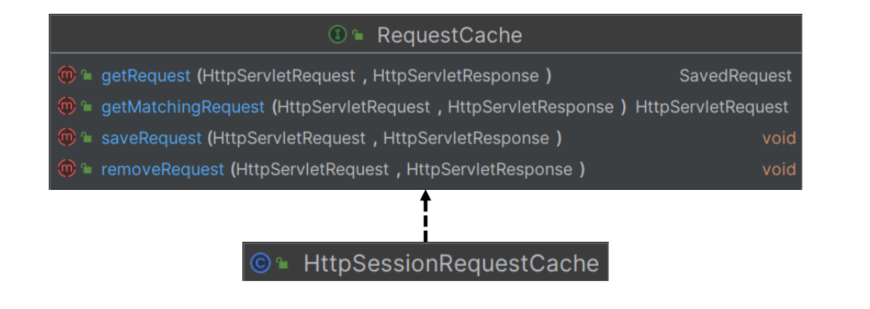
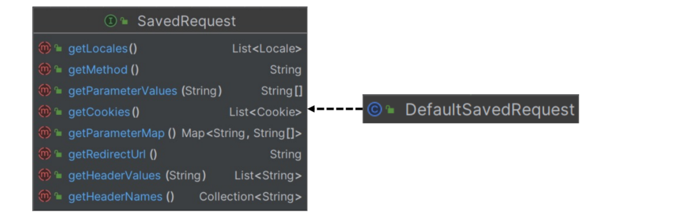
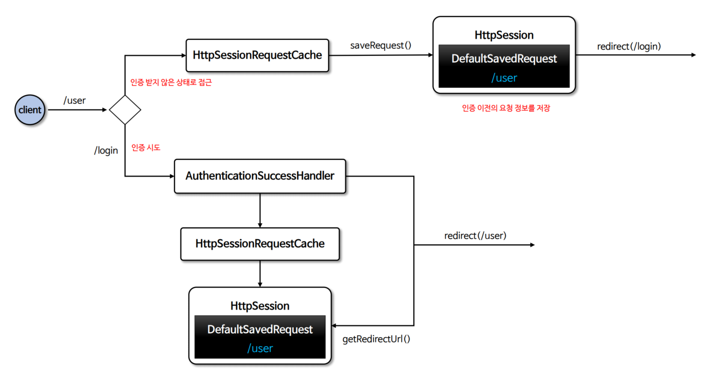
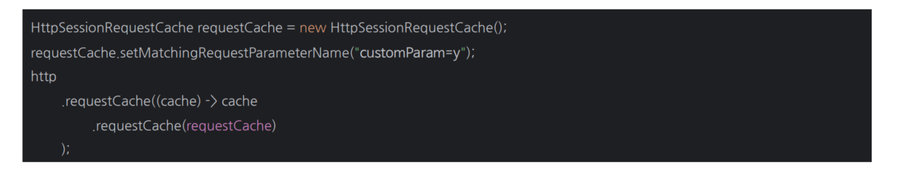
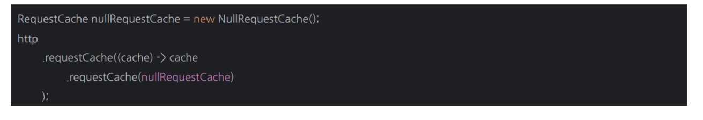
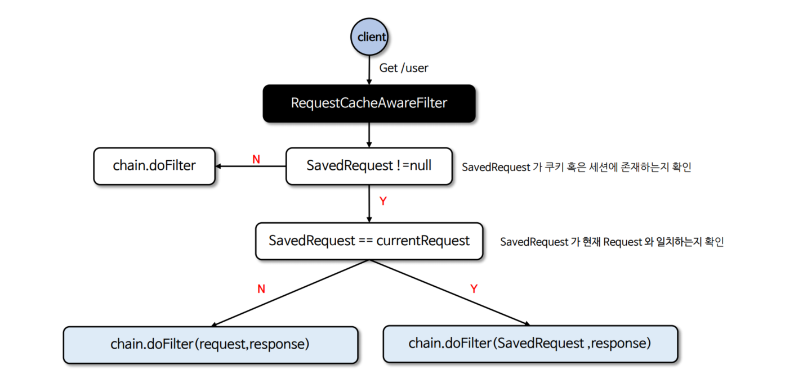

# **RequestCache**

인증 절차 문제로 리다이렉트 된 후에 이전에 했던 요청 정보를 담고 있는 `SavedRequest` 객체를 쿠키 or 세션에 저장하고 필요시 다시 가져와 실행하는 캐시 메커니즘이다 



`HttpSessionRequestCahe`: 세션에(SavedRequest) 저장 

# **SavedRequest**

로그인 같은 인증 절차 이후 사용자를 인증 이전의 원래 페이지로 안내하며 이전 요청과 관련된 여러 정보를 저장한다 



# **동작 방식**



# **requestCache() API**



요청 Url에 `customParam=y` 라는 이름의 매개변수가 있는 경우에만 `HttpSession`에 저장된 

`SavedRequest`을 꺼내오도록 설정할 수 있다 (기본값은 `continue`)

즉, 인증에 성공하면 `localhost:8080/user?customParam=y` 형태로 보내준다. 

기본값은 `localhost:8080/user?continue` 



요청을 저장하지 않도록 하려면 `NullRequestCache` 구현을 사용할 수 있다.

# **RequestCacheAwareFilter**

`RequestCacheAwareFilter`는 이전에 저장했던 웹 요청을 다시 불러오는 요청을 한다 

`SavedRequest` 가 현재 Request와 일치하면 `SavedRequest` 요청을 필터 체인의 doFilter 메소드에 전달하고 `SavedRequest`가 없으면 필터는 원래 Request를 그대로 진행시킨다 



`SavedRequest`가 쿠키 혹은 세션에 존재하는지 확인은 

custom한 파라미터나 기본값인 continue 파라미터가 존재하면 동작한다 

# **흐름 정리1** 

`ExceptionTranslationFilter` 

```java
private void doFilter(HttpServletRequest request, HttpServletResponse response, FilterChain chain)
			throws IOException, ServletException {
		try {
			chain.doFilter(request, response);
		}
		catch (IOException ex) {
			throw ex;
		}
		catch (Exception ex) {
			// 생략 ...
		}
		handleSpringSecurityException(request, response, chain, securityException);
}		
```

인증 없이 인증이 필요한 경로에 접근하면 `AuthenticationException`이 발생한다.

즉, 다음 필터들에서 `AuthenticationException` 예외가 올라온다 

```java
/// 호출1
private void handleSpringSecurityException(HttpServletRequest request, HttpServletResponse response,
		FilterChain chain, RuntimeException exception) throws IOException, ServletException {
		if (exception instanceof AuthenticationException) {
			handleAuthenticationException(request, response, chain, (AuthenticationException) exception);
		}
		else if (exception instanceof AccessDeniedException) {
			handleAccessDeniedException(request, response, chain, (AccessDeniedException) exception);
		}
}

// 호출2
private void handleAuthenticationException(HttpServletRequest request, HttpServletResponse response,
			FilterChain chain, AuthenticationException exception) throws ServletException, IOException {
		this.logger.trace("Sending to authentication entry point since authentication failed", exception);
		sendStartAuthentication(request, response, chain, exception);
}
	
// 호출3
protected void sendStartAuthentication(HttpServletRequest request, HttpServletResponse response, FilterChain chain,
			AuthenticationException reason) throws ServletException, IOException 
		SecurityContext context = this.securityContextHolderStrategy.createEmptyContext();
		this.securityContextHolderStrategy.setContext(context);
		this.requestCache.saveRequest(request, response);
		this.authenticationEntryPoint.commence(request, response, reason);
}	
```

호출 순서대로 메소드를 나열했다. 

`this.requestCache.saveRequest(request, response)`

`RequestCache`기본 구현체는 `HttpSessionRequestCache` 

`SecurityConfig` 에서 `RequestCache` 구현체를 바꿀 수 있다. 

`HttpSessionRequestCache`

```java
  @Override
	public void saveRequest(HttpServletRequest request, HttpServletResponse response) {
		if (!this.requestMatcher.matches(request)) {
			if (this.logger.isTraceEnabled()) {
				this.logger
					.trace(LogMessage.format("Did not save request since it did not match [%s]", this.requestMatcher));
			}
			return;
		}

		if (this.createSessionAllowed || request.getSession(false) != null) {
			// Store the HTTP request itself. Used by
			// AbstractAuthenticationProcessingFilter
			// for redirection after successful authentication (SEC-29)
			DefaultSavedRequest savedRequest = new DefaultSavedRequest(request, this.portResolver,
					this.matchingRequestParameterName);
			request.getSession().setAttribute(this.sessionAttrName, savedRequest);
			if (this.logger.isDebugEnabled()) {
				this.logger.debug(LogMessage.format("Saved request %s to session", savedRequest.getRedirectUrl()));
			}
		}
		else {
			this.logger.trace("Did not save request since there's no session and createSessionAllowed is false");
		}
	}
```

세션에 `DefaultSavedRequest` 객체를 저장한다.

**세션에 SavedRequest 저장 흐름 정리** 

인증 없이 페이지에 접근 → Exception(Authentication) 발생 →  `ExceptionTranslationFilter`  →

`HttpSessionRequestCache` 세션에 저장 

# **흐름 정리2**

`RequestCacheAwareFilter`

```java
public class RequestCacheAwareFilter extends GenericFilterBean {

	private RequestCache requestCache;

	public RequestCacheAwareFilter() {
		this(new HttpSessionRequestCache());
	}

	public RequestCacheAwareFilter(RequestCache requestCache) {
		Assert.notNull(requestCache, "requestCache cannot be null");
		this.requestCache = requestCache;
	}

	@Override
	public void doFilter(ServletRequest request, ServletResponse response, FilterChain chain)
			throws IOException, ServletException {
		HttpServletRequest wrappedSavedRequest = this.requestCache.getMatchingRequest((HttpServletRequest) request,
				(HttpServletResponse) response);
		chain.doFilter((wrappedSavedRequest != null) ? wrappedSavedRequest : request, response);
	}

}
```

`RequestCache 인터페이스` `getMatchingRequest()` 를 통해서 

반환하는 HttpServletRequest 객체가 null 이면 기존 request를 다음 필터로 넘기고 아니라면 

RequestCache가 반환하는 HttpServletRequest 즉, 이전 요청에 대한 정보가 담긴 객체를 다음 필터로 넘긴다. 

`HttpSessionRequestCache`

```java
@Override
public HttpServletRequest getMatchingRequest(HttpServletRequest request, HttpServletResponse response) {
	if (this.matchingRequestParameterName != null) {
		if (!StringUtils.hasText(request.getQueryString())
				|| !UriComponentsBuilder.fromUriString(UrlUtils.buildRequestUrl(request))
					.build()
					.getQueryParams()
					.containsKey(this.matchingRequestParameterName)) {
			this.logger.trace(
					"matchingRequestParameterName is required for getMatchingRequest to lookup a value, but not provided");
			return null;
		}
	}
	SavedRequest saved = getRequest(request, response);
	if (saved == null) {
		this.logger.trace("No saved request");
		return null;
	}
	if (!matchesSavedRequest(request, saved)) {
		if (this.logger.isTraceEnabled()) {
			this.logger.trace(LogMessage.format("Did not match request %s to the saved one %s",
					UrlUtils.buildRequestUrl(request), saved));
		}
		return null;
	}
	removeRequest(request, response);
	if (this.logger.isDebugEnabled()) {
		this.logger.debug(LogMessage.format("Loaded matching saved request %s", saved.getRedirectUrl()));
	}
	return new SavedRequestAwareWrapper(saved, request);
}
```

getMatchingRequest 에서는 현재 요청에 쿼리 스트링 default: continue가 존재하는지 확인하고 

저장된 요청 객체 가져오기 가져온 요청 객체 비교까지 통과하면 이전에 요청했던 객체를 반환(세션에 저장된) 아니라면 null을 반환한다.

