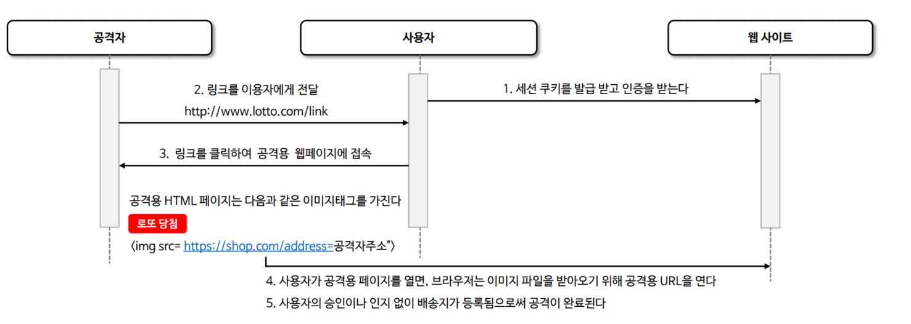

# **CSRF(Cross Site Request Forgery, 사이트 간 요청 위조)**

- 웹 애플리케이션의 보안 취약점으로 공격자가 사용자로 하여금 이미 인증된 다른 사이트에 대해 원치 않는 작업을 수행하게 만드는 기법을 말한다 
- 이 공격은 사용자의 브라우저가 자동으로 보낼 수 있는 인증 정보, 예를 들어 쿠키나 기본 인증 세션을 이용하여 사용자가 의도하지 않은 요청을 서버로 전송하게 만든다 
- 이는 사용자가 로그인한 상태에서 악의적인 웹사이트를 방문하거나 이메일 등을 통해 악의적인 링크를 클릭할 때 발생할 수 있다 

# **CSRF 진행 순서**



# **CSRF 기능 활성화**

```java
@Bean
SecurityFilterChain defaultSecurityFilterChain(HttpSecurity http) throws Exception {
	 http.csrf(Customizer.withDefaults()); 
	 return http.build();
}
```

- `csrf` 기능을 활성화 한다. 별도 설정하지 않아도 활성화 상태로 초기화 된다 
- 토큰은 서버에 의해 생성되어 클라이언트 세션에 저장되고 폼을 통해 서버로 전송되는 모든 변경 요청에 포함되어야 하며 서버는 이 토큰을 검증하여 요청의 유효성을 확인한다 
- 기본 설정은 `GET, HEAD, TRACE, OPTIONS` 같은 안전한 메소드를 무시하고 `POST, PUT, DELETE` 와 같은 변경 요청 메소드에 대해서만 `CSRF 토큰` 검사를 수행한다 
- 중요한 점은 실제 `CSRF 토큰`이 브라우저에 의해 자동으로 포함되지 않는 요청 부분에 위치해야 한다는 것으로서 `HTTP 매개변수`나 `헤더`에 `CSRF 토큰`을 요구하는 것이 `CSRF 공격`을 방지하는데 효과적이라 할 수 있다 
- 반면에 쿠키에 토큰을 요구하는 것은 브라우저가 쿠키를 자동으로 요청에 포함시키기 때문에 효과적이지 않다고 볼 수 있다 

# **CSRF 기능 비활성화**

**csrf 의 기능 전체 비활성화**

```java
@Bean
SecurityFilterChain defaultSecurityFilterChain(HttpSecurity http) throws Exception {
		http.csrf(csrf -> csrf.disabled()
		return http.build();
}
```

**csrf 보호가 필요하지 않은 특정 엔드포인트만 비활성화**

```java
@Bean
SecurityFilterChain defaultSecurityFilterChain(HttpSecurity http) throws Exception {
		http.csrf(csrf -> csrf.ignoringRequestMatchers("/api/*")); 
		return http.build();
}
```

# **CSRF 기능 테스트**

```java
@EnableWebSecurity
@Configuration
@Slf4j
public class SecurityConfig {
    @Bean
    public SecurityFilterChain securityFilterChain(HttpSecurity http, AuthenticationConfiguration configuration) throws Exception{
        http
                .authorizeHttpRequests(auth -> auth
				                .requestMatchers("/csrf").permitAll()
                        .anyRequest().authenticated());
        http
                .formLogin(Customizer.withDefaults());

        return  http.build();
    }
    @Bean
    public UserDetailsService userDetailsService(){
        UserDetails user = User
                .withUsername("user")
                .password("{noop}1111")
                .roles("USER")
                .build();
        return new InMemoryUserDetailsManager(user);
    }
}

@Slf4j
@RestController
@RequiredArgsConstructor
public class IndexController {
    // 생략 ..
    @PostMapping("/csrf")
    public String csrf(){
        return "csrf 적용";
    }
}
```

- 현재 SecurityConfig 코드를 보면 CSRF 관련 설정을 하지 않았다. 
- → Spring Security는 자동으로 CSRF 검증을 활성화 한다.
-  `/csrf` 경로는 인증이 필요하지 않는다. 

**테스트1**

```java
### Send POST request
POST http://localhost:8080/csrf
Content-Type: application/json
```

**테스트1 결과**

```java
POST http://localhost:8080/csrf

Redirections:
-> http://localhost:8080/login

<input name="_csrf" type="hidden"
       value="8Oq2OU71Z5nmfhngyebVjH916WMIIsD9nJSTOxOTvRGA7_67lt-CC3uXAa3LR3qD_8vh6UcXxAI5FqHQrqGqWnL1jCi51s2L"/>
<button class="btn btn-lg btn-primary btn-block" type="submit">Sign in</button>
```

결과를 보면 로그인 페이지(`/login`)로 리다이렉트 하였다. 

그리고 로그인 페이지에 `hidden` 타입으로 `input` 태그가 생겼다. 

그리고 `CSRF 토큰`이 보인다.

 

**테스트2**

```java
### Send POST request with csrf token
POST http://localhost:8080/csrf
Content-Type: application/x-www-form-urlencoded

_csrf=8Oq2OU71Z5nmfhngyebVjH916WMIIsD9nJSTOxOTvRGA7_67lt-CC3uXAa3LR3qD_8vh6UcXxAI5FqHQrqGqWnL1jCi51s2L
```

-  CSRF 토큰을 넣어서 다시 요청 

**테스트2 결과** 

```java
POST http://localhost:8080/csrf

csrf 적용
```

**SecurityConfig - SecurityFilterChain 수정** 

```java
@Bean
public SecurityFilterChain securityFilterChain(HttpSecurity http) throws Exception{
    http
            .csrf(csrf -> csrf.disable());
    http
            .authorizeHttpRequests(auth -> auth
                    .requestMatchers("/csrf").permitAll()
                    .anyRequest().authenticated());
    http
            .formLogin(Customizer.withDefaults());

    return  http.build();
}
```

- CSRF 비활성화 

**테스트**

```java
### Send POST request
POST http://localhost:8080/csrf
Content-Type: application/x-www-form-urlencoded
```

**테스트 결과**

```java
POST http://localhost:8080/csrf

csrf 적용
```

CSRF를 비활성화 하니까 이제 CSRF 토큰 없이도 POST 요청이 가능하다.

**SecurityConfig - SecurityFilterChain 수정** 

```java
@Bean
public SecurityFilterChain securityFilterChain(HttpSecurity http) throws Exception{
    http
            .csrf(csrf -> csrf.ignoringRequestMatchers("/csrf"));
    http
            .authorizeHttpRequests(auth -> auth
                    .requestMatchers("/csrf").permitAll()
                    .anyRequest().authenticated());
    http
            .formLogin(Customizer.withDefaults());

    return  http.build();
}
```

- `/csrf` 경로만 CSRF 검증을 하지 않도록 설정 
- 테스트 결과는 동일하다 CSRF 토큰 없이 요청이 정상 응답

