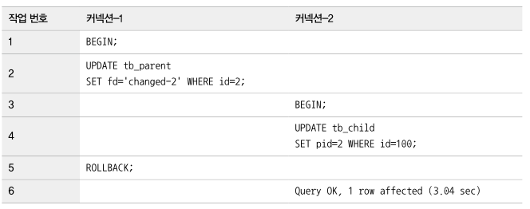
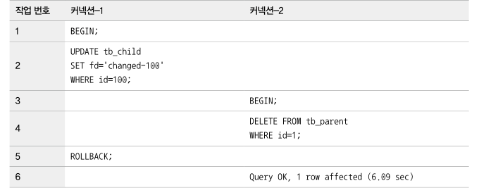

*MySQL 엔진에서 외래키는 InnoDB 스토리지 엔진만 생성이 가능하다.*

*외래키 제약이 설정되면 자동으로 연관되는 테이블 컬럼에 인덱스까지 생성된다.*

*외래키가 제거되지 않은 상태에서는 자동으로 생성된 인덱스를 삭제할 수 없다.*

***InnoDB 외래키 관리에는 중요한 2가지 특성이 있다.***

- *테이블의 변경(쓰기 잠금)이 발생하는 경우에만 잠금 경합(잠금 대기)이 발생한다.*
- *외래키와 연관되지 않은 컬럼의 변경은 최대한 잠금 경합(잠금 대기)을 발생시키지 않는다.*

***example query***

```sql
CREATE TABLE tb_parent (
		id INT NOT NULL,
    fd VARCHAR(100) NOT NULL, 
    PRIMARY KEY(id)
)
ENGINE = InnoDB;


CREATE TABEL tb_child (
		id INT NOT NULL,
    pid INT DEFAULT NULL,
    fd VARCHAR(100) DEFAULT NULL, 
    PRIMARY KEY (id),
    KEY ix_parentid(pid),
    CONSTRAINT child_ibfk_1 FOREIGN KEY (pid) REFERENCES tb_parent (id) ON DELETE CASCADE 
)
ENGINE = InnoDB:


INSERT INTO tb_parent VALUES
(1, 'parent-1'),
(2, 'parent-2');

INSERT INTO tb_child VALUES
(100, 1, 'child-100');
```

# ***8.10.1 자식 테이블의 변경이 대기하는 경우*** 



*InnoDB의 외래키 관리의 첫 번째 특징이다.*

*1번 커넥션에서 먼저 트랜잭션을 시작하고 부모 테이블에서 id가 2인 레코드에 UPDATE를 실행한다.*

*이 과정에서 1번 커넥션은 id가 2인 레코드에 대해 쓰기 잠금을 획득한다.*

*2번 커넥션에서는 자식 테이블에서 외래키 컬럼인 pid를 2로 변경하는 쿼리를 실행한다. 이 쿼리(4번 작업)은 부모 테이블의 변경 작업이 완료될 때까지 대기한다.*

*1번 커넥션에서 ROLLBACK, COMMIT으로 트랜잭션을 종료하면 2번 커넥션의 대기 중이던 작업이 즉시 처리된다.*

*즉, 자식 테이블의 외래 키 컬럼 변경은 부모 테이블의 확인이 필요한데, 이 상태에서 부모 테이블의 해당 레코드가 쓰기 잠금이 걸려 있으면 쓰기 잠금이 해제될 때까지 기다리게 된다.*

# ***8.10.2 부모 테이블의 변경 작업이 대기하는 경우*** 



*8.10.1 작업과 동일한데 순서만 변경했다.*

*커넥션1에서 부모 키 1을 참조하는 자식 테이블의 레코드를 변경하면 자식 테이블의 레코드에 쓰기 잠금을 획득한다.*

*이 상태에서 2번 커넥션이 키가 1인 레코드를 삭제하는 경우 쿼리(4번)은 자식 테이블의 레코드에 대한 쓰기 잠금이 해제될 때까지 기다려야 한다. 이는 자식 테이블이 생성될 때 정의한 외래키 특성(ON DELETE CASCADE) 때문에 부모 레코드가 삭제되면 자식 레코드도 동시에 삭제되는 방식으로 작동하기 때문이다.*

*즉, 데이터베이스에서 외래 키를 물리적으로 생성하려면 잠금 경합까지 고려해 모델링을 진행하는 것이 좋다.*

