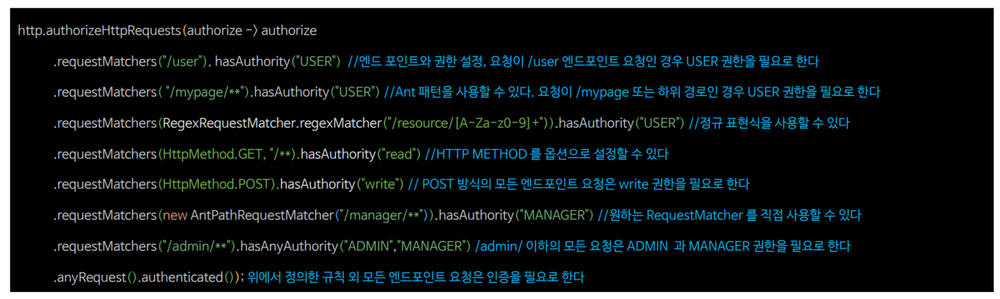
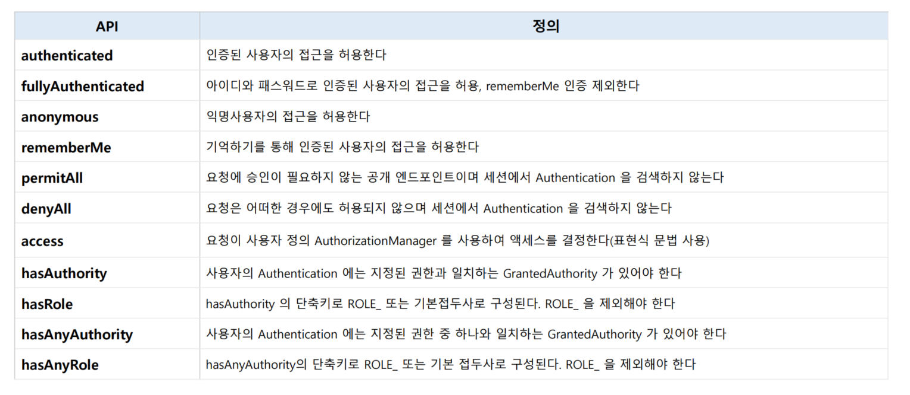
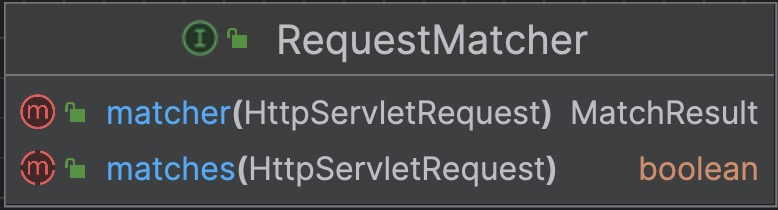
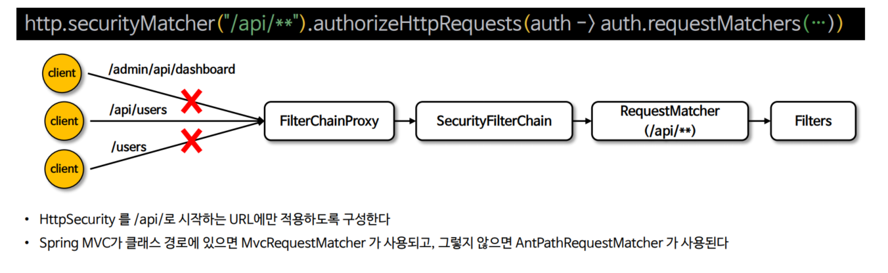
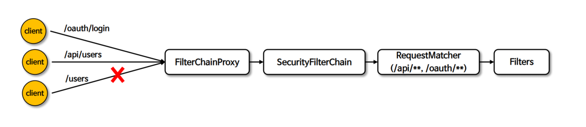
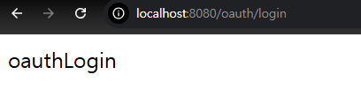
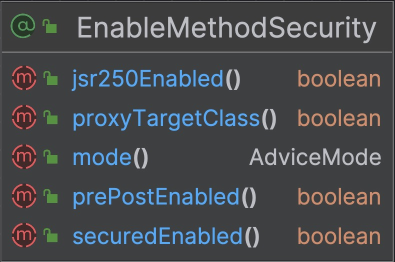
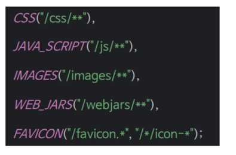
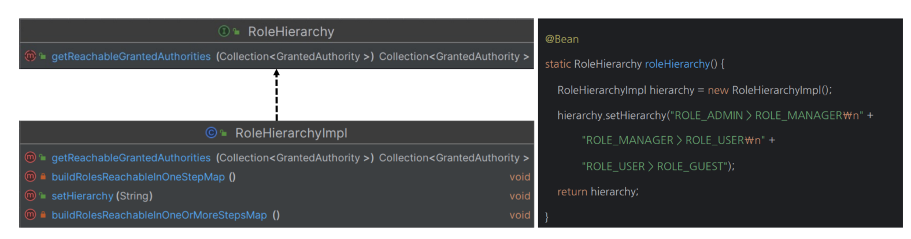

# **개요**

  - Spring Security는 요청 기반 권한 부여(Request Based Authorization)와 메소드 기반 권한 부여(Method Based Authorization)를 통해 자원에 대한 심층적인 방어를 제공한다 
  - 요청 기반 권한 부여는 클라이언트의 요청 즉 `HttpServletRequest` 에 대한 권한 부여를 모델링 하는 것이며 이를 위해 `HttpSecurity` 인스턴스를 사용하여 권한 규칙을 선언 할 수 있다 

# **요청 기반 권한 부여 - HttpSecurity.authorizeHttpRequests()**

```java
@Bean
SecurityFilterChain defaultSecurityFilterChain(HttpSecurity http) throws Exception {
		http.authorizeHttpRequests(authorize -> authorize
					.anyRequest().authenticated()); 
		return http.build();
	}
```

  - `authorizeHttpRequests()`는 사용자의 자원접근을 위한 요청 엔드포인트와 접근에 필요한 권한을 매핑시키기 위한 규칙을 설정하는 것으로서 서블릿 기반 엔드포인트에 접근하려면 `authorizeHttpRequests()` 에 해당 규칙들을 포함해야 한다 
  - `authorizeHttpRequests()` 을 통해 요청과 권한 규칙이 설정되면 내부적으로 `AuthorizationFilter` 가 요청에 대한 권한 검사 및 승인 작업을 수행한다

# **authorizeHttpRequests() API** 

**requestMatchers()**

  - `requestMatchers()` 메소드는 HTTP 요청의 URL 패턴, HTTP 메소드, 요청 파라미터 등을 기반으로 어떤 요청에 대해서는 특정 보안 설정을 적용하고 다른 요청에 대해서는 적용하지 않도록 세밀하게 제어할 수 있게 해 준다 
  - 예를 들어 특정 API 경로에만 CSRF 보호를 적용하거나, 특정 경로에 대해 인증을 요구하지 않도록 설정할 수 있다. 이를 통해 애플리케이션의 보안 요구 사항에 맞춰서 유연한 보안 정책을 구성할 수 있다 
  1. **requestMatchers(String... urlPatterns)**
• 보호가 필요한 자원 경로를 한 개 이상 정의한다
  1. **requestMatchers(RequestMatcher... requestMatchers)**
• 보호가 필요한 자원 경로를 한 개 이상 정의한다. `AntPathRequestMatcher`, `MvcRequestMatcher` 등의 구현체를 사용할 수 있다
  1. r**equestMatchers(HttpMethod method, String... utlPatterns)**
• `Http Method`와 보호가 필요한 자원 경로를 한 개 이상 정의한다

**엔드 포인트 & 권한 부여**


# **보호 자원과 권한 규칙 설정하기**



**주의 사항**

  - 스프링 시큐리티는 클라이언트의 요청에 대하여 위에서 아래로 나열된 순서대로 처리하며 요청에 대하여 첫 번째 일치만 적용되고 다음 순서로 넘어가지 않는다. 
  - `/admin/**` 가 `/admin/db` 요청을 포함하므로 의도한 대로 권한 규칙이 적용되지 않을 수 있다. 그렇기 때문에 엔드 포인트 설정 시 좁은 범위의 경로를 먼저 정의하고 그것 보다 큰 범위의 경로를 다음 설정으로 정의 해야 한다 

# **권한 규칙 종류**



  - 권한 규칙은 내부적으로 `AuthorizationManager` 클래스에 의해 재구성되며 모든 요청은 여러 종류의 `AuthorizationManager` 에 설정된 권한 규칙에 따라 승인 혹은 거부된다 

# **테스트** 

**SecurityConfig**

```java
@EnableWebSecurity
@Configuration
public class SecurityConfig {
    @Bean
    public SecurityFilterChain securityFilterChain(HttpSecurity http, HandlerMappingIntrospector introspector) throws Exception {
        http
                .authorizeHttpRequests(authorize -> authorize
                        .requestMatchers("/","/login").permitAll()
                        // "/user" 엔드포인트에 대해 "USER" 권한을 요구합니다.
                        .requestMatchers("/user").hasAuthority("ROLE_USER")
                        // "/mypage" 및 하위 디렉터리에 대해 "USER" 권한을 요구합니다. Ant 패턴 사용.
                        .requestMatchers("/myPage/**").hasRole("USER")
                        // POST 메소드를 사용하는 모든 요청에 대해 "write" 권한을 요구합니다.
                        .requestMatchers(HttpMethod.POST).hasAuthority("ROLE_WRITE")
                        // "/manager" 및 하위 디렉터리에 대해 "MANAGER" 권한을 요구합니다. AntPathRequestMatcher 사용.
                        .requestMatchers(new AntPathRequestMatcher("/manager/**")).hasAuthority("ROLE_MANAGER")
                        // "/manager" 및 하위 디렉터리에 대해 "MANAGER" 권한을 요구합니다. AntPathRequestMatcher 사용.
                        .requestMatchers(new MvcRequestMatcher(introspector, "/admin/payment")).hasAuthority("ROLE_ADMIN")
                        // "/admin" 및 하위 디렉터리에 대해 "ADMIN" 또는 "MANAGER" 권한 중 하나를 요구합니다.
                        .requestMatchers("/admin/**").hasAnyAuthority("ROLE_ADMIN", "ROLE_MANAGER")
                        // 정규 표현식을 사용하여 "/resource/[A-Za-z0-9]+" 패턴에 "MANAGER" 권한을 요구합니다.
                        .requestMatchers(new RegexRequestMatcher("/resource/[A-Za-z0-9]+", null)).hasAuthority("ROLE_MANAGER")
                        // 위에서 정의한 규칙 외의 모든 요청은 인증을 필요로 합니다.
                        .anyRequest().authenticated())

                .formLogin(Customizer.withDefaults())
                .csrf(AbstractHttpConfigurer::disable);

        return http.build();
    }
    @Bean
    public UserDetailsService userDetailsService(){
        UserDetails user = User.withUsername("user").password("{noop}1111").roles("USER").build();
        UserDetails manager = User.withUsername("manager").password("{noop}1111").roles("MANAGER").build();
        UserDetails admin = User.withUsername("admin").password("{noop}1111").roles("ADMIN","WRITE").build();
        return  new InMemoryUserDetailsManager(user, manager, admin);
    }
}
```

**IndexController, ViewController**

```java
@Slf4j
@RestController
public class IndexController {
    @GetMapping("/user")
    public String user(){
        return "user";
    }

    @GetMapping("/myPage/points")
    public String myPage(){
        return "myPage";
    }

    @GetMapping("/manager")
    public String manager(){
        return "manager";
    }

    @GetMapping("/admin")
    public String admin(){
        return "admin";
    }

    @GetMapping("/admin/payment")
    public String adminPayment(){
        return "adminPayment";
    }

    @GetMapping("/resource/address_01")
    public String address_01(){
        return "address_01";
    }

    @GetMapping("/resource/address01")
    public String address01(){
        return "address01";
    }

    @PostMapping("/post")
    public String post(){
        return "post";
    }
}

@Controller
public class ViewController {
    @GetMapping("/")
    public String index(){
        return "index";
    }
}
```

**index.html**

```java
<!DOCTYPE html>
<html xmlns:th="http://www.thymeleaf.org">
<head>
    <meta charset="UTF-8">
    <title>Spring Security Test Page</title>
</head>
<body>
<h2>Spring Security 요청 테스트</h2>
<a href="/login">로그인</a>
<a href="/logout">로그아웃</a>
<button onclick="fetchAndDisplay('/user')">User 페이지 접근</button>
<button onclick="fetchAndDisplay('/myPage/points')">MyPage 페이지 접근</button>
<button onclick="fetchAndDisplay('/manager')">Manager 페이지 접근</button>
<button onclick="fetchAndDisplay('/admin/payment')">Admin Payment 접근</button>
<button onclick="fetchAndDisplay('/admin')">Admin 페이지 접근</button>
<button onclick="fetchAndDisplay('/resource/address_01')">인증자 페이지 접근</button>
<button onclick="fetchAndDisplay('/resource/address01')">Manager 페이지 접근</button>
<button onclick="sendPostRequest()">POST 요청 보내기</button>

<script>
    function fetchAndDisplay(url) {
        fetch(url)
            .then(response => {
                if (!response.ok) throw new Error('Request failed');
                return response.text();
            })
            .then(data => alert('Response: ' + data))
            .catch(error => alert('Error: ' + error));
    }

    function sendPostRequest() {
        fetch('/post', {
            method: 'POST',
            headers: {
                'Content-Type': 'application/json',
                // 'Authorization': 'Bearer YOUR_TOKEN_HERE' // 필요한 경우 인증 토큰 추가
            },
            body: JSON.stringify({ data: 'yourDataHere' })
        })
            .then(response => {
                if (!response.ok) throw new Error('Post request failed');
                return response.text();
            })
            .then(data => alert('Post Response: ' + data))
            .catch(error => alert('Post Error: ' + error));
    }
</script>
</body>
</html>
```

# **표현식 권한 규칙 설정**

  - 스프링 시큐리티는 표현식을 사용해서 권한 규칙을 설정하도록 `WebExpressionAuthorizationManager`를 제공한다 
  - 표현식은 시큐리티가 제공하는 권한 규칙을 사용하거나 사용자가 표현식을 커스텀하게 구현해서 설정 가능하다 

# **사용 방법**

`requestMatchers().access(new WebExpressionAuthorizationManager("expression"))`

# **적용 하기** 

```java
// 요청으로부터 값을 추출할 수 있다
requestMatchers("/resource/{name}").access(new WebExpressionAuthorizationManager("#name == authentication.name")

// 여러개의 권한 규칙을 조합할 수 있다
requestMatchers("/admin/db").access(new WebExpressionAuthorizationManager("hasAuthority('DB') or hasRole('ADMIN')"))

// 2번 예시와 동일한 적용 
requestMatchers("/admin/db").access(anyOf(hasAuthority("db"), hasRole("ADMIN")))
```

# **커스텀 권한 표현식 구현**

```java
// 사용자 정의 빈 
@Component("customWebSecurity")
public class CustomWebSecurity {
		public boolean check(Authentication authentication, HttpServletRequest request) {
				return authentication.isAuthenticated(); //사용자가 인증되었는지를 검사
		}
}

@EnableWebSecurity
@Configuration
public class SecurityConfig {
		 @Bean
	   public SecurityFilterChain securityFilterChain(HttpSecurity http, ApplicationContext context) throws Exception {
			  
			  DefaultHttpSecurityExpressionHandler expressionHandler = new DefaultHttpSecurityExpressionHandler();
				expressionHandler.setApplicationContext(context);
				
				WebExpressionAuthorizationManager expressManager = 
				// 빈 이름을 참조하고 접근 제어 로직을 수행한다 
				new WebExpressionAuthorizationManager("@customWebSecurity.check(authentication,request)");
				expressManager.setExpressionHandler(expressionHandler);
				
				http.authorizeHttpRequests(authorize -> authorize
							.requestMatchers("/resource/**").access(expressManager));
				
				return http.build();
		 }
}
```

# **커스텀 RequestMatcher 구현**



  - `RequestMatcher`의 macher 및 matches 메서드를 사용하여 클라이언트의 요청객체로부터 값을 검증하도록 커스텀한 `RequestMatcher`를 구현하고 `requestMatchers()`메서드에 설정한다

**CustomRequestMatcher**

```java
public class CustomRequestMatcher implements RequestMatcher {
		private final String urlPattern;
		
		public CustomRequestMatcher(String urlPattern) {
				this.urlPattern = urlPattern;
		}
		
		@Override
		public boolean matches(HttpServletRequest request) {
				String requestURI = request.getRequestURI();
				return requestURI.startsWith(urlPattern);
		}
}

// Security Filter Chain 적용 
http .authorizeHttpRequests((authorize) -> authorize
		.requestMatchers(new CustomRequestMatcher("/api/**)).hasAuthority("USER")
		.anyRequest().authenticated());
```

# **실습 1 - Security 기본 제공 권한 표현식** 

```java
@EnableWebSecurity
@Configuration
public class SecurityConfig {
    @Bean
    public SecurityFilterChain securityFilterChain(HttpSecurity http) throws Exception {
        http
                .authorizeHttpRequests(authorize -> authorize
                        .requestMatchers("/user/{name}")
                        .access(new WebExpressionAuthorizationManager("#name == authentication.name"))

                        .requestMatchers("/admin/db")
                        .access(new WebExpressionAuthorizationManager("hasAuthority('ROLE_DB') or hasRole('ADMIN')"))
                        .anyRequest().authenticated());
        http

                .formLogin(Customizer.withDefaults())
                .csrf(AbstractHttpConfigurer::disable);

        return http.build();
    }
    @Bean
    public UserDetailsService userDetailsService(){
        UserDetails user = User.withUsername("user").password("{noop}1111").roles("USER").build();
        UserDetails manager = User.withUsername("manager").password("{noop}1111").roles("MANAGER").build();
        UserDetails admin = User.withUsername("admin").password("{noop}1111").roles("ADMIN","WRITE").build();
        return  new InMemoryUserDetailsManager(user, manager, admin);
    }
}
```

# **실습 2 - 커스텀 권한 표현식 구현**

```java
@Component("customWebSecurity")
public class CustomWebSecurity {
    public boolean check(Authentication authentication, HttpServletRequest request){
        return authentication.isAuthenticated();
    }
}

@EnableWebSecurity
@Configuration
public class SecurityConfig {
    
    @Bean
    public SecurityFilterChain securityFilterChain(HttpSecurity http, ApplicationContext context) throws Exception {

        DefaultHttpSecurityExpressionHandler expressionHandler = new DefaultHttpSecurityExpressionHandler();
        expressionHandler.setApplicationContext(context);

        WebExpressionAuthorizationManager authorizationManager =
                new WebExpressionAuthorizationManager("@customWebSecurity.check(authentication, request)");
        authorizationManager.setExpressionHandler(expressionHandler);

        http
                .authorizeHttpRequests(authorize -> authorize
                        .requestMatchers("/custom/**").access(authorizationManager)
                        .anyRequest().authenticated());
        http
                .formLogin(Customizer.withDefaults())
                .csrf(AbstractHttpConfigurer::disable);

        return http.build();
    }
    @Bean
    public UserDetailsService userDetailsService(){
        UserDetails user = User.withUsername("user").password("{noop}1111").roles("USER").build();
        UserDetails manager = User.withUsername("manager").password("{noop}1111").roles("MANAGER").build();
        UserDetails admin = User.withUsername("admin").password("{noop}1111").roles("ADMIN","WRITE").build();
        return  new InMemoryUserDetailsManager(user, manager, admin);
    }
}
```

# **실습 3 - CustomRequestMatcher**

```java
public class CustomRequestMatcher implements RequestMatcher {
    private final String urlPattern;
    public CustomRequestMatcher(String urlPattern) {
        this.urlPattern = urlPattern;
    }
    @Override
    public boolean matches(HttpServletRequest request) {
        String requestURI = request.getRequestURI();
        return requestURI.startsWith(urlPattern);
    }
}

@EnableWebSecurity
@Configuration
public class SecurityConfig {
    @Bean
    public SecurityFilterChain securityFilterChain(HttpSecurity http) throws Exception {
        http
                .authorizeHttpRequests(authorize -> authorize
                        .requestMatchers(new CustomRequestMatcher("/admin")).hasRole("ADMIN")
                        .anyRequest().authenticated());
        http
                .formLogin(Customizer.withDefaults())
                .csrf(AbstractHttpConfigurer::disable);

        return http.build();
    }
    @Bean
    public UserDetailsService userDetailsService(){
        UserDetails user = User.withUsername("user").password("{noop}1111").roles("USER").build();
        UserDetails manager = User.withUsername("manager").password("{noop}1111").roles("MANAGER").build();
        UserDetails admin = User.withUsername("admin").password("{noop}1111").roles("ADMIN","WRITE").build();
        return  new InMemoryUserDetailsManager(user, manager, admin);
    }
}
```

# **securityMatcher()**

  - securityMatcher 메소드는 특정 패턴에 해당하는 요청에만 보안 규칙을 적용하도록 설정할 수 있으며 중복해서 정의할 경우 마지막에 설정한 것으로 대체한다 
  1. **securityMatcher(String... urlPatterns)**
• 특정 자원 보호가 필요한 경로를 정의한다
  1. **securityMatcher(RequestMatcher... requestMatchers)**
• 특정 자원 보호가 필요한 경로를 정의한다. `AntPathRequestMatcher`, `MvcRequestMatcher` 등의 구현체를 사용할 수 있다

# **패턴 설정**



  - `SecurityFilterChain`은 다중 설정이 가능하다
  - `SecurityFilterChain` 각각 `RequestMatcher`, `Filters`를 가지고 있다.
  - `SecurityFilterChain` 2개 이상 존재하고 클라이언트로부터 요청이 오면 `securityMatcher` 를 통해 지정한 `RequestMatcher`에 해당하는 `SecurityFilterChain` 이 동작한다 
  - `SecurityFilterChain`  `RequestMatcher`에 해당하지 않으면 요청은 다음 `ServletFilter`로 넘어가거나 존재하지 않으면 바로 `스프링 MVC(DispatcherSevlet)`에 넘어간다. 

# **securityMatchers(Customizer<RequestMatcherConfigurer>)**

**다중 패턴 설정**

  - `securityMatchers` 메소드는 특정 패턴에 해당하는 요청을 단일이 아닌 다중 설정으로 구성해서 보안 규칙을 적용할 수 있으며 현재의 규칙은 이전의 규칙을 대체하지 않는다

**패턴 유형**

```java
// 패턴 1
http. securityMatchers((matchers) -> matchers.requestMatchers("/api/**", "/oauth/**"));

// 패턴 2
http. securityMatchers((matchers) -> matchers.requestMatchers("/api/**").requestMatchers("/oauth/**"));

// 패턴 3
http.securityMatchers((matchers) -> matchers.requestMatchers("/api/**")
 .securityMatchers((matchers) -> matchers.requestMatchers("/oauth/**"))
```



# **테스트** 

**SecurityConfig**

```java
@EnableWebSecurity
@Configuration
public class SecurityConfig {
    @Bean
    @Order(2)
    public SecurityFilterChain securityFilterChain1(HttpSecurity http) throws Exception{
        http
                .authorizeHttpRequests(authorize -> authorize
                        .anyRequest().authenticated())
                .formLogin(Customizer.withDefaults());

        return http.build();
    }
    @Bean
    @Order(1)
    public SecurityFilterChain securityFilterChain2(HttpSecurity http) throws Exception{

        http.securityMatchers(matches -> matches.requestMatchers("/api/**", "/oauth/**"));
        http
                .authorizeHttpRequests(authorize -> authorize
                        .anyRequest().permitAll())
                .formLogin(Customizer.withDefaults());

        return http.build();
    }
    @Bean
    public UserDetailsService userDetailsService(){
        UserDetails user = User.withUsername("user").password("{noop}1111").roles("USER").build();
        UserDetails manager = User.withUsername("manager").password("{noop}1111").roles("MANAGER").build();
        UserDetails admin = User.withUsername("admin").password("{noop}1111").roles("ADMIN","WRITE").build();
        return  new InMemoryUserDetailsManager(user, manager, admin);
    }
}
```

**IndexController**

```java
@RestController
public class IndexController {
    @GetMapping("/")
    public String index(){
        return "index";
    }
    @GetMapping("/user")
    public String user(){
        return "user";
    }
    @GetMapping("/user/{name}")
    public String userName(@PathVariable(value = "name") String name){
        return name;
    }
    @GetMapping("/admin/db")
    public String admin(){
        return "admin";
    }
    @GetMapping("/api/photos")
    public String photos(){
        return "photos";
    }
    @GetMapping("/oauth/login")
    public String oauth(){
        return "oauthLogin";
    }
}

```

[http://localhost:8080/api/photos](http://localhost:8080/api/photos)


[http://localhost:8080/oauth/login](http://localhost:8080/oauth/login)



`/api` , `/api/**` , `/oauth` , `/oauth/**` 경로는 `securityMathcer`를 통해서 `securityFilterChain2` 에서 처리한다 해당 경로들은 모두 `permitAll()` 이기 때문에 인증 없이 접근이 가능하다

`/user` , `/` , `/user/{name}` , `/admin/db` 경로들은 `securityFilterChain1` 에서 처리하여 모두 `authenticated()` 이기 때문에 인증이 필요하고 따라서 접근하면 `/login` 경로로 리다이렉트 

```java
@EnableWebSecurity
@Configuration
public class SecurityConfig {
    @Bean
    @Order(1)
    public SecurityFilterChain securityFilterChain1(HttpSecurity http) throws Exception{
        http
                .authorizeHttpRequests(authorize -> authorize
                        .anyRequest().authenticated())
                .formLogin(Customizer.withDefaults());

        return http.build();
    }
    @Bean
    @Order(2)
    public SecurityFilterChain securityFilterChain2(HttpSecurity http) throws Exception{

        http.securityMatchers(matches -> matches.requestMatchers("/api/**", "/oauth/**"));
        http
                .authorizeHttpRequests(authorize -> authorize
                        .anyRequest().permitAll())
                .formLogin(Customizer.withDefaults());

        return http.build();
    }
    @Bean
    public UserDetailsService userDetailsService(){
        UserDetails user = User.withUsername("user").password("{noop}1111").roles("USER").build();
        UserDetails manager = User.withUsername("manager").password("{noop}1111").roles("MANAGER").build();
        UserDetails admin = User.withUsername("admin").password("{noop}1111").roles("ADMIN","WRITE").build();
        return  new InMemoryUserDetailsManager(user, manager, admin);
    }
}
```

우선순위를 이렇게 바꾸면 모든 경로에 인증이 필요하다.

- `SecurityFilterChain` 다중 설정 

# **개요**

  - Spring Security는 요청 수준의 권한 부여뿐만 아니라 메소드 수준에서의 권한 부여를 지원한다 
  - 메서드 수준 권한 부여를 활성화 하기 위해서는 설정 클래스에 `@EnableMethodSecurity` 애노테이션을 추가해야 한다
  - `SpEL(Spring Expression Language)` 표현식을 사용하여 다양한 보안 조건을 정의할 수 있다

# **@EnableMethodSecurity**

```java
@EnableMethodSecurity
@Configuration
public class SecurityConfig {}
```



  - `jsr250Enabled()` 
- true 설정이면 JSR-250 관련 어노테이션들(`@RolesAllowed`, `@PermitAll`, `@DenyAll`)을 활성화 한다
    - default: false
  - `prePostEnabled()` 
- true 설정이면 `@PreAuthorize, @PostAuthorize, @PreFilter, @PostFilter`를 활성화 한다. 
    - default: true
  - `securedEnabled()` 
- true 설정이면 `@Secured` 를 활성화 한다
    - default: false

# **@PreAuthorize**

`@PreAuthorize` 애노테이션은 메소드가 실행되기 전에 특정한 보안 조건이 충족되는지 확인하는  데 사용되며 보통 서비스 혹은 컨트롤러 레이어의 메소드에 적용되어 메소드가 호출되기 전에 사용자의 인증 정보와 권한을 검사한다 

```java
@PreAuthorize("hasAuthority('ROLE_ADMIN')")
public void adminOnlyMethod() {
/* 관리자 역할을 가진 사용자만 실행할 수 있는 메소드 */
}

@PreAuthorize("hasAnyAuthority('ROLE_ADMIN', 'ROLE_USER')")
public void adminOrUserMethod() {
/* 관리자 또는 일반 사용자 역할을 가진 사용자가 실행할 수 있는 메소드 */
}

@PreAuthorize("isAuthenticated()")
public void authenticatedUserOnlyMethod() {
/* 인증된 사용자만 실행할 수 있는 메소드 */
}

@PreAuthorize("#id == authentication.name")
public void userSpecificMethod(String id) {
/* 인증된 사용자가 자신의 ID에 해당하는 작업을 수행할 수 있는 메소드 */
}
```

# **@PostAuthorize**

  - `@PostAuthorize` 애노테이션은 메소드가 실행된 후에 보안 검사를 수행하는 데 사용된다 
  - `@PreAuthorize` 와 다르게, `@PostAuthorize` 는 메소드 실행 후 결과에 대한 보안 조건을 검사하여 특정 조건을 만족하는 경우에만 사용자가 결과를 받을 수 있도록 한다 

```java
@PostAuthorize("returnObject.owner == authentication.name")
public BankAccount getAccount(Long id) {
	 // 계정를 반환하지만 계정의 소유자만 결과를 볼 수 있음
	 return new BankAccount();
}

@PostAuthorize("hasAuthority('ROLE_ADMIN') and returnObject.isSecure")
public BankAccount getSecureAndAdminAccount(Long id) {
		// 계정을 반환하지만 계정이 기밀이고 사용자가 관리자일 경우에만 결과를 볼 수 있음
		return new BankAccount();
}

@PostAuthorize("returnObject != null and (returnObject.status == 'APPROVED' or hasAuthority('ROLE_ADMIN'))")
public BankAccount updateRequestStatus() {
		return new BankAccount();
}
```

# **실습 -** @PreAuthorize

**SeucirtyConfig**

```java
@EnableWebSecurity
@EnableMethodSecurity
@Configuration
public class SecurityConfig {
    @Bean
    public SecurityFilterChain securityFilterChain1(HttpSecurity http) throws Exception{
        http
                .authorizeHttpRequests(authorize -> authorize
                        .anyRequest().authenticated())
                .formLogin(Customizer.withDefaults());
        return http.build();
    }
    @Bean
    public UserDetailsService userDetailsService(){
        UserDetails user = User.withUsername("user").password("{noop}1111").roles("USER").build();
        UserDetails manager = User.withUsername("manager").password("{noop}1111").authorities("ROLE_DB").build();
        UserDetails admin = User.withUsername("admin").password("{noop}1111").roles("ADMIN","WRITE").build();
        return  new InMemoryUserDetailsManager(user, manager, admin);
    }
}

```

  - `@EnableMethodSecurity` 

```java
@RestController
public class MethodController {
    @GetMapping("/")
    public String index(){
        return "index";
    }
    @GetMapping("/admin")
    @PreAuthorize("hasAuthority('ROLE_ADMIN')")
    public String admin(){
        return "admin";
    }
    @GetMapping("/user")
    @PreAuthorize("hasAnyAuthority('ROLE_ADMIN', 'ROLE_USER')")
    public String user(){
        return "user";
    }
    @GetMapping("/isAuthenticated")
    @PreAuthorize("isAuthenticated()")
    public String isAuthenticated(){
        return "isAuthenticated";
    }
    @GetMapping("/user/{id}")
    @PreAuthorize("#id == authentication.name")
    public String authentication(@PathVariable String id){
        return "id";
    }
}
```

# **실습 -** @PostAuthorize

  - Security Config 동일 

**MethodController**

```java
@RestController
public class MethodController {
    @GetMapping("/owner")
    @PostAuthorize("returnObject.owner == authentication.name and hasAnyAuthority('ROLE_USER', 'ROLE_ADMIN')")
    public Account owner(String name){
        return new Account(name, false);
    }
    @GetMapping("/isSecure")
    @PostAuthorize("returnObject.owner == authentication.name and returnObject.isSecure")
    public Account isSecure(String name, String isSecure){
        return new Account(name, "Y".equals(isSecure));
    }
}
```

# **@PreFilter**

  - `@PreFilter` 어노테이션은 메소드가 실행되기 전에 메소드에 전달된 컬렉션 타입의 파라미터에 대한 필터링을 수행하는데 사용된다 
  - `@PreFilter` 어노테이션은 주로 사용자가 보내온 컬렉션(배열, 리스트, 맵, 스트림)내의 객체들을 특정 기준에 따라 필터링하고 그 중 보안 조건을 만족하는 객체들에 대해서만 메소드가 처리하도록 할 때 사용된다 

```java
@PreFilter("filterObject.owner == authentication.name")
public Collection<BankAccount> updateAccounts(BankAccount[] data){
		return data;
}
@PreFilter("filterObject.owner == authentication.name")
public Collection<BankAccount> updateAccounts(Collection<BankAccount> data){
		return data;
}
@PreFilter("filterObject.value.owner == authentication.name")
public Collection<BankAccount> updateAccounts(Map<String, BankAccount> data){
		return data;
}
@PreFilter("filterObject.owner == authentication.name")
public Collection<BankAccount> updateAccounts(Stream<BankAccount> data){
		return data;
}
```

# **@PostFilter**

  - `PostFilter` 어노테이션은 메소드가 반환하는 컬렉션 타입의 결과에 대해 필터링을 수행하는 데 사용된다 
  - `PostFilter` 어노테이션은 메소드가 컬렉션을 반환할 때 반환되는 각 객체가 특정 보안 조건을 충족하는지 확인하고 조건을 만족하지 않는 객체들을 결과에서 제거한다 

```java
@PostFilter("filterObject.owner == authentication.name")
public List<BankAccount> readAccounts1(){
		return dataService.readList();
}
@PostFilter("filterObject.value.owner == authentication.name")
public Map<String, BankAccount> readAccounts2(){
		return dataService.readMap();
}
```

# **실습** 

**SecurityConfig**

```java
@EnableWebSecurity
@EnableMethodSecurity
@Configuration
public class SecurityConfig {
    @Bean
    public SecurityFilterChain securityFilterChain1(HttpSecurity http) throws Exception{
        http
                .csrf(AbstractHttpConfigurer::disable)
                .authorizeHttpRequests(authorize -> authorize
                        .anyRequest().authenticated())
                .formLogin(Customizer.withDefaults());
        return http.build();
    }
    @Bean
    public UserDetailsService userDetailsService(){
        UserDetails user = User.withUsername("user").password("{noop}1111").roles("USER").build();
        UserDetails manager = User.withUsername("manager").password("{noop}1111").authorities("ROLE_DB").build();
        UserDetails admin = User.withUsername("admin").password("{noop}1111").roles("ADMIN","WRITE").build();
        return  new InMemoryUserDetailsManager(user, manager, admin);
    }
}
```

**ViewController**

```java
@Controller
public class ViewController {
    @GetMapping("/method")
    public String method(){
        return "method";
    }
}
```

**method.html**

```javascript
<!DOCTYPE html>
<html xmlns:th="http://www.thymeleaf.org">
<head>
    <meta charset="UTF-8">
    <meta name="viewport" content="width=device-width, initial-scale=1.0">
    <title>Button Click Example</title>
    <script>
        function sendRequest(url) {
            const dataItems = [
                { "owner": "user", "isSecure": "N" },
                { "owner": "admin", "isSecure": "Y" },
                { "owner": "db", "isSecure": "N" }
            ];
            fetch(url, {
                method: 'POST',
                headers: {
                    'Content-Type': 'application/json'
                },
                body: JSON.stringify(dataItems),
            })
                .then(response => {
                    if (response.ok) {
                        return response.text();
                    }
                    throw new Error('Network response was not ok.');
                })
                .then(text => console.log(text))
                .catch(error => console.error('There was a problem with your fetch operation:', error));
        }
    </script>
</head>
<body>
<p><button onclick="sendRequest('/writeList')">Pre Account List</button></p>
<p><button onclick="sendRequest('/writeMap')">Pre Account Map</button></p>
<p><a href="/readList">Post Account List</a></p>
<p><a href="/readMap">Post Account Map</a></p>
</body>
</html>
```

**Account - DTO** 

```java
@NoArgsConstructor
@AllArgsConstructor
@Getter  @Setter
public class Account {
    private String owner;
    private boolean isSecure;
}

```

**MethodController**

```java
@RestController
@RequiredArgsConstructor
public class MethodController {
    private final DataService dataService;
    @GetMapping("/")
    public String index(){
        return "index";
    }
    @PostMapping("/writeList")
    public List<Account> writeList(@RequestBody List<Account> data) {
        return dataService.writeList(data);
    }
    @PostMapping("/writeMap")
    public Map<String, Account> writeMap(@RequestBody List<Account> data) {
        Map<String, Account> dataMap = data.stream()
                .collect(Collectors.toMap(Account::getOwner, account -> account));
        return dataService.writeMap(dataMap);
    }
    @GetMapping("/readList")
    public List<Account> readList() {
        return dataService.readList();
    }
    @GetMapping("/readMap")
    public Map<String, Account> readMap() {
        return dataService.readMap();
    }
}
```

**DataService**

```java
@Service
public class DataService {
    @PreFilter("filterObject.owner == authentication.name")
    public List<Account> writeList(List<Account> data) {
        return data;
    }
    @PreFilter("filterObject.value.owner == authentication.name")
    public Map<String, Account> writeMap(Map<String, Account> data) {
        return data;
    }
    @PostFilter("filterObject.owner == authentication.name")
    public List<Account> readList() {
        return new ArrayList<>(List.of(
                new Account("user",false),
                new Account("db",false),
                new Account("admin",false)
        ));
    }
    @PostFilter("filterObject.value.owner == authentication.name")
    public Map<String, Account> readMap() {
        return new HashMap<>(Map.of("user", new Account("user", false),
                "db", new Account("db", false),
                "admin", new Account("admin", false)));
    }
}

```

  - `@PostFilter`는 DB로부터 읽은 데이터를 보안 조건에 맞게 반환이 가능하다 
- 현재 사용자가 작성한 글만 return 
    - 현재 사용자가 작성한 글만 return 보단 DB에 날리는 쿼리에 where 절 통한 필터링이 더 성능상 좋을듯하다
  - `@PreFilter` 같은 경우 클라이언트에서 보내는 요청 데이터를 알아서 필터링이 가능하니 사용할 가능성이 좀 더 있어 보인다.

# **@Secured**

  - `@Secured` 어노테이션을 메소드에 적용하면 지정된 권한(역할)을 가진 사용자만 해당 메소드를 호출할 수 있으며 더 풍부한 형식을 지원하는 `@PreAuthorize` 사용을 권장한다
  - `@Secured` 어노테이션을 사용하려면 스프링 시큐리티 설정에서 `@EnableMethodSecurity(securedEnabled = true)` 설정을 활성화해야 한다

```java
@Secured("ROLE_USER")
public void performUserOperation() {
		// ROLE_USER 권한을 가진 사용자만 이 메소드를 실행할 수 있습니다.
}
```

# **JSR-250**

  - JSR-250 기능을 적용하면 `@RolesAllowed`, `@PermitAll` 및 `@DenyAll` 어노테이션 보안 기능이 활성화 된다
  - JSR-250 어노테이션을 사용하려면 스프링 시큐리티 설정에서 `@EnableMethodSecurity(jsr250Enabled = true)` 설정을 활성화해야 한다

```java
@RolesAllowed("USER")
public void editDocument() {
		// 'ROLE_USER' 권한을 가진 사용자만 문서를 편집할 수 있습니다.
}

@PermitAll
public void viewDocument() {
		// 모든 사용자가 문서를 볼 수 있습니다.
}

@DenyAll
public void hiddenMethod() {
		// 어떠한 사용자에게도 접근이 허용되지 않습니다.
}
```

# **메타 주석 사용**

  - 메서드 보안은 애플리케이션의 특정 사용을 위해 편리성과 가독성을 높일 수 있는 메타 주석을 지원한다

```java
@Target({ ElementType.METHOD, ElementType.TYPE })
@Retention(RetentionPolicy.RUNTIME)
@PreAuthorize("hasRole('ADMIN')")
public @interface IsAdmin {}

@IsAdmin
public BankAccount readAccount(Long id) {
		// ADMIN 권한을 가진 사용자에게 메소드 호출이 승인 될 수 있다
}
```

  - `@PreAuthorize("hasRole('ADMIN')")`를 다음과 같이 `@IsAdmin`으로 간소화할 수 있다

```java
@Target({ ElementType.METHOD, ElementType.TYPE })
@Retention(RetentionPolicy.RUNTIME)
@PostAuthorize("returnObject.owner == authentication.name")
public @interface RequireOwnership 

@RequireOwnership
public Account readAccount(Long id) {
	 // 'Account'가 로그인한 사용자에게 속할 경우에만 반환된다
}
```

# **특정 주석 활성화** 

```java
@EnableMethodSecurity(prePostEnabled = false)
class MethodSecurityConfig {
		@Bean
		@Role(BeanDefinition.ROLE_INFRASTRUCTURE)
		Advisor postAuthorize() {
				return AuthorizationManagerAfterMethodInterceptor.postAuthorize();
		}
}
```

  - `@EnableMethodSecurity` -  `prePostEnabled default: true` 
- 4개의 주석이 활성화 
- `@PreAuthorize, @PostAuthorize, @PreFilter, @PostFilter`
  - `@EnableMethodSecurity(prePostEnabled = false)` 
- 4개의 주석이 모두 비활성화 

```java
@Bean
@Role(BeanDefinition.ROLE_INFRASTRUCTURE)
Advisor postAuthorize() {
		return AuthorizationManagerAfterMethodInterceptor.postAuthorize();
}
```

    - `@PostAuthroize` 주석만 활성화

# **커스텀 빈을 사용하여 표현식 구현하기**

```java
@GetMapping("/delete")
@PreAuthorize("@authorizer.isUser(#root)") 
public void delete(){
		System.out.println("delete");
}

@Component("authorizer")
class MyAuthorizer{
		public boolean isUser(MethodSecurityExpressionOperations root){
				boolean decision = root.hasAuthority("ROLE_USER");
				return decision;
		}
}
```

  - `@PreAuthorize("@authorizer.isUser(#root)")`
- 빈 이름을 참조하고 접근 제어 로직을 수행한다
  - `booleandecision=root.hasAuthority("ROLE_USER")`
- 인증된 사용자가 `ROLE_USER`권한을 가지고 있는지를 검사

# **클래스 레벨 권한 부여**

```java
@Controller
@PreAuthorize("hasAuthority('ROLE_USER')")
public class MyController {
		@GetMapping("/endpoint")
		public String endpoint() {
			  return "endpoint";
		}
}
```

  - 모든 메소드는 클래스 수준의 권한 처리 동작을 상속한다

```java
@Controller
@PreAuthorize("hasAuthority('ROLE_USER')")
public class MyController {
		@GetMapping("/endpoint")
		@PreAuthorize("hasAuthority('ROLE_ADMIN')") 
		public String endpoint() {
			  return "endpoint";
		}
}
```

  - 메서드에 어노테이션을 선언한 메소드는 클래스 수준의 어노테이션을 덮어쓰게 된다
- 즉, `/endpoint` 경로는 `ADMIN` 권한을 가진 사용자만 접근이 가능하다
  - 인터페이스에도 동일한 규칙이 적용되지만 클래스가 두 개의 다른 인터페이스로부터 동일한 메서드의 어노테이션을 상속받는 경우에는 시작할 때 실패한다. 그래서 구체적인 메소드에
어노테이션을 추가함으로써 모호성을 해결할 수 있다

# **개요** 

  - 스프링 시큐리티는 `RequestMather` 인스턴스를 등록하여 무시해야 할 요청을 지정할 수 있다 
  - 주로 정적 자원(이미지, CSS, JavaScript 파일 등)에 대한 요청이나 특정 엔드포인트가 보안 필터를 거치지 않도록 설정할 때 사용된다 

# 사용 방법

```java
@Bean
public WebSecurityCustomizer webSecurityCustomizer() {
		 return (webSecurity) -> {
				 webSecurity.ignoring().requestMatchers(PathRequest.toStaticResources().atCommonLocations());
		 };
}
```

  - `StaticResourceLocation` 


# **Ignoring 보다 permitAll 권장**

```java
http.authorizeHttpRequests(auth -> auth
	 .requestMatchers("/css/**", "/images/**", "/js/**", "/webjars/**", "/favicon.*", "/*/icon-*").permitAll()
	 .requestMatchers(PathRequest.toStaticResources().atCommonLocations()).permitAll()
	 .anyRequest().authenticated());
```

  - 이전에는 모든 요청마다 세션을 확인해야 해서 성능 저하가 있었지만 스프링 시큐리티 6 부터는 권한 부여 규칙에서 필요한 경우를 제외하고는 세션을 확인하지 않는다.
  - 성능 문제가 해결되었기 때문에 모든 요청에 대해서 `permitAll` 을 사용할 것을 권장하며 정적 자원에 대한 요청일지라도 안전한 헤더를 작성할 수 있어 더 안전하다

# **개요**

  - 기본적으로 스프링 시큐리티에서 권한과 역할은 계층적이거나 상하 관계로 구분하지 않는다. 그래서 인증 주체가 다양한 역할과 권한을 부여 받아야 한다. 
  - `RoleHirerachy` 는 역할 간의 계층 구조를 정의하고 관리하는 데 사용되며 보다 간편하게 역할 간의 계층 구조를 설정하고 이를 기반으로 사용자에 대한 엑세스 규칙을 정의할 수 있다 

```java
ROLE_A>ROLE_B
ROLE_B>ROLE_C
ROLE_C>ROLE_D
```

  - `ROLE_A`를 가진 모든 사용자는 `ROLE_B, ROLE_C 및 ROLE_D`도 가지게 된다
  - `ROLE_B`를 가진 모든 사용자는 `ROLE_C 및 ROLE_D`도 가지게 된다
  - 계층적 역할을 사용하면 액세스 규칙이 크게 줄어들 뿐만 아니라 더 간결하고 우아한 형태로 규칙을 표현할 수 있다

# **구조**



  - `setHirerachy`
- 역할 계층을 설정하고 각 역할에 대해 해당 역할의 하위 계층에 속하는 모든 역할 집합을 미리 정해 놓는다
    - 역할 계층 :ROLE_A>ROLE_B>ROLE_C
  - `getReachableGrantedAuthorities` 
- 모든 도달 가능한 권한의 배열을 반환한다
    - 도달 가능한 권한은 직접 할당된 권한에 더해 역할 계층에서 이들로부터 도달 가능한 모든 권한을 의미한다
- 직접 할당된 권한 : ROLE_B
      - 도달 가능한 권한 : ROLE_B, ROLE_C

**RoleHierarchyImpl() - setHierarchy: @deprecated**

```java
@Bean
public RoleHierarchy roleHierarchy(){
    RoleHierarchyImpl hierarchy = new RoleHierarchyImpl();
    hierarchy.setHierarchy(
            "ROLE_ADMIN > ROLE_MANAGER\n"+
            "ROLE_MANAGER > ROLE_USER \n"+
            "ROLE_USER > ROLE_GUEST");
    return hierarchy;
}
```

  - `new RoleHierarchyImpl()` - `@Deprecated`
- `RoleHierarchyImpl` 기본 생성자가 `@Deprecated` 되었다.
  - `setHierarchy` - `@Deprecated`
- `RoleHierarchyImpl` `setHierarchy` 메소드 또한 `@Deprecated` 되었다.

**RoleHierarchyImpl.fromHierarchy() static 메소드** 

```java
@Bean
public RoleHierarchy roleHierarchy() {
    return RoleHierarchyImpl.fromHierarchy(
            "ROLE_ADMIN > ROLE_DB\n" +
            "ROLE_DB > ROLE_USER\n" +
            "ROLE_USER > ROLE_ANONYMOUS");
}
```

# **테스트** 

**SecurityConfig**

```java
@EnableWebSecurity
@Configuration
public class SecurityConfig {
    @Bean
    public SecurityFilterChain securityFilterChain(HttpSecurity http) throws Exception{
        
        http.authorizeHttpRequests(authorize -> authorize
                .requestMatchers("/user").hasRole("USER")
                .requestMatchers("/db").hasRole("DB")
                .requestMatchers("/admin").hasRole("ADMIN")
                .anyRequest().authenticated())
                .formLogin(Customizer.withDefaults())
                .csrf(AbstractHttpConfigurer::disable);

        return http.build();
    }
    @Bean
    public RoleHierarchy roleHierarchy() {
        return RoleHierarchyImpl.fromHierarchy(
                "ROLE_ADMIN > ROLE_DB\n" +
                "ROLE_DB > ROLE_USER\n" +
                "ROLE_USER > ROLE_ANONYMOUS");
    }
    
    @Bean
    public UserDetailsService userDetailsService(){
        UserDetails user = User.withUsername("user").password("{noop}1111").roles("USER").build();
        UserDetails db = User.withUsername("db").password("{noop}1111").authorities("ROLE_DB").build();
        UserDetails admin = User.withUsername("admin").password("{noop}1111").roles("ADMIN","SECURE").build();
        return  new InMemoryUserDetailsManager(user, db, admin);
    }
}
```

  - `/user` 경로에는 ROLE_USER, ROLE_DB, ROLE_ADMIN 권한을 가진 사용자가 접근이 가능하다 
  - `/db` 경로에는 ROLE_DB, ROLE_ADMIN 권한을 가진 사용자가 접근이 가능하다 
  - `/admin` 경로에는  ROLE_ADMIN 권한을 가진 사용자만 접근이 가능하다 

**IndexController**

```java
@RestController
public class IndexController {
    @GetMapping("/")
    public String index(){
        return "index";
    }
    @GetMapping("/user")
    public String user(){
        return "user";
    }
    @GetMapping("/db")
    public String db(){
        return "db";
    }
    @GetMapping("/admin")
    public String admin(){
        return "admin";
    }
}
```

