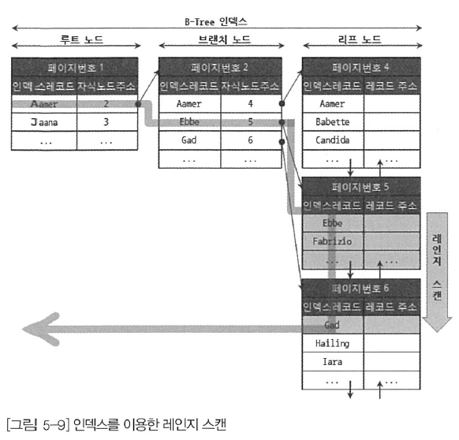
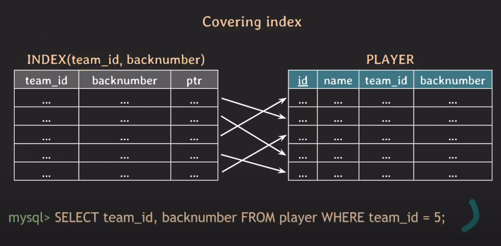
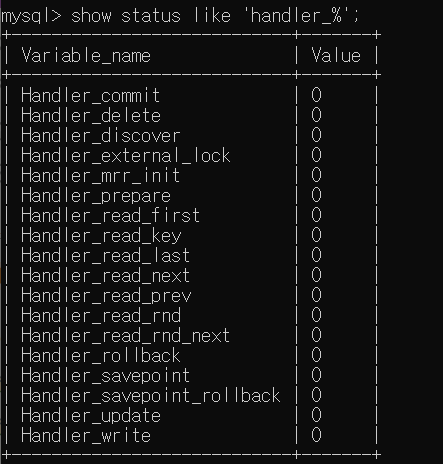
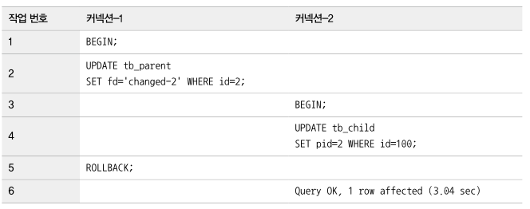
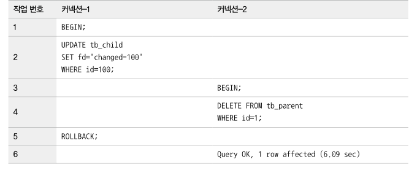

# *개요*

*인덱스는 데이터베이스의 쿼리의 성능을 언급하면서 빼놓을 수 없는 부분이다.* 

*현재의 MySQL 서버 옵티마이저가 발전하고 성능이 개선됐다고 해도 여전히 관리자(개발자)의 역할은 중요하다.* 

*그래서 인덱스에 대한 기본 지식은 지금도 앞으로도 매우 중요한 부분이며, 쿼리 튜닝의 기본이 될 것이다.*

# *개요*

*먼저* ***랜덤(Random) I/O,*** ***순차(Sequential) I/O*** *같은 디스크 읽기 방식을 알아보고 인덱스를 살펴보자* 

*컴퓨터의 CPU/메모리 같은 장치에 비해서 디스크 같은 기계식 장치의 성능은 제한적으로 발전했다.*

*데이터베이스의 성능 튜닝은 어떻게 디스크 I/O를 줄이느냐가 관건일 때가 상당히 많다.*

# *8.1.1 하드 디스크 드라이브(HDD), 솔리드 스테이트 드라이브(SSD)*

*기계식 하드 디스크 드라이브를 대체하기 위한 전자식 저장 매체인* ***SSD(Solid State Drive)****가 많이 출시되고 있다.*

*SSD 또한 기존 HDD와 같은 인터페이스를 지원해서 내장 디스크나 DAS, SAN에 그대로 사용할 수 있다.*

*SSD는 기존 HDD에서 데이터 저장용 플래터(원판)를 제거하고 그 대신 플래시 메모리를 장착하고 있다.* 

*→ 디스크 원판을 기계적으로 회전시킬 필요가 없어서 데이터를 빠르게 read/write 가능*

*순차I/O에서는 SSD, HDD 차이가 별로 없지만 랜덤I/O에서는 SSD가 훨씬 빠르다.*

*데이터베이스 서버에서 순차 I/O는 랜덤 I/O에 비해서 비중이 크지 않다.* 

*그래서 SSD는 DBMS용 스토리지에 최적이다.* 

# *8.1.2 랜덤 I/O, 순차 I/O*


*순차 I/O는 디스크에 기록하기 위해 1번의 커널에게 시스템 콜을 요청했지만, 랜덤 I/O는 3번의 시스템 콜을 요청했다.*

*즉, 디스크에 기록해야 할 위치를 찾기 위해 순차 I/O는 디스크의 헤드를 1번 움직였고, 랜덤 I/O는 3번 움직였다.*

*디스크에 데이터를 read/write 걸리는 시간은 디스크 헤더를 움직여서 읽고 쓸 위치로 옮기는 단계에서 결정된다.* 

*즉, 그림 8.3의 경우 순차 I/O는 랜덤 I/O보다 거의 3배가 더 빠르다고 볼 수 있다.* 

*디스크의 성능은 헤더의 위치 이동 없이 얼마나 많은 데이터를 한 번에 기록하느냐에 따라 결정된다* 

*그래서 랜덤 I/O 작업이 빈번한 데이터베이스 작업은 많은 버퍼(지연)기능이 내장돼 있다.*

***쿼리 튜닝의 목적***

*쿼리를 튜닝해서 랜덤 I/O를 순차 I/O로 바꿔서 실행할 방법은 그다지 많지 않다.* 

*일반적으로 쿼리를 튜닝하는 것은 랜덤 I/O 자체를 줄여주는 것이 목적이라고 할 수 있다.*

*랜덤 I/O를 줄인다는 것은 쿼리를 처리하는 데 꼭 필요한 데이터만 읽도록 쿼리를 개선하는 것을 의미*

# *개요*

***인덱스란 무엇인가?***

*1권의 책을 비유하면 책의 목차(색인)는 인덱스 책의 내용은 데이터 파일에 해당한다고 볼 수 있다.*

*책의 목차를 통해서 알아낼 수 있는 페이지 번호는 데이터 파일에 저장된 레코드(물리) 주소이다.* 

*DBMS도 데이터베이스에 있는 모든 데이터를 검색해서 원하는 결과를 가져오려면 매우 오랜 시간이 걸린다.*

*그래서 레코드가 저장된 주소를 VALUE 인덱스를 KEY로 구성된 저장 구조를 만들어 두는 것이다.*

***인덱스의 정렬, 데이터 파일의 저장 방식*** 

*DBMS의 인덱스는 주어진 칼럼의 값을 순서로 미리 정렬해서 보관한다.* 

*즉, SortedList 자료 구조를 사용한다. (인덱스의 자료 구조)*

*반대로 데이터 파일은 ArrayList와 같이 저장된 순서대로 별도의 정렬 없이 그대로 저장해 둔다.*

*SortedList 자료 구조는 데이터가 저장될 때마다 항상 값을 정렬해야 하므로 저장(INSERT, DELETE, UPDATE)하는 과정이 복잡하지만 그만큼 SELECT는 매우 빠르게 처리할 수 있다.* 

*결론적으로 DBMS의 인덱스는 데이터 저장 성능을 희생하고 그 대신 데이터의 읽기 속도를 높이는 기능이다.*

*그래서 이런 트레이드오프를 잘 이해하고 SELECT 쿼리 문장의 WHERE 조건절에 사용되는 컬럼이라고 전부 인덱스를 생성하는 등의 역효과를 불러올 행위를 하지 말아야 한다.* 

***인덱스의 분류 Primary Key, Secondary Key***

*프라이머리 키는 칼럼(들) 조합은 레코드를 식별할 수 있는 기준값이 되기 때문에 식별자라고도 부른다. NULL을 허용하지 않으며 중복을 허용하지 않는 것이 특징* 

*프라이머리 키를 제외한 나머지 모든 인덱스를 세컨더리 인덱스로 분류한다.* 

*유니크 인덱스는 프라이머리 키와 성격이 비슷하고 대체해서 사용이 가능할 수도 있다고 해서 대체 키라고 한다.* 

***데이터 저장 방식(알고리즘)으로 인덱스 분류***

*대표적으로 B-Tree 인덱스, Hash 인덱스로 구분할 수 있다.*

*B-Tree 인덱스는 컬럼의 값을 변형하지 않고 원래의 값을 이용해 인덱싱하는 알고리즘* 

*Hash 인덱스는 컬럼의 값으로 해시값을 계산해서 인덱싱하는 알고리즘으로 매우 빠른 검색O(1)을 지원하지만 Prefix 일치 같이 값의 일부만 검색하거나 범위를 검색할 때는 해시 인덱스를 사용할 수 없다. 이런 특징으로 보통 메모리 기반의 데이터베이스(Redis)에서 많이 사용한다.*

***데이터의 중복 허용 여부로 인덱스 분류*** 

*Non Unique, Unique로 구분할 수 있다.*

옵티마이저에게는 상당히 중요한 문제가 된다. 유니크 인덱스에 대해 동등 조건(Equal, =)으로 검색한다는 것은 항상 1건의 레코드만 찾으면 더 찾지 않아도 된다는 것을 알려주는 효과를 낸다.

***인덱스의 기능별로 분류***

*전문 검색용 인덱스, 공간 검색용 인덱스*

# *개요*

[https://20240228.tistory.com/416](https://20240228.tistory.com/416)

*B-Tree는 칼럼의 원래 값을 변형시키지 않고 인덱스 구조체 내에서는 항상 정렬된 상태로 유지한다.*

*대부분의 인덱스는 B-Tree를 사용할 정도로 일반적인 용도에 적합한 알고리즘? 자료구조 이다.*

*B-Tree에는 여러가지 변형된 형태의 알고리즘이 있는데 DBMS에서는 주로 B+-Tree 또는 B*-Tree가 사용된다. 여기서 B는 Binary(이진)이 아닌 Balanced(균형)을 의미한다.*

*사실 B-Tree는 Binary Tree의 advanced balanced tree이다.*

# *8.3.1 구조 및 특성*

*B-Tree 구조는 트리 구조의 최상위에 루트 노드(Root Node)가 존재하고 그 하위에 자식 노드가 붙어 있는 형태* 

*트리 구조의 가장 하위에 있는 노드를 리프 노드(Leaf Node)라 하고 리프 노드도 아니고 루트 노드도 아닌 중간 노드를 브랜치 노드(Branch Node)라고 한다.*

*인덱스의 리프 노드는 항상 실제 데이터 레코드를 찾아가기 위한 주솟값을 가지고 있다.*


*인덱스의 키 값은 항상 정렬된 상태, 하지만 데이터 파일의 레코드는 정렬돼 있지 않고 임의의 순서로 저장돼 있다.* 

*데이터 파일의 레코드는 INSERT 순서대로 저장되지 않는다. 테이블의 레코드를 전혀 변경(DELETE)하지 않고 INSERT만 수행한다면 맞지만 삭제되어 빈 공간이 생기면 DBMS는 공간을 재활용한다.*

*인덱스는 테이블의 키 컬럼만 가지고 있으므로 나머지 컬럼을 읽으려면 데이터 파일에서 레코드를 찾아야 한다.* 

*인덱스의 리프 노드에는 데이터 파일에 저장된 레코드의 주소를 가진다.*


*MyISAM 테이블의 프라이머리 키, 세컨더리 인덱스는 모두 데이터 파일에 저장된 레코드의 ROWID 값을 포인터(물리적인 주소)로 가진다.*

*반면 InnoDB 테이블은 프라이머리키가 ROWID 역할을 한다. 즉, 프라이머리 키가 논리적인 주소를 가진다.*

*그래서 InnoDB 테이블은 인덱스를 통해 레코드를 읽을 때 데이터 파일을 바로 찾아가지 못한다.* 

*인덱스에 저장돼 있는 프라이머리 키 값을 이용해 프라이머리 키 인덱스를 한번 더 검색한 후, 프라이머리 키 인덱스의 리프 페이지에 저장돼 있는 레코드를 읽는다.*

*세컨더리 인덱스를 통한 검색에서 데이터 레코드를 읽기 위해서는 반드시 프라이머리 키를 저장하고 있는 B-Tree를 다시 한번 검색해야 한다.* 

*이런 작업 구조로 인해서 InnoDB 스토리지 엔진을 사용하는 테이블은 성능이 떨어질 것처럼 보이지만 MyISAM 인덱스 구조와 InnoDB 인덱스 구조는 각각의 장단점이 있다.*

# *8.3.2 B-Tree 인덱스 키 추가 및 삭제*

*테이블의 레코드를 저장하거나 변경하는 경우 인덱스 키 추가나 삭제 작업이 발생한다.* 

### *인덱스 키 추가* 

*B-Tree 인덱스를 추가하는 작업은 메모리와 CPU에서 처리하는 시간이 아닌 디스크로부터 인덱스 페이지를 읽고 쓰기를 하는 시간이다. 
또한 균형 트리여서 리프 노드가 꽉 차서 더는 저장할 수 없을 때 리프 노드가 분리돼야 하는데, 이는 상위 브랜치 노드까지 처리의 범위가 넓어진다.*

*이러한 작업 특성 탓에 B-Tree는 쓰기 작업에 비용이 많이 든다.* 

*그래서 InnoDB는 인덱스 키 추가 작업을 지연시켜 나중에 처리할 수 있다. (체인지 버퍼)*

*하지만 PK나 유니크 인덱스 같은 경우 중복 체크가 필요하기 때문에 즉시 B-Tree에 추가하거나 삭제한다.*

### *인덱스 키 삭제*

*해당 키 값이 저장된 B-Tree 리프 노드를 찾아서 삭제 마크만 하면 작업이 끝난다.*

*삭제 마킹된 인덱스 키 공간은 그대로 방치하거나 재활용할 수 있다.*

이 작업 또한 디스크 I/O가 필요한 작업이다. 

*MySQL 5.5 이상 버전에서는 삭제 작업 또한 지연 처리될 수 있다. (체인지 버퍼)*

### *인덱스 키 변경*

*인덱스 키 값은 그 값에 따라 저장될 리프 노드의 위치가 결정되므로 단순히 인덱스상의 키 값만 변경하는 것은 불가능하고 삭제 이후 키를 추가하는 형태로 처리된다.*

*삭제, 추가 작업은 인덱스 키 추가, 삭제 설명과 동일하게 진행되고 이 작업 모두 체인지 버퍼를 활용해 지연 처리 될 수 있다.*

### *인덱스 키 검색*

*INSERT, DELETE, UPDATE 작업을 할 때 인덱스 관리에 대한 추가 비용을 감당하면서 인덱스를 구축하는 이유는 빠른 검색을 위해서다.*

*인덱스를 검색하는 작업은 루트 노드 → 브랜치 노드 → 리프 노드로 이동하면서 비교 작업을 수행하는데 이 과정을 트리 탐색이라고 한다.*

*트리 탐색은 SELECT 뿐만 아니라 UPDATE, DELETE 같은 작업에서 검색해야 할 경우에도 사용된다.*

*인덱스는 결국 키 값으로 정렬되기 때문에 정렬된 효과를 누릴 수 없는 경우라면 인덱스 사용이 불가능하다. → 키 값의 뒷부분만 검색*

*InnoDB 테이블에서 지원하는 레코드 잠금이나 넥스트 키락(갭락)이 검색을 수행한 인덱스를 잠근 후 테이블의 레코드를 잠그는 방식으로 구현돼 있다.*

*따라서 UPDATE, DELETE가 실행될 때 적절한 인덱스가 없으면 불필요하게 많은 레코드를 잠근다.* 

*이는 InnoDB 스토리지 엔진에서 인덱스 설계가 얼마나 중요한지를 나타낸다.* 

# *8.3.3 B-Tree 인덱스 사용에 영향을 미치는 요소*

### ***인덱스 키 값의 크기*** 

*InnoDB에서 디스크에 데이터를 저장하는 기본 단위를 페이지(Page) 또는 블록(Block)이라고 한다.*

*인덱스 또한 페이지 단위로 관리된다.*

*일반적으로 DBMS B-Tree 구조는 자식 노드의 개수가 가변적인 구조다.*

*MySQL B-Tree는 자식 노드의 개수가 인덱스 페이지의 크기와 인덱스 값의 크기에 따라 결정된다.*

*`innodb_page_size`* *시스템 변수를 통해서 4KB ~ 64KB 사이의 값을 선택할 수 있지만 기본은 16KB이다.*

*인덱스의 키가 16바이트면 다음 그림과 같이 인덱스 페이지가 구성된다.*


*인덱스 페이지(16KB)에 몇 개의 키를 저장할 수 있을까?*

*16^1024 /(16 + 12) = 585개* 

*인덱스 키 값이 커지면 어떤 현상이 벌어질까? 키 값의 크기가 두 배인 32바이트로 늘어났다고 가정*

*16^1024/(32 + 12)  = 372개*

*만약 SELECT 쿼리가 레코드 500개를 읽어야 한다면 전자는 인덱스 페이지 한번으로 해결될 수도 있지만 후자는 최소 2번 이상 디스크로부터 읽어야 한다.*

*즉, 디스크 I/O 작업이 늘어난다.*

*또한 인덱스 키 값의 길이가 길어진다는 것은 전체적인 인덱스 크기가 커진다는 것을 의미한다.
즉, 인덱스를 캐시하는 InnoDB 버퍼 풀에 캐시해 둘 수 있는 레코드 수가 줄어든다.*

### *B-Tree 깊이*

*B-Tree 인덱스의 깊이는 중요하지만 직접 제어할 방법은 없다.*

*B-Tree 깊이는 값을 검색할 때 몇 번이나 랜덤하게 디스크를 읽어야 하는지와 직결되는 문제다.*

*인덱스 키 값이 커지면 하나의 인덱스 페이지에 담을 수 있는 인덱스 키 값의 개수가 적어지고, 그 때문에 같은 레코드 컨수라 하더라도 B-Tree의 깊이가 깊어져서 디스크 읽기가 더 많이 필요하게 된다는 것을 의미한다.*

### ***카디날리티(Cardinality, 기수성)***

*카디날리티는 특정 컬럼에 존재하는 데이터의 고유성을 의미한다.*

*카디날리티가 높을수록 중복도는 낮아진다.*

*인덱스는 카디날리티가 높을수록 검색 대상이 줄어들기 때문에 그만큼 빠르게 처리된다.*

*MySQL 서버에서는 인덱스의 통계 정보(유니크한 값의 개수)관리*

***예시 조건*** 

*country 컬럼, city 컬럼이 포함된 tb_test 테이블 존재*

*전체 레코드 건수는 1만, country 컬럼으로만 인덱스가 생성된 상태* 

***케이스 A:*** *country 컬럼의 유니크한 값의 개수 10개* 

***케이스 B:*** *country 컬럼의 유니크한 값의 개수 1,000개*

***Query***

```sql
SELECT *
FROM tb_test
WHERE country = 'KOREA' AND city = 'SEOUL';
```

*해당 쿼리를 실행하면 A 케이스는 평균 1,000건 B 케이스는 평균 10건이 조회될 수 있다는 인덱스의 통계 정보(유니크 값의 개수)로 예측할 수 있다.*

*케이스 A, B를 모두 만족하는 레코드 1건만 있었다면 A 케이스는 쓸모없는 레코드를 999건의 레코드를 더 읽은 것이지만 B 케이스는 9건만 더 읽은 것이다.*

*즉, A 케이스 같은 경우 인덱스가 적합하지 않은 것이라고 볼 수 있다.*

***예시 조건***

```sql
CREATE TABLE tb_city(
		 country VARCHAR(10),
		 city VARCHAR(10),
		 INDEX ix_country (country)
);
```

*tb_city 테이블 전체 레코드 건수 1만, 인덱스는 country만 존재*

*국가, 도시 중복해서 저장 X*

***Query***

```sql
SELECT *
FROM tb_city
WHERE country = 'KOREA' AND city = 'SEOUL';
```

***case: country 컬럼의 유니크 개수 10개***

*국가, 도시 중복해서 저장하지 않고 country 컬럼의 유니크 값이 10개이므로 tb_city 테이블에는 10개의 나라(country)정보가 저장돼 있다.*

*즉, ‘KOREA’ 조건의 인덱스를 검색하면 대략적으로 (10000/10)이 일치한다*

*찾는 레코드는 1건이므로 999건은 불필요하게 읽은 것으로 볼 수 있다.*

***case: country 컬럼의 유니크 개수 1000개***

*유니크한 나라가 1000개니까 tb_city 테이블에는 대략 한 국가당 대략 10개의 도시 정보가 저장돼 있다. 그래서 ‘KOREA’ 조건 인덱스 검색을 하면 (10000/1000)이 일치하고 찾는 레코드는 1건이므로 9건만 불필요하게 읽은 것이다.* 

***정리***

*같은 결과를 받지만 MySQL 서버가 수행한 작업 내용 편차는 매우 크다.* 

*이처럼 인덱스에서 유니크한 값의 개수는 인덱스나 쿼리의 효율성에 큰 영향을 준다.*

### *읽어야 하는 레코드의 건수* 

*인덱스를 통해 테이블의 레코드를 읽는 행위는 인덱스를 거치지 않고 바로 테이블의 레코드를 읽는 것보다 높은 비용이 드는 작업이다.*

*인덱스 (루트 → 브랜치 → 리프) → 프라이머리 인덱스(루프 → 브랜치 → 리프(데이터 파일)* 

*만약 테이블에 100만 건이 저장돼 있는데, 그중에서 50만 건을 읽는 쿼리가 있다고 가정*

*이 작업은 전체 테이블을 모두 읽어서 필요 없는 50만 건을 버리는 것이 효율적인지, 인덱스를 통해 필요한 50만 건만 읽어 오는 것이 효율적일지 판단해야 한다.*

*옵티마이저는 인덱스를 통해 레코드 1건을 읽는 것이 테이블을 통해 직접 읽는 것 보다 4~5배 정도 비용이 더 많이 드는 것으로 예측을 한다.*

*읽어야 할 레코드의 건수가 전체 테이블의 20%~25%를 넘어서면 인덱스를 사용하지 않는 것이 효율적이다. 그래서 이런 케이스에 옵티마이저는 인덱스를 사용하지 않고 테이블을 처음부터 끝까지 읽어서 처리할 것이다.* 

# *8.3.4 B-Tree 인덱스를 통한 데이터 읽기* 

*MySQL이 인덱스를 이용하는 대표적인 3가지 방법을 알아보자*

### *인덱스 레인지 스캔*

*인덱스의 접근 방법 가운데 가장 대표적이고 빠른 방식이다.*

***Query Example***

```sql
SELECT * FROM EMPLOYEES WHERE FIRST_NAME BETWEEN 'Ebbe' AND 'Gad';
```



*인덱스 레인지 스캔은 인덱스의 범위가 결정됐을 때 사용하는 방식이다.*

*루트 노드 → 브랜치 노드 → 리프 노드까지 찾아 들어가야만 레코드의 시작 지점을 찾을 수 있다.*

*시작해야 할 위치를 찾으면 그때부터는 리프 노드의 레코드만 순서대로 읽으면 된다.*

*이렇게 차례대로 쭉 읽는 행위를 스캔이라고 한다.*

*스캔을 하다가 리프 노드의 끝까지 읽으면 리프 노드 간의 링크를 이용해 다음 리프 노드를 찾아서 다시 스캔을 한다.*

*최종적으로 스캔이 끝나면 지금까지 읽은 레코드를 사용자에게 반환하고 쿼리는 종료된다.*


*스캔 시작 위치를 검색하고 해당 지점부터 필요한 방향(내림차순, 오름차순)으로 인덱스를 읽어 나가는 과정이다. 인덱스의 특성상 정렬되어 있기 때문에 스캔 방식과 상관없이 칼럼의 정순 또는 역순으로 정렬된 레코드를 가져온다.*

*인덱스의 리프 노드에서 검색 조건에 일치하는 건들은 데이터 파일에서 레코드를 읽어오는 과정이 필요하다.*

이때 리프 노드에 저장된 레코드 주소(실제 물리 주소)를 바탕으로 읽어오는데, 레코드 한 건 단위로 랜덤 I/O가 발생한다. 

*이런 특성 때문에 인덱스를 통한 데이터 레코드를 읽는 작업은 비용이 많이 드는 작업으로 분류된다.*

***인덱스 레인지 스캔 동작 정리***

  1. ***인덱스 스캔(Index Scan):*** *인덱스 조건을 만족하는 값이 저장된 위치(리프 노드)를 찾는다.*
  1. *인덱스 스캔에서 찾은 위치부터 인덱스를 쭉 차례대로 읽는다. 1번 + 2번을 인덱스 스캔으로 통칭하기도 한다.*
  1. *2번에서 읽어 들인 인덱스 키와 레코드 주소를 이용하여 레코드가 저장된 페이지를 가져오고, 최종적으로 레코드를 읽어온다. 이때 랜덤 I/O가 발생한다.*

***커버링 인덱스 (Covering Index)***



*쿼리가 필요로 하는 데이터에 따라 3번 과정이 필요하지 않을 수 있다.* 

*해당 쿼리는 인덱스로 team_id, back_number가 존재하고 다른 컬럼 데이터는 필요 하지 않는다.*

*커버링 인덱스로 처리되는 쿼리는 디스크의 레코드를 읽지 않아도 되기 때문에 랜덤 I/O가 줄어들고 성능이 그만큼 빨라진다.* 

***MySQL 서버에서의 인덱스 작업 수행 확인 방법***

```sql
SHOW STATUS LIKE 'Handler_%';
```



*`Handler_read_key`**: 1번 단계가 실행된 횟수* 

*`Handler_read_next`**,* *`Handler_read_prev`* *: 2번 단계가 실행된 횟수* 

*`Handler_read_last, Handler_read_first`* *: MIN(), MAX() 같이 제일 큰 값 또는 작은 값만 읽는 경우 증가* 

*이 상태 값들은 읽은 인덱스 레코드 건수를 의미하지, 인덱스를 통해 테이블의 레코드를 읽었는지(3번 단계)는 구분하지 않는다.*

*→ 즉, 인덱스를 얼마나 사용했는지 알 수 있는 상태 값이다.*

### *인덱스 풀 스캔*

*인덱스 풀 스캔은 인덱스를 사용하지만 인덱스 레인지 스캔과 다르게 인덱스의 처음부터 끝까지 모두 읽는 방식을 인덱스 풀 스캔이라고 한다.*

*대표적으로 쿼리의 조건절에 사용된 컬럼이 인덱스의 첫 번째 컬럼이 아닌 경우 인덱스 풀 스캔 방식이 적용된다.*

*→ 인덱스 (A, B, C) 순서 쿼리의 조건절은 B, C로 검색하는 경우* 

→ *`SELECT COUNT(*) FROM employee`*

*일반적으로 인덱스의 크기는 테이블 크기보다 작다. 그래서 인덱스만 읽는 것이 효율적이다.* 

*쿼리가 인덱스에 명시된 컬럼만으로 조건(WHERE)을 처리할 수 있는 경우 주로 이 방식이 사용된다.*

*인덱스뿐만 아니라 데이터 레코드까지 모두 읽어야 한다면 절대 이 방식으로 처리되지 않는다.*


*인덱스의 리프 노드의 제일 끝(앞/뒤)로 이동한 후, 인덱스의 리프 노드를 연결하는 링크드 리스트를 따라서 처음부터 끝까지 스캔하는 방식을 인덱스 풀 스캔이라고 한다.* 

*이 방식은 인덱스 레인지 스캔 방식보다는 빠르지 않지만 데이터 풀 스캔보다는 효율적이다.* 

*하지만 인덱스 풀 스캔 방식은 인덱스를 이용하는 것이지만 효율적인 방식이 아니며, 일반적으로 인덱스의 생성 목적이 아니다.* 

### *루스 인덱스 스캔*

*루스 인덱스 스캔은 말 그대로 느슨하게(듬성등섬) 인덱스를 읽는 것을 의미한다.*

인덱스 레인지 스캔과 비슷하게 동작하지만 중간에 필요치 않은 인덱스 키 값은 무시하고 넘어간다.

*일반적으로 GROUP BY 또는 집합 함수 가운데 MAX(), MIN() 함수에 대해 최적화를 하는 경우 사용된다.*

***example***

```sql
SELECT DEPT_NO, MIN(EMP_NO)
FROM   DEPT_EMP
WHERE  DEPT_NO BETWEEN 'd002' AND 'd004'
GROUP BY DEPT_NO;
```

  

*DEPT_EMP 테이블은 DEPT_NO, EMP_NO 두 개의 컬럼으로 컴포짓 인덱스가 생성돼 있다.*

*또한 해당 인덱스는 (DEPT_NO, EMP_NO) 조합으로 오름차순 정렬돼 있다.*

*그래서 DEPT_NO 그룹의 첫 번째 EMP_NO 값만 읽으면 된다.*

*즉, 인덱스의 WHERE 조건을 만족하는 범위 전체를 다 스캔할 필요가 없다는 것을 옵티마이저는 알고 있기 때문에 조건에 맞지 않는 레코드는 넘어간다.* 

### *인덱스 스킵 스캔*

*데이터베이스에서 인덱스 핵심은 값이 정렬돼 있다는 것이다.*

*그래서 인덱스를 구성하는 컬럼의 순서는 매우 중요하다.*

***EMPLOYEES 테이블에 인덱스 추가***

```sql
ALTER TABLE EMPLOYEES
ADD INDEX id_gender_birthdate (gender, birth_date);
```

*해당 인덱스를 사용하려면 WHERE 조건절에 gender 컬럼에 대한 비교 조건이 필수다.*

```sql
// 인덱스 사용하지 못하는 쿼리 
SELECT * FROM EMPLOYEES WHERE birth_date >= '1965-02-01';


// 인덱스를 사용할 수 있는 쿼리 
SELECT * FROM EMPLOYEES WHERE gender='M' AND birth_date >= '1965-02-01';
```

*이전 버전의 MySQL은 인덱스를 사용하지 못하는 첫 번째 쿼리는 birth_date 컬럼부터 시작하는 인덱스를 새로 생성해야만 했다.*

*하지만 MySQL 8.0 버전 부터는 옵티마이저가 gender 칼럼을 건너뛰어서 birth_date 컬럼만으로도 인덱스 검색이 가능하게 해주는 인덱스 스킵 스캔(Index Skip Scan) 최적화 기능이 도입됐다.* 

*이전 버전에서도 루스 인덱스 스캔이라는 기능이 있었지만 해당 기능은 group by 작업을 처리하기 위한 쿼리에만 적용이 가능했다.*

***실행 계획 확인하기*** 

```sql
mysql> SET optimizer_switch='skip_scan=off';
Query OK, 0 rows affected (0.00 sec)

mysql> EXPLAIN SELECT gender, birth_date FROM employees WHERE birth_date>='1965-02-01';
+----+-------------+-----------+------------+-------+---------------+---------------------+---------+------+--------+----------+--------------------------+
| id | select_type | table     | partitions | type  | possible_keys | key                 | key_len | ref  | rows   | filtered | Extra                    |
+----+-------------+-----------+------------+-------+---------------+---------------------+---------+------+--------+----------+--------------------------+
|  1 | SIMPLE      | employees | NULL       | index | NULL          | ix_gender_birthdate | 4       | NULL | 300719 |    33.33 | Using where; Using index |
+----+-------------+-----------+------------+-------+---------------+---------------------+---------+------+--------+----------+--------------------------+
1 row in set, 1 warning (0.00 sec)

mysql> EXPLAIN SELECT gender, birth_date FROM employees WHERE gender='M' AND birth_date>='1965-02-01';
+----+-------------+-----------+------------+-------+---------------------+---------------------+---------+------+------+----------+--------------------------+
| id | select_type | table     | partitions | type  | possible_keys       | key                 | key_len | ref  | rows | filtered | Extra                    |
+----+-------------+-----------+------------+-------+---------------------+---------------------+---------+------+------+----------+--------------------------+
|  1 | SIMPLE      | employees | NULL       | range | ix_gender_birthdate | ix_gender_birthdate | 4       | NULL |   27 |   100.00 | Using where; Using index |
+----+-------------+-----------+------------+-------+---------------------+---------------------+---------+------+------+----------+--------------------------+
1 row in set, 1 warning (0.00 sec)
```

*MySQL 8.0 이전 버전의 동작 방식을 알아보기 위해 인덱스 스킵 스캔 off*

*type: index의 의미는 풀 인덱스 스캔을 의미한다.*

*만약 employees 테이블의 모든 컬럼을 가져와야 했다면 테이블 풀 스캔을 실행했을 것이다.*

```sql
mysql> SET optimizer_switch='skip_scan=on';
Query OK, 0 rows affected (0.00 sec)

mysql> EXPLAIN SELECT gender, birth_date FROM employees WHERE birth_date>='1965-02-01';
+----+-------------+-----------+------------+-------+---------------------+---------------------+---------+------+--------+----------+----------------------------------------+
| id | select_type | table     | partitions | type  | possible_keys       | key                 | key_len | ref  | rows   | filtered | Extra                                  |
+----+-------------+-----------+------------+-------+---------------------+---------------------+---------+------+--------+----------+----------------------------------------+
|  1 | SIMPLE      | employees | NULL       | range | ix_gender_birthdate | ix_gender_birthdate | 4       | NULL | 100229 |   100.00 | Using where; Using index for skip scan |
+----+-------------+-----------+------------+-------+---------------------+---------------------+---------+------+--------+----------+----------------------------------------+
1 row in set, 1 warning (0.00 sec)
```

*인덱스 스킵 스캔 on*

*type: range 인덱스에서 꼭 필요한 부분만 읽었다는 것이다. 인덱스를 잘 활용했다고 평가할 수 있다.*

*Extra 컬럼에  “Using index for skip scan”이라는 문구가 표시됐는데, 이는 ix_gender_birthdate 인덱스에 대해 인덱스 스킵 스캔을 활용해 데이터를 조회했다는 것을 의미한다.*

*MySQL 옵티마이저는 먼저 gender 컬럼에서 유니크한 값을 모두 조회해서 주어진 쿼리에 gender 컬럼 조건을 추가해서 쿼리를 다시 실행하는 형태로 처리한다.*


***인덱스 스캔의 단점***

  - *WHERE 조건절에 조건이 없는 인덱스의 선행 컬럼의 유니크한 값의 개수가 적어야함*
  - *쿼리가 인덱스에 존재하는 컬럼만으로 처리 가능해야 함(커버링 인덱스)*

*유니크한 값의 개수가 많아지면 인덱스에서 스캔해야 할 시작 지점을 검색하는 작업이 많이 필요해진다. 그래서 오히려 쿼리의 처리 성능이 더 느려질 수 있다.*

*커버링 인덱스 제약사항은 옵티마이저가 개선되면 충분히 해결될 수 있는 부분으로 보인다.*

# *8.3.5 다중 컬럼(Multi-Column) 인덱스*

*실제 서비스용 데이터베이스에서는 2개 이상의 컬럼을 포함하는 컴포짓 인덱스가 더 많이 사용된다.*

*2개 이상의 컬럼이 연결됐다고 해서 Concatenated Index 라고도 한다.*

*다중 컬럼 인덱스에서 중요한 점은 컬럼의 순서이다.*

*인덱스 컬럼의 순서에 따라서 정렬되기 때문이다.*

# *8.3.6 B-Tree 인덱스의 정렬 및 스캔 방향* 

*인덱스를 생성할 때 설정한 정렬 규칙(DESC, ASC)에 따라서 인덱스 키 값은 항상 오름차순 또는 내림차순으로 정렬되어 저장된다.*

*하지만 인덱스 생성과 상관없이 읽는 순서는 쿼리에 따라서 달라질 수 있다.’*

### ***인덱스의 정렬*** 

*인덱스를 생성하는 시점에 인덱스를 구성하는 각 컬럼의 정렬을 ASC, DESC 순으로 설정할 수 있다.*

```sql
CREATE INDEX ix_teamname_userscore ON employees (team_name ASC, user_score DESC);
```

### ***인덱스의 스캔 방향*** 

```sql
SELECT *
FROM employees
ORDER BY first_name DESC
LIMIT 1;
```

*만약 first_name 인덱스가 오름차순으로 정렬되어 있다면 옵타마이저는 처음부터 끝까지 읽어 가장 마지막 레코드의 값 하나를 가져올까?*

*그렇지 않다. 옵티마이저는 최솟값부터 읽으면 오름차순으로 값을 가져올 수 있고, 최댓값부터 꺼꾸로 읽으면 내림차순으로 값을 가져올 수 있다는 것을 MySQL 옵티마이저는 이미 알고 있다.*

*즉, 생성 시점에 인덱스의 정렬이 결정되지만 인덱스를 사용하는 시점에 동적으로 인덱스를 읽는 방향에 따라 오름차순 또는 내림차순 정렬 효과를 얻을 수 있다.*

*쿼리의 ORDER BY 처리나 MIN(), MAX() 함수 등의 최적화가 필요한 경우에도 옵티마이저는 읽기 방향을 전환해서 사용하도록 실행 계획을 만들어 낸다.*

### *내림차순 인덱스* 

[https://tech.kakao.com/posts/351](https://tech.kakao.com/posts/351)

  - *인덱스 페이지 간 연결이 single - linked list여서 오름차순 스캔은 빠르지만 
역순 스캔은 현재 페이지가 이전 페이지의 주솟값을 가지지 않기 때문에 느리다. 
데이터 페이지(프라이머리 인덱스의 리프 노드가 가지는 실제 레코드 물리 주소 좌표)는 double - linkedlist 이다.*
  - *데이터 페이지는 double - linkedlist 구조이지만 데이터가 정렬되어 있지 않는 구조이기 때문에 결국 원하는 레코드의 읽기(커버링 인덱스가 아닌 경우)는 랜덤 I/O가 발생한다.*
  - *역순 스캔과 정순 스캔의 차이는 있지만 크지는 않다. 쿼리 튜닝의 효과가 나타나는 곳은 결국 데이터 페이지의 랜덤 I/O 숫자를 줄이는 데 있다.*
  - *그래도 테이블의 역순 스캔이 많이 발생하는 서비스라면 기존 인덱스의 역순 인덱스를 고려할만하다.*

# *8.3.7 B-Tree 인덱스의 가용성과 효율성*

*쿼리의 WHERE 조건이나 GROUP BY, ORDER BY 절이 어떤 경우에 인덱스를 사용할 수 있고 어떤 방식으로 사용할 수 있는지 식별할 수 있어야 한다.* 

*그래야만 쿼리의 조건을 최적화하거나 반대로 인덱스를 최적으로 생성할 수 있다.*

### ***비교 조건의 종류와 효율성*** 

*다중 컬럼 인덱스에서 컬럼의 순서와 그 컬럼에 사용된 조건* *`>`* *,* *`<`* *,* *`=`* *에 따라서 인덱스 컬럼 활용, 효율이 달라진다.*

```sql
SELECT * FROM dept_emp
WHERE dept_no = 'd002' AND emp_no >= 10144;
```

*해당 쿼리를 위해 컬럼의 순서만 다른 인덱스 2개 생성*

  - *케이스 A: INDEX(dept_no, emp_no)*
  - *케이스 B: INDEX(emp_no, dept_no)*

*케이스 A 같은 경우 dept_no = 'd002' AND emp_no ≥ 10144 인 레코드를 찾기 그 이후에는 dept_no가 ‘d002’가 아닌 경우까지 쭉 읽기만 하면 된다*

*조건을 만족하는 레코드가 5건이라고 할 때, 5번의 비교 작업만 구행한 것이므로 효율적으로 인덱스를 이용한 것이다.*

*케이스 B는 emp_no ≥ 10144 인 레코드를 찾고 그 이후에 dept_no가 ‘d002’인지 비교하는 과정을 거친다.*


*케이스 B 같은 경우 emp_no 조건에 맞는 레코드 건수 만큼 비교 작업이 들어가서 매우 비효율적이다. 즉, 단순히 쿼리 조건에 맞는지 검사하는 용도로만 사용됐다.*

### *가용성과 효율성 판단*

*기본적으로 B-Tree 인덱스의 특성상 다음 조건들은 체크 조건으로는 사용 가능하지만 작업 범위 결정 조건으로 사용할 수 없다.*

| **구분** | **예시** | **설명** |
| --- | --- | --- |
| **NOT-EQUAL로 비교된 경우** | `WHERE column <> 'N'` | 특정 값과 다른 경우를 검색 |
|  | `WHERE column NOT IN (10, 11, 12)` | 특정 값 목록에 없는 경우를 검색. |
|  | `WHERE column IS NOT NULL` | NULL이 아닌 값을 검색하며, 일반적으로 인덱스를 제대로 활용하지 못함. |
| **LIKE로 뒷부분 또는 중간 일치** | `WHERE column LIKE '%승환'` | 문자열 끝부분이 특정 패턴과 일치하는 경우. `%`가 앞에 오면 인덱스 사용이 어렵다. |
|  | `WHERE column LIKE '_승환'` | 두 번째 문자부터 특정 패턴과 일치하는 경우. |
|  | `WHERE column LIKE '%승%'` | 문자열 중간에 특정 패턴이 포함된 경우. |
| **인덱스 컬럼이 변형된 경우** | `WHERE SUBSTRING(column, 1, 1) = 'X'` | 인덱스가 적용되지 않으며, 컬럼 값을 변형하는 함수 사용. |
|  | `WHERE DAYOFMONTH(column) = 1` | 날짜 함수로 컬럼을 변형하여 비교하는 경우. |
| **NOT-DETERMINISTIC <br>함수 사용** | `WHERE column = deterministic_function()` | 결과가 매번 달라질 수 있는 함수 사용 시, 인덱스 사용이 제한 |
| **데이터 타입이 다른 비교** | `WHERE char_column = 10` | 문자열과 숫자와 같이 서로 다른 타입을 비교하면 암묵적 형변환이 발생하고 인덱스 사용이 제한 |
| **문자열 콜레이션이 다른 문자열 비교** | `WHERE utf8_bin_char_column = euckr_bin_char_column` | 서로 다른 문자 집합(콜레이션)을 비교하면 불필요한 변환 |

다른 일반적인 DBMS에서는 NULL 값이 인덱스에 저장되지 않지만 MySQL에서는 NULL 값도 인덱스에 저장된다. 다음과 같은 조건도 작업 범위 결정 조건으로 인덱스를 사용한다.

```sql
	... WHERE column IS NULL ..
```

### 다중 컬럼 인덱스의 적용 가능/불가능 조건 - INDEX( col1, col2, col3, … col n)

| **구분** | **설명** | **예시** |
| --- | --- | --- |
| **적용되지 않는 경우** |  |  |
| `col_1`에 대한 조건 없음 | 다중 컬럼 인덱스에서 가장 앞 컬럼(`col_1`)에 대한 조건이 없으면 인덱스가 적용되지 않음. | `WHERE col_2 = 10 AND col_3=20` |
| `col_1` 조건이 인덱스에서 사용 불가 | `col_1` 조건이 NOT-EQUAL (`<>`, `NOT IN`, 등), 패턴 불일치 (`LIKE '%str'`) 등이 포함될 경우. | `WHERE col_1 <> 10 AND col_2 = 20` |
| **적용되는 경우** |  |  |
| `col_1` ~ `col_(i-1)` 동등 비교 | 인덱스 컬럼 중 앞부분(`col_1` ~ `col_(i-1)`)이 동등 비교 조건 (`=`, `IN`)일 때 적용 가능. | `WHERE col_1 = 10 AND col_2 IN (20, 30)` |
| `col_i` 비교 가능 조건 | `col_i`에 동등 비교 (`=`, `IN`), 크고 작음 (`<`, `>`, `<=`, `>=`), 또는 좌측 일치 `LIKE` 조건 사용 가능. | `WHERE col_1 = 10 AND col_2 = 20 AND col_3 > 30`  <br>`WHERE col_1 = 10 AND col_2 LIKE 'jour%'` |
| **작업 범위/체크 조건** |  |  |
| 작업 범위 조건 | `col_1` ~ `col_i`는 작업 범위를 결정하는 조건으로 사용 | `WHERE col_1 = 10 AND col_2 = 20` (인덱스를 통한 데이터 스캔 범위 결정). |
| 체크 조건 | `col_i+1` ~ `col_n`은 작업 범위 내에서 일치 여부를 확인하는 조건으로 사용됨. | `WHERE col_1 = 10 AND col_2 = 20 AND col_3 = 30 AND col_4 = 40` (작업 범위 스캔 후 추가 체크). |

*인덱스는 기본적으로 레코드 1건이 1개의 인덱스 키 값을 가진다. 즉, 1:1 관계를 가진다.*

***멀티 밸류(Multi-Value) 인덱스****는 하나의 데이터 레코드가 여러 개의 키 값을 가질 수 있는 형태의 인덱스다.* 

*일반적인 RDBMS 기준으로 생각하면 이러한 인덱스는 1정규화 대상이다.*

*하지만 최근 RDBMS들이 JSON 데이터 타입을 지원하면서 JSON 배열 타입의 필드에 저장된 원소에 인덱스 요건이 발생한 것이다.*

***멀티 밸류 인덱스 활용 방법***

*일반적인 조건 방식을 사용하면 안 되고 다음 함수들을 이용해서 검색해야 옵티마이저가 인덱스를 활용한 실행 계획을 수립한다.* 

  - MEMBER OF()
  - JSON_CONTAINS()
  - JSON_OVERLAPS()

*클러스터링이란 여러 개를 하나로 묶는다는 의미로 주로 사용된다.*

*MySQL에서 클러스터링 인덱스는 InnoDB 스토리지 엔진에서만 지원한다.*

# *8.8.1 클러스터링 인덱스*

*클러스터링 인덱스는 테이블의 프라이머리 키에 대해서만 적용되는 내용이다.*

*프라이머리 키 값에 의해 레코드의 저장 위치가 결정된다.*

*InnoDB 같이 항상 클러스터링 인덱스로 저장되는 테이블은 프라이머리 키 기반의 검색이 매우 빠르다. 대신 레코드의 저장이나 프라이머리 키 변경이 상대적으로 느리다.*

*→ 검색은 순차 I/O로 하기 때문에 매우 빠르다.*

***일반적인 B-Tree 인덱스 (논클러스터링 인덱스) VS 클러스터링 인덱스***

*모두 인덱스는 B-Tree 구조를 기반으로 생성되지만 클러스터링 인덱스는 테이블의 레코드가 프라이머리 키 값으로 정렬되어 저장된 경우만 해당한다.*


*세컨더리 인덱스 B-Tree 리프 노드와 다르게 리프 노드에 모든 컬럼이 같이 저장돼 있음을 알 수 있다.*

*즉, 클러스터링 테이블은 그자체가 하나의 거대한 인덱스 구조다.*

### ***InnoDB 테이블의 클러스터링 인덱스***

*InnoDB 테이블은 다음 조건으로 무조건 클러스터링 인덱스를 구성한다.*

  1. *프라이머리 키가 있으면 기본적으로 프라이머리 키를 클러스터링 키로 선택* 
  1. *NOT NULL 옵션의 UNIQUE INDEX 중에서 첫 번째 인덱스를 클러스터링 키로 선택*
  1. *자동으로 유니크한 값을 가지도록 증가되는 컬럼을 내부적으로 추가한 후, 클러스터링 키로 선택* 

*3번 방식으로 자동 추가된 컬럼은 사용자에게 노출되지 않으며, 쿼리 문장에 명시적으로 사용할 수 없다. 즉, 우리에게 아무런 혜택을 주지 않는다.*

*클러스터링 인덱스는 테이블당 단 하나만 가질 수 있는 엄청난 혜택이므로 가능하다면 프라이머리 키를 명시적으로 생성하자*

# *8.8.2 세컨더리 인덱스*

*MyISAM, MEMORY 스토리지 엔진은 세컨더리 인덱스, 프라이머리 인덱스 모두 레코드가 저장된 주소(ROWID)를 이용해 가져온다.* 

*그래서 세컨더리 인덱스와 프라이커리 인덱스는 구조적 차이가 없다.*

*InnoDB 테이블(클러스터링 테이블)의 모든 세컨더리 인덱스는 해당 레코드가 저장된 주소가 아니라 프라이머리 키 값을 저장하도록 구현돼 있다.*

# *8.8.3 클러스터링 테이블 사용 시 주의사항* 

***장점***

  - *프라이머리 키로 검색할 때 처리 성능이 매우 빠름, 특히 프라이머리 키를 범위 검색하는 경우*
  - *테이블의 모든 세컨더리 인덱스가 프라이머리 키를 가지고 있기 때문에 인덱스만으로 처리될 수 있는 경우가 많다(커버링 인덱스)*

***단점***

  - *모든 세컨더리 인덱스가 클러스터링 키를 갖기 때문에 클러스터링 키 값의 크기가 클 경우 전체적으로 인덱스 크기가 커진다.*
  - *세컨더리 인덱스를 통해 프라이머리 키로 다시 한번 검색해야 하므로 처리 성능이 느리다*
  - *INSERT를 할 때 프라이머리 키에 의해 레코드 저장 위치가 결정되기 때문에 처리 성능이 느리다*
  - *프라이머리 키를 변경할 때 레코드를 DELETE, INSERT 작업이 필요하기 때문에 처리 성능이 느리다*

*클러스터링 인덱스의 장단점을 요약하면 장점은 빠른 읽기(SELECT) 성능, 단점은 느린 쓰기(DELETE, INSERT, UPDATE) 성능이다.*  

*보통 웹 서비스에서 읽기 쓰기 비율은 9:1 이다. 그래서 조금 느린 쓰기를 감수하고 읽기를 빠르게 유지하는 것은 매우 중요하다*

# *8.8.4 클러스터링 인덱스의 장점과 단점*

***클러스터링 인덱스 키의 크기*** 

*클러스터링 테이블의 경우 모든 세컨더리 인덱스가 프라이머리 키(클러스터링 키) 값을 리프 노드에 포함한다.*

*즉, 프라이머리 키의 크기가 커지면 세컨더리 인덱스도 자동으로 크기가 커진다.*

***프라이머리 키 생성 방식***

*프라이머리 키로 검색하는 경우(특히 많은 범위로 레코드를 검색하는 case) 클러스터링 되지 않은 테이블에 비해 매우 빠르게 처리될 수 있다.*

*책에서는 프라이머리 키 컬럼의 크기가 크더라도 비즈니스적으로 해당 레코드를 대표할 수 있다면 그 컬럼을 프라이머리 키로 설정하는 것을 추천한다.*

*즉, 아무 이유 없이 AUTO_INCREMENT를 사용하지 말자*

  - *회원 테이블의 소셜 아이디 USERNAME 컬럼* 
  - *주문 테이블의 주문 ID → AUTO_INCREMENT, 클러스터링 인덱스*

***프라이머리 키는 반드시 명시할 것***

*InnoDB 테이블에서 프라이머리 키를 정의하지 않으면 내부적으로 일련번호 컬럼을 추가한다.*

*이렇게 자동으로 추가된 컬럼은 사용자에게 보이지 않기 때문에 사용자가 전혀 접근(사용)할 수 가 없다.*

***AUTO-INCREMENT 컬럼을 인조 식별자로 사용할 경우*** 

*여러 개의 컬럼이 복합으로 프라이머리 키가 만들어지는 경우 프라이머리 키의 크기가 길어질 때가 있다. 이때 세컨더리 인덱스도 필요하면 AUTO_INCREMENT 컬럼을 추가하고, 이를 프라이머리 키로 설정하면 된다.*

*이렇게 프라이머리 키를 대체하기 위해 인위적으로 추가된 프라이머리 키를 인조 식별자라고 한다.*

*로그 테이블과 같이 조회보다는 INSERT 위주의 테이블들은 AUTO_INCREMENT를 활용한 인조 식별자를 프라이머리 키로 설정하는 것이 성능 향상에 도움이 된다.*

*유니크는 인덱스보단 제약 조건에 가깝다*

*테이블이나 인덱스에 같은 값이 2개 이상 저장될 수 없음을 의미한다.*

*유니크 인덱스에도 NULL도 저장될 수 있는데, NULL은 특정 값이 아니므로 2개 이상 저장될 수 있다*

*→ NULL은 UNKNOWN 이다. 이는 UNKNOWN ≠ UNKNOWN*

*MySQL에서 프라이머리 키는 기본적으로 NOT NULL, UNIQUE 속성이 자동으로 부여된다.* 

*이는 스토리지 엔진과 상관없이 모두 공통 속성이다.*

# ***8.9.1 유니크 인덱스와 일반 세컨더리 인덱스의 비교*** 

*유니크 인덱스와 유니크하지 않은 일반 세컨더리 인덱스는 인덱스 구조상 아무런 차이점이 없다.*

***인덱스 읽기*** 

*많은 사람들은 유니크 인덱스가 빠르다고 생각한다.* 

*유니크 인덱스에서는 1건만 읽으면 되지만, 유니크하지 않은 세컨더리 인덱스에서는 레코드를 한 건 더 읽어야하므로 느리다고 주장한다. 하지만 이것은 사실이 아니다.*

*유니크하지 않은 세컨더리 인덱스에서 한 번 더 해야 하는 작업은 디스크 읽기가 아니라 CPU에서 컬럼값을 비교하는 작업이기 때문에 성능상 영향이 거의 없다고 볼 수 있다.*

*레코드의 개수를 읽느냐의 차이만 있다는 것을 의미할 뿐, 읽어야 할 레코드 건수가 같다면 성능상는 미미하다.*

***인덱스 쓰기*** 

*새로운 레코드 INSERT 또는 인덱스 컬럼의 값이 변경되는 경우에는 인덱스 쓰기 작업이 필요*

*유니크 인덱스의 값을 쓸 때는 중복된 값이 있는지 체크하는 과정이 한 단계 더 필요하다.*

*그래서 유니크하지 않은 세컨더리 인덱스의 쓰기보다 느리다*

*MySQL 유니크 인덱스에서 중복된 값을 체크할 때는 읽기 잠금을 사용하고, 쓰기를 할 때는 쓰기 잠금을 사용하는데 이 과정에서 데드락이 아주 빈번하게 발생한다.*

또한 InnoDB에서 인덱스 키 저장을 체인지 버퍼를 통해서 하는데 유니크 인덱스는 중복 체크를 해야 하므로 작업 자체를 버퍼링하지 못한다. 

*그래서 유니크 인덱스는 일반 세컨더리 인덱스보다 변경 작업이 더 느리게 동작한다.* 

# ***8.9.2 유니크 인덱스 사용 시 주의사항***

*같은 컬럼에 유니크 인덱스와 일반 인덱스를 각각 중복해서 생성할 필요 없다.* 

*마찬가지로 같은 컬럼에 프라이머리 키와 유닉스 인덱스를 동일하게 생성할 필요 없다.*

*모두 불필요한 중복이다.*

*유일성이 꼭 보장돼야 하는 컬럼에 대해서는 유니크 인덱스를 생성하되, 꼭 필요하지 않다면 유니크 인덱스보다는 유니크하지 않은 세컨더리 인덱스를 생성하는 방법도 고려해 보자*

*MySQL 엔진에서 외래키는 InnoDB 스토리지 엔진만 생성이 가능하다.*

*외래키 제약이 설정되면 자동으로 연관되는 테이블 컬럼에 인덱스까지 생성된다.*

*외래키가 제거되지 않은 상태에서는 자동으로 생성된 인덱스를 삭제할 수 없다.*

***InnoDB 외래키 관리에는 중요한 2가지 특성이 있다.***

  - *테이블의 변경(쓰기 잠금)이 발생하는 경우에만 잠금 경합(잠금 대기)이 발생한다.*
  - *외래키와 연관되지 않은 컬럼의 변경은 최대한 잠금 경합(잠금 대기)을 발생시키지 않는다.*

***example query***

```sql
CREATE TABLE tb_parent (
		id INT NOT NULL,
    fd VARCHAR(100) NOT NULL, 
    PRIMARY KEY(id)
)
ENGINE = InnoDB;


CREATE TABEL tb_child (
		id INT NOT NULL,
    pid INT DEFAULT NULL,
    fd VARCHAR(100) DEFAULT NULL, 
    PRIMARY KEY (id),
    KEY ix_parentid(pid),
    CONSTRAINT child_ibfk_1 FOREIGN KEY (pid) REFERENCES tb_parent (id) ON DELETE CASCADE 
)
ENGINE = InnoDB:


INSERT INTO tb_parent VALUES
(1, 'parent-1'),
(2, 'parent-2');

INSERT INTO tb_child VALUES
(100, 1, 'child-100');
```

# ***8.10.1 자식 테이블의 변경이 대기하는 경우*** 



*InnoDB의 외래키 관리의 첫 번째 특징이다.*

*1번 커넥션에서 먼저 트랜잭션을 시작하고 부모 테이블에서 id가 2인 레코드에 UPDATE를 실행한다.*

*이 과정에서 1번 커넥션은 id가 2인 레코드에 대해 쓰기 잠금을 획득한다.*

*2번 커넥션에서는 자식 테이블에서 외래키 컬럼인 pid를 2로 변경하는 쿼리를 실행한다. 이 쿼리(4번 작업)은 부모 테이블의 변경 작업이 완료될 때까지 대기한다.*

*1번 커넥션에서 ROLLBACK, COMMIT으로 트랜잭션을 종료하면 2번 커넥션의 대기 중이던 작업이 즉시 처리된다.*

*즉, 자식 테이블의 외래 키 컬럼 변경은 부모 테이블의 확인이 필요한데, 이 상태에서 부모 테이블의 해당 레코드가 쓰기 잠금이 걸려 있으면 쓰기 잠금이 해제될 때까지 기다리게 된다.*

# ***8.10.2 부모 테이블의 변경 작업이 대기하는 경우*** 



*8.10.1 작업과 동일한데 순서만 변경했다.*

*커넥션1에서 부모 키 1을 참조하는 자식 테이블의 레코드를 변경하면 자식 테이블의 레코드에 쓰기 잠금을 획득한다.*

*이 상태에서 2번 커넥션이 키가 1인 레코드를 삭제하는 경우 쿼리(4번)은 자식 테이블의 레코드에 대한 쓰기 잠금이 해제될 때까지 기다려야 한다. 이는 자식 테이블이 생성될 때 정의한 외래키 특성(ON DELETE CASCADE) 때문에 부모 레코드가 삭제되면 자식 레코드도 동시에 삭제되는 방식으로 작동하기 때문이다.*

*즉, 데이터베이스에서 외래 키를 물리적으로 생성하려면 잠금 경합까지 고려해 모델링을 진행하는 것이 좋다.*
