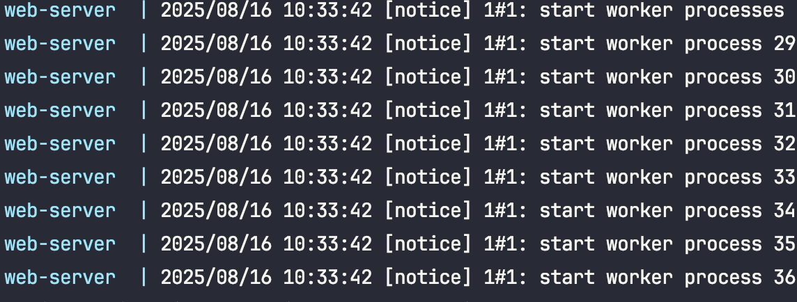

**compose.yml → nginx 컨테이너 띄우기**

```yaml
services:
  my-web-server:
    container_name: web-server
    image: nginx:latest
    ports:
      - 80:80
```

```bash
# 도커 컴포즈 시작
docker compose up 

# 도커 컴포즈 백그라운드로 시작 
docker compose up -d 

# 도커 컴포즈 컨테이너 삭제
docker compose down

# 도커 컴포즈 컨테이너중에 실행중인 컨테이너 확인
docker compose ps 

# 도커 컴포즈 모든 컨테이너 확인
docker compose ps -a

# 도커 컴포즈 컨테이너들 모든 로그를 볼 수 있다.
docker compose logs
```



- 로그를 보면 왼쪽에 컨테이너 이름이 붙어있다.

```bash
# 최신 도커 이미지를 가져와서 도커 컴포즈를 실행시킨다.
docker compose pull
```

- **docker compose up:** 로컬에 이미지가 있으면 바로 실행시키고 없으면 pull 받아서 실행
- **docker compose pull:** 로컬에 이미지가 있더라도 항상 최신 도커 이미지를 pull 받아서 실행

**compose.yml → redis 컨테이너 띄우기** 

```yaml
services:
  my-cache-server:
    container_name: redis
    image: redis:latest
    ports:
      - 6379:6379
```

**compose.yml → mysql 컨테이너 띄우기** 

```yaml
services:
  my-db:
    container_name: mysql-db
    image: mysql:latest
    environment:
      MYSQL_ROOT_PASSWORD: [REDACTED]
    volumes:
      - ./mysql-data:/var/lib/mysql
    ports:
      - 3306:3306
```

---

### Spring Boot Project Docker Compose 통해서 띄우기

**DockerFile** 

```bash
FROM openjdk:21-jdk

COPY build/libs/*SNAPSHOT.jar /app.jar

EXPOSE 8080

ENTRYPOINT ["java", "-jar", "/app.jar"]
```

```yaml
services:
  my-server:
    container_name: my-server
    build: .
    ports:
      - 8080:8080
```

```bash
# 도커 컴포즈 빌드하고 컨테이너 띄우기
docker compose up -d --build
```

---

