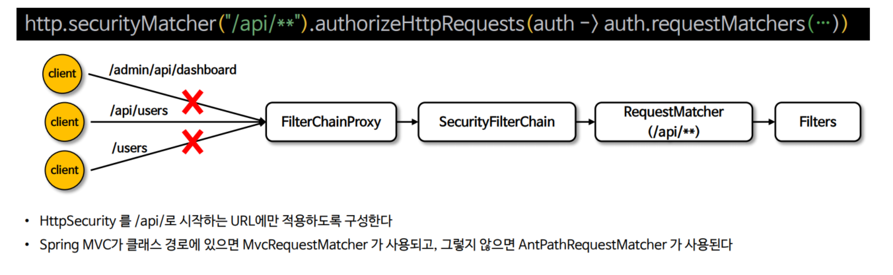
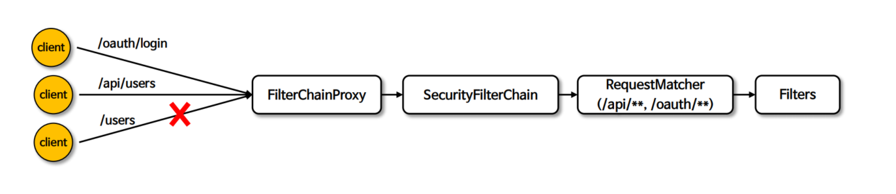
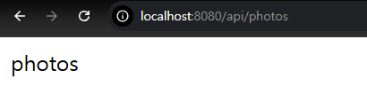
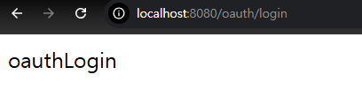

# **securityMatcher()**

- securityMatcher 메소드는 특정 패턴에 해당하는 요청에만 보안 규칙을 적용하도록 설정할 수 있으며 중복해서 정의할 경우 마지막에 설정한 것으로 대체한다 
1. **securityMatcher(String... urlPatterns)**
• 특정 자원 보호가 필요한 경로를 정의한다
1. **securityMatcher(RequestMatcher... requestMatchers)**
• 특정 자원 보호가 필요한 경로를 정의한다. `AntPathRequestMatcher`, `MvcRequestMatcher` 등의 구현체를 사용할 수 있다

# **패턴 설정**



- `SecurityFilterChain`은 다중 설정이 가능하다
- `SecurityFilterChain` 각각 `RequestMatcher`, `Filters`를 가지고 있다.
- `SecurityFilterChain` 2개 이상 존재하고 클라이언트로부터 요청이 오면 `securityMatcher` 를 통해 지정한 `RequestMatcher`에 해당하는 `SecurityFilterChain` 이 동작한다 
- `SecurityFilterChain`  `RequestMatcher`에 해당하지 않으면 요청은 다음 `ServletFilter`로 넘어가거나 존재하지 않으면 바로 `스프링 MVC(DispatcherSevlet)`에 넘어간다. 

# **securityMatchers(Customizer<RequestMatcherConfigurer>)**

**다중 패턴 설정**

- `securityMatchers` 메소드는 특정 패턴에 해당하는 요청을 단일이 아닌 다중 설정으로 구성해서 보안 규칙을 적용할 수 있으며 현재의 규칙은 이전의 규칙을 대체하지 않는다

**패턴 유형**

```java
// 패턴 1
http. securityMatchers((matchers) -> matchers.requestMatchers("/api/**", "/oauth/**"));

// 패턴 2
http. securityMatchers((matchers) -> matchers.requestMatchers("/api/**").requestMatchers("/oauth/**"));

// 패턴 3
http.securityMatchers((matchers) -> matchers.requestMatchers("/api/**")
 .securityMatchers((matchers) -> matchers.requestMatchers("/oauth/**"))
```



# **테스트** 

**SecurityConfig**

```java
@EnableWebSecurity
@Configuration
public class SecurityConfig {
    @Bean
    @Order(2)
    public SecurityFilterChain securityFilterChain1(HttpSecurity http) throws Exception{
        http
                .authorizeHttpRequests(authorize -> authorize
                        .anyRequest().authenticated())
                .formLogin(Customizer.withDefaults());

        return http.build();
    }
    @Bean
    @Order(1)
    public SecurityFilterChain securityFilterChain2(HttpSecurity http) throws Exception{

        http.securityMatchers(matches -> matches.requestMatchers("/api/**", "/oauth/**"));
        http
                .authorizeHttpRequests(authorize -> authorize
                        .anyRequest().permitAll())
                .formLogin(Customizer.withDefaults());

        return http.build();
    }
    @Bean
    public UserDetailsService userDetailsService(){
        UserDetails user = User.withUsername("user").password("{noop}1111").roles("USER").build();
        UserDetails manager = User.withUsername("manager").password("{noop}1111").roles("MANAGER").build();
        UserDetails admin = User.withUsername("admin").password("{noop}1111").roles("ADMIN","WRITE").build();
        return  new InMemoryUserDetailsManager(user, manager, admin);
    }
}
```

**IndexController**

```java
@RestController
public class IndexController {
    @GetMapping("/")
    public String index(){
        return "index";
    }
    @GetMapping("/user")
    public String user(){
        return "user";
    }
    @GetMapping("/user/{name}")
    public String userName(@PathVariable(value = "name") String name){
        return name;
    }
    @GetMapping("/admin/db")
    public String admin(){
        return "admin";
    }
    @GetMapping("/api/photos")
    public String photos(){
        return "photos";
    }
    @GetMapping("/oauth/login")
    public String oauth(){
        return "oauthLogin";
    }
}

```

[http://localhost:8080/api/photos](http://localhost:8080/api/photos)



[http://localhost:8080/oauth/login](http://localhost:8080/oauth/login)



`/api` , `/api/**` , `/oauth` , `/oauth/**` 경로는 `securityMathcer`를 통해서 `securityFilterChain2` 에서 처리한다 해당 경로들은 모두 `permitAll()` 이기 때문에 인증 없이 접근이 가능하다

`/user` , `/` , `/user/{name}` , `/admin/db` 경로들은 `securityFilterChain1` 에서 처리하여 모두 `authenticated()` 이기 때문에 인증이 필요하고 따라서 접근하면 `/login` 경로로 리다이렉트 

```java
@EnableWebSecurity
@Configuration
public class SecurityConfig {
    @Bean
    @Order(1)
    public SecurityFilterChain securityFilterChain1(HttpSecurity http) throws Exception{
        http
                .authorizeHttpRequests(authorize -> authorize
                        .anyRequest().authenticated())
                .formLogin(Customizer.withDefaults());

        return http.build();
    }
    @Bean
    @Order(2)
    public SecurityFilterChain securityFilterChain2(HttpSecurity http) throws Exception{

        http.securityMatchers(matches -> matches.requestMatchers("/api/**", "/oauth/**"));
        http
                .authorizeHttpRequests(authorize -> authorize
                        .anyRequest().permitAll())
                .formLogin(Customizer.withDefaults());

        return http.build();
    }
    @Bean
    public UserDetailsService userDetailsService(){
        UserDetails user = User.withUsername("user").password("{noop}1111").roles("USER").build();
        UserDetails manager = User.withUsername("manager").password("{noop}1111").roles("MANAGER").build();
        UserDetails admin = User.withUsername("admin").password("{noop}1111").roles("ADMIN","WRITE").build();
        return  new InMemoryUserDetailsManager(user, manager, admin);
    }
}
```

우선순위를 이렇게 바꾸면 모든 경로에 인증이 필요하다.

