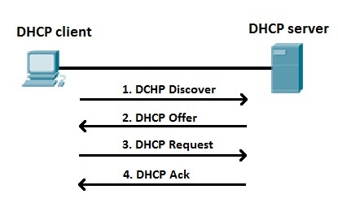

일반적으로 인터넷을 사용하거나 WAN 환경에서 다른 컴퓨터와 통신하기 위해서는 IP 주소가 필요하다

그리고 IP는 명시적으로 내 컴퓨터에 할당되어 있어야 한다.

하지만 관리자가 모든 컴퓨터를 찾아다니면서 일일이 IP 주소를 입력해주는 것은 매우 비효율적이다. 또한 IP 주소는 반납되어야 하는데, 이것 역시 관리하기 어렵다.

그래서 자동으로 IP 주소 설정 및 네트워크 설정 정보(서브넷 마스크, DNS 서버 주소)제공을 하는 DHCP 서버가 등장했다. **DHCP(Dynamic Host Configuration Protocol)서버는 사용자들에게 IP 주소를 할당하거나 회수하는 것을 자동으로 해주는 서버이다.**

DHCP 서버가 IP를 할당해주는 방식은 다음과 같다.

1. **먼저 사용자 컴퓨터는 DHCP 서버를 찾는다.**
1. **DHCP 서버는 사용자에게 IP 주소 할당 여부를 묻는다.**
1. **사용자가 IP 주소가 필요하다고 요청을 한다.**
1. **DHCP 서버는 IP 주소를 할당해준다.**

**IP 임대 시간은 DHCP 서버 측에서 결정한다.**

