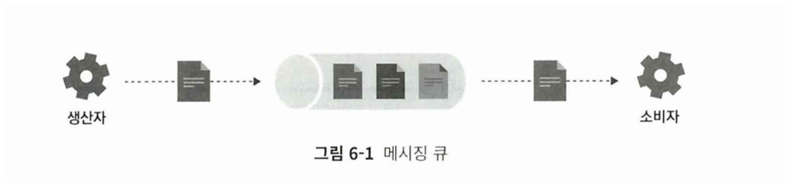
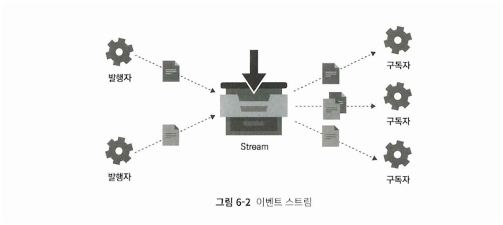
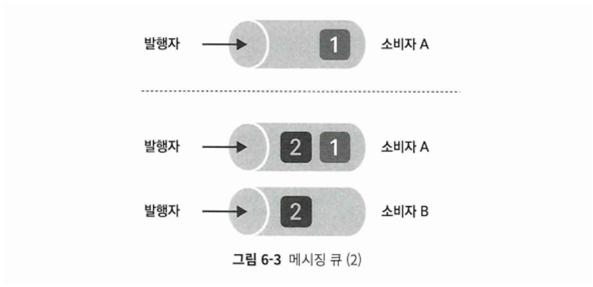
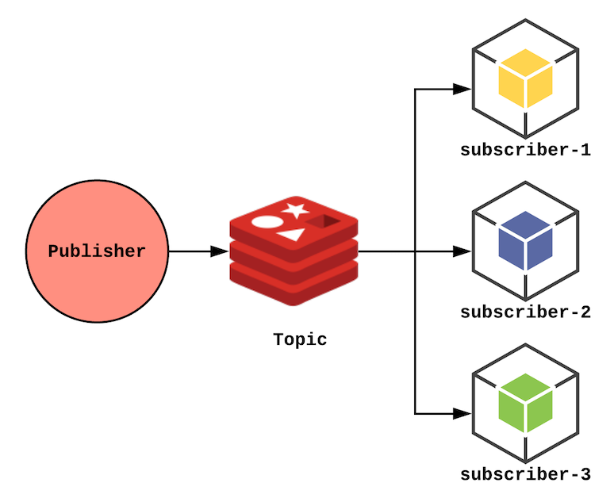
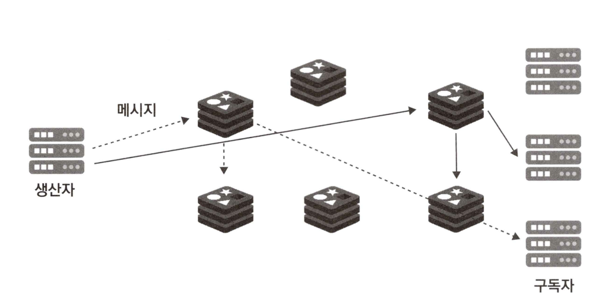
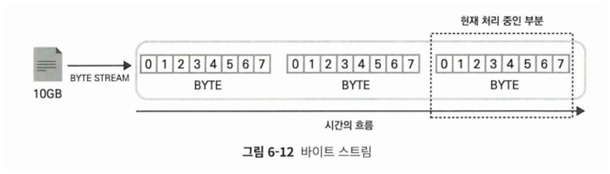
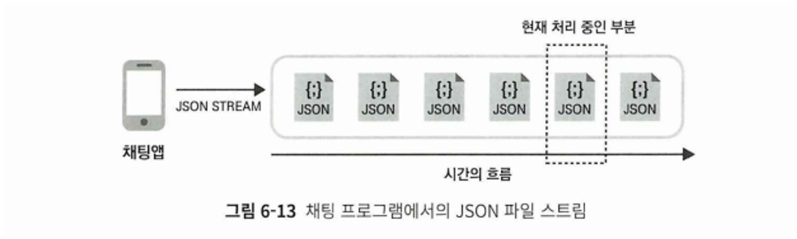
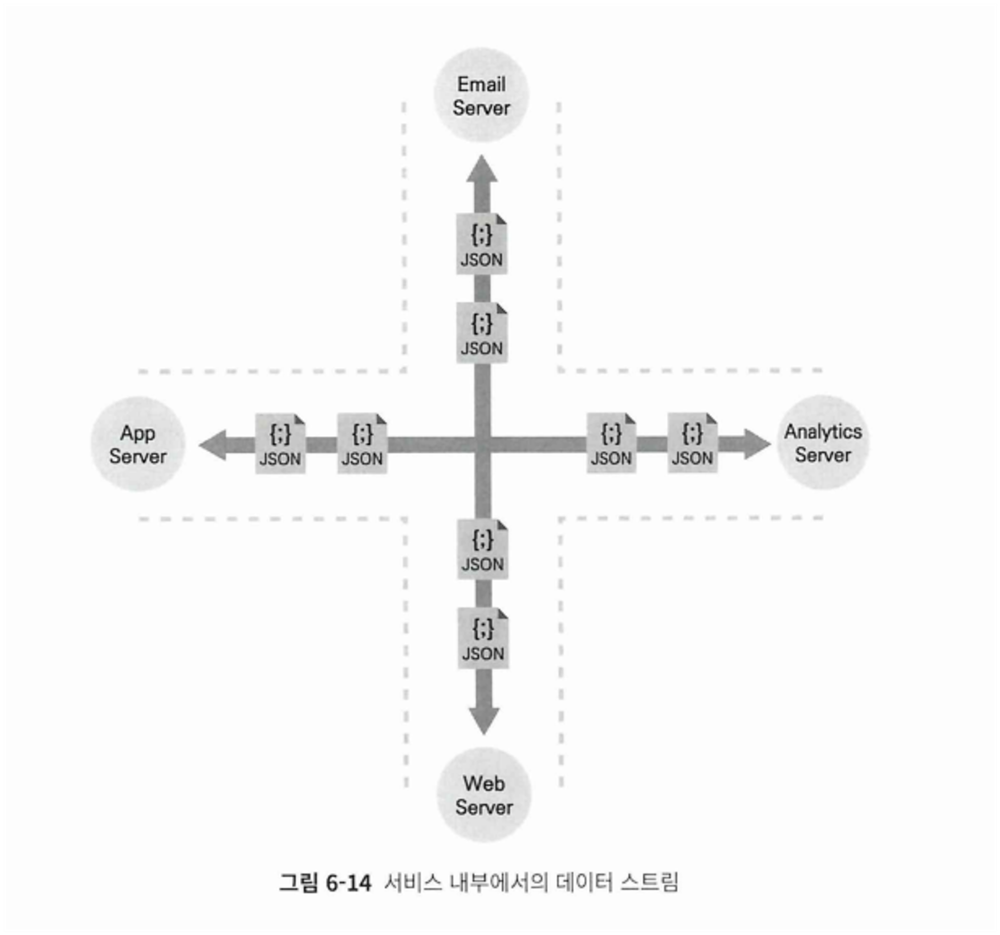
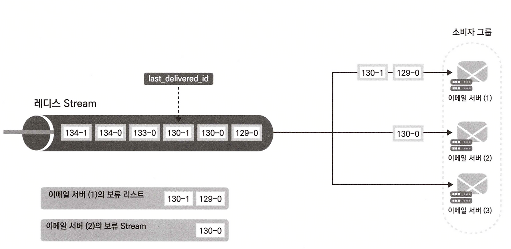

서비스 간 통신이 불가능한 상황이 바로 장애로 이어지지 않게, **당장 메시지를 처리하지 못하더라도 보낸 메시지를 어딘가에 쌓아 둔 뒤 나중에 처리할 수 있는 채널을 만들어 주는 것**.

이것이 메시지 브로커의 핵심 역할이라 할 수 있다.

메시지 브로커는 크게 메시징 큐와 이벤트 스트림이라는 두 가지 형태로 나눌 수 있다.

# 메시징 큐와 이벤트 스트림



**메시징 큐**에서는 주로 데이터를 생성하는 쪽을 **생산자(producer)**, 데이터를 수신하는 쪽을 **소비자(consumer)**로 지칭한다.



**이벤트 스트림**에서는 데이터를 생성하는 쪽을 **발행자(publisher)**, 데이터를 조회하는 쪽을 **구독자(subscriber)**로 지칭한다.

**메시징 큐와 이벤트 스트림은 방향성이 다르다.**

메시징 큐의 생산자는 소비자의 큐로 데이터를 직접 푸시한다.

2개의 서비스에 같은 메시지를 보내야할 때 메시징 큐를 이용한다면 생잔자는 2개의 각각 다른 메시징 큐에 각각 데이터를 푸시해야 한다.

반면 스트림을 이용한다면 생산자는 특정 저장소에 하나의 메시지를 보낼 수 있고, 메시지를 읽어가는 소비자들은 스트림에서 같은 메시지를 풀(pull)해 갈 수 있게 떄문에 메시지를 복제해서 저장하지 않아도 된다.

**메시징 큐와 이벤트 스트림은 데이터의 영속성이 다르다.**

메시징 큐에서는 소비자가 데이터를 읽어갈 때 큐에서 데이터를 삭제한다. 하지만 이벤트 스트림에서는 구독자가 읽어간 데이터는 바로 삭제되지 않고, 저장소의 설정에 따라 특정 기간 동안 저장될 수 있다.

메시지를 보내는 도중에 새로운 소비자를 추가할 때, 메시징 큐를 이용한다면 소비자는 새롭게 추가된 이후의 이벤트만 확인할 수 있다. 



그림 6-3을 보면 소비자 B는 프로듀서가 소비자에게 1이라는 메시지를 보낸 이후 추가됐기 때문에 데이터 2만을 확인할 수 있다.

하지만 **스트림 방식에서는 메시지를 생산할 때 구독자를 지정하지 않고, 스트림에 쌓인 데이터는 일정 기간 동안 지워지지 않기** 때문에 새로 추가된 서비스도 스트림에 남아 있는 이전 데이터의 히스토리를 볼 수 있다.

따라서 메시지 큐는 일대일(1:1) 상황에서 한 서비스가 다른 서비스에게 동작을 지시할 때 유용하게 사용될 수 있으며, 스트림은 다대다(n:n) 상황에서 유리함을 확인할 수 있다.

### 레디스를 메시지 브로커로 사용하기

레디스에서 제공하는 **pub/sub**를 사용하면 빠르고 간단한 방식으로 메시지를 전달할 수 있는 메시지 브로커를 구현할 수 있다. 발행자가 특정한 채널에 데이터를 전송하면 이 채널을 듣고 있는 모든 소비자는 데이터를 바로 소비할 수 있다.

**레디스의 pub/sub에서 모든 데이터는 한 번 채널 전체에 전파된 뒤 삭제되는 일회성의 특징을 가지며, 메시지가 잘 전달됐는지 등의 정보는 보장하지는 않는다.**

따라서 완벽하게 메시지가 전달돼야 하는 상황에는 적합하지 않을 수 있지만 fire-and-forget 패턴이 필요한 간단한 알림 서비스에서는 유용하게 사용될 수 있다.

**fire-and-forget 패턴** 

```
비동기 프로그래밍에서 사용되는 디자인 패턴
어떤 작업을 실행하고 그 결과에 대한 응답을 기다리지 않고 다음 코드를 실행하는 것을 의미
fire-and-forget 패턴을 사용할 때는 결과 확인이나 오류 처리를 고려하지 않고 작업을 진행하므로,
신뢰성이 필요한 경우에는 사용하지 않아야 한다.
```

**레디스의 list 자료 구조는 메시징 큐로 사용하기에 알맞다.** list의 데이터는 푸시와 팝이 가능하며 애플리케이션은 list에 데이터가 있는지 매번 확인할 필요 없이 대기하다가 list에 새로운 데이터가 들어오면 읽어갈 수 있는 블로킹 기능을 사용할 수도 있다

**레디스의 stream을 사용하면 레디스를 완벽한 스트림 플랫폼으로 사용할** 수 있다.

레디스 stream은 아파치 카프카 시스템에서 영감을 받아 만들어진 자료 구조로, 데이터는 계속 추가되는 방식으로 저장된다(append-only) 소비자, 소비자 그룹 개념을 이용하면 카프카에서와 비슷하게 데이터의 분산 처리를 구현할 수 있다.

stream에 저장되는 메시지를 실시간으로 리스닝하며 소비할 수도 있으며, 저장돼 있는 데이터를 시간대별로 검색하는 것도 가능하다.

---

# 레디스의 pub/sub

레디스 노드에 접근할 수 있는 모든 클라이언트는 발행자와 구독자가 될 수 있다.

발행자는 특정 채널에 메시지를 보낼 수 있고, 구독자는 특정 채널을 리스닝하다가 메시지를 읽어갈 수 있다.



**레디스 pub/sub은 최소한의 메시지 전달 기능만 제공한다**

발행자는 메시지를 보낼 수 있을 뿐, 어떤 구독자가 읽어가는지, 정상적으로 전달됐는지 확인할 수 없다.

마찬가지로 구독자 또한 메시지를 받을 수 있지만 언제 어떤 발행자에 의해 생성됐는지 등의 메타데이터는 알 수 없다.

한 번 전파된 데이터는 레디스에 저장되지 않으며, 단순히 메시지의 통로 역할만 한다.

이런 특징 때문에 정합성이 중요한 데이터를 전달하기에는 적합하지 않을 수 있다.

## 메시지 발행 

**PUBLISH 커맨드**

```
PUBLISH hello world
```

해당 커맨드를 수행하면 hello 채널을 수신하고 있는 모든 서버들에 world 메시지가 전파된다.

메시지가 전파된 후에는 메시지를 수신한 구독자의 수가 반환된다.

## 메시지 구독

**SUBSCRIBE 커맨드**

SUBSCRIBE 커맨드를 이용하면 특정 채널을 구독할 수 있다.

클라이언트가 구독자로 동작할 때에는 pub/sub과 관련되지 않은 다른 커맨드를 수행할 수는 없다.

구독자가 수행할 수 있는 커맨드는 아래와 같다.

```
SUBSCRIBE, SSUBSCRIBE, SUNSUBSCRIBE, PSUBSCRIBE,
UNSUBSCRIBE, PUNSCRIBE, PING, RESET, QUIT
```

PSUBSCRIBE 커맨드는 일치하는 패턴에 해당하는 채널을 한 번에 구독할 수 있도록 한다.

```
PSUBSCRIBE mail-*
```

prefix가 “maile-”인 모든 채널을 구독한다. ex): mail-track, mail-album 등등

### **메시지 타입**

```
**PSUBSCRIBE 커맨드로 구독하는 경우 메시지 타입이 pmessage** 
**SUBSCRIBE 커맨드로 구독하는 경우 메시지 타입이 message 

특정 클라이언트 구독 상태**
1. subscribe mail-1
2. psubscribe mail-*

**발행자**
publish mail-1 hello

**해당 클라이언트 수신**
1. message: hello
2. pmessage: hello
```

## 클러스터 구조 pub/sub

**레디스 클러스터에서 pub/sub을 사용할 때, 메시지를 발행하면 해당 메시지는 클러스터에 속한 모든 노드에 자동으로 전달**된다.

따라서 **레디스 클러스터의 아무 노드에 연결해 SUBSCRIBE 커맨드를 사용하면 데이터를 수신**할 수 있다.



모든 노드에 전파되는 방식은 굉장히 간단하고 명료하지만, 불필요한 리소스 사용과 네트워크 부하가 발생한다.

### sharded pub/sub

클러스터 환경에서의 모든 노드에 전파되는 pub/sub 비효율을 해결하기 위해서 레디스 7.0에서는 shared pub/sub 기능이 도입됐다.

클러스터에서 키가 특정 슬롯에 할당되는 것과 동일한 방식으로 채널이 할당되면, 같은 슬롯을 가지고 있는 노드 간에만 pub/sub 메시지를 전달한다.

---

# 레디스의 List를 메시징 큐로 사용하기

레디스에는 큐의 tail, head에 데이터를 넣고 뺄 수 있는 LPUSH, LPOP, RPUSH, RPOP 커맨드가 존재하기 때문에 애플리케이션 특성에 맞는 메시징 큐를 직접 구현할 수 있다.

## list EX 기능

인스타그램, 트위터, 페이스북 같은 SNS에는 각 유저별 타임라인이 존재한다.

각자의 타임라인에 자신이 팔로우한 계정의 게시물, 혹은 자신과 관련 있는 게시물 등이 표시된다.

트위터는 각 유저의 타임라인 캐시 데이터를 레디스에서 list 자료 구조로 관리한다.

유저 A가 새로운 트윗을 작성하면 그 데이터는 유저 A를 팔로우하는 유저의 타임라인 캐시에 저장된다.

이때 **각 타임라인 캐시에 데이터를 저장할 때 RPUSH 커맨드가 아닌 RPUSHX 커맨드를 사용한다**

RPUSHX는 데이터를 저장하고자 하는 리스트가 이미 존재할 때에만 아이템을 추가하는 커맨드다.

즉, 이미 캐시된 타임라이엔만 데이터를 추가할 수 있다.

이를 통해 자주 트위터를 들어오지 않는 유저에 대해서는 타임라인 캐시 데이터를 굳이 관리해야 할 필요가 없기 때문이다.

사용자의 캐시가 이미 존재하는지 유무를 애플리케이션 레벨에서 확인하는 과정 없이 레디스를 통해서만 제어할 수 있기 때문에 불필요한 확인 과정을 줄여 서능을 향상시킬 수 있다.

## list 블로킹 기능

레디스를 이벤트 큐로 사용할 경우, 블로킹 기능을 유용하게 사용할 수 있다.

event-driven 구조에서 event handler는 이벤트 루프를 돌며 신규로 처리할 데이터가 있는지 체크한다.

새로운 데이터가 없을 경우 정해진 시간(폴링 인터벌)동안 대기한 뒤 다시 이벤트 큐에 데이터가 있는지 확인하는 과정을 반복한다.

이러한 방식을 “폴링”이라고 부르며, 폴링 프로세스가 진행되는 동안 애플리케이션과 큐의 리소스가 불필요하게 소모될 수 있다.

또한 이벤트가 들어왔을 수 있지만, 폴링 인터벌 시간 동안은 대기한 뒤 다시 확인하는 과정을 거치기 때문에 이벤트를 즉시 처리할 수 없다는 단점이 있다.

list 블로킹 기능을 사용하면 이를 해결할 수 있다. 

BPOP, LPOP 커맨드를 사용하면, list에 데이터가 들어올 때까지 기다린 후에 들어온 값을 반환하거나, 클라이언트가 설정한 타임아웃시간만큼 대기한후 nil값을 반환한다.

```
> BROP queue:a 5
1) "queue:a"
2) "data"

**BROP queue:a 5 커맨드**
해당 커맨드는 queue:a 리스트에 데이터가 입력할 때까지 최대 5초 동안 대기하고, 
5초가 경과하면 nil을 반환하라는 의미다.

"타임아웃을 0으로 설정하면 제한 없이 기다리라는 의미로 쓰인다."
하나의 리스트에 여러 클라이언트가 동시에 블로킹될 수 있으며, 리스트에 데이터가 입력되면
가장 먼저 요청을 보낸 클라이언트가 데이터를 가져간다.
```

BROP은 RPOP과 다르게 2개의 데이터를 반환한다.

첫 번째는 팝된 리스트 키, 두 번째는 반환된 데이터 값을 반환한다.

이렇게 설계된 이유는 동시에 여러 개의 리스트에서 대기할 수 있게 하기 위해서다.

```
> BRPOP queue:a queue:b queue:c timeout 1000
1) "queue:b"
2) "EVENT"
```

클라이언트는 3개의 리스트 중에서 어느 하나라도 데이터가 들어올 때까지 기다린 뒤, 데이터를 반환받는다.

---

# Stream

## 레디스의 Stream과 아파치 카프카

Stream은 레디스 5.0에서 새로 추가된 자료 구조로 대용량, 대규모의 메시징 데이터를 빠르게 처리할 수 있도록 설계됐다.

stream은 데이터를 계속해서 추가하는 방식으로 저장되는(append-only)자료 구조다.

stream은 사용 목적에 따라 두 가지 방식으로 활용될 수 있다.

첫 번째로 **stream을 대량의 데이터를 효율적으로 처리하는 플랫폼으로 활용**할 수 있다.

두 번째로 **stream을 여러 생산자가 생성한 데이터를 다양한 소비자가 처리할 수 있게 지원하는 데이터 저장소 및 중간 큐잉 시스템으로 사용**할 수 있다.

대규모 메시징 데이터를 처리하기 위해 플랫폼을 도입하고자 할 때 가장 먼저 고려되는 시스템은 아파치 카프카이다. 카프카는 링크드인에서 처음 개발된 분산 메시징 시스템이다.

**레디스 stream은 카프카의 영향을 많이 받은 시스템**인 만큼 카프카와 유사한 여러 기능을 갖고 있으며, 일부 기능은 카프카보다 뛰어난 처리를 할 수 있도록 설계됐다.

---

## 스트림이란?

스트림이란 연속적인 데이터 흐름, 일정한 데이터 조각의 연속을 의미한다.



그림 6-12에서는 10GB의 텍스트 파일을 처리하는 애플리케이션에서 바이트 스트림을 처리하는 과정을 보여준다.

파일 하나는 유한하지만 이를 읽어올 때 애플리케이션은 단어 단위, 줄 단위로 데이터를 잘게 쪼개서 처리하기 때문에 애플리케이션은 바이트 스트림을 처리하는 것이라고 생각할 수 있다.

끝이 정해지지 않고 계속되는 불규칙한 데이터를 연속으로 반복 처리할 때 이 또한 스트림 처리를 한다고 할 수 있다.



그림 6-13은 채팅 프로그램에서 JSON 파일을 스트리밍하는 과정을 나타낸다.

채팅앱에서 사용자는 아무때나 채팅을 보낼 수 있으며, 메신저 서버는 사람들이 계속 채팅하는 동안 끝없이 데이터를 처리할 수 있어야 한다. 따라서 서버는 JSON 스트림을 처리하는 것이라고 볼 수 있다.

그림 6-12, 6-13은 애플리케이션 외부에서 인풋을 받아오는 예제이지만 애플리케이션 내부에서 서버 간 데이터의 이동이 필요할 수도 있다.



그림 6-14에서는 웹 서버에서 받아온 결제 데이터를 분석 서버로 전달하거나, 사용자의 결제 데이터를 이메일 서버로 넘기는 등의 서비스 간 데이터 전달 과정 또한 연속적인 데이터의 전달을 의미하기 때문에, 이 또한 스트림이라 할 수 있다.

---

## 데이터의 저장

### 메시지의 저장과 식별

카프카에서 **스트림 데이터는 토픽이라는 개념에 저장**된다.

**토픽은 각각의 분리된 스트림을 뜻하며, 같은 데이터를 관리하는 하나의 그룹을 의미**한다.

레디스에서는 **하나의 stream 자료 구조가 하나의 stream을 의미**한다.

stream 또한 다른 자료구조와 마찬가지로 **하나의 키에 연결된 자료 구조**다.

카프카에서 각 메시지는 0부터 시작해 증가하는 시퀀스 넘버로 식별할 수 있는데, 이때 시퀀스 넘버는 토픽 내의 파티션 안에서만 유니크하게 증가하기 때문에 토픽이 1개 이상의 파티션을 갖는다면 메시지는 하나의 토픽 내에서 유니크하게 식별되지 않는다.

레디스 stream에서 **각 메시지는 시간과 관련된 유니크한 ID를 가지며, 이 값은 중복되지 않는다**.

```
# ID는 밀리세컨드 파트, 시퀀스 넘버 파트 2개의 파트로 나뉜다.
<millisecondsTime>-<sequenceNumber>
```

**밀리세컨드 파트는 stream에 아이템이 저장될 시점의 레디스 노드 로컬 시간**이다.

시퀀스 파트는 동일한 밀리세컨드 시간에 여러 아이템이 저장될 수 있으므로, **같은 밀리세컨드에 저장된 데이터의 순서를 의미**한다.

**시퀀스 번호는 64bit로 사실상 하나의 밀리세컨드 내에 생성할 수 있는 항목 수에는 제한이 없다.**

레디스 stream은 지정된 모든 데이터는 유니크한 ID를 가지며, 이 ID 값이 곧 시간을 의미하기 때문에 **시간을 이용해 특정 데이터를 검색할 수 있다.**

---

### 스트림 생성과 데이터 입력

카프카에서 생성자는 데이터를 토픽에 푸시하며, 소비자는 토픽에서 데이터를 읽어간다.

카프카에서는 데이터를 저장하기 위해 토픽을 먼저 생성한 뒤, 프로듀서를 이용해 메시지를 보낼 수 있다.

레디스에서는 다른 자료구조와 마찬가지로 따로 stream을 생성하는 과정이 필요하지 않으며, 

**XADD 커맨드를 이용해 새로운 이름의 stream에 데이터를 저장하면 데이터 저장과 동시에 생성**된다.

```bash
XADD Email * subject "first" body "hello?"
1757346642191-0
```

Email KEY를 가지는 stream 생성, 이미 존재했다면 기존 stream에 새로운 메시지 추가

“*” 저장되는 데이터 ID를 의미, 이 값을 “*”로 입력할 경우 레디스에서 자동 생성되는 타임스탬프 ID를 사용하겠다는 것을 의미한다. 반환되는 값이 바로 저장되는 데이터 ID이다.

메시지는 key-value 쌍으로 저장되며, subject key에 first value, body key에 hello? value가 저장된다.

```bash
XADD Push * userid 1000 ttl 3 body hey
1757346946000-0
XADD Email * subject "second" body "hi?"
1757346964466-0
```

```
스트림
├── 엔트리 ID: 1757346946000-0
│   ├── userid: 1000
│   ├── ttl: 3
│   └── body: hey
└── 엔트리 ID: 1757346964466-0
    ├── subject: "second"
    └── body: "hi?"
```

각 엔트리는 하나의 논리적 메시지 단위이고, 그 안에 관련된 여러 필드들을 함께 저장할 수 있다.

만약 자동으로 생성되는 ID가 아니라 서비스에서 기존에 사용하던 ID를 이용해 메시지를 구분하고 싶을 수 있다.

이때에는 ID를 직접 지정하면 된다.

```bash
XADD mystream 0-1 hello world
0-1
XADD mystream 0-2 hi redis
0-2
XADD mystream 0-0 expect error
ERR The ID specified in XADD must be greater than 0-0
```

**ID는 이전에 저장됐던 ID 값보다 작은 값으로 지정할 수 없다.**

---

### 데이터의 조회

카프카와 레디스 stream의 데이터 저장 방식은 비슷하지만 데이터를 읽는 방식에서 차이가 있다.

**카프카** 

**카프카에서 소비자는 토픽을 실시간으로 리스닝하며, 새롭게 토픽에 저장되는 메시지를 전달받을 수 있다**.

기본적으로 리스닝을 시작한 시점부터 토픽에 새로 저장되는 메시지를 받도록 동작하며, 카프카에 저장돼 있는 모든 데이터를 처음부터 읽는것도 가능하다.

소비자는 더 이상 토픽에서 읽어올 데이터가 없으면 새로운 이벤트가 토픽에 들어올 때까지 계속 토픽을 리스닝하면서 기다린다.

**레디스 스트림**

데이터를 두 가지 방식으로 읽을 수 있다.

1. **카프카처럼 실시간으로 처리되는 데이터를 리스닝**
1. **ID를 이용해 필요한 데이터를 검색하는 방식**

---

### **실시간 리스닝**

```bash
XREAD [COUNT count] [BLOCK milliseconds] STREAMS key [key ...] ID [ID ...]
```

**XREAD:** 실시간으로 stream에 저장되는 데이터를 읽어올 수 있다.

Email stream에 저장된 데이터를 처음부터 읽어오고, 새로운 메시지가 들어올 때까지 토픽을 리스닝하면서 기다리기

```bash
XREAD BLOCK 0 STREAMS Email 0
Email
1757346642191-0
subject
first
body
hello?
1757346964466-0
subject
second
body
hi?
```

**BLOCK 0**: 더 이상 stream에 가져올 데이터가 없더라도 연결을 끊지 말고 계속 stream을 리스닝하라는 의미

**BLOCK 1000:** 들어오는 데이터가 없더라도 1000ms 즉, 최대 1초 동안 연결을 유지하며 대기하라는 의미

**STREAMS Email 0:** Email stream에 저장된 데이터 중 ID가 0보다 큰 값을 읽어오라는 의미

- 즉, 모든 데이터를 읽어온다.

```bash

# 1번 클라이언트
XREAD BLOCK 0 STREAMS Email $

# 2번 클라이언트
XADD Email * head test1 head test2
1757348397670-0

# 1번 클라이언트
Email
1757348397670-0
head
test1
head
test2

# 1번 클라이언트 직접 ID 값 지정해서 읽어오기
XREAD BLOCK 0 STREAMS Email 1757346642191-0
Email
1757346964466-0
subject
second
body
hi?
1757348397670-0
head
test1
head
test2
1757348407117-0
head
test1
head
test2
```

**Email $:** 커맨드를 실행한 이후의 메시지만을 가져오기

- $: stream에 저장된 최대 ID를 의미

**XREAD BLOCK 0 STREAMS Email 1757346642191-0:** 1757346642191-0 이후의 데이터 가져오기 

- 1757346642191-0 포함 X

---

### 특정한 데이터 조회

```bash
XRANGE key start end [COUNT count]
XREVRANGE key end start [COUNT count]
```

**XRANGE 커맨드**를 이용하면 ID를 이용해 원하는 시간대의 데이터를 조회할 수도 있다.

ID 중 가장 작은 ID 값을 지정하고 싶을 때에는 “-”, 제일 마지막 ID값을 지정하고 싶을 때에는 “+” 기호를 사용

**모든 데이터 가져오기**

```bash
XRANGE Email - +
1757346642191-0
subject
first
body
hello?
1757346964466-0
subject
second
body
hi?
1757348397670-0
head
test1
head
test2
1757348407117-0
head
test1
head
test2
```

XRANGE를 이용하면 메시지가 저장된 시점을 이용해 데이터를 조회할 수도 있다.

```bash
# 범위로 조회
XRANGE Email 1757346642191 1757348397670
1757346642191-0
subject
first
body
hello?
1757346964466-0
subject
second
body
hi?
1757348397670-0
head
test1
head
test2

# 입력한 데이터 포함하지 않고 그 다음 데이터 부터 조회
XRANGE Email (1757346642191 1757348397670 
1757346964466-0
subject
second
body
hi?
1757348397670-0
head
test1
head
test2
```

COUNT 옵션으로 조회할 데이터 개수 제한

```bash
XRANGE Email 1757346642191 1757348397670 COUNT 2
1757346642191-0
subject
first
body
hello?
1757346964466-0
subject
second
body
hi?
```

---

### 소비자와 소비자 그룹

stream 데이터를 여러 소비자가 읽어가는 상황

같은 데이터를 여러 소비자에게 전달하는 것을 팬아웃(fan-out)이라 한다.

카프카에서는 같은 토픽을 여러 개의 소비자가 읽어가게 함으로써 간단하게 팬아웃할 수 있다.

레디스 stream에서도 XREAD 커맨드를 여러 소비자가 수행한다면 팬아웃이 가능하다.

데이터를 여러 개의 소비자를 이용해 메시지를 병렬 처리함으로써 서비스의 처리 성능을 높일 수 있다.

stream을 이용해 이벤트 데이터를 처리하는 과정에서 이벤트의 처리 성능을 높이기 위해 여러 소비자를 이용해 한 번에 여러 이벤트를 병렬적으로 처리되도록 구성할 수 있다.

이때 처리되는 메시지의 순서가 보장돼야 하는 경우와 그렇지 않은 경우 2가지 유형이 존재한다.

티켓 판매 서비스에서는 고객이 티켓을 결제할 때 카드의 유효성 검사나 사용자 잔고 확인 같은 선행 작업 후에 결제 프로세스가 진행돼야 하므로, 이벤트의 순서를 보장하는 것이 중요하다.

반면, 사용자의 회원가입 이벤트는 순서를 엄격하게 지키지 않아도 되므로 메시지를 생성한 순서대로 처리할 필요가 없다.

레디스 stream에서는 데이터가 저장될 때마다 고유한 ID를 부여받아 순서대로 저장된다.

**따라서 소비자에게 데이터가 전달될 때, 그 순서는 항상 보장**된다.

반면 **카프카에서 유니크 키는 파티션 내에서만 보장되기 때문에 소비자가 여러 파티션에서 토픽을 읽어갈 때에는 데이터의 순서를 보장할 수 없다.**

즉, **카프카에서 메시지 순서가 보장되도록 데이터를 처리하려면 소비자 그룹을 사용**해야 한다.

---

### 소비자 그룹

카프카에서는 소비자 그룹에 여러 소비자를 추가할 수 있으며, 이때 소비자는 토픽 내의 파티션과 일대일로 연결

파티션 내부에서는 메시지의 순서가 보장되기 때문에 메시지를 읽을 때 순서를 보장 받을 수 있다.

레디스 stream에서도 소비자 그룹이라는 개념이 존재하지만, 카프카와는 다르다.

**레디스 stream은 카프카와는 달리 메시지가 전달되는 순서를 신경 쓰지 않아도 되기 때문**이다.

레디스 stream에서 소비자 그룹 내의 한 소비자는 다른 소비자가 아직 읽지 않은 데이터만을 읽어간다.

각 요청마다 소비자는 stream에서 차례대로 데이터를 가져오게 된다.

**소비자 그룹 생성**

```bash
XGROUP CREATE Email EmailServiceGroup $ 
```

레디스 stream에서 소비자 그룹을 생성하려면 XGROUP 커맨드를 사용한다.

EmailServiceGroup 소비자 그룹 이름, Email Stream, $는 현재 시점 이후의 데이터부터 리스닝하겠다는 의미

**소비자 그룹을 이용해 데이터를 읽어오기**

```bash
XREADGROUP GROUP EmailServiceGroup emailService1 COUNT 1 STREAMS Email >

XADD Email * publisher consumer
1757357803993-0

XREADGROUP GROUP EmailServiceGroup emailService1 COUNT 1 STREAMS Email >
Email
1757357803993-0
publisher
consumer
```

- EmailServiceGroup에 속한 emailService1 이름의 소비자가 Email stream에 있는 1개의 메시지를 읽어오고자 하는 커맨드다. 
- 매번 소비자가 소비자 그룹을 이용해 작업을 수행할 때마다 그룹 내에서 이 소비자를 고유하게 식별할 수 있는 이름을 지정해야 한다.
- 만약 다른 소비자에게 읽히지 않은 데이터가 있다면 데이터를 1개 가져오고 없다면 nil 반환
- 카프카와는 다르게 각 소비자는 COUNT 커맨드를 이용해 소비할 메시지 개수를 지정할 수 있다.
- **STREAM Email >:** Email이라는 이름의 stream에서, 다른 소비자에게 전달되지 않았던 새로운 데이터를 가지고 오는 것
- 대부분의 상황에서 “>”를 사용하면 되겠지만 만약 0 또는 다른 숫자 ID를 입력할 경우 새로운 메시지를 확인하는 것이 아닌, 입력한 ID 보다 큰 ID 중 대기에 속하던 메시지를 반환

소비자는 처음 언급될 때 자동으로 생성되며 명시적으로 생성할 필요는 없다.

하지만 소비자 그룹은 먼저 생성해야 한다.

**하나의 소비자 그룹에서 여러 개의 stream 리스닝**

```bash
XGROUP CREATE Email BIGroup 0
XGROUP CREATE Push BIGroup 0

XREADGROUP GROUP BIGROUP BI1 COUNT 2 STREAMS Email Push > > 
```

---

### ACK와 보류 리스트

여러 서비스가 메시지 브로커를 통해 데이터를 처리할 때 예상치 못한 장애로 인해 시스템이 종료됐을 경우 이를 인지하고 재처리할 수 있는 기능이 필요하다.

메시지 브로커는 각 소비자에게 어떤 메시지까지 전달됐고, 전달된 메시지의 처리 유무를 인지하고 있어야 한다.

레디스 stream 에서는 소비자 그룹에 속한 소비자가 메시지를 읽어가면 각 소비자별로 읽어간 메시지에 대한 리스트를 새로 생성하며, 마지막으로 읽어간 데이터의 ID로 last_delivered_id 값을 업데이트한다.

**last_delivered_id 값은 해당 소비자 그룹에 마지막으로 전달한 ID가 무엇인지를 파악해, 동일한 메시지를 중복으로 전달하지 않기 위해 사용**된다.



**레디스 stream은 소비자별로 보류 리스트를 만들고, 어떤 소비자가 어떤 데이터를 읽어갔는지 인지하고 있다.**

만약 이메일 서비스2가 **stream 에게 데이터가 처리됐다는 뜻의 ACK를 보내면 레디스 stream은 이메일 서비스2의 보류 리스트에서 ACK를 받은 메시지를 삭제**한다.

즉, 보류 리스트를 이용해 소바자가 처리한 데이터를 파악할 수 있다.

예를 들어 이메일 서비스에 문제가 발생해 서비스를 재부팅해야 하는 상황에서, stream 보류 리스트에 데이터가 남아 있는 경우 해당 데이터를 먼저 불러와 처리하는 작업을 선행적으로 수행한다면 예상치 못한 서비스 중단 상황에서도 모든 메시지를 놓치지 않고 처리할 수 있게 된다.

만약 이메일 서버 1에 장애가 발생해 해당 서버를 당분간 사용할 수 없는 상태라면,

1번 서버가 맡아서 처리해야할 작업을 다른 서버에서 처리해야 한다.

이를 위해 1번 서버의 보류 리스트에 남아 있는 메시지를 확인하는 과정을 거치면 된다.

따라서 XREADGROUP를 이용해 소비자 그룹 형태로 데이터를 읽었을 때, 데이터 처리가 완료된 후에 애플리케이션에서 XACK를 주기적으로 전송하는 작업이 필요하다.

현재 소비자 그룹에서 보류 중인 리스트가 있는지 확인하려면 다음 커맨드를 이용할 수 있다.

```
XPENDING <key> <groupname> [<start-id> <end-id> <count> [<consumer-name>]]
```

```bash
XPENDING Email EmailServiceGroup
1
1757357803993-0
1757357803993-0
emailService1
1
```

- **첫 번째 값: 현재 소비자 그룹에서 ACK를 받지 못해 보류중인 메시지 개수**
- **두 번째 값: 보류 중인 메시지 ID의 최솟값**
- **세 번째 값: 보류 중인 메시지 ID의 최댓값**
- 그 뒤로는 각 소비자별로 보류 중인 리스트가 몇 개 있는지 알려준다.

**XACK 통해 데이터가 처리됐음을 알려줄 수 있다.**

```bash
XACK Email EmailServiceGroup 1757357803993-0
1

XPENDING Email EmailServiceGroup
0
```

카프카도 레디스 stream과 마찬가지로 비슷하게 파티션별 오프셋을 관리한다.

카프카는 내부적으로 _consumer_offsets 라는 토픽에 데이터를 기록하는데, 소비자가 지정된 토픽의 특정 파티션의 메시지를 읽으면 소비자 그룹, 토픽, 파티션 내용이 토합돼 저장된다.

소비자 그룹은 consumer_offsets 토픽에 기록된 정보를 이용해 내부 소비자가 어디까지 읽었는지 추적 가능하다. 카프카는 마지막으로 읽은 위치가 아니라 다음으로 읽어야 할 위치를 기록한다.

---

### 레디스 stream 메시지 보증 전략 

**at most once**

메시지를 최대 한 번 보내는것을 의미

**소비자는 메시지를 받자마자 실제 처리하기 전에 먼저 ACK를 보낸다.**

이로 인해 속도는 향상되지만 **ACK를 보낸 뒤 소비자에 문제가 생겨 서비스가 다운 됐을 때에는 이미 ACK를 보냈지만 실제 처리하지 못한 데이터는 잃을 수 있다.**

메시지가 일부 손실되더라도 빠른 응답이 필요한 경우에 선택하는 전략

**at least once**

소비자는 받은 메시지를 모두 처리한 뒤 ACK를 보낸다.

ACK 전송이 지연돼, 실제로 메시지는 처리됐지만 ACK를 전송하기 전에 소비자가 종료되는 상황이 발행할 수도 있다.

이런 경우 보류 리스트에 처리된 메시지도 남아있기 때문에 이미 처리한 메시지를 또 한 번 더 처리하게 되는 상황이 발생할 수도 있다.

**exactly once** 

모든 메시지가 무조건 한 번씩 전송된다는 것을 보장한다는 의미로, 이런 방식으로 메시지를 전송하려면 추가적인 기능이 필요할 수도 있다. 만약 레디스 stream을 이용하면서 exactly once하게 메시지를 전송하고 싶다면 레디스의 set 등의 추가 자료 구조를 이용해 이미 처리된 메시지인지 아닌지를 확인하는 과정이 필요할 수도 있다.

---

### 메시지의 재할당

레디스는 소비자에게 장애가 날 경우를 대비해 소비자별 보류 리스트를 유지한다

만약 소비자 서버에 장애가 발생해 복구되지 않는다면, 해당 소비자가 처리하던 보류 중인 메시지들을 다른 소비자가 대신 처리해야 한다. 

**XCLAIM 커맨드를 이용하면 메시지의 소유권을 다른 소비자에게 할당할 수 있다.**

```bash
XCLAIM <key> <group> <consumer> <min-idle-time> <ID-1> <ID-2> ... 
```

XCLAIM 커맨드를 사용할 때는 최소 대기 시간 min-idle-time을 지정해야 한다.

이는 메시지가 보류 상태로 머무른 시간이 최소 대기 시간을 초과한 경우에만 소유권을 변경할 수 있도록 해서

같은 메시지가 2개의 다른 소비자에게 중복으로 할당되는 것을 방지할 수 있다.

EmailService3 소비자에 문제가 생겨, 다른 소비자인 EmailService 1, 2가 가져가기 위해 XCLAIM 커맨드를 실행하는 상황 가정

```bash
EmailService 1: XCLAIM Email EmailServiceGroup EmailService3 3600000

EmailService 2: XCLAIM Email EmailServiceGroup EmailService3 3600000
```

**2개의 소비자가 모두 보류 중인 메시지에 XCLAIM 커맨드를 실행하지만, EmailService1이 먼저 실행되면**

**메시지의 보류 시간이 즉시 0으로 재설정된다.**

그럼 EmailService2에서 실행한 XCLAIM 커맨드는 최소 대기 시간보다 메시지의 보류 시간이 짧기 때문에

이 커맨드는 무시되며, 이를 통해 consumer에 중복 메시지 할당을 방지할 수 있다.

[Redis Stream 재할당(XCLAIM) 테스트](https://app.notion.com/p/26b7d6692ca881a6ae6ef585bee33a85) 

---

### 메시지의 자동 재할당

메시자의 재할당 파트에서는 특정 소비자 그룹에서 XPENDING 명령을 사용해 보류 중인 메시지를 확인,

XCLAIM 명령을 사용해 메시지를 다른 소비자에게 할당하였다.

그러나 **보류 중인 메시지를 확인**하고 **특정 소비자에게 직접 소유권을 재할당하는 작업이 자주 발생**한다면 이러한 방법은 번거로울 수 있다.

**XAUTOCLAIM**

소비자가 직접 보류했던 메시지 중 하나를 자동으로 가져와서 처리할 수 있도록 하는 XAUTOCLAIM 커맨드는

할당 대기 중인 다음 메시지의 ID를 반환하는 방식으로 동작하기 때문에 반복적인 호출이 가능하다.

```
XAUTOCLAIM <key> <group> <consumer> <min-idle-time> <start> [Count count] [JUSTID]
```

```
# 현재 보류 메시지 확인
XPENDING Email EmailServiceGroup - + 10
1) 1) "1757395389502-0"
   2) "EmailService3"
   3) (integer) 25068
   4) (integer) 2
2) 1) "1757395389504-0"
   2) "EmailService2"
   3) (integer) 1785793
   4) (integer) 1
3) 1) "1757395391312-0"
   2) "EmailService2"
   3) (integer) 1117103
   4) (integer) 3
   
# EmailService1 소비자에게 자동 할당
XAUTOCLAIM Email EmailServiceGroup EmailService1 60000 0-0 count 1
1) "1757395389504-0"
2) 1) 1) "1757395389502-0"
      2) 1) "subject"
         2) "Welcome Email"
         3) "recipient"
         4) "user1@example.com"
3) (empty array)   

# 자동 할당 이후 다시 확인: EmailService3 소비자 -> EmailService1 소비자로 이동
XPENDING Email EmailServiceGroup - + 10
1) 1) "1757395389502-0"
   2) "EmailService1"
   3) (integer) 16635
   4) (integer) 3
2) 1) "1757395389504-0"
   2) "EmailService2"
   3) (integer) 1881412
   4) (integer) 1
3) 1) "1757395391312-0"
   2) "EmailService2"
   3) (integer) 1212722
   4) (integer) 3
```

- XAUTOCLAIM 0-0: 타임스탬프-시퀀스넘버 → 가장 오래된 메시지 ID부터 찾아라
```
보류 리스트의 메시지들: 1757395389502-0, 1757395389502-1, 1757395389504-0

XAUTOCLAIM ... 0-0 을 하면
0-0 < 1757395389502-0 이므로 첫 번째 메시지부터 검색 시작 
```

**XAUTOCLAIM 커맨드를 실행 결과**

- **첫 번째 반환값:** 다음 보류 메시지 ID(더 이상 대기중인 메시지가 없는 경우 0-0 반환)
- **두 번째 반환값:** 소유권이 이전된 메시지 정보

---

### 메시지의 수동 재할당

stream 내의 각 메시지는 counter 값을 각각 가지고 있다.

XREADGROUP 이용해 소비자에게 할당하거나 XCLAIM 명령을 통해 재할당할 경우 1씩 증가한다.

메시지가 처리되지 못하고 보류될 경우, 위와 같은 프로세스에 의해 새로운 소바자에게 다시 할당돼 처리

만약 메시지에 문제가 있어 처리되지 못할 경우 메시지는 계속 여러 소비자에게 할당되기를 반복하면서

counter 값이 계속 증가한다. 따라서 **counter가 특정 값에 도달하면 이 메시지를 특수한 다른 stream으로 보내**, 관리자가 추후에 처리할 수 있도록 하는 것이 현명할 수 있다. **이런 메시지를 dead letter라고 부른다.**

---

### Stream 상태 확인

XINFO 커맨드를 통해 여러 상태를 확인할 수 있으며, 사용할 수 있는 기능은 XINFO HELP를 통해 확인할 수 있다.

---

