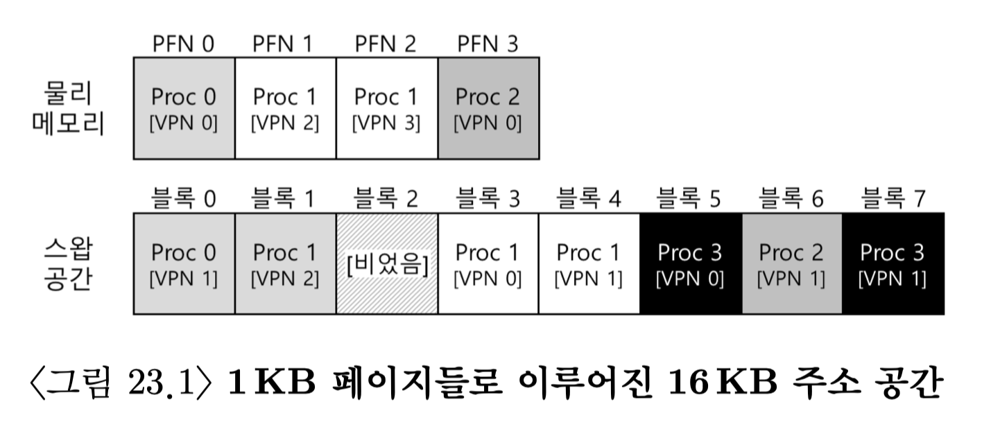
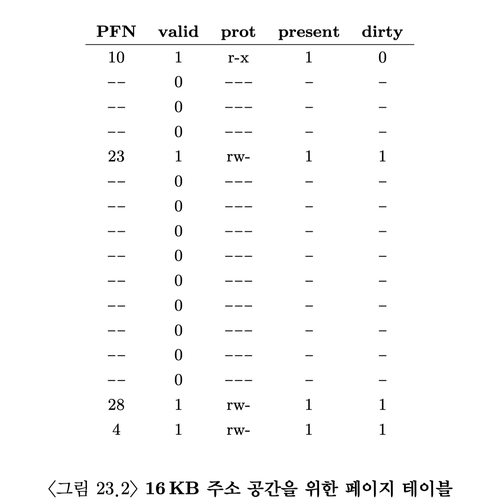
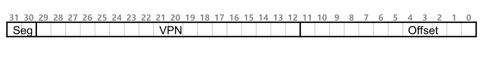
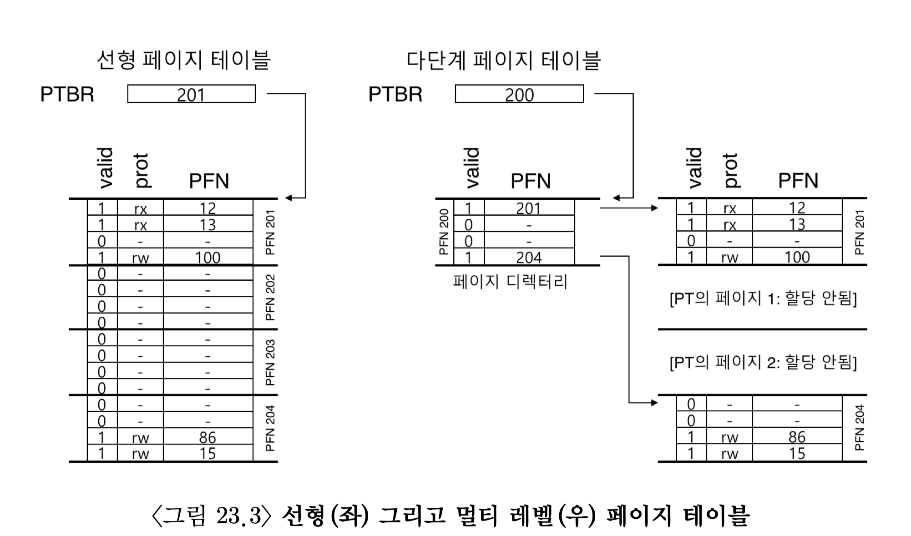
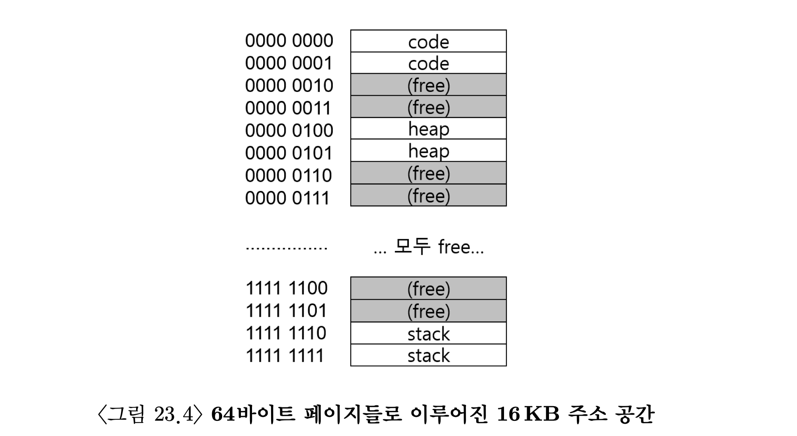
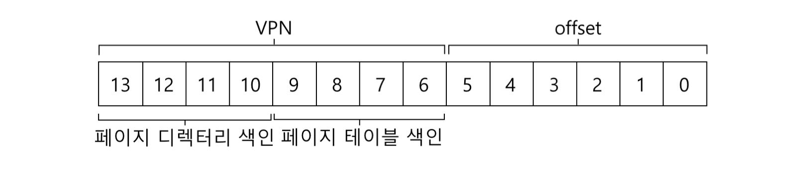
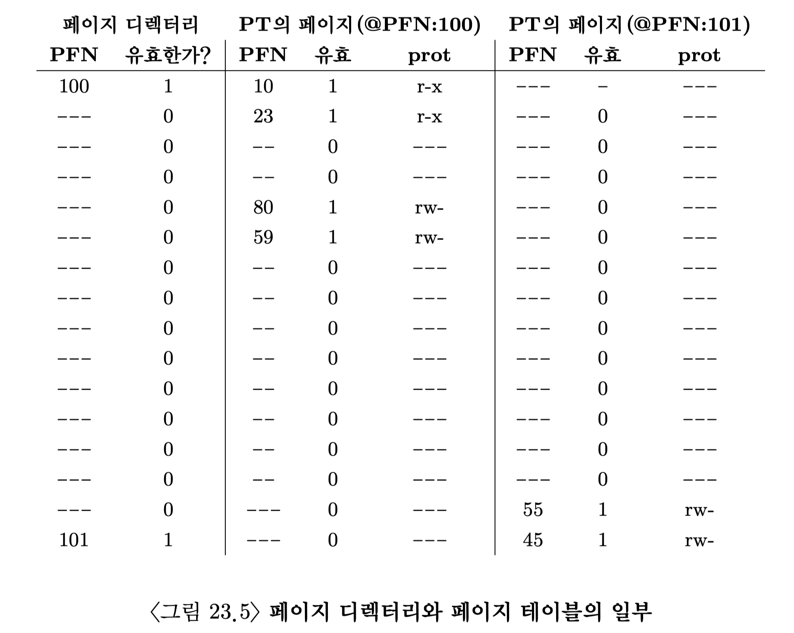
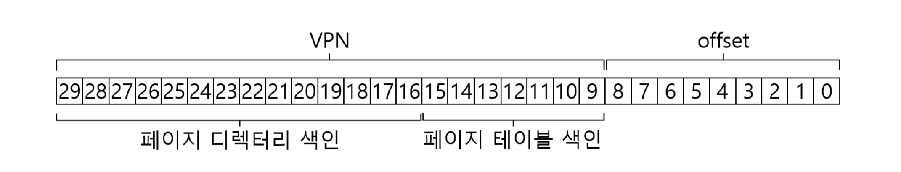
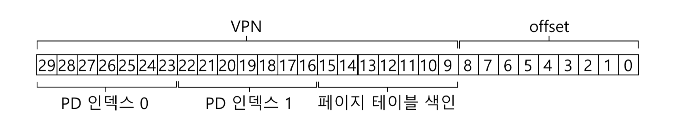

# 23장 개요

페이지 테이블이 크면 많은 메모리 공간을 차지한다.

배열 형태를 가지는 선형 페이지 테이블(linear page table)을 예로 들자

페이지 크기가 4KB(2^12바이트), 페이지 테이블 각 항목은 4바이트인 32비트 주소 공간을 가정해 보자.

주소 공간에는 대략 100만 개(2^32/2^12)의 가상 페이지가 존재할 것이다. 

| 비트 구간 | 의미 |
| --- | --- |
| 상위 20비트 (32-12) | Virtual Page Number (VPN), (PFN) |
| 하위 12비트 | Page Offset (페이지 내 주소) |

여기에 페이지 테이블 항목의 크기를 곱하면 (4바이트 * 백만) = 약 4MB가 된다.

또한 이런 페이지 테이블은 프로세스 마다 존재한다. 즉, 100개의 프로세스가 실행 중이라면 페이지 테이블은 400MB의 메모리가 필요하다.

이는 엄청난 부담이다. **어떻게 페이지 테이블의 크기를 줄일 수 있는가?**

---

# 23.1 간단한 해법: 더 큰 페이지

페이지 테이블의 크기를 간단하게 줄이는 방법은 페이지의 크기를 증가시키는 것

16KB 페이지를 가정하자

그럼 18비트의 VPN과 14비트의 오프셋을 가진다.

PTE 크기가 4바이트로 동일하다면, 페이지 테이블의 총 크기는 1MB가 된다.

기존 테이블 대비 크기가 1/4로 감소된다.

하지만 페이지 크기의 증가는 부작용을 수반한다.

가장 큰 문제는 페이지 내부의 낭비 공간이 증가하는 것이다. 이를 **내부 단편화(internal fragmentation)**라고 부른다

---

# 23.2 하이브리드 접근 방법: 페이징과 세그멘트





| 비트 구간 | 의미 |
| --- | --- |
| 상위 4비트 (14 - 10) | Virtual Page Number (VPN) |
| 하위 10비트 = 페이지 크기 | Page Offset (페이지 내 오프셋) |

그림에서 보는 바와 같이, 페이지 테이블 대부분이 비어있다. → 엄청난 낭비가 발생한다.

16KB 크기의 아주 작은 주소 공간에서 발생한 상황이다.

프로세스의 전체 주소 공간을 위해 하나의 페이지 테이블을 두는 대신, 논리 세그멘트마다 따로 페이지 테이블을 두면 어떨까?

이 예제에서는 3개의 페이지 테이블이 있을 수 있다. 

코드, 힙, 스택 세그멘트에 대해 테이블을 각각 두는 것이다.

세그멘테이션에서는 세그멘트의 물리 주소 시작 위치를 나타내는 베이스(base) 레지스터, 크기를 나타내는 바운드(bound) 레지스터가 있다.

하이브리드 방식의 MMU에서도 비슷한 구조를 사용한다. 

베이스 레지스터는 세그멘트 시작 주소를 가리키는 것이 아니라 세그멘트의 페이지 테이블 시작 주소를 갖는다.

바운드 레지스터는 페이지 테이블의 끝을 나타내기 위해서 사용한다.

4KB 페이지를 갖는 32비트 가상 주소 공간이 4개의 세그멘트로 나뉘어 있다고 가정하자.

예제에서는 3개의 세그만트만 사용한다.

소속 세그멘트를 나타내기 위해 상위 2비트를 사용한다. 

- 미사용 세그멘트 00
- 코드 세그멘트 01
- 힙 세그멘트 10
- 스택 세그멘트 11

가상 주소는 다음과 같이 표현될 수 있다. 



하드웨어에는 3개의 베이스/바운드 레지스터 쌍이 코드와 힙 그리고 스택을 위해서 존재한다고 가정

실행 중인 프로세스에서, 각 세그멘트의 베이스 레지스터는 각 세그멘트 페이지 테이블의 시작 물리 주소를 갖는다.

즉, 이 시스템에서 모든 프로세스는 3개의 페이지 테이블을 갖는다.

문맥 교환 시, 이 레지스터들은 새로 실행되는 프로세스의 페이지 테이블의 위치값으로 변경된다.

TLB 미스가 발생하면, (하드웨어 기반 TLB로 가정) 하드웨어는 세그멘트 비트를 사용하여 어떤 베이스와 레지스터 쌍을 사용할지 결정한다. 하드웨어는 그 세그멘트에 들어 있는 물리 주소를 VPN과 함께 다음과 같은 방식으로 조작하여 페이지 테이블 항목(PTE)의 주소를 얻는다.


이와 같은 방식으로 하이브리드 기법은 선형 페이지 테이블에 비해 메모리 사용을 개선시킬 수 있다.

스택과 힙 사이의 할당되지 않은 페이지들은 페이지 테이블 상에서 더 이상 공간을 차지하지 않는다.

### **선형 페이지 테이블 구조 (Linear Page Table)**

- **구조**: 프로세스마다 하나의 큰 배열 형태의 페이지 테이블을 가짐
- **장점**: 구조가 단순하고 구현이 쉬움
- **문제점**:
- **전체 가상 주소 공간을 커버**해야 하므로,
→ 비어있는 PTE (Page Table Entry)가 많음

→ **공간 낭비(내부 단편화)**

### **이 문제의 해결 시도 – 하이브리드 기법 (Segmentation + Paging)**

- **구조**:
- 가상 주소를 먼저 **세그먼트로 나누고**,
  - 각 세그먼트 안에서 **별도의 페이지 테이블**을 둠
- **장점**:
- 전체 주소 공간을 전부 커버하지 않아도 되므로 **낭비 줄일 수 있음(내부 단편화 해결)**
  - 각 세그먼트는 독립적으로 페이징 가능 → 더 유연한 구조
- **문제점**:
- 세그먼트마다 페이지 테이블이 필요하고,
→ 이 테이블도 **연속된 배열 구조**

→ 결국 **연속된 물리 메모리 공간 필요**
  - 세그먼트마다 **크기가 다 다르기 때문에**,
→ **외부 단편화 발생**

→ 특히 **커널 영역에서 연속 공간 확보가 어려움**

### 내 생각 정리

```
하이브리드 기법은 커널 메모리 영역을 페이지로 나눈 게 의미가 없어지는 방법이다.
물론 여전히 사용자 메모리 영역은 페이징으로 외부 단편화를 없애고 내부 단편화를 최소화하지만 
커널 메모리 영역에서는 세그멘트 기법 특징상 페이지 테이블 정보를 담는 
페이지의 연속 할당되기 때문에 외부 단편화가 발생한다. 
따라서 커널 메모리 영역에서는 여전히 외부 단편화가 발생하고, 
이로 인해 페이지 단위로 나누는 것의 의미가 퇴색된다고 할 수 있다.
```

---

# 23.3 멀티 레벨 페이지 테이블

세그멘테이션을 사용하지 않고 페이지 테이블 크기를 줄이는 방법에 대해서 생각해 보자.

어떻게 하면 사용하지 않는 주소 공간을 페이지 테이블에서 제거할 수 있을까?

→ 멀티 레벨 페이지 테이블

→ 멀티 레벨 페이지 테이블에서는 선형 페이지 테이블을 트리 구조로 표현한다.

**페이지 디렉터리(page directory)** 자료 구조를 사용하여 페이지 테이블 각 페이지의 할당 여부와 위치를 파악한다. 페이지 디렉터리는 페이지 테이블을 구성하는 각 페이지의 존재 여부와 위치 정보를 가지고 있다.



그림 23.3의 왼쪽을 보면 전형적인 선형 페이지 테이블이다. 중앙부를 보면 주소 공간을 사용하지 않고 있다.(내부 단편화). 그리고 페이지 테이블에서 항목들이 할당되어 있다.

우측을 보면 동일한 주소 공간을 다루는 멀티 레벨 페이지 테이블이다. 

페이지 디렉터리에는 두 개의 유효한 페이지가 있다(처음과 마지막). 유효 페이지는 2개는 메모리에 존재한다.

**Depth = 1: 페이지 디렉터리 (Page Directory)**

- **가상 주소의 상위 비트**를 사용해서 인덱싱
- 각 엔트리(PDE)는 **다음 단계인 페이지 테이블(PTE 테이블)의 주소**를 가지고 있다.
- 말하자면, 어떤 페이지 테이블로 가야 할지 알려주는 역할

**Depth = 2: 페이지 테이블 (Page Table)**

- 디렉터리에서 찾아온 주소에 있는 테이블
- 여기에는 실제 물리 메모리 프레임의 주소 (Page Frame Address)가 들어 있다
- **하위 비트로 인덱싱해서 실제 데이터를 찾는 데 사용**

**PTE(Page Table Entry) 유효 비트 VS PDE(Page Directory Entry) 유효 비트(valid bit)**

PDE valid bit = 1의 의미는 그 항목이 가리키는 페이지 내에서 최소한 하나가 유효하다는 것

즉, 최소한 하나의 PTE valid bit = 1

만약 PDE valid bit = 0의 의미는 PDE는 실제 페이지가 할당되지 않은 것이다.

### 멀티 레벨 페이지 테이블의 장점 요약

1. **주소 공간의 효율적 사용**
- 사용된 주소 공간 크기에 비례하여 페이지 테이블이 생성됨.
  - 사용되지 않는 가상 주소 영역에 대해선 페이지 테이블을 할당하지 않으므로 메모리 절약 가능.
1. **메모리 관리의 용이성**
- 페이지 테이블도 페이지 단위로 나뉘므로, 필요한 경우에만 메모리 할당 가능.
  - 운영체제가 **free page pool**에서 빈 페이지를 쉽게 할당하거나 회수할 수 있음.
1. **유연한 페이지 테이블 저장**
- 단일 테이블(선형) 구조는 항상 메모리에 상주해야 하지만,
멀티 레벨 구조는 **페이지 디렉터리**를 통해 페이지 테이블 페이지의 위치를 추적 가능.
  - 페이지 테이블 일부가 디스크에 스왑되어도 위치 추적 가능하므로, 물리 메모리 사용이 유연함.

### 멀티 레벨 페이징 유의사항 및 단점

- **추가적인 메모리 접근 비용 발생 (TLB 미스 시)**
- TLB(TLB: Translation Lookaside Buffer) 미스가 발생하면,
**페이지 디렉터리 접근 + PTE(Page Table Entry) 접근**,

**총 두 번의 메모리 접근**이 필요함.
  - 반면 선형 페이지 테이블은 **단 한 번의 접근**으로 가능.
  - ⇒ **시간-공간 절충(time-space trade-off)**의 대표적인 예.
공간 절약을 얻었지만, 메모리 접근 시간이 늘어남.
- **검색(구현) 복잡도 증가**
- 선형 페이지 테이블은 인덱스 한 번으로 바로 PTE에 접근 가능하지만,
멀티 레벨 구조는 각 단계마다 인덱스를 계산하고 따라가야 함.
  - 하드웨어/소프트웨어 구현 방식과 무관하게,
검색 과정 자체가 더 복잡해짐.
- **성능은 대부분 TLB 히트에 의존**
- 현실적으로 대부분의 주소 변환은 TLB 히트로 처리됨.
  - 그러나 **TLB 미스 발생 시 성능 저하가 뚜렷**하게 나타남.
  - TLB 미스를 줄이기 위한 **TLB 크기 확대**나 **TLB 계층화** 등의 보조 기법이 필요함.

### 멀티 레벨 페이징 예제

조건: 64바이트 페이지를 갖는 16KB 주소 공간

→ 14비트 가상 주소 공간

→ VPN 8비트

→ 페이지 오프셋 6비트 

선형 페이지 테이블



주소에서 작은 부분만 사용된다 하더라도, 선형 페이지 테이블의 크기는 변하지 않는다.

즉, 2^8(256)개 엔트리 고정

**페이지 사용** 

페이지 0,1 → code / 페이지 4,5 → heap / 페이지 254,255 → stack 

이 주소 공간을 2단계 페이지 테이블로 구성해 보자

선형 페이지 테이블을 페이지 단위로 분할한다. 

각 PTE는 4바이트로 가정

전체 페이지 테이블의 크기는 256 * 4바이트 = 1024바이트 = 1KB 

각 페이지가 64바이트니까 1KB 페이지 테이블은 16개의 페이지로 분할된다.

각 페이지에는 16개의 PTE가 있다.

VPN으로부터 페이지 디렉터리 인덱스를 추출한다.


총 256개의 PTE를 1페이지에서 16개의 PTE를 가지니까

페이지 디렉터리는 4비트가 필요하다. = VPN 상위 4비트를 페이지 디렉터리 색인으로 구성

VPN에서 **페이지-디렉터리 인덱스(page-directory index, PDIndex)**를 추출하면 

PDEAddr = PageDirBase + (PDIndex * sizeof(PDE)) 식으로 PDE 주소를 찾을 수 있다 



페이지-디렉터리의 해당 항목이 무효(invalid) 표시되어 있으면, 이 주소 접근은 유효하지 않다.

해당 PDE가 유효하면 추가 작업을 한다.

이 페이지 디렉터리 항목이 가리키고 있는 페이지 테이블의 PTE를 읽기 위해서 VPN의 나머지 4비트를 사용한다.

이 **페이지-테이블 인덱스(page-table index, PTIndex)**는 페이지 테이블 자체 인덱스로 사용된다.

PTEAddr = (PDE.PFN << SHIFT) + (PTIndex * sizeof(PTE))



그림 23.5를 보면 페이지 디렉터리 항목(PDE)는 2개의 유효한 영역이 존재한다.

물리 페이지 100, 101에 가상 주소 공간의 첫 16개 페이지에 대한 물리 주소를 가진다.

선형 페이지의 16개의 페이지들을 모두 할당하는 대신 단지 3개의 페이지만 할당하였다.

페이지 디렉터리를 위해서 한 페이지, 페이지 테이블을 위해 2개의 페이지 할당

많은 공간이 절약되었다.

**가상 주소를 물리 주소로 바꿔보자**

VPN 254를 가지는 스택 페이지는 이진수로 11 1111 1000 0000이다.

1. VPN 상위 4비트(1111: 페이지 디렉터리의 마지막 엔트리) → 즉, 물리 프레임 주소 101이 저장
1. VPN 다음 4비트(1110: 페이지 테이블 뒤에서 2번째 항목) → 즉, 물리 프레임 주소 55 저장
1. 결과 = (PTE.PEN << SHIFT) + offset 
- 55 = 2^5 + 2^4 + 2^2 + 2^1 + 2^0 = 11010 → (<< SHIFT) 11011100
  - 11011100 + offset(000000) = 00 1101 1100 0000

### 2단계 이상 사용하기

가정 

- 30비트 가상 주소 공간
- 페이지 크기 : 512바이트 = 9비트 오프셋
- VPN: 21비트(30(가상 주소 공간) - 9(오프셋))

멀티 레벨 테이블에서 몇 단계를 둘지 정하기 위해 먼저 한 페이지에 몇 개의 페이지 테이블 항목을 저장할 수 있을지 계산하자.

페이지 크기  = 512바이트, PTE 크기 = 4비트  → 1페이지에 128개의 PTE를 넣을 수 있다.

즉, 페이지 테이블의 페이지를 인덱스로 사용하려면 VPN의 하위 7비트가 필요하다. (2^7 = 128)



이제 남은 비트는 21 - 7 = 14비트

만약 2단계 페이지를 사용하면 페이지 디렉터리에 2^14개의 항목이 있게 된다.

1개의 페이지가 128개의 PTE를 가지니까 총 128개의 페이지 분량의 연속된 메모리가 필요하다.

이는 멀티 레벨 페이지 테이블의 근본 취지가 훼손된 셈이다.



페이지 디렉터리 자체를 멀티 페이지들로 나누어서 트리의 단계를 늘린다.

- 가상 주소 분할
- 최상위 비트: 1단계 페이지 디렉터리 인덱스 (PD Index 0)
  - 그다음 비트들: 2단계 페이지 디렉터리 인덱스 (PD Index 1)
  - 그다음 비트들: 페이지 테이블 인덱스 (PT Index)
  - 마지막 비트들: 페이지 오프셋
- 주소 변환 단계
1. PD Index 0을 사용해서 최상위 페이지 디렉터리 항목(PDE)을 찾음.
  1. 이 PDE에서 다음 단계 페이지 디렉터리(또는 테이블)의 물리 주소를 얻음.
  1. 이 주소와 PD Index 1을 결합해 2단계 페이지 디렉터리 항목을 가져옴.
  1. 해당 항목이 유효하다면, PTE 페이지의 물리 주소를 얻음.
  1. 이 주소와 PT Index를 결합해 PTE의 실제 물리 주소를 계산.
  1. 이 PTE가 가리키는 실제 페이지 프레임의 물리 주소 + 오프셋 → 최종 물리 주소

# 23.5 페이지 테이블을 디스크로 스와핑하기

이제까지는 페이지 테이블이 커널이 소유하고 있는 물리 메모리 영역에 존재한다고 가정하였다. 

페이지 테이블 크기 축소를 위해 많은 시도를 하더라도, 여전히 모든 페이지 테이블을 메모리에 상주시키기에는 양이 너무 클 수도 있다. 

그래서 페이지 테이블들을 시스템의 메모리가 부족할 경우, 페이지 테이블들을 스왑(swap)하기도 한다.

# 23.6 요약

공간을 많이 차지하는 테이블 구조를 사용할수록 TLB 미스의 처리가 빨라지고, 공간을 적게 차지하는 테이블 구조를 사용하면 상황은 반대가 된다. 주어진 제약 조건을 적절히 고려하여 적합한 자료 구조를 결정해야 한다.

