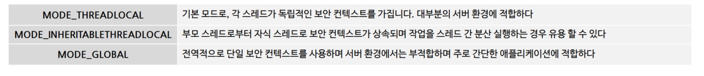
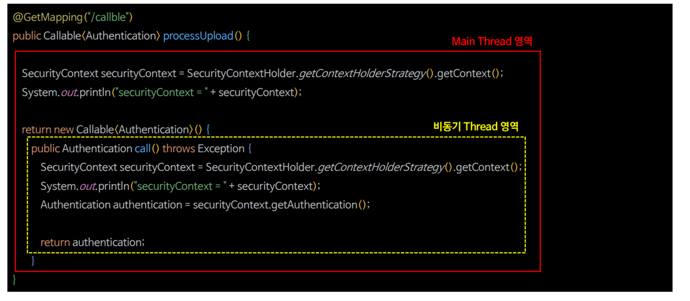
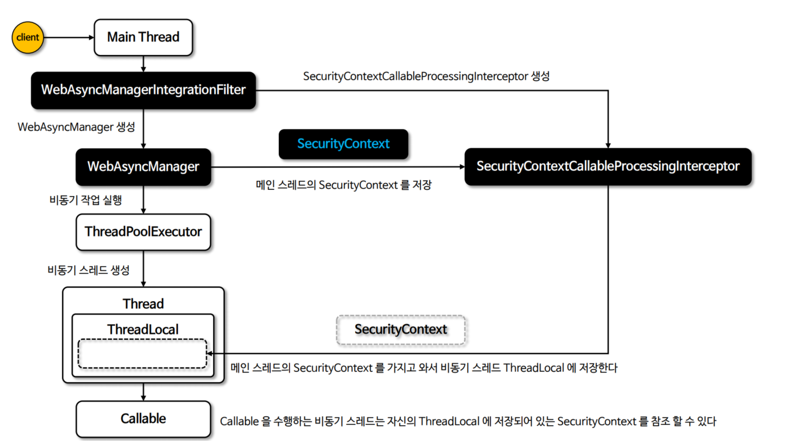
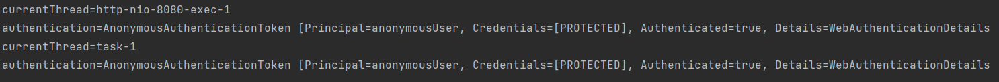
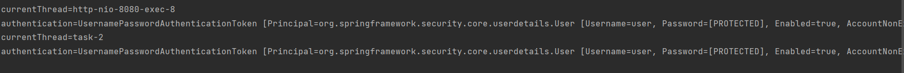
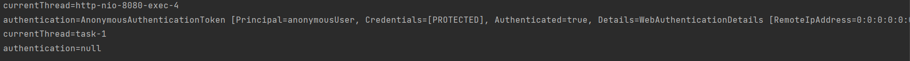
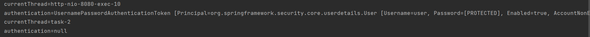
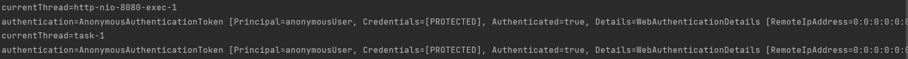
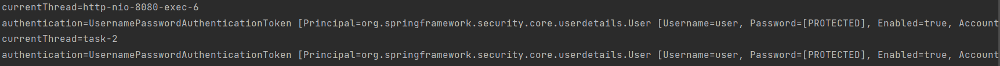

# ***개요***

- *Spring Security는 Spring MVC Controller에서 Callable을 실행하는 비동기 스레드에 SecurityContext를 자동으로 설정하도록 지원한다*
- *Spring Security는 WebAsyncManager와 통합하여 SecurityContextHolder에서 사용 가능한 SecurityContext를 Callable 에서 접근 가능하도록 해 준다*

***What is Collable & 비동기 스레드 ?***

[https://20240228.tistory.com/307](https://20240228.tistory.com/307)

***SpringSecurty - SecurityContextHolder 기본전략***  



- *기본은* *`MODE_THREADLOCAL`**이다.*
- *따라서 부모 스레드가 비동기 스레드를 생성하면 해당 비동기 스레드 즉, 자식 스레드에는 SecurityContext가 저장되지 않는다.* 
- *하지만 스프링 시큐리티는 Callable을 반환하면 자식 스레드의 스레드 로컬에 SecurityContext를 저장한다.*  

# ***WebAsyncManagerIntegrationFilter***

- *SecurityContext와 WebAsyncManager사이의 통합을 제공하며 WebAsyncManager를 생성하고 SecurityContextCallableProcessingInterceptor를 WebAsyncManager에 등록한다*

# ***WebAsyncManager***

- *스레드 풀의 비동기 스레드를 생성하고 Callable 를 받아 실행시키는 주체로서 등록된 SecurityContextCallableProcessingInterceptor를 통해 현재 스레드가 보유하고 있는 SecurityContext 객체를 비동기 스레드의 ThreadLocal에 저장시킨다*

# ***코드 구현***



- *비동기 스레드가 수행하는 Callable 영역 내에서 자신의 ThreadLocal에 저장된 SecurityContext 를 참조할 수 있으며 이는 부모 스레드가 가지고 있는 SecurityContext와 동일한 객체이다*
- ***@Async***나 다른 비동기 기술은 스프링 시큐리티와 통합되어 있지 않기 때문에 비동기 스레드에 SecurityContext 가 적용되지 않는다
- *@Async에 SecurityContext를 적용하려면* ***SecurityContextHolder*** *전략을 MODE_INHERITABLETHREADLOCAL 사용해야 한다.*

***What is @Async?***

[https://velog.io/@gillog/Spring-Async-Annotation%EB%B9%84%EB%8F%99%EA%B8%B0-%EB%A9%94%EC%86%8C%EB%93%9C-%EC%82%AC%EC%9A%A9%ED%95%98%EA%B8%B0](https://velog.io/@gillog/Spring-Async-Annotation%EB%B9%84%EB%8F%99%EA%B8%B0-%EB%A9%94%EC%86%8C%EB%93%9C-%EC%82%AC%EC%9A%A9%ED%95%98%EA%B8%B0)

# ***흐름도***



# ***테스트 개요*** 

***1. Callable + MODE_THREADLOCAL***

***2. @Async + MODE_THREADLOCAL***

***3. @Async + MODE_INHERITABLETHREADLOCAL*** 

# ***테스트1***

***SecurityConfig***

```java
@EnableWebSecurity
@Configuration
public class SecurityConfig {
    @Bean
    public WebSecurityCustomizer webSecurityCustomizer() {
        return webSecurity -> webSecurity.ignoring().requestMatchers(PathRequest.toStaticResources().atCommonLocations());
    }
    @Bean
    public SecurityFilterChain securityFilterChain(HttpSecurity http) throws Exception {
        http
                .authorizeHttpRequests(authorize -> authorize
                        .requestMatchers("/user").hasAuthority("ROLE_USER")
                        .requestMatchers("/db").hasAuthority("ROLE_DB")
                        .requestMatchers("/admin").hasAuthority("ROLE_ADMIN")
                        .anyRequest().permitAll())
                .formLogin(Customizer.withDefaults())
                .csrf(AbstractHttpConfigurer::disable);

        SecurityContextHolder.setStrategyName(SecurityContextHolder.MODE_THREADLOCAL);

        return http.build();
    }
    @Bean
    public UserDetailsService userDetailsService(){
        UserDetails user = User.withUsername("user").password("{noop}1111").roles("USER").build();
        UserDetails db = User.withUsername("db").password("{noop}1111").authorities("ROLE_DB").build();
        UserDetails admin = User.withUsername("admin").password("{noop}1111").roles("ADMIN","SECURE").build();
        return  new InMemoryUserDetailsManager(user, db, admin);
    }
}
```

- `SecurityContextHolder.setStrategyName(SecurityContextHolder.MODE_THREADLOCAL)` 
- default

***IndexController***

```java
@Slf4j
@RestController
public class IndexController {
    @GetMapping("/")
    public Callable<Authentication> index(){
        Authentication authentication = SecurityContextHolder.getContextHolderStrategy().getContext().getAuthentication();
        log.info("currentThread={}", Thread.currentThread().getName());
        log.info("authentication={}", authentication);
        return () -> {
            Authentication auth = SecurityContextHolder.getContextHolderStrategy().getContext().getAuthentication();
            log.info("currentThread={}", Thread.currentThread().getName());
            log.info("authentication={}", auth);
            return auth;
        };
    }
    @GetMapping("/user")
    public String user(){
        return "user";
    }
}
```

1. *Anoymous 즉, 로그인을 하지 않고 루트 경로 접근*



*2. ROLE_USER 권한으로 접근*



*비동기 스레드인 task - xx에도 Authentication이 정상적으로 들어간다.*

# ***테스트2***

***SecurityApplication***

```java
@SpringBootApplication
@EnableAsync
public class SecurityApplication {
	public static void main(String[] args) {
		SpringApplication.run(SecurityApplication.class, args);
	}
}
```

- *@EnableAsync 추가* 

***SecurityConfig*** *설정 그대로 → SecurityContextHolder strategy* ***THREAD_LOCAL***

***IndexController, AyncService***

```java
@Slf4j
@RestController
@RequiredArgsConstructor
public class IndexController {
    private final AsyncService asyncService;
    @GetMapping("/")
    public String index(){
        Authentication authentication = SecurityContextHolder.getContextHolderStrategy().getContext().getAuthentication();
        log.info("currentThread={}", Thread.currentThread().getName());
        log.info("authentication={}", authentication);
        asyncService.async();
        return "index";
    }
    @GetMapping("/user")
    public String user(){
        return "user";
    }
}

@Service
@Slf4j
public class AsyncService {
    @Async
    public void async(){
        Authentication authentication = SecurityContextHolder.getContextHolderStrategy().getContext().getAuthentication();
        log.info("currentThread={}", Thread.currentThread().getName());
        log.info("authentication={}", authentication);
    }
}
```

1. *Anoymous 즉, 로그인을 하지 않고 루트 경로 접근*



1. *ROLE_USER 권한으로 접근*



*비동기 스레드인 task - xx에 Authentication이 null로 나온다.*

# ***테스트3***

*테스트2에서 SecurityConfig만 수정* 

```java
@Bean
public SecurityFilterChain securityFilterChain(HttpSecurity http) throws Exception {
    http
            .authorizeHttpRequests(authorize -> authorize
                    .requestMatchers("/user").hasAuthority("ROLE_USER")
                    .requestMatchers("/db").hasAuthority("ROLE_DB")
                    .requestMatchers("/admin").hasAuthority("ROLE_ADMIN")
                    .anyRequest().permitAll())
            .formLogin(Customizer.withDefaults())
            .csrf(AbstractHttpConfigurer::disable);

    SecurityContextHolder.setStrategyName(SecurityContextHolder.MODE_INHERITABLETHREADLOCAL);

    return http.build();
}
```

- *SecurityContextHolder.setStrategyName(SecurityContextHolder.MODE_INHERITABLETHREADLOCAL);*
- *MODE_THREADLOCAL → MODE_INHERITABLETHREADLOCAL*
1. *Anoymous 즉, 로그인을 하지 않고 루트 경로 접근*



1. *ROLE_USER 권한으로 접근*



*비동기 스레드인 task - xx에도 Authentication이 정상적으로 들어간다.*

# **정리**

*SpringSecurity + SpringMVC 프레임워크를 사용하고 비동기 프로그래밍을 한다고 하면* 

*@Aysnc 애노테이션을 사용할 때 자식 스레드(비동기 스레드)에 인증 객체(Authentication)이 필요하면 MODE_INHERITABLETHREADLOCAL을 사용하자 또는 Callable 반환을 하자*

