# **시큐리티 인증 / 인가 흐름도**

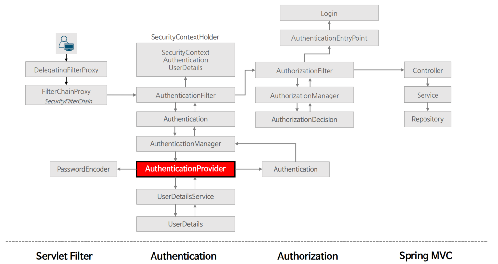

# **AuthenticationProvider**

- 사용자의 자격 증명을 확인하고 인증 과정을 관리하는 클래스로서 사용자가 시스템에 엑세스하기 위해 제공한 정보(아이디/비빌번호)가 유효한지 검증하는 과정을 포함한다 
- 다양한 유형의 인증 메커니즘을 지원할 수 있는데, 기본적인 사용자 이름과 비밀번호를 기반으로 한 인증, 토큰 기반 인증, 지문 인식 등을 처리할 수 있다 
- 성공적인 인증 후에는 `Authentication` 객체를 반환하며 이 객체에는 사용자의 신원 정보와 인증된 자격 증명을 포함한다 
- 인증 과정 중에 문제가 발생한 경우 `AuthenticatioException` 과 같은 예외를 발생시켜 문제를 알리는 역할을 한다 

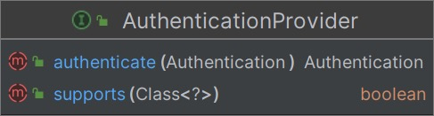

- `AuthenticationManager`로부터 `Authentication` 객체를 받아 인증을 수행한다 
- 인증을 수행할 수 있는 조건인지를 `supports 메소드`를 통해 검사한다 

# **AuthenticationProvider 흐름도**

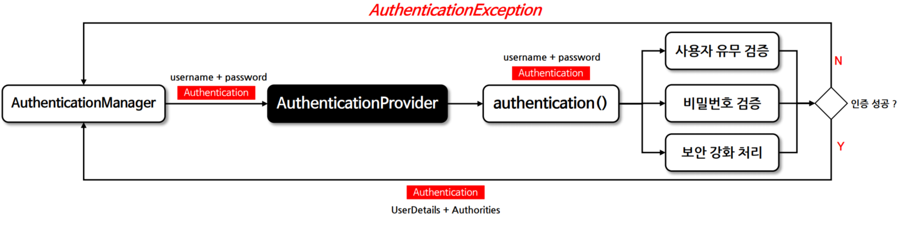

# **AuthenticationProvider사용 방법 ­- 일반 객체로 생성**

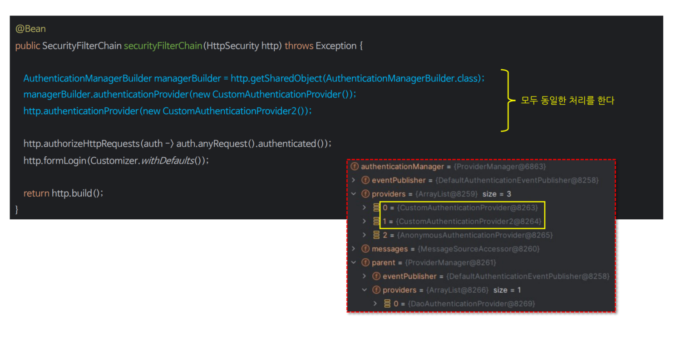

**HttpSecurity - addAuthenticationProvider 활용** 

`http.authenticationProvider(new CustomAuthenticationProvider()))`

**ManagerBuilder 활용** 

`AuthenticationManagerBuilder managerBuilder = http.getSharedObject(AuthenticationMnagerBuilder.class`

`managerBuilder.addAuthenticationProvider(new CustomAuthenticationProvider())`

**저장 위치** 

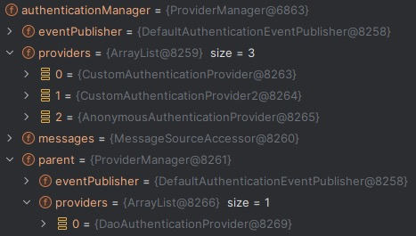

`AuthenticationManager`는 `AuthenticationProvider` 목록인 `providers`와 추가적으로 

`AuthenticationManager(parent)`를 가질 수 있다

일반 객체로 생성해서 추가되는 위치는 `providers`

`AnonymousAuthenticationProvider`, `DaoAuthenticationProvider` 2개의 `Provider`는 시큐리티가 기본적으로 넣어준다.

# **AuthenticationProvider 사용 방법 -­ 빈으로 생성**

## **빈을 한 개만 정의하는 경우** 

`AuthenticationProvider`를 빈으로 정의하면 `DaoAuthenticationProvider`를 자동으로 대체하게 된다

```java
@Bean
public AuthenticationProvider customAuthenticationProvider(){
	 return new CustomAuthenticationProvider();
}
```

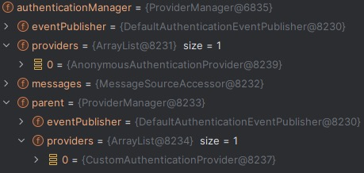

하지만 상황에 따라서 내가 Custom한 `AuthenticationProvider` 뿐만 아니라 

`DaoAuthenticationProvider`도 필요할 수 있다. 

→ ex: 인증 방식이 (Custom한 방식 / 폼 로그인 방식) 2가지가 있는 경우 

```java
@Bean
public SecurityFilterChain securityFilterChain(HttpSecurity http, AuthenticationManagerBuilder builder, AuthenticationConfiguration configuration) 
throws Exception {
		 AuthenticationManagerBuilder managerBuilder = http.getSharedObject(AuthenticationManagerBuilder.class);
		 managerBuilder.authenticationProvider(customAuthenticationProvider());
		 ProviderManager providerManager = (ProviderManager)configuration.getAuthenticationManager();
		 providerManager.getProviders().remove(0);
		 builder.authenticationProvider(new DaoAuthenticationProvider());
		 http.authorizeHttpRequests(auth -> auth.anyRequest().authenticated());
		 return http.build();
}

@Bean
public AuthenticationProvider customAuthenticationProvider(){
		 return new CustomAuthenticationProvider();
}
```

**결과** 

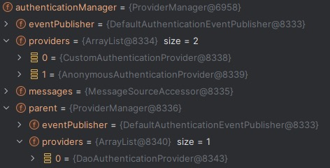

```java
AuthenticationManagerBuilder managerBuilder = http.getSharedObject(AuthenticationManagerBuilder.class);
managerBuilder.authenticationProvider(customAuthenticationProvider());
```

`HttpSecurity` 객체를 통해 `getSharedObject(AuthenticationManagerBuilder.class)` ManagerBuilder 가져오기 

가져온 `builder.authenticationProvider(customAuthenticationProvider())` 

이렇게 하면 `AuthenticationManager providers` 목록에 `CustomAuthenticationProvider`가 들어간다.

`parent`에 있는 `ProviderManager`가 아니다!

```java
ProviderManager providerManager = (ProviderManager)configuration.getAuthenticationManager();
providerManager.getProviders().remove(0);
```

`AuthenticationConfiguration configuration` 주입 받았다.

configuration에서 `getAuthenticationManager`는 `parent`에 해당하는 `ProviderManager`이다 

여기서 첫 번째 인덱스에 해당하는 `AuthenticationProvider`를 삭제한다

삭제하는 `Provider`는 우리가 빈으로 등록한 `CustomAuthenticationProvider` 이다.

```java
 builder.authenticationProvider(new DaoAuthenticationProvider());
```

`AuthenticationManagerBuilder builder` 주입 받았다. 

`builder.authenticationProvider` 에 `DaoAuthenticationProvider`를 추가한다 

이때 `DaoAuthenticationProvider`가 추가되는 `AuthenticationManager`는 `patent`이다

그래서 최종적으로 아래 결과가 나온다 


## **빈을 두 개 이상 정의하는 경우** 

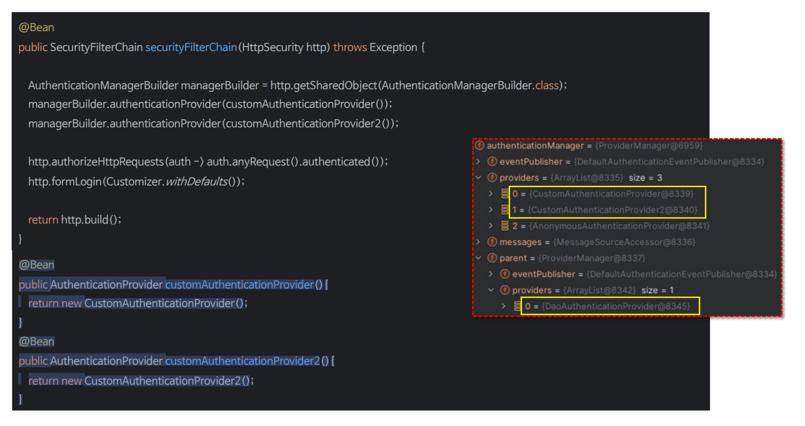

# **테스트1**

CustomAuthenticationProvider 일반 객체로 생성해서 사용하기 

```java
@EnableWebSecurity
@Configuration
@Slf4j
public class SecurityConfig {
    @Bean
    public SecurityFilterChain securityFilterChain(HttpSecurity http, AuthenticationConfiguration configuration) throws Exception{

        AuthenticationManagerBuilder managerBuilder = http.getSharedObject(AuthenticationManagerBuilder.class);
        managerBuilder.authenticationProvider(new CustomAuthenticationProvider());

        ProviderManager providerManager = (ProviderManager) configuration.getAuthenticationManager();
        providerManager.getProviders().add(new CustomAuthenticationProvider());

        http
            .authorizeHttpRequests(auth -> auth
                        .requestMatchers("/").permitAll()
                        .anyRequest().authenticated());

        //http.authenticationProvider(new CustomAuthenticationProvider2());

        http
            .formLogin(Customizer.withDefaults());

        return  http.build();
    }
    @Bean
    public UserDetailsService userDetailsService(){
        UserDetails user = User.withUsername("user12")
                .password("{noop}1111")
                .roles("USER").build();
        return new InMemoryUserDetailsManager(user);
    }
}
```

`AuthenticationConfiguration` 에서 가져온 `ProviderManager` 는 `Parent` 

`HttpSecurity.getSharedObject(AuthenticationManagerBuilder.class)` 를 통해서

가져온 `ProviderManager` 는 `Parent` 를 가지는 `ProviderManager` 이다.

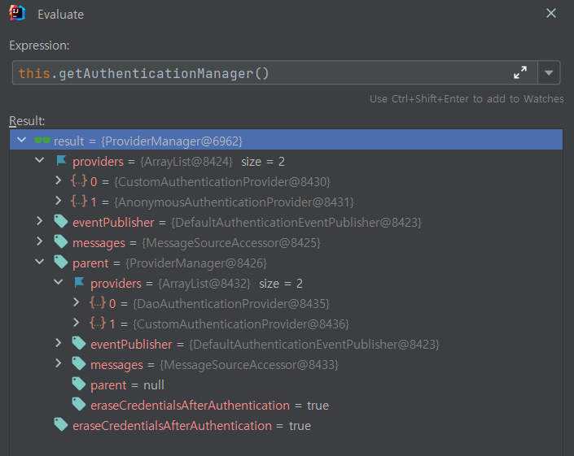

# **테스트2**

CustomAuthenticationProvider 빈으로만 등록 다른 설정 X

```java
@EnableWebSecurity
@Configuration
@Slf4j
public class SecurityConfig {
    @Bean
    public SecurityFilterChain securityFilterChain(HttpSecurity http) throws Exception{
        http
            .authorizeHttpRequests(auth -> auth
                        .anyRequest().authenticated());
        http
            .formLogin(Customizer.withDefaults());

        return  http.build();
    }
    @Bean
    public CustomAuthenticationProvider customAuthenticationProvider(){
        return new CustomAuthenticationProvider();
    }
    @Bean
    public UserDetailsService userDetailsService(){
        UserDetails user = User.withUsername("user12")
                .password("{noop}1111")
                .roles("USER").build();
        return new InMemoryUserDetailsManager(user);
    }
}
```

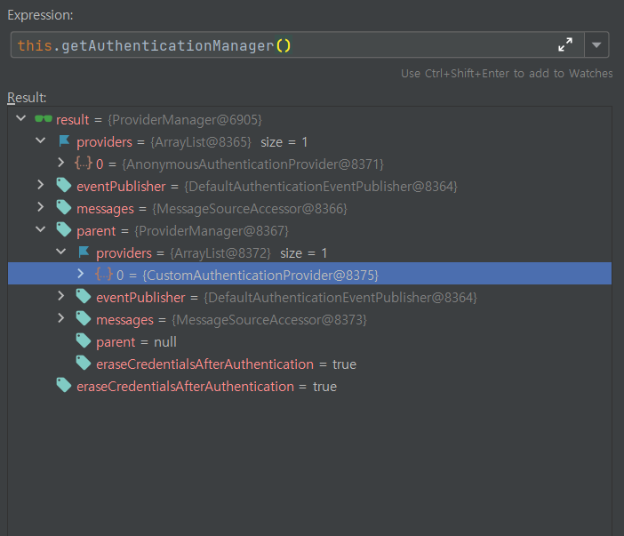

`CustomAuthenticationProvider`를 빈으로만 등록해도 `DaoAuthenticationProvider` 존재하지 않는다.

# **테스트3**

빈으로 등록하고 `HttpSecurity`를 통해서 추가하기 

```java
@EnableWebSecurity
@Configuration
@Slf4j
public class SecurityConfig {
    @Bean
    public SecurityFilterChain securityFilterChain(HttpSecurity http) throws Exception{
        AuthenticationManagerBuilder managerBuilder = http.getSharedObject(AuthenticationManagerBuilder.class);
        managerBuilder.authenticationProvider(customAuthenticationProvider());
        
        http
            .authorizeHttpRequests(auth -> auth
                        .anyRequest().authenticated());
        http
            .formLogin(Customizer.withDefaults());

        return  http.build();
    }
    @Bean
    public CustomAuthenticationProvider customAuthenticationProvider(){
        return new CustomAuthenticationProvider();
    }
    @Bean
    public UserDetailsService userDetailsService(){
        UserDetails user = User.withUsername("user12")
                .password("{noop}1111")
                .roles("USER").build();
        return new InMemoryUserDetailsManager(user);
    }
}
```

`CustomProviderManager`가 2곳에 들어간다.

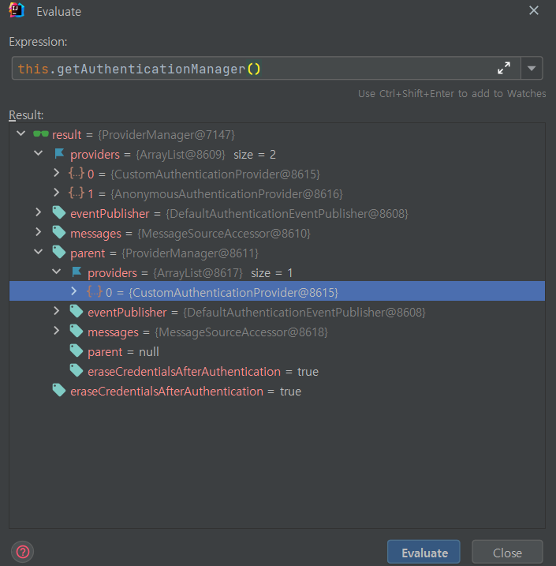

역시 `DaoAuthenticationProvider` 존재하지 않는다.

# **테스트4**

CustomProviderManager를 빈으로 등록하면서 1개만 존재하게 하고 

`DaoAuthenticationProvider` 또한 등록하기

```java
@EnableWebSecurity
@Configuration
@Slf4j
public class SecurityConfig {
    @Bean
    public SecurityFilterChain securityFilterChain(HttpSecurity http, AuthenticationConfiguration configuration) throws Exception{

        ProviderManager providerManager = (ProviderManager) configuration.getAuthenticationManager();
        providerManager.getProviders().add(new DaoAuthenticationProvider());

        http
            .authorizeHttpRequests(auth -> auth
                        .anyRequest().authenticated());
        http
            .formLogin(Customizer.withDefaults());

        return  http.build();
    }
    @Bean
    public CustomAuthenticationProvider customAuthenticationProvider(){
        return new CustomAuthenticationProvider();
    }
    @Bean
    public UserDetailsService userDetailsService(){
        UserDetails user = User.withUsername("user12")
                .password("{noop}1111")
                .roles("USER").build();
        return new InMemoryUserDetailsManager(user);
    }
}
```

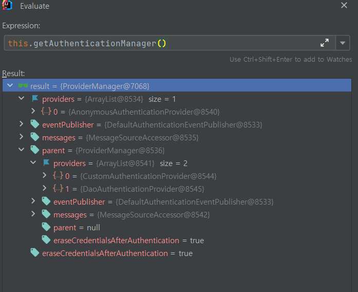

`DaoAuthenticationProvider` 를 `Parent ProviderManager` 에 등록 

등록 위치를 바꾸고 싶으면 `HttpSecurity`를 통해서 추가하면 된다

# **테스트5**

CustomProvider 2개 빈으로 등록만 하기 

```java
@EnableWebSecurity
@Configuration
@Slf4j
public class SecurityConfig {
    @Bean
    public SecurityFilterChain securityFilterChain(HttpSecurity http) throws Exception{
        http
            .authorizeHttpRequests(auth -> auth
                        .anyRequest().authenticated());
        http
            .formLogin(Customizer.withDefaults());

        return  http.build();
    }
    @Bean
    public CustomAuthenticationProvider customAuthenticationProvider(){
        return new CustomAuthenticationProvider();
    }
    @Bean
    public CustomAuthenticationProvider2 customAuthenticationProvider2(){
        return new CustomAuthenticationProvider2();
    }
    @Bean
    public UserDetailsService userDetailsService(){
        UserDetails user = User.withUsername("user12")
                .password("{noop}1111")
                .roles("USER").build();
        return new InMemoryUserDetailsManager(user);
    }
}
```

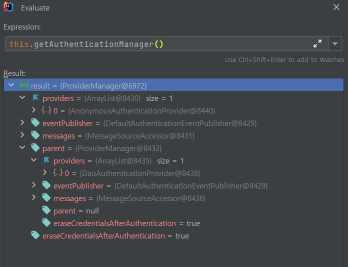

빈을 2개 등록하고 추가하지 않으면 기본 Provider만 존재한다 

# **테스트6**

CustomProvider 2개 빈으로 등록하고 HttpSecurity, AuthenticationConfiguration 통해서 

서로 다른 ProviderManager에 Provider 등록하기 

```java
@EnableWebSecurity
@Configuration
@Slf4j
public class SecurityConfig {
    @Bean
    public SecurityFilterChain securityFilterChain(HttpSecurity http, AuthenticationConfiguration configuration) throws Exception{

        AuthenticationManagerBuilder managerBuilder = http.getSharedObject(AuthenticationManagerBuilder.class);
        managerBuilder.authenticationProvider(customAuthenticationProvider());

        ProviderManager providerManager = (ProviderManager) configuration.getAuthenticationManager();
        providerManager.getProviders().add(customAuthenticationProvider2());

        http
            .authorizeHttpRequests(auth -> auth
                        .anyRequest().authenticated());
        http
            .formLogin(Customizer.withDefaults());

        return  http.build();
    }
    @Bean
    public CustomAuthenticationProvider customAuthenticationProvider(){
        return new CustomAuthenticationProvider();
    }
    @Bean
    public CustomAuthenticationProvider2 customAuthenticationProvider2(){
        return new CustomAuthenticationProvider2();
    }
    @Bean
    public UserDetailsService userDetailsService(){
        UserDetails user = User.withUsername("user12")
                .password("{noop}1111")
                .roles("USER").build();
        return new InMemoryUserDetailsManager(user);
    }
}
```

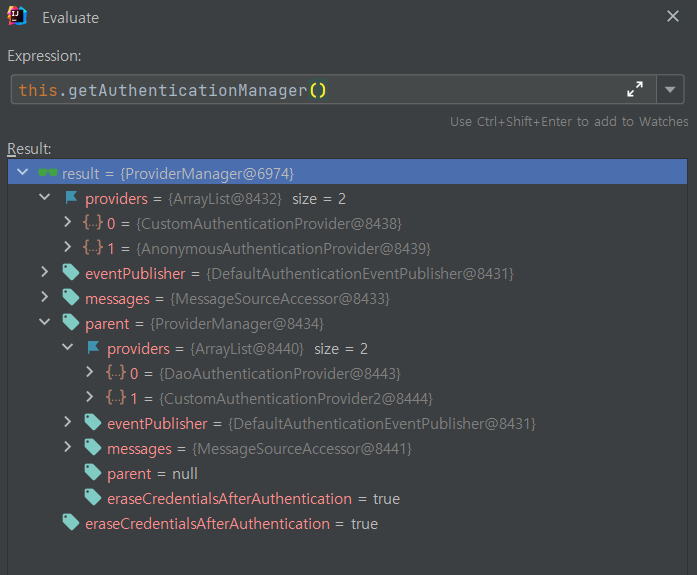

