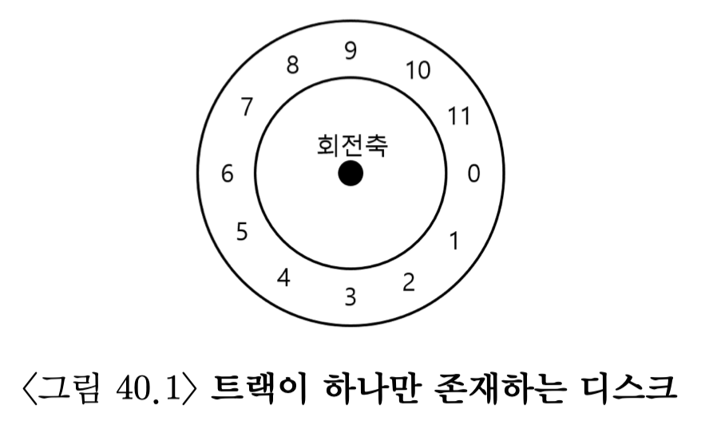
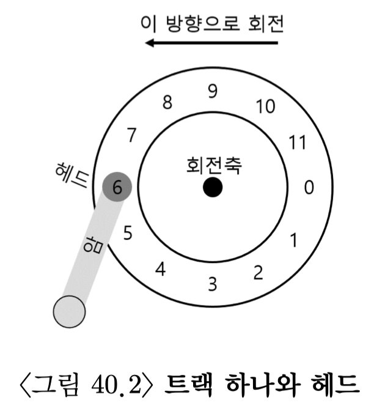
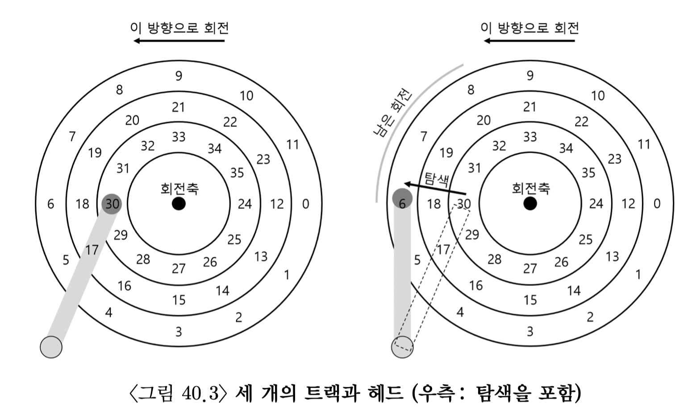
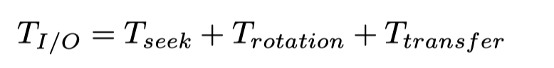
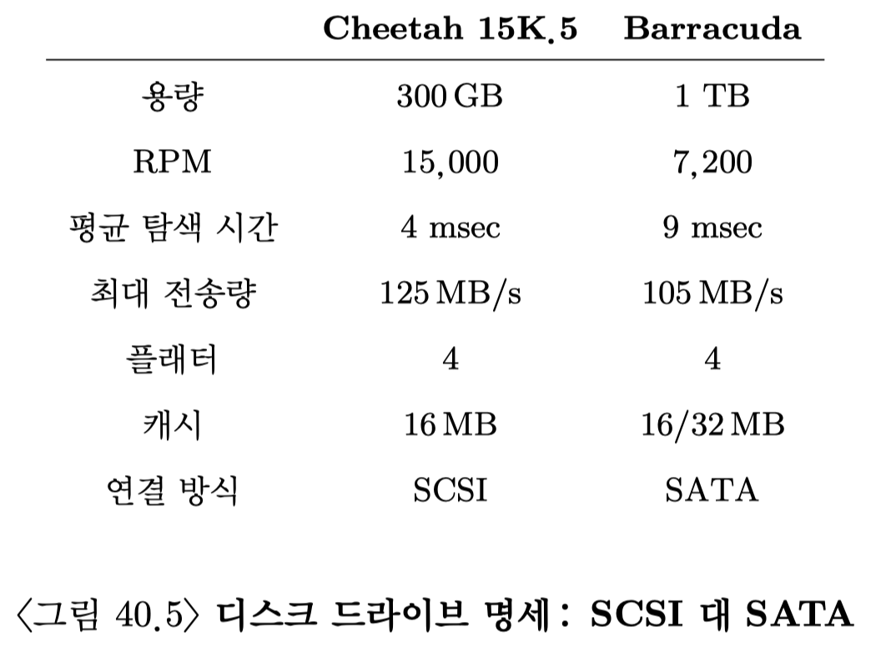
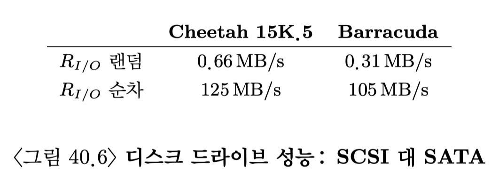

# 40.1 인터페이스

드라이브는 읽고 쓸 수 있는 **매우 많은 수의 섹터(512 바이트 블럭)들로 이루어져 있다.**

디스크 위의 n개의 섹터들은 0부터 n-1까지의 이름이 붙어 있다.

즉, **디스크를 섹터들의 배열로 볼 수 있으며 0부터 n-1이 드라이브의 주소 공간**이 된다.

멀티 섹터 작업도 가능하다. 보통 파일 시스템은 한 번에 4KB(또는 그 이상)를 읽거나 쓴다.

하지만 드라이브 제조사는 하나의 512 바이트 쓰기만 원자적으로 보장한다.

그러므로 전력 손실이 발생한다면 대량의 쓰기 중에 일부만 완료될 수 있다. 이런 현상을 **찢긴 쓰기(torn write)**라고 부른다.

**하드 디스크 사용자들이 하는 가정(제조사는 명시 X)**

1. 주소 공간에서 가깝게 배치되어 있는 블럭 두 개의 접근이 멀리 떨어져있는 두 개의 블럭을 접근하는 것보다 빠르다
1. 랜덤 I/O는 무조건 순차 I/O보다 느리다.

---

# 40.2 기본 구조

디스크는 하나 또는 그 이상의 **플래터(platter)**를 가진다.

플래터들은 **회전축(spindle)**이라는 것으로 고정되어 있는데, 플래터를 일정한 속도로 회전시킨다.

회전의 속도는 **분당 회전 수(rotation per minute, RPM)**로 측정되며 일반적인 값은 7,200 RPM 15,000 RPM 사이에 있다.

플래터 표면에는 중심에서 같은 거리에 있는 동심원 형태의 고리들이 있다. 이때 동심원 하나를 **트랙(track)**이라고 한다. 수많은 트랙들이 서로 촘촘하게 붙어있고, 수백 개의 트랙들이 모여야 사람의 머리카락 두께 정도가 된다.

읽기와 쓰기 동작은 **디스크 헤드(disk head)**를 통해서 할 수 있으며 각 플레터마다 그런 헤드가 하나씩 존재한다.

디스크 헤드는 **디스크 암(disk arm)**에 연결이 되어 있으며 이것을 통해서 헤드가 원하는 트랙 위에 위치하도록 이동시킬 수 있다.

---

# 40.3 간단한 디스크 드라이브

그림 40.1은 하나의 트랙으로만 이루어진 간단한 디스크이다.

이 트랙에는 12개의 섹터가 존재하고 각 섹터는 512 byte 크기를 갖고있다.

주소 영역은 0부터 11까지로 이루어져 있다. 회전축을 중심으로 플래터가 회전한다.

그림 40.2에서 보는 것과 같이 디스크 헤드는 디스크 암의 끝에 붙어 있으며 섹터 6에 위치해 있다.

그리고 표면(플레터)는 시계 반대 방향으로 회전한다.

### 단일 트랙 지연 시간: 회전 지연

그림 40.2에서 현재 디스크 헤드는 블록 6번에 있다. 만약 블럭 0번을 읽는다고 하면 디스크는 이 요청을 어떻게 처리할까? 간단하다. 회전축을 통해 플레터를 회전켜서 디스크 헤드 아래에 원하는 섹터가 위치하기를 가디라면 된다. 디스크 헤드를 원하는 섹터에 위치하도록 회전 시키는 시간을 **회전 지연(rotation delay)**라고 부른다. 이는  I/O 서비스 시간의 매우 중요한 요소이다.

### 멀티 트랙: 탐색 시간

현대의 디스크들은 하나의 플레터에 수백만 개의 트랙을 갖고 있다.

그림 40.3을 보면 트랙을 세 개 가진다. 헤드는 가장 안쪽의 트랙(24 ~ 34)에 위치하고 있고 그 다음 트랙은 12~23번의 섹터 집합을 가진다. 마지막으로 가장 바깥쪽 트랙에는 섹터 0~11번이 존재한다. 

I/O 요청에 대한 디스크 처리를 자세히 알아보기 위해서 그림의 왼쪽처럼 헤드가 섹터 30번에 위치해 있고

섹터11번에 대한 처리를 한다고 가정해 보자. 즉, 섹터 11번 위로 헤드가 움직여야 한다. 

먼저 디스크 암을 올바른 트랙 위에 위치시킨다. 즉, 가장 바깥쪽 트랙에 위치시킨다. 

이 과정을 **탐색(seek)**이라고 한다. 회전과 더불어서 탐색은 가장 비싼 디스크 동작 중 하나이다.

탐색 이후에는 회전축을 통해 플레터를 회전 시켜서 헤드를 섹터 11번 위치로 이동시킨다.

섹터 11번 위에 헤드가 위치하면 이제 마지막 단계인 전송이 이루어져 표면 위에 데이터를 읽거나 쓰게 된다.

탐색 시간(I/O 트랙으로 이동) + 회전 지연(같은 트랙에서 원하는 섹터로 회전) + 전송(데이터 전송)

= 디스크 처리 시간

### 캐시(cache)

디스크 드라이버의 캐시는 **트랙 버퍼(track buffer)**라고도 부른다. 이 캐시는 일반적으로 8 또는 16 MB 정도의 작은 크기의 메모리로 디스크에서 읽거나 쓴 데이터를 보관하는 데 사용된다.

예를 들어, 디스크에서 하나의 섹터를 읽을 때 드라이브가 그 트랙위의 모든 섹터를 다 읽어서 캐시에 저장할 수도 있다. 이렇게 하면 같은 트랙의 섹터에 대한 이후의 요청에 빠르게 응답할 수 있게 된다.

쓰기의 경우 2가지 방식이 존재한다. 

**write-back 방식**은 디스크 캐시에 데이터가 기록된 시점에 쓰기가 완료되었다고 보고

**write-through 방식**은 디스크에 실제로 데이터가 기록되었을 때 완료되었다고 보고

write-back 캐싱을 사용할 경우 드라이브가 더 빠른 것처럼 보이지만 위험할 수 있다. 

특히 프로그램의 정합성을 위해서 특정 순서로 디스크에 기록해야 한다고 할 때 write-back 방식을 사용하면 문제가 될 수 있다.

# 40.4 I/O 시간 계산

I/O 시간 = 탐색 시간 + 회전 지연 + 전송 시간

### 워크로드 유형으로 비교하는  I/O 시간 차이 

1. 랜덤 워크로드, 디스크에 4KB의 작은 읽기 요청 발생
1. 순차 워크로드, 헤드의 이동 없이 디스크에 연속되어 있는 여러 개의 섹터를 단순히 읽는 것.

순차 access vs 랜덤 access 성능 차이를 이해하기 위해서 디스크 드라이브에 대한 몇 가지 가정을 하자.

왼쪽은 고성능 드라이브 오른쪽은 용량 위주의 드라이브

결과 

랜덤 워크로드와 순차 워크로드의 드라이브 간 성능 차이가크다.

Cheetah 같은 경우 200배 이상 차이 나고, Barracuda 같은 경우 300배 이상 차이가 난다.

또한 성능 위주의 드라이브와 용량 위주의 드라이브 간의 성능 차이가 크다.

---

