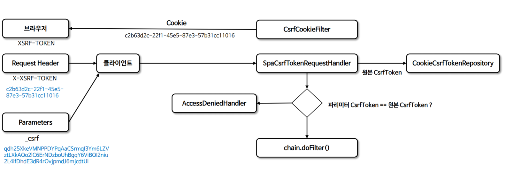
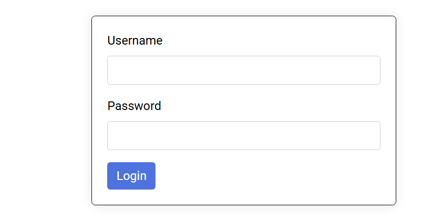
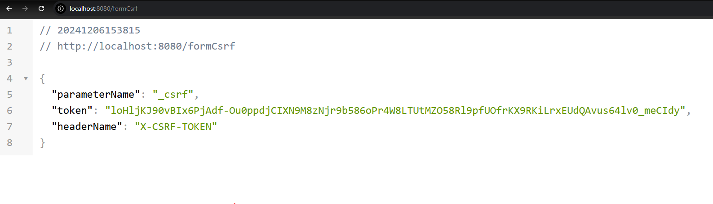
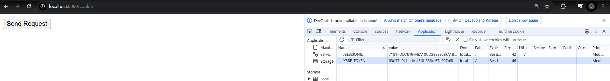
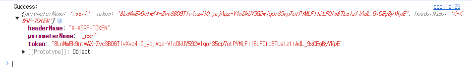

# **개요** 

- CSRF 공격을 방지하기 위한 토큰 패턴을 사용하려면 실제 CSRF 토큰을 HTTP 요청에 포함해야 한다 
- 그래서 브라우저에 의한 HTTP 요청에 자동으로 포함되지 않는 부분 (폼 매개변수, HTTP 헤더)중 하나에 포함되어야 한다 
- 클라이언트 애플리케이션이 CSRF로 보호된 백엔드 애플리케이션과 통합하는 여러 가지 방법을 살펴보자 

# **HTML Forms**

- HTML 폼을 서버에 제출하려면 CSRF 토큰을 hidden 값으로 Form 에 포함해야 한다

```html
<form action="/memberJoin" method="post">
<input type="hidden" name="${_csrf.parameterName}" value="${_csrf.token}"/>
</form>
<input type="hidden" name="_csrf" value="4bfd1575-3ad1-4d21-96c7-4ef2d9f86721"/>
```

- 폼에 실제 CSRF 토큰을 자동으로 포함하는 뷰는 다음과 같다 
- Thymeleaf
  - Spring 의 폼 태그 라이브러리 
- `<%@ taglib prefix="form"uri="`[`http://www.springframework.org/tags/form`](http://www.springframework.org/tags/form)`" %>`

# **JavaScript Applications**

**Single Page Application**

1. `CookieCsrfTokenRepository.withHttpOnlyFalse`를 사용해서 클라이언트가 서버가 발행한 쿠키로 부터 CSRF 토큰을 읽을 수 있도록 한다
1. 사용자 정의 `CsrfTokenRequestHandler`을 만들어 클라이언트가 요청 헤더나 요청 파라미터로 CSRF 토큰을 제출할 경우 이를 검증하도록 구현한다
1. 클라이언트의 요청에 대해 CSRF 토큰을 쿠키에 렌더링해서 응답할 수 있도록 필터를 구현한다



# **Multi Page Application**

- JavaScript 가 각 페이지에서 로드되는 멀티 페이지 애플리케이션의 경우 CSRF 토큰을 쿠키에 노출시키는 대신 HTML 메타 태그 내에 CSRF 토큰을 포함시킬 수 있다

**HTML 메타 태그에 CSRF 토큰 포함한다**

```html
<!DOCTYPE html>
<html xmlns:th="http://www.thymeleaf.org">
<meta name="_csrf" th:content="${_csrf.token}"/>
<meta name="_csrf_header" th:content="${_csrf.headerName}"/>
</html>
```

**AJAX 요청에서 CSRF 토큰 포함**

```javascript
function login() {
		const csrfHeader = $('meta[name="_csrf_header"]').attr('content');
		const csrfToken = [REDACTED]
		fetch('/api/login', {
		method: 'POST',
		headers: {[csrfHeader]: csrfToken }
})
```

# Thymeleaf 적용 

**form.html**

```html
<!DOCTYPE html>
<html xmlns:th="http://www.thymeleaf.org">
<head>
    <title>Dashboard</title>
    <link rel="stylesheet" href="https://stackpath.bootstrapcdn.com/bootstrap/4.3.1/css/bootstrap.min.css">
    <link href="https://fonts.googleapis.com/css2?family=Roboto:wght@300;400;500&display=swap" rel="stylesheet">
    <style>
        body {
            font-family: 'Roboto', sans-serif;
            background-color: #ffffff; /* 밝은 배경색 변경 */
            color: #000000; /* 어두운 글자색 변경 */
        }
        .navbar-custom {
            background-color: #ffffff; /* 밝은 네이비 변경 */
            color: #000000;
            margin-bottom: 0;
        }
        .container-fluid {
            padding: 0; /* container의 패딩 제거 */
        }
        .navbar-custom .navbar-brand, .navbar-custom .nav-link {
            color: #000000;
        }
        .sidebar {
            background-color: #ffffff; /* 밝은 네이비 변경 */
            min-height: 100vh;
            color: #000000;
        }
        .sidebar a {
            color: #000000;
            transition: background-color 0.3s ease, color 0.3s ease;
        }
        .sidebar a:hover {
            background-color: #cccccc; /* 마우스 오버시 밝은 회색 */
            color: #000000;
        }
        .content {
            padding: 20px;
            background-color: #ffffff; /* 밝은 그레이 변경 */
            border-radius: 10px;
            box-shadow: 0 0 10px rgba(0, 0, 0, 0.1); /* 박스 그림자 색상 변경 */
            margin-top: 0;
        }
        .footer {
            background-color: #ffffff; /* 밝은 네이비 변경 */
            color: #000000;
            padding: 10px 0;
            border-top: 1px solid #cccccc; /* 경계선 색상 변경 */
        }
        .sidebar .list-group-item {
            color: #000000; /* 글자색 변경 */
            background-color: #ffffff; /* 배경색 변경 */
            transition: background-color 0.3s ease, color 0.3s ease;
        }

        .sidebar .list-group-item:hover {
            background-color: #cccccc; /* 마우스 오버시 밝은 회색 */
            color: #000000;
        }
        /* 중앙 로그인 폼 스타일 변경 */
        .login-form {
            max-width: 400px;
            margin: 30px auto;
            padding: 20px;
            background-color: #ffffff; /* 밝은 폼 배경색 변경 */
            border-radius: 5px;
            border: 1px solid #000000; /* 검은색 테두리 추가 */
            box-shadow: 0 0 15px rgba(0, 0, 0, 0.1); /* 박스 그림자 색상 변경 */
        }
        .login-form h2 {
            color: #000000; /* 어두운 글자색 변경 */
            margin-bottom: 20px;
        }
        .login-form .form-control {
            background-color: #ffffff; /* 밝은 입력 필드 배경색 변경 */
            color: #000000; /* 어두운 입력 필드 글자색 변경 */
            border: 1px solid #cccccc; /* 입력 필드 경계선 색상 변경 */
        }
        .login-form .btn-primary {
            background-color: #4e73df; /* 밝은 버튼 색상 유지 */
            border: none;
        }
    </style>
    <script src="https://code.jquery.com/jquery-3.3.1.slim.min.js"></script>
    <script src="https://cdnjs.cloudflare.com/ajax/libs/popper.js/1.14.7/umd/popper.min.js"></script>
    <script src="https://stackpath.bootstrapcdn.com/bootstrap/4.3.1/js/bootstrap.min.js"></script>
</head>
<body>
<div class="container-fluid">
    <div class="row">
        <div class="col-md-10 content">
            <div class="login-form">
                <form th:action="@{/formCsrf}" method="post">
                    <div class="form-group">
                        <label for="username">Username</label>
                        <input type="text" class="form-control" id="username" name="username" required>
                    </div>
                    <div class="form-group">
                        <label for="password">Password</label>
                        <input type="password" class="form-control" id="password" name="password" required>
                    </div>
                    <button type="submit" class="btn btn-primary">Login</button>
                </form>
            </div>
        </div>
    </div>
</div>
</body>
</html>
```

- `<form th:action="@{/formCsrf}" method="post">` 
- <form> 태그 안에 타임리프 문법을 사용 
  - 현재는 <input> 태그, hidden 으로 CSRF 토큰을 넣는 코드가 없지만 나중에 브라우저에서 보면 보일 것 이다.

**ViewController**

```java
@Controller
public class ViewController {
    @GetMapping("/form")
    public String form(){
        return "form";
    }
}
```

```java
@Slf4j
@RestController
@RequiredArgsConstructor
public class IndexController {
    /**
     * CsrfFiler: HTTP 메소드 상관없이 토큰을 지연 초기화를 적용해서 가져옴 by (세션/쿠키)
     * 현재 메소드는 GET 그래서 아직 초기화 과정이 진행되지 않고 넘어온 상태
     * getToken() 하는 순간 여러 Supplier 감싸진 CsrfToken 초기화 과정 진행
     */
    @GetMapping("/supplier")
    public String tokenSupplier(HttpServletRequest request){
        CsrfToken csrfToken1 = (CsrfToken) request.getAttribute("_csrf");
        CsrfToken csrfToken2 = (CsrfToken) request.getAttribute(CsrfToken.class.getName());
        log.info("{}", csrfToken1 == csrfToken2);
        return csrfToken1.getToken();
    }
    /**
     * CsrfFilter: Post 요청이어서 세션에 저장된 토큰과 클라이언트가 보낸 토큰을 이미 비교했음
     * 즉, CsrfToken 초기화 완료된 상태
     */
    @PostMapping("/formCsrf")
    public CsrfToken formCsrf(CsrfToken csrfToken){
        return csrfToken;
    }
}
```

**SecurityConfig**

```java
@EnableWebSecurity
@Configuration
@Slf4j
public class SecurityConfig {
    @Bean
    public SecurityFilterChain securityFilterChain(HttpSecurity http) throws Exception{
        http
                .csrf(Customizer.withDefaults());

        http
                .authorizeHttpRequests(auth -> auth
                        .requestMatchers("/csrf", "/form", "/formCsrf", "/supplier").permitAll()
                        .anyRequest().authenticated());
        http
                .formLogin(Customizer.withDefaults());

        return  http.build();
    }
    @Bean
    public UserDetailsService userDetailsService(){
        UserDetails user = User.withUsername("user").password("{noop}1111").roles("USER").build();
        return new InMemoryUserDetailsManager(user);
    }
}
```

- CSRF 설정은 default 사용 
- handler:  default 설정은 `XorCsrfTokenRequestAttributeHandler` 사용한다 
- 스프링 시큐리티가 제공하는 Handler는 2개이다 `CsrfTokenRequestAttributeHandler`
`XorCsrfTokenRequestAttributeHandler`
  - `XorCsrfTokenRequestAttributeHandler` 해당 Handler 는 인코딩해서 토큰을 응답하고 요청 객체 있는 토큰을 디코딩하는 기능이 있다.
- `CsrfTokenRepository` : default 설정은 `HttpSessionCsrfTokenRepository` 
- `CookieCsrfTokenRepository` : 쿠키에 저장 
  - `HttpSessionCsrfTokenRepository` : 세션에 저장

[**localhost:8080/form**](http://localhost:8080/form) **경로 테스트** 




- 타임리프가 자동으로 CSRF 삽입 부분을 만들어 줬다. 

로그인 버튼을 누른 결과 **localhost:8080/formCsrf**



# **쿠키에 저장 & Javascript**

**SpaCsrfTokenRequestHandler - CustomCsrfTokenHandler**

```java
public class SpaCsrfTokenRequestHandler extends CsrfTokenRequestAttributeHandler {
    /**
     * 헤더에서 온 값은 인코딩되지 않고 그대로 온다
     * 하지만 쿠키처럼 다른 값들은 인코딩되어서 오기 때문에 인코딩된 CsrfToken 디코딩할 수 있는 XorCsrfTokenRequestAttributeHandler 위임
     */
    private final CsrfTokenRequestHandler delegate = new XorCsrfTokenRequestAttributeHandler();
    @Override
    public String resolveCsrfTokenValue(HttpServletRequest request, CsrfToken csrfToken) {
        if(StringUtils.hasText(request.getHeader(csrfToken.getHeaderName()))){
            return super.resolveCsrfTokenValue(request, csrfToken);
        }
        return delegate.resolveCsrfTokenValue(request, csrfToken);
    }
    @Override
    public void handle(HttpServletRequest request, HttpServletResponse response, Supplier<CsrfToken> csrfToken) {
        delegate.handle(request, response, csrfToken);
    }
}
```

- `CsrfTokenRequestHandler` 인터페이스 구현체 
- `CsrfTokenRequestAttributeHandler` 
- 클라이언트가 보내주는 토큰을 원본 토큰 그대로 비교
  - `XorCsrfTokenRequestAttributeHandler` 
- 클라이언트가 보내주는 인코딩된 토큰을 디코딩하여 원본 토큰과 비교
- `SpaCsrfTokenRequestHandler` 
- 커스텀하게 만든 Handler
  - 인코딩 된 토큰 비교는 `XorCsrfTokenRequestAttributeHandler` 에게 위임
  - 인코딩 되지 않은 토큰은 부모 클래스인  `CsrfTokenRequestAttributeHandler` 에서 한다
- 인코딩 된 토큰 / 그냥 토큰 
- 쿠키에 있는 CSRF 토큰을 Javascript에서 가져와서 그냥 헤더에 넣으면 인코딩 되어있지 않다 그래서 헤더에 CSRF 토큰이 있으면 `XorCsrfTokenRequestAttributeHandler`  처리 
  - 헤더에 있지 않고 HTTP 매개변수를 통해서 전달되었다면 디코딩된 값이기 때문에 
`CsrfTokenRequestAttributeHandler` 처리 
- `application/x-www-form-urlencoded`

**Cookie.html**

```java
<!DOCTYPE html>
<html xmlns:th="http://www.thymeleaf.org">
<head>
    <meta charset="UTF-8">
    <title>Fetch Example</title>
    <script>
        // fetch 요청을 실행하는 함수
        function sendRequest() {
            fetch('/cookieCsrf', {
                method: 'POST', // 요청 메소드
                headers: {
                    'Content-Type': 'application/json', // 컨텐츠 타입 지정
                    'X-XSRF-TOKEN': getCookie('XSRF-TOKEN') // CSRF 토큰 헤더에 추가
                },
                body: JSON.stringify({/* 데이터 객체 */}), // 서버로 보낼 데이터
                credentials: 'include' // 쿠키를 포함시키기 위해 필요
            })
                .then(response => {
                    if (!response.ok) {
                        throw new Error('Network response was not ok');
                    }
                    return response.json(); // 여기에서 서버 응답을 처리
                })
                .then(data => {
                    console.log('Success:', data); // 성공 처리 로직
                })
                .catch(error => {
                    console.error('Error:', error); // 에러 처리 로직
                });
        }

        // 쿠키 값을 가져오는 함수
        function getCookie(name) {
            let cookieValue = null;
            if (document.cookie && document.cookie !== '') {
                const cookies = document.cookie.split(';');
                for (let i = 0; i < cookies.length; i++) {
                    const cookie = cookies[i].trim();
                    if (cookie.substring(0, name.length + 1) === (name + '=')) {
                        cookieValue = decodeURIComponent(cookie.substring(name.length + 1));
                        break;
                    }
                }
            }
            return cookieValue;
        }
    </script>
</head>
<body>
<!-- 버튼 요소 -->
<button onclick="sendRequest()">Send Request</button>
</body>
</html>
```

**Controller** 

```java
@Slf4j
@RestController
@RequiredArgsConstructor
public class IndexController {
    @PostMapping("/cookieCsrf")
    public CsrfToken cookieCsrf(CsrfToken csrfToken){
        return csrfToken;
    }
}

@Controller
public class ViewController {
    @GetMapping("/cookie")
    public String cookie(){
        return "cookie";
    }
}
	
```

**CsrfCookieFilter**

```javascript
public class CsrfCookieFilter extends OncePerRequestFilter {
  @Override
  protected void doFilterInternal(HttpServletRequest request, HttpServletResponse response, FilterChain filterChain) throws ServletException, IOException {
      CsrfToken csrfToken = [REDACTED] request.getAttribute("_csrf");
      if(csrfToken != null){
          csrfToken.getToken();
      }
      filterChain.doFilter(request, response);
  }
}

```

- 단순하게 `getToken()`을 통해서 초기화 작업을 진행한다 

**SecurityConfig**

```java
@EnableWebSecurity
@Configuration
@Slf4j
public class SecurityConfig {
    @Bean
    public SecurityFilterChain securityFilterChain(HttpSecurity http) throws Exception{
        http
                .csrf(csrf -> csrf
                        .csrfTokenRepository(CookieCsrfTokenRepository.withHttpOnlyFalse())
                        .csrfTokenRequestHandler(new SpaCsrfTokenRequestHandler())
                );
        http
                .authorizeHttpRequests(auth -> auth
                        .requestMatchers("/cookie", "/cookieCsrf").permitAll()
                        .anyRequest().authenticated());

        http.addFilterBefore(new CsrfCookieFilter(), BasicAuthenticationFilter.class);

        http
                .formLogin(Customizer.withDefaults());
        return  http.build();
    }

    @Bean
    public UserDetailsService userDetailsService(){
        UserDetails user = User.withUsername("user").password("{noop}1111").roles("USER").build();
        return new InMemoryUserDetailsManager(user);
    }
}
```

- `.csrfTokenRepository(CookieCsrfTokenRepository.withHttpOnlyFalse())` 
- `CookieCsrfTokenRepository`는 쿠키에 CSRF Token을 저장한다. 
  - HttpOnly false 설정으로 쿠키에 CSRF Token을 저장한다 
  - 그래서 javascript를 통해 쿠키에 있는 값을 읽을 수 있다.
- `.csrfTokenRequestHandler(new SpaCsrfTokenRequestHandler())` 
- custom 하게 만든 `csrfTokenRequestHandler` 를 추가한다. 
  - CsrfFilter는 이제 해당 Handler를 사용

[localhost:8080/cookie](http://localhost:8080/cookie) 요청



Cookie에 `XSRF-TOKEN` 이름으로 CSRF 토큰이 존재한다.

Send Request 버튼 (JS Function)

```javascript
function sendRequest() {
      fetch('/cookieCsrf', {
          method: 'POST', // 요청 메소드
          headers: {
              'Content-Type': 'application/json', // 컨텐츠 타입 지정
              'X-XSRF-TOKEN': getCookie('XSRF-TOKEN') // CSRF 토큰 헤더에 추가
          },
          body: JSON.stringify({/* 데이터 객체 */}), // 서버로 보낼 데이터
          credentials: 'include' // 쿠키를 포함시키기 위해 필요
      })
          .then(response => {
              if (!response.ok) {
                  throw new Error('Network response was not ok');
              }
              return response.json(); // 여기에서 서버 응답을 처리
          })
          .then(data => {
              console.log('Success:', data); // 성공 처리 로직
          })
          .catch(error => {
              console.error('Error:', error); // 에러 처리 로직
          });
  }
```

Send Request 요청 결과(console)



