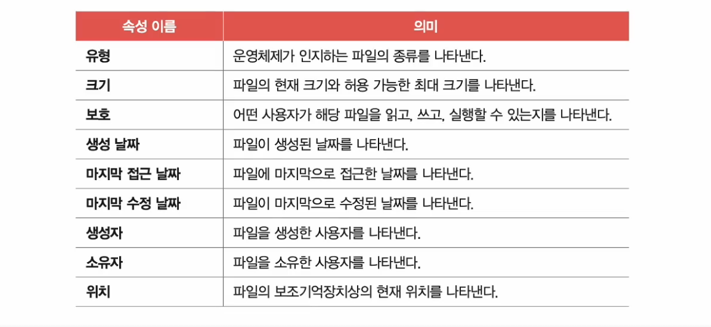
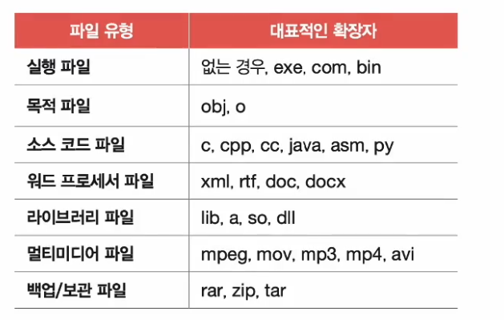
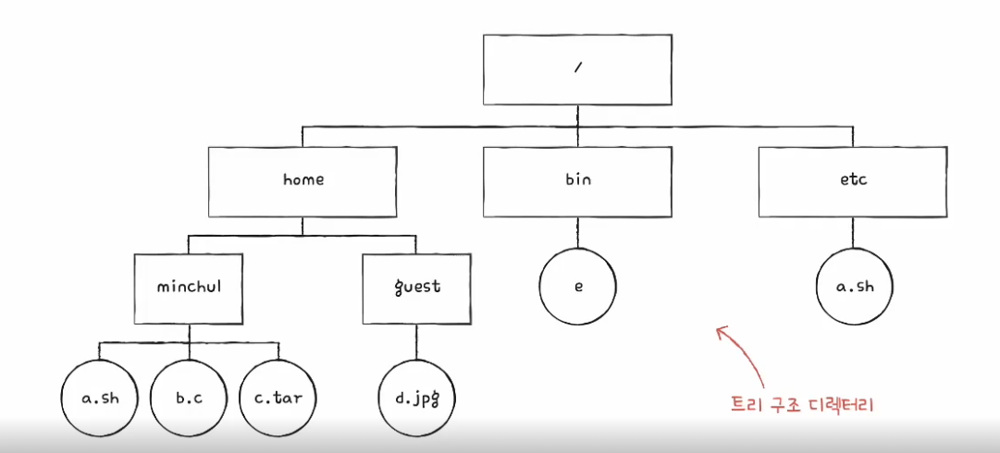
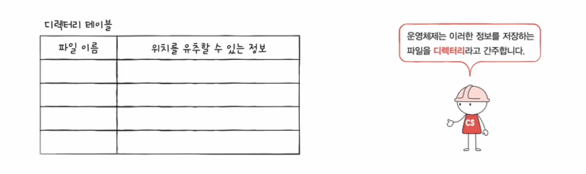
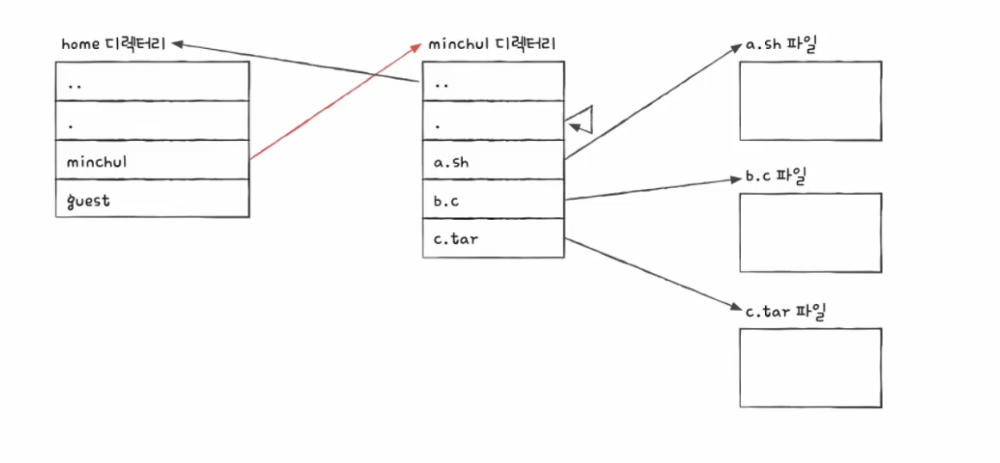

## **✅**  들어가며

**파일 시스템(file system)**

- 파일과 디렉터리를 관리하는 운영체제 내의 프로그램 

**파일과 디렉터리** 

- 보조기억장치의 데이터 덩어리, 파일과 디렉터리 

## **✅  파일** 

- 보조기억장치에 저장된 관련 정보의 집합 
- 의미 있고 관련 있는 정보를 모은 논리적 단위 
- 파일을 이루는 정보 
- 파일을 실행하기 위한 정보 
  - 부가 정보(속성, 메타 데이터)

### **파일의 속성 종류** 



### **유형 = 확장자** 

운영체제가 인식하기 위한 파일의 종류 



### 파일 연산을 위한 시스템 호출 

1. 파일 생성
1. 파일 삭제
1. 파일 열기 
1. 파일 닫기
1. 파일 읽기
1. 파일 쓰기 

## **✅** 디렉터리 

- 윈도우에서는 폴더(folder)
- 여러 계층으로 파일 및 폴더를 관리하는 트리 구조 디렉터리 
- 최상위 디렉터리(루트 디렉터리, / ), 서브 디렉터리 



### 경로 

- 디렉터리를 이용해 파일/디렉터리의 위치, 나아가 이름까지 특정 지을 수 있는 정보 
- **절대 경로: 루트 디렉터리부터 시작하는 경로** 
- /home/minchul/a.sh
- **상대 경로: 현재 디렉터리부터 시작하는 경로** 
- 현재 디렉터리 경로: /home
  - guest/d.jpg

### 디렉터리 연산을 위한 시스템 호출 

1. 디렉터리 생성 
1. 디렉터리 삭제 
1. 디렉터리 열기 
1. 디렉터리 닫기 
1. 디렉터리 읽기 

### 디렉터리 엔트리 

```
사실 많은 운영체제에서는 디렉터리를 그저 특별한 형태의 파일로 간주한다 
즉, 디렉터리는 그저 포함된 정보가 조금 특별한 파일 
```

- 파일의 내부에는 파일과 관련된 정보들이 있다면, 디렉터리 내부에는 해당 디렉터리에 담겨 있는 대상과 관련된 정보들이 담겨 있다.
- 이 정보는 보통 테이블(표) 형태로 구성

각 엔트리(행)에 담기는 정보 

- 디렉터리에 포함된 대상의 이름 
- 그 대상이 보조기억장치 내에 저장된 위치를 유추할 수 있는 정보 





