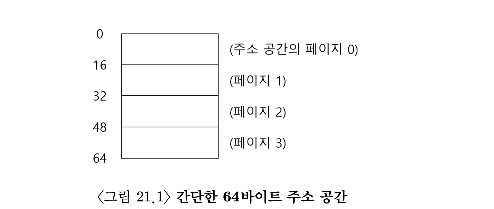
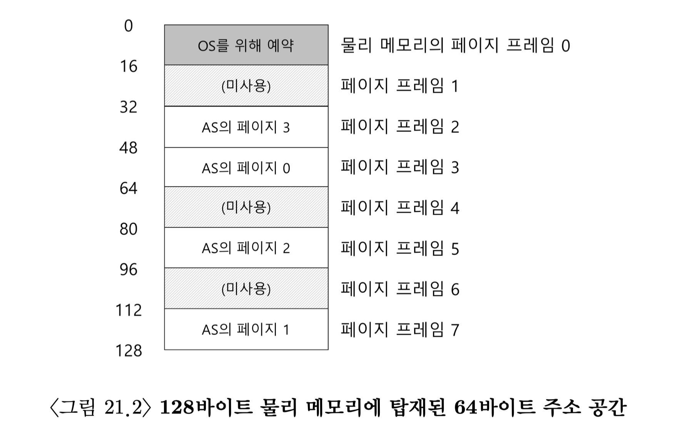
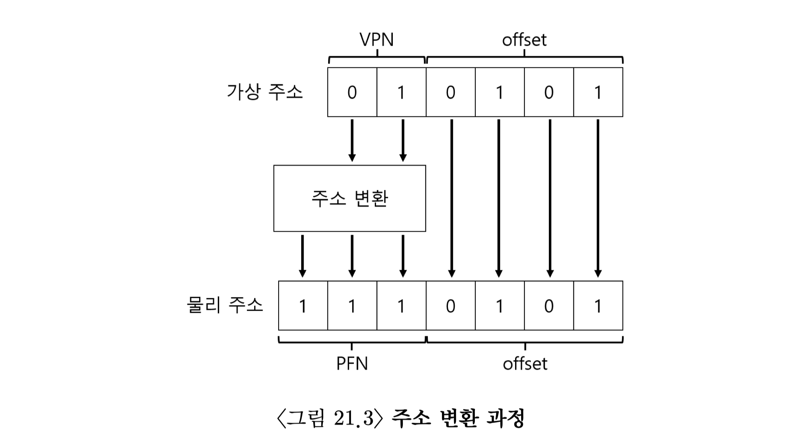
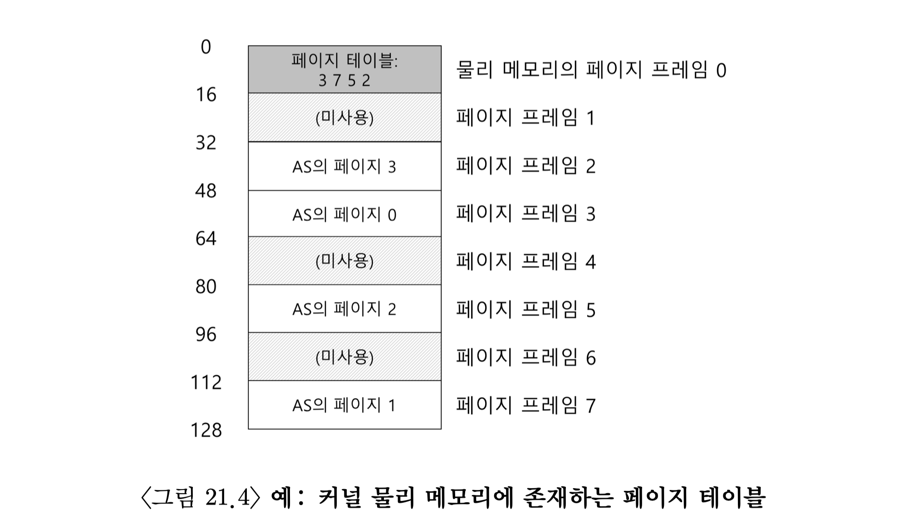
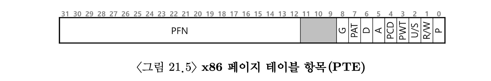
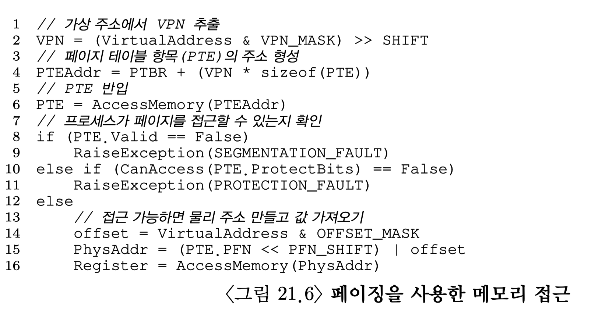

## 21장 페이징 개요

운영체제는 거의 모든 공간 관리 문제를 해결할 때 두 가지 중 하나를 사용한다.

세그멘테이션은 가변 크기의 조각들로 분할하는 것

공간을 다양한 크기의 청크로 분할할 때 공간 자체가 단편화 될 수 있고, 할당은 점점 어려워진다.

두 번째 방법인 **페이징(paging)**은 공간을 동일 크기의 조각으로 분할한다.

프로세스의 주소 공간을 몇개의 가변 크기의 논리 세그멘트(코드, 힙, 스택)로 나누는 것이 아니라 고정 크기의 단위로 나눈다.

이 각각의 고정 크기 단위를 **페이지(page)**라고 부른다. 

똑같이 물리 메모리도 페이지 프레임(page frame)이라는 고정 크기로 분할한다.

이 프레임 각각은 하나의 가상 메모리 페이지를 저정할 수 있다.

---

## 21.1 간단한 예제 및 개요



  

그림 21.1은 총 크기가 64바이트, 4개의 16바이트 페이지로 구성



그림 21.2는 물리 메모리를 나타낸 그림이다. 

총 128바이트, 8개의 페이지 프레임이 있다.

그림에서 볼 수 있듯이, 가상 주소 공간의 페이지들은 물리 메모리 전체에 분산 배치되어 있다.

또한 운영체제가 자기자신을 위해서 물리 메모리의 일부를 사용하는 것도 보여준다. 

페이징은 이전 방식에 비해 크게 효율성, 단순함 측면으로 많은 장점을 가진다. 

**효율성** 

페이징을 사용하면 프로세스의 주소 공간 사용 방식과는 상관없이 효율적으로 주소 공간 개념을 지원할 수 있다.

예를 들어, 힙과 스택이 어느 방향으로 커지는가, 어떻게 사용되는가에 대한 고려가 필요없다. 

**단순함** 

운영체제가 프로세스의 메모리 64바이트 주소 공간을 4페이지 물리 메모리에 배치하기를 원한다고 할 때, 운영체제는 비어있는 4개의 페이지만 찾으면 된다. 

이를 위해 운영체제는 모든 비어 있는 페이지의 빈 공간 리스트를 유지하고 첫 4개 페이지를 선택할 것이다. 

주소 공간의 각 가상 페이지에 대한 물리 메모리 위치 기록을 위하여 운영체제는 프로세스 마다 **페이지 테이블(page table)**이라는 자료구조를 유지한다. 

페이지 테이블의 주요 역할은 주소 공간의 가상 페이지 **주소 변환(address translation)**정보를 저장하는 것 

각 페이지가 저장된 물리 메모리의 위치가 어디인지 알려준다. 

그림 21.2 프로세스의 페이지 테이블은 다음과 같은 4개의 항목을 가진다.

가상 페이지 0 → 물리 프레임 3, VP1 → PF7, VP2 → PF5, VP3 → PF2

페이지 테이블은 프로세스마다 존재한다는 사실을 꼭 숙지하자

다른 프로세스를 실행한다면 운영체제는 이 프로세스를 위한 다른 페이지 테이블이 필요하다. 

공유하는 페이지가 없다면 새 프로세스의 가상 페이지는 다른 물리 페이지에 존재하기 때문이다. 

### 주소 변환 이해 

프로세스가 생성한 가상 주소의 변환을 위해 먼저 가상 주소를 **가상 페이지 번호(virtual page number, VPN)**와 페이지 내의 **오프셋** 2개의 구성 요소로 분할한다.

가상 주소 공간의 크기 = 64바이트 

→ 가상 주소는 6비트가 필요하다. (2^6 = 64) 

페이지의 크기는 16바이트 즉, 64바이트 주소 공간에서 4페이지를 선택할 수 있어야한다. 

→ 이는 주소의 최상위 2비트로 표현(2^2 = 4) 


즉, 2비트 가상 페이지 번호(VPN)를 가지게 된다.

나머지 비트는 페이지 내에서 우리가 원하는 바이트의 위치를 나타난다.

→ 오프셋 

프로세스가 가상 주소를 생성하면 운영체제와 하드웨어가 의미있는 물리 주소로 변환한다. 

예를 들어 가상 주소가 21

21 → 010101(2) 


가상 주소 21은 가상 페이지1의 5번째 바이트이다. 

이 가상 페이지 번호를 페이지 테이블의 인덱스로 사용하여 가상 페이지 1이 어느 물리 프레임에 저장되어 있는지 찾을 수 있다.

**페이지 테이블에서 물리 프레임 번호(physical frame number, PFN) 또는 물리 페이지 번호(physical page number, PPN)**는 7이다. 그림 21.2 참고 

VPN을 PFN으로 교체하여 가상 주소를 변환할 수 있다. 그런 후에 물리 메모리에 탑재 명령어를 실행한다. 



오프셋은 동일하다. 오프셋은 페이지, 페이지 프레임 내에서 우리가 원하는 위치를 알려 주기 때문이다. 

최종적으로 계산된 물리 주소는 1110101(2)이며, 이곳이 탑재할 데이터가 저장된 정확한 위치이다. 

---

## 21.2 페이지 테이블은 어디에 저장되는가?

페이지 테이블은 세그멘트 테이블이나 베이스-바운드 쌍에 비해서 매우 커질 수 있다.

- 베이스-바운드는 각 프로세스 마다 베이스, 바운드 값만 저장 
- 세그멘트 테이블은 프로세스 마다 각 세그멘트의 베이스, 바운드 + 기타 정보 저장 

**4KB 크기의 페이지를 가지는 전형적인 32비트 주소 공간** 

4KB = 4 * 1024 = 2^2 * 2^10 = 2^12 → 1페이지당 12비트

즉, 가상 주소는 20비트 VPN과 12비트 오프셋으로 구성된다.

20비트 VPN은 운영체제가 각 프로세스를 위해 관리해야 하는 개수가 2^20을 의미 거의 100만 

물리 주소로의 변환 정보와 다른 필요한 부가 정보를 저장하기 위하여 **페이지 테이블 항목(page table entry, PTE)**마다 4바이트가 필요하다고 가정하면, 각 페이지 테이블을 저장하기 위하여 4MB의 메모리가 필요하게 된다. 이것은 꽤 커다란 크기이다.

총 페이지 테이블 크기 = 페이지 수 × PTE 크기 = 2^20 × 4B = 4MB 

- PTE 크기 4바이트 
- PTE 정보
- 물리 프레임 번호 (PFN)
  - Valid bit (유효 여부)
  - Dirty bit (수정 여부)
  - Access permission (읽기/쓰기 권한) 
  - 사용 여부 비트 (사용 빈도 기반 교체 알고리즘용): LRU, LFU 구현 시 사용

프로세스 100개가 실행 중이라고 가정

주소 변환을 위해서 운영체제가 400MB의 메모리를 필요로 하는 것을 의미한다. 

컴퓨터가 Giga byte 단위의 메모리를 가지고 있는 현재라도 변환을 위해서 이렇게 큰 청크를 사용한다는 것은 매우 비정상적이다. 

페이지 테이블은 매우 크기 때문에 현재 실행 중인 프로세스의 페이지 테이블을 저장할 수 있는 회로를 MMU안에 유지하지 않을 것이다. 

대신 각 프로세스의 페이지 테이블을 메모리에 저장한다.

당분간 페이지 테이블은 운영체제가 관리하는 물리 메모리에 상주한다고 가정

나중에 페이지 테이블은 운영체제 가상화될 수 있다는 것을 알게 될 것이다. 

- 아마 계층적 페이지 테이블과 디스크 스왑을 의미하는듯하다.



---

## 21.3 페이지 테이블에는 실제 무엇이 있는가

페이지 테이블 구성에 대해 살펴보자. 

페이지 테이블은 가상 주소를 물리 주소로 매핑(mapping)하는 데 사용되는 자료구조이다. 

가장 간단한 형태는 **선형 페이지 테이블(linear page table)**이다. 

운영체제는 원하는 물리 프레임 번호(PEN)를 찾기 위하여 가상 페이지 번호(VPN)로 배열 항목에 접근하고 

그 항목의 페이지 테이블 항목(PTE)을 검색한다.

지금은 이 간단한 선형 구조를 사용한다고 가정

**PTE에는 여러 비트들이 존재한다.**

### Valid bit(유효 비트)

프로그램이 실행을 시작할 때 모든 미사용 공간은 무효(valid)로 표시되고, 프로세스가 그런 메모리를 접근하려고 하면 운영체제에 트랩을 발생시킨다. 운영체제는 그 프로세스를 종료시킬 확률이 높다.

Valid bit는 할당되지 않은 주소 공간을 표현하기 위해 반드시 필요하다. 

| Valid Bit | 의미 |
| --- | --- |
| 1 (Valid) | 해당 페이지는 메모리에 있으며, 접근 가능 |
| 0 (Invalid) | 해당 페이지는 메모리에 없거나 접근 불가 |

- **초기 페이지 테이블**에서 valid bit는 **0**으로 설정되어 있으며, 이는 해당 페이지가 아직 **사용되지 않음을 나타낸다.**
- **동적 메모리 할당** 시, 필요한 페이지가 **메모리에 로드되면 valid bit가 1로 설정**되어 해당 페이지가 **사용 가능**한 상태가 된다.
- 만약 **추가적인 메모리 공간**이 필요하면, 운영체제는 **빈 페이지 테이블 엔트리(valid bit = 0)**를 찾아 할당하고, 그 페이지의 valid bit를 **1로 설정한다**. 만약 빈 엔트리가 없으면, **새로운 페이지 테이블 엔트리**를 추가하여 확장한다.

### Protection Bit(보호 비트)

페이지를 읽을 수 있는지, 쓸 수 있는지, 또는 실행될 수 있는지를 표시하는 비트이다.

Protection Bit가 허용되지 않는 방식으로 페이지에 접근하려고 하면 운영체제가 트랩을 생성한다.

### Present Bit(존재 비트)

이 페이지가 물리 메모리에 있는지 혹은 디스크에 있는지(즉, 스왑 상태)를 가리킨다.

### Dirty Bit(수정 비트)

메모리에 반입된 후 페이지가 변경되었는지 여부를 나타낸다. 

### Reference Bit(accessed bit)

페이지가 접근되었는지를 추적하기 위해 사용된다. 

이 정보는 페이지 교체 알고리즘에 매우 중요하다. 



 

- P: Present bit
- R/W: 읽기 쓰기 비트 
- U/S: 사용자/슈퍼바이저 비트
- 사용자 모드 프로세스가 페이지에 엑세스 할 수 있는지를 결정
- PWT, PCD, PAT, G
- 페이지에 대한 하드웨어 캐시 동작을 결정하는 비트들
- A: Reference bit
- D: Dirty bit
- PFN: 페이지 프레임 번호 

### Valid Bit VS Present Bit

**상황 1: 아직 메모리 할당을 안 받은 영역에 접근**

- `valid = 0`, `present = x` (의미 없음)
- → 접근 시 **segmentation fault** 또는 **invalid memory access** 발생

**상황 2: 메모리 할당은 받았지만 스왑 아웃된 경우**

- `valid = 1`, `present = 0`
- → 접근 시 **page fault**, 디스크에서 스왑 인

**상황 3: 메모리 할당도 받았고, 현재 물리 메모리에 있음**

- `valid = 1`, `present = 1`
- → 정상 접근 가능

**정리** 

- **Present**: 스왑 인 여부 (물리 메모리에 있냐 없냐)
- **Valid**: 해당 주소 자체가 접근 가능한 주소인가 (올바른 페이지인가)

| 상황 | Valid | Present | 의미 |
| --- | --- | --- | --- |
| 아직 안 쓴 예약 주소 | 0 | 0 | 접근 불가 (예약만 됨) |
| 초기 물리 메모리 할당됨 | 1 | 1 | 정상 접근 가능 |
| 스왑 아웃됨 | 1 | 0 | 접근 시 예외 (page fault) |
| 해제됨 (free)  | 0 | x | 접근 시 예외 (segmentation fault) 종료 |

---

## 21.4 페이징: 너무 느림 

페이지 테이블의 크기가 메모리 상에서 매우 크게 증가할 수 있다.

페이지 테이블로 인해 처리 속도가 저하될 수 있다.

```c
movl 21, %eax
```

주소 21에 대한 참조만 고려하자

원하는 데이터를 가져오기 위해, 먼저 시스템은 가상 주소(21)을 물리 주소(53)로 변환해야 한다. 

시스템은 프로세스의 페이지 테이블에서 적절한 페이지 테이블 항목을 가져와야 하고, 변환을 수행한 후, 물리 메모리에서 데이터를 탑재한다. 

하드웨어는 현재 실행 중인 프로세스의 페이지 테이블 위치를 알아야한다. 

당분간 하나의 **페이지 테이블 베이스 레지스터(page table base register, PTBR)**가 페이지 테이블의 시작 주소(물리 주소)를 저장한다고 가정한다. 

### 물리 주소 변환 과정 정리 

1️⃣ **가상 주소 → 가상 페이지 번호(VPN)와 오프셋(offset) 분리**

- 가상 주소: `0b010101` (= 21)
- `VPN_MASK = 0b110000`
- `SHIFT = 4` (페이지 크기 = 2⁴ = 16바이트)

**VPN 계산**

```c
VPN = (VirtualAddress & VPN_MASK) >> SHIFT
    = (0b010101 & 0b110000) >> 4
    = (0b010000) >> 4
    = 0b01 = 1
```

→ 즉, **VPN = 1**

2️⃣ **페이지 테이블에서 PFN 얻기**

**PTE 주소 계산**

```c
PTEAddr = PageTableBaseRegister + (VPN * sizeof(PTE))
        = PTBR + (1 * sizeof(PTE))
```

→ 이 주소에서 PFN을 읽어옴.

→ 예시로 **PFN = 3**이라 가정

3️⃣ **오프셋 추출**

- `OFFSET_MASK = 0b001111`

```c
offset = VirtualAddress & OFFSET_MASK
       = 0b010101 & 0b001111
       = 0b000101 = 5
```

4️⃣ **물리 주소 생성**

```c
PhysAddr = (PFN << SHIFT) | offset
         = (3 << 4) | 5
         = 0b00110000 | 0b00000101
         = 0b00110101
         = 53 (십진수)
```

✅ **최종 결과**

| 항목 | 값 |
| --- | --- |
| 가상 주소 | 21 (0b010101) |
| VPN | 1 |
| offset | 5 |
| PFN (예시) | 3 |
| 물리 주소 | **53** |

📦 **요약**

하드웨어는 가상 주소를 다음 단계로 해석

1. **VPN 추출 (마스킹 후 시프트)**
1. **PTE 인덱싱 후 PFN 추출**
1. **오프셋 추출**
1. **PFN과 offset을 결합 → 물리 주소 생성**
1. **메모리 접근 후, 결과 → eax 등에 저장**



각 메모리 참조 시 일어나는 세부 동작을 살펴보자.

모든 메모리 참조(명령어 fetch, load, store)에 대해 먼저 페이지 테이블에서 변환 정보를 반입해야 하기 때문에 

반드시 한 번의 추가적인 메모리 참조가 필요하다. 

메모리 참조는 비용이 비싸고 프로세스는 2배 이상 느려진다.

즉, 정리하면 하드웨어와 소프트웨어의 신중한 설계 없이는 페이지 테이블로 인해 시스템이 매우 느려질 수 있으며 많은 메모리를 차지한다. 

---

