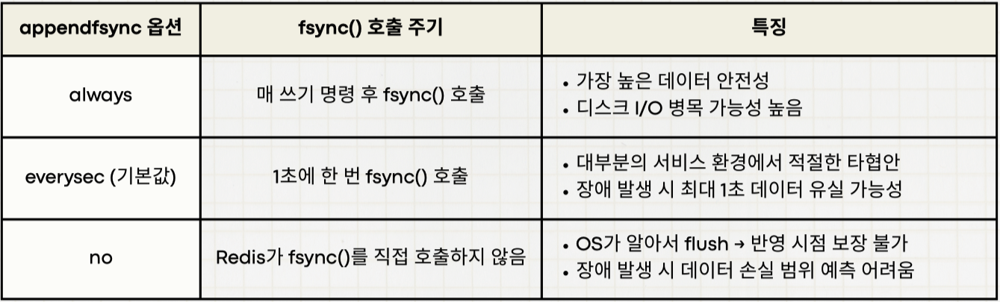

# Redis에서 영속성이 필요한 이유

### 기본 동작: 메모리 기반 저장

- Redis는 모든 데이터를 메모리(RAM)에 저장
- 서버를 재시작하면 데이터는 기본적으로 모두 사라짐
- 디스크에는 아무것도 남지 않음(기본 설정 시)

### 영속성이 필요한 이유

- 서버 장애, 재시작 등 예기치 못한 상황 발생 시 데이터 복구 필요
- 휘발성 캐시가 아닌, 중요한 상태 저장소로 Redis를 활용할 경우
- 수동 복원이나 백업 없이도 서비스 일관성을 유지하려면 필수

### 영속성이 필요한 케이스

- **캐시 중심 서비스:** 데이터가 유실되어도 복원 가능 → 저장 생략 가능
- **상태 중심 시스템:** 장애 발생 시 그대로 복원돼야 함 → 저장 필수
- **데이터 보호가 중요한 환경:** 가능한 한 모든 변경 사항을 남겨야 함

---

# RDB(Redis Database)

### RDB(Redis Database): 스냅샥 기반 저장 방식

Redis의 전체 메모리 상태를 일정 시점에 저장하여, 빠른 복구를 지원하는 기본적인 영속화 메커니즘

- **저장 대상:** Redis 전체 메모리 상태(snapshot)
- **저장 트리거:** SAVE, BGSAVE, 또는 save 설정(redis.conf) 조건 충족 시
- **저장 포맷:** .rdb 확장자, 바이너리 직렬화 포맷
- **저장 파일 특징**
- **파일 크기 작음:** 명령 이력 없이 상태만 저장
  - **로딩 속도 빠름:** 일괄 읽기 → 바로 메모리에 복원
- **저장 위치 및 파일명:** 기본 이름은 dump.rdb, 위치는 dir 설정 기준
- **save 조건 예시**
- **save 900 1:** 900초 내 1건 이상 변경 시 저장
  - **save 300 10:** 5분 내 10건 이상 변경 시 저장
  - 다중 조건 동시 설정 가능

### 백그라운드 저장과 Copy-on-Write

Redis는 RDB 저장 중에도 요청 처리를 중단하지 않기 위해 fork() 기반 비차단 구조를 사용한다

- 저장 실행: BGSAVE 명령 또는 설정 조건 충족 시 자동 실행
- **fork() 호출: 자식 프로세스를 생성해 저장 작업 전담**
- 역할 분리
- **부모 프로세스:** 클라이언트 요청 처리 계속 수행
  - **자식 프로세스:** 저장 시점의 메모리 상태를 .rdb 파일로 기록
- **Copy-on-Write(CoW) 메커니즘**
- 메모리 페이지는 부모 - 자식이 공유
  - 부모가 페이지 수정 시 → 해당 페이지만 복사
- 동시성 확보: 저장 중에도 읽기/쓰기 모두 처리 가능
- 주의 사항
- 쓰기 트래픽이 많을수록 Cow 증가 → 메모리 급등
  - 메모리 부족 시 fork 실패 또는 OOM 가능성 존재

### RDB의 장단점 요약

스냅샷 기반의 구조적 특성을 기준으로 RDB의 장점과 제한점을 비교해 정리

- **장점**
- **빠른 복구:** 전체 상태를 일괄 로딩 → 짧은 재시작 시간
  - **파일 크기 효율적:** 상태만 저장, 누적 로그 없음
  - **포맷 단순:** 바이너리 직렬화 → 외부 전송/이식성 유리
- **단점**
- 마지막 저장 이후의 변경 데이터는 복구되지 않음
  - fork() 또는 디스크 병목 시 저장 실패 가능
  - 실시간 무결성 보장 불가 → 민감한 시스템에 단독 사용 어려움

---

# AOF(Append Only File)

### AOF(Append Only File) 개요: 변경 명렁어 로그 기록 방식

**명령어 로그**를 통해 Redis의 상태를 복구할 수 있도록 보장하는 **실시간 영속화 방식**

- **영속화 방식:** 처리된 쓰기 명령어 자체를 로그에 기록하여 상태 복원 가능
- **저장 포맷:** .aof 파일, 사람이 읽을 수 있는 명령어 나열 형식
- **복구 방식:** 서버 재시작 시 **AOF 파일의 명령어를 순서대로 재실행하여 메모리 상태 복원**
- **동작 시점:** 명령 처리 직후 버퍼에 기록, 설정에 따라 디스크에 반영
- **RDB와 차이점:** 메모리 상태 저장이 아니라, **명령의 이력을 저장**하는 방식

### AOF 활성화와 설정 항목

AOF 기능을 사용하려면 명시적으로 활성화해야 하며, 관련 설정 항목들을 함께 지정해야 한다

- **활성화 옵션:** appendonly yes 설정 시 AOF 기능이 켜진다(default: no)
- **설정 위치:** redis.conf 파일 또는 CONFIG SET 명령을 통해 적용 가능
- **주의 사항:** appendonly yes로 설정되기 전에는 AOF 관련 옵션이 적용되지 않음
- **AOF 파일 이름:** appendfilename (default: appendonly.aof)
- **저장 디렉터리:** dir 옵션으로 지정
- **영구 적용 방법:** CONFIG REWRITE 명령으로 현재 설정을 redis.conf에 반경 가능

### AOF 설정 예시 (redis.conf)

```
# AOF 기능 활성화
appendonly yes

# AOF 파일 이름 설정
appendfilename appendonly.aof

# AOF fsync 정책: 1초마다 디스크 반영
appendfsync eversec

# 저장 경로(RDB와 공유)
dir /var/lib/redis

# AOF 리라이팅 조건 설정
auto-aof-rewrite-percentage 100
auto-aof-rewrite-min-size 64mb
```

### 내부 동작 흐름: 버퍼, flush, fsync

AOF는 **명령 실행 후 버퍼에 기록되고, 설정에 따라 디스크에 반영**되는 단계적 흐름을 가진다.

```
1. 클라이언트 쓰기 명령 실행
2. Redis 명령어를 AOF 내부 버퍼에 먼저 기록
3. 이후 OS 파일 시스템 캐시에 flush (write 또는 writev) 호출
4. fsync 또는 fdataasync로 디스크에 물리적 반영
```

- **버퍼:** Redis 내부에 존재, 여러 명령어를 일시적으로 쌓아둔다
- **flush:** 버퍼 내용을 OS 파일 시스템 캐시(RAM)에 쓰는 단계
- **fsync:** 파일 시스템 캐시의 내용을 디스크에 강제 반영(write-through)
- flsuh/fsync 호출 시점은 appendfsync 설정에 따라 결정된다

### appendfsync 옵션 설명

fsync 호출 시점을 제어하며 AOF의 데이터 안정성과 쓰기 성능 사이의 균형을 조절하는 설정

**설정 항목: appendfsync**

AOF 내부 버퍼의 내용을 OS 파일 시스템 캐시 flush 후 언제 디스크에 반영할지를 결정



### **AOF 파일 리라이팅**

명령 누적으로 커진 AOP 파일을 정리하여, **상태 재현에 필요한 최소 명령어 집합으로 재작**성하는 최적화 과정

- **필요 이유**
- AOF는 모든 쓰기 명령을 누적 기록 → 시간이 지날수록 파일 크기 지속 증가
  - 예: SET * 1 → SET * 2 → SET * 3 → 최종 상태는 SET * 3 하나면 충분
- **동작 방식**
- Redis는 현재 메모리 상태를 기준으로 최소 명령 집합을 생성
  - 새 AOF 파일을 백그라운드에서 작성한 뒤, 기존 파일과 교체
- **자동 트리거 조건**
- 설정 항목: auto-aof-rewrite-percentage, auto-aof-rewrite-min-size
  - 예: 이전 파일보다 100% 이상 커지고, 64MB 이상일 때 자동 실행
- **중단 없는 리라이팅 보장**
- 리라이팅 중에도 Redis는 명령어를 계속 처리하고, diff buffer에 변경사항 기록 후 최종 병합
  - 전체 무중단 운영 가능

### AOF 장단점 요약

- **장점**
- **높은 데이터 보존성:** everysec 기준으로도 최대 1초 이내 손실 → RDB 보다 유실 가능성 낮음
  - **명령어 기반 복원:** 사람이 읽을 수 있어 수동 분석 및 복구 용이
  - **실시간 반영:** 모든 쓰기 명령 즉시 기록 → 상태 변경 직후에도 복원 가능
  - **RDB와 병행 가능:** 빠른 재시작(RDB) + 정밀 복원(AOF) 조합 구성 가능
- **단점**
- **파일 크기 증가:** 명령 누적으로 RDB보다 훨씬 커질 수 있음
  - **복구 속도 저하:** 재시작 시 명령어 순차 실행 → RDB보다 느림
  - **명령 오류 전파 위험:** 잘못된 명령도 그대로 기록 → 복구 시 재현
  - **디스크 I/O 영향 민감:** 설정에 따라 TPS 성능 저하 가능

---

# 하이브리드 방식(RDB + AOF)

### 하이브리드 구성의 실제 동작 구조

Redis는 RDB, AOF 병행 설정하면, 각 방식의 역할을 명확히 분리하여 함께 운영한다

- **구성 목적**
- RDB: 메모리 상태를 정기적으로 스냅샷 저장
  - AOF: RDB 저장 이후의 변경 명령을 지속적으로 기록
- **저장 동작**
- save 설정 조건 충족 시 .rdb 생성
  - 이후 발생한 쓰기 명령은 .aof에 순차적으로 기록됨
- **복구 시 동작 순서**
1. Redis가 .rdb 파일로 메모리 상태를 먼저 복원
  1. .aof 파일의 전체 명령어(=RDB 이후 기록된 명령)를 순차 실행하여 최신 상태 반영
- **중복 여부** 
- .aof에는 RDB에 포함된 명령은 기록되지 않음
  - Redis는 AOF 전체를 실행하지만, 그 내용은 RDB 이후의 것만 포함

### **설정 방식과 구성 예시** 

하이브리드 방식은 RDB, AOF 설정을 함께 활성화하여 운영한다

- **설정 항목 예시(redis.conf)**
- save 900 1
  - save 300 10
  - appendonly yes
  - appendfsync everysec
- **저장 위치:** .rdb와 .aof 파일 모두 dir 설정 경로에 저장
- **복구 흐름은 고정**
- .rdb 로드
  - .aof 명령 전체 재실행
- AOF에는 RDB 이후 명령만 포함되므로 중복 실행 없음

### 하이브리드 구성의 장단점

**두 방식의 특성을 결합하여 복구 성능과 데이터 정합성 모두를 확보할 수 있다.**

- **장점**
- RDB로 빠른 재시작 가능
  - AOF로 정밀한 복구 가능(최대 1초 단위 보존)
  - 중복 저장 없이 명확한 복구 흐름 확보
- **단점**
- 디스크 사용량 증가(두 파일 모두 저장됨)
  - 설정 관리 복잡도 증가(주기, 경로, 정책 등 이중 관리 필요)

---

