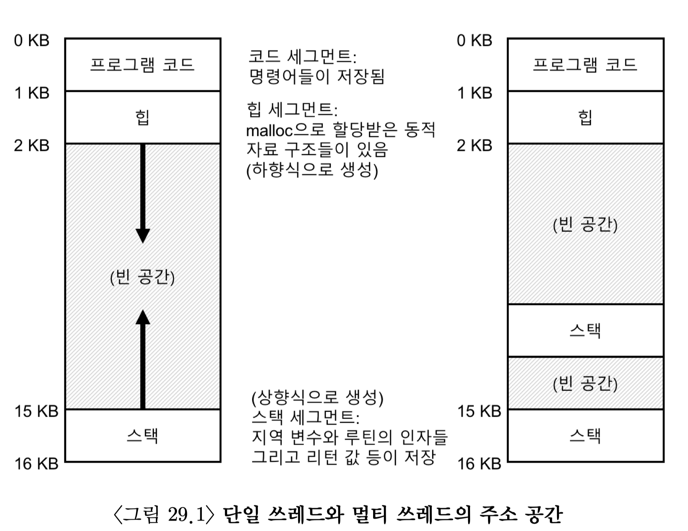
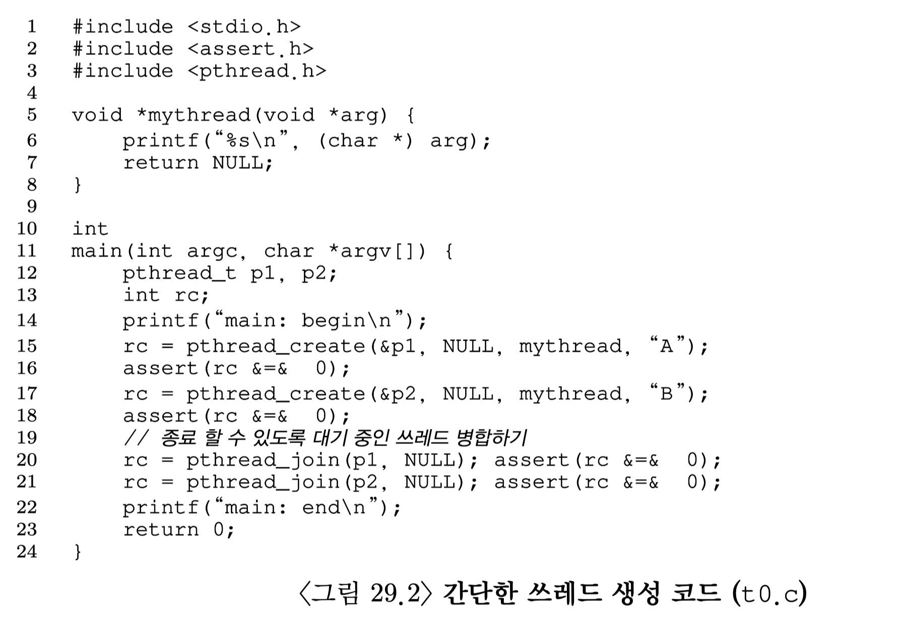
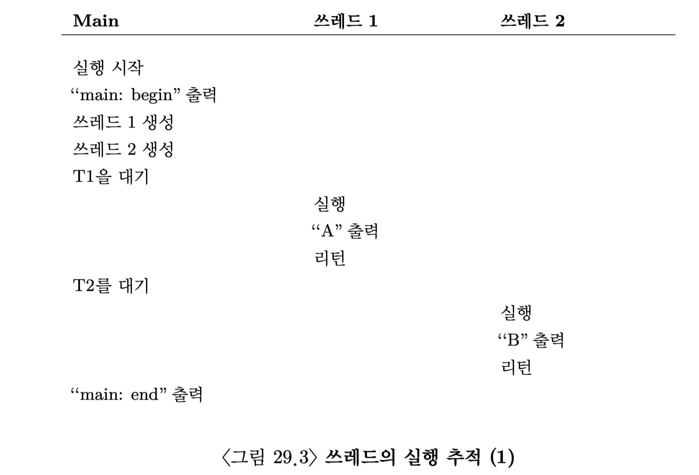
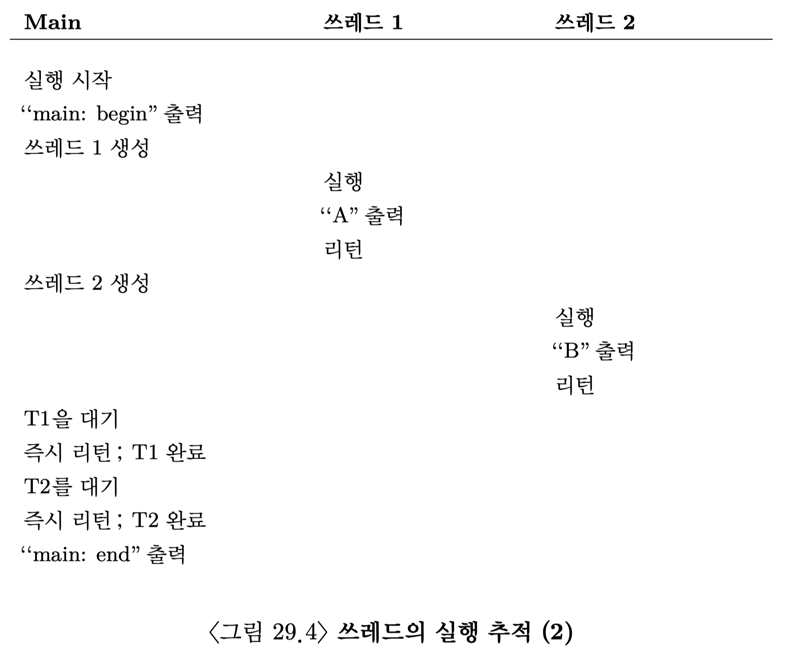
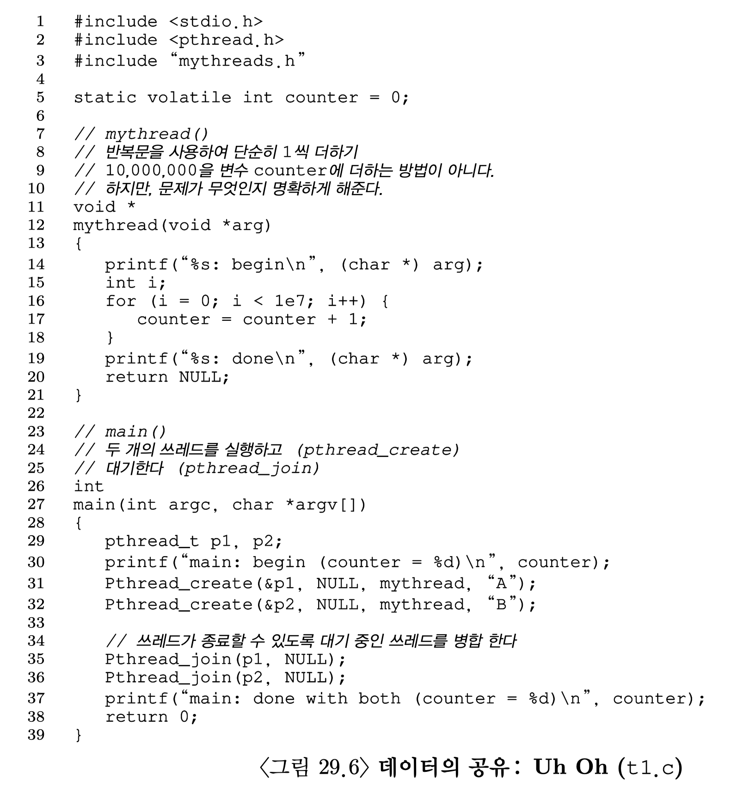
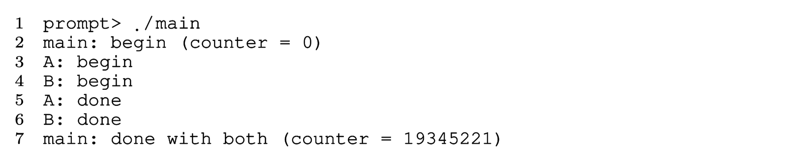
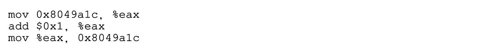
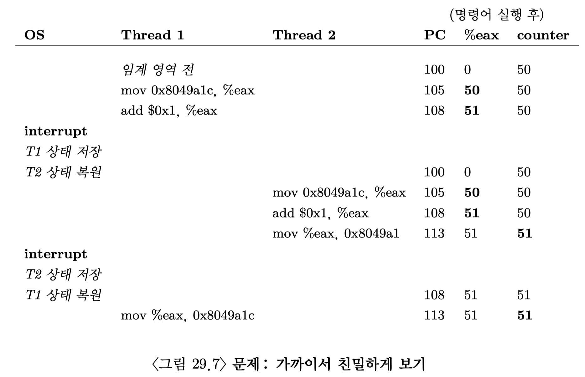

# 29장 개요

이번장에서는 쓰레드(thread)를 소개한다.

멀티 쓰레드 프로그램은 하나 이상의 실행 지점(여러 개의 PC)을 가진다.

쓰레드의 상태는 프로세스의 상태와 매우 유사하다.

프로그램 카운터(PC)와 연산들 위한 레지스터들을 가지고 있다.

만약 두 개의 쓰레드가 하나의 프로세서에서 실행 중이라면 실행 중인 쓰레드는 실행하고자 하는 쓰레드로 문맥 교환을 통해서 교체된다.

프로세스가 문맥 교환을 할 때에 프로세스 상태를 PCB에 저장하듯이 프로세스의 쓰레드들의 상태를 저장하기 위해 **쓰레드 제어 블록(thread control block, TCB)**이 필요하다.

가장 큰 차이는 프로세스와 다르게 쓰레드 간의 **문맥 교환에서는 주소 공간을 그대로 사용**한다. 즉, 페이지 테이블을 그대로 사용하면 된다.  



그림 29.1의 왼쪽은 고전적 프로세스 주소 공간(단일 쓰레드 프로세스)에서는 스택이 하나만 존재한다.

반면에 그림 29.2의 오른쪽 멀티 쓰레드 프로세스 같은 경우 각 쓰레드가 독립적으로 실행하기 위해서 하나의 스택이 아닌 쓰레드마다 스택이 존재한다. 

---

# 29.1 예제: 쓰레드 생성



메인 쓰레드는 각각 mythread() 함수를 실행할 2개의 쓰레드(각각 ”A”, “B” 출력)를 생성한다.

2개의 쓰레드를 생성한 후에 메인 쓰레드는 pthread_join()을 호출하여 쓰레드의 동작 종료를 대기한다.





그림 29.3과 29.4가 다르다. 스케줄러가 특정 시점에 실행하는 쓰레드에 따라 다양한 순서가 있을 수 있다.

쓰레드 생성 함수(pthread_create)가 리턴되기 전에 쓰레드가 실행될 수도 있고, 그보다 이후에 실행될 수도 있다. 

---

# 29.2 훨씬 더 어려운 이유: 데이터의 공유 



그림 29.6은 전역 공유 변수(counter)를 갱신하는 두 개의 쓰레드 예제이다.

각 작업자 쓰레드는 반목문 안에서 공유 변수인 counter를 천만 번(1e7) 더한다.

결과적으로 최종적으로 얻으려는 값은 20,000,000이다.



기대한 대로 결과가 출력되지 않는다.

각 실행의 결과가 다르고 기댓값이 아니다. 왜 이런 일이 일어나는걸까?

---

# 29.3 제어 없는 스케줄링

먼저 counter 갱신을 위해서 컴파일러가 생성한 코드의 실행 순서를 이해하자.



counter 변수의 주소는 0x8049a1c

먼저 명시한 메모리 주소의 값을 읽어 eax 레지스터에 저장한다.

그리고 1을 eax 레지스터의 값에 더하는 연산을 한 후에 마지막으로 eax에 저장되어 있는 값을 메모리의 원래의 주소에 다시 저장한다.

**동시성 이슈 설명** 

```
쓰레드1 메모리에서 counter 50 읽음, 레지스터에 저장 
쓰레드1 50 + 1 
컨텍스트 스위칭 
쓰레드2 메모리에서 counter 50 읽음, 레지스터에 저장 
쓰레드2 50 + 1
쓰레드2 레지스터 값 51을 메모리에 저장
컨텍스트 스위칭 
쓰레드1 레지스터 값 51을 메모리에 저장 

즉 각 쓰레드가 2번의 더하기를 했지만 결과적으로 +1 
정확하게 동작하도록 작성된 프로그램이라고 한다면 counter 값은 52가 되어야 한다.
```



예시에서처럼 명령어의 실행 순서에 따라 결과가 달라지는 상황을 **경쟁 조건(race condition)**이라고 부른다.

컴퓨터의 작동에서 일반적으로 발생하는 결정적 결과와 달리 결과가 어떠할지 알지 못하거나 실행할 때마다 결과가 다른 경우를 **비결정적(indeterminate)**인 결과라고 한다.

멀티 쓰레드가 같은 코드를 실행할 때 경쟁 조건이 발생하기 때문에 이러한 코드 부분을 **임계 영역(critical section)**이라고 부른다.

이러한 코드에서 필요한 것은 **상호 배제(mutual exclusion)**이다. 

이 속성은 하나의 쓰레드가 임계 영역 내의 코드를 실행 중일 때는 다른 쓰레드가 실행할 수 없도록 보장해 준다.

---

# 29.4 원자성에 대한 바람

임계 영역 문제에 대한 해결 방법 중 하나로 강력한 명령어 한 개로 의도한 동작을 수행하여, 인터럽트 발생 가능성을 원천적으로 차단하는 것이다.


이 가상 명령어는 메모리 상의 위치에 어떤 값을 더하는 명령어다.

하드웨어가 이 명령어가 원자적으로 실행되는 것을 보장하면 이전 예시에서 값은 결정적으로 바뀐다.


즉, 이 3개의 명령어가 원자적으로 실행된다.

하지만 현실은 그런 명령어는 존재하지 않는다. 

하드웨어적으로 **동기화 함수(synchronization primitives)**구현에 필요한 기본적인 명령어는 몇 개만 필요하다. 즉, 병행 실행이라는 어려운 상황에서 하드웨어 동기화 명령어와 운영체제의 지원을 통해 한 번에 하나의 쓰레드만 임계 구역에서 실행하도록 구성된, 제대로 잘 동작하는 멀티 쓰레드 프로그램을 작성할 수 있다.

---

