# **시큐리티 인증 / 인가 흐름도** 

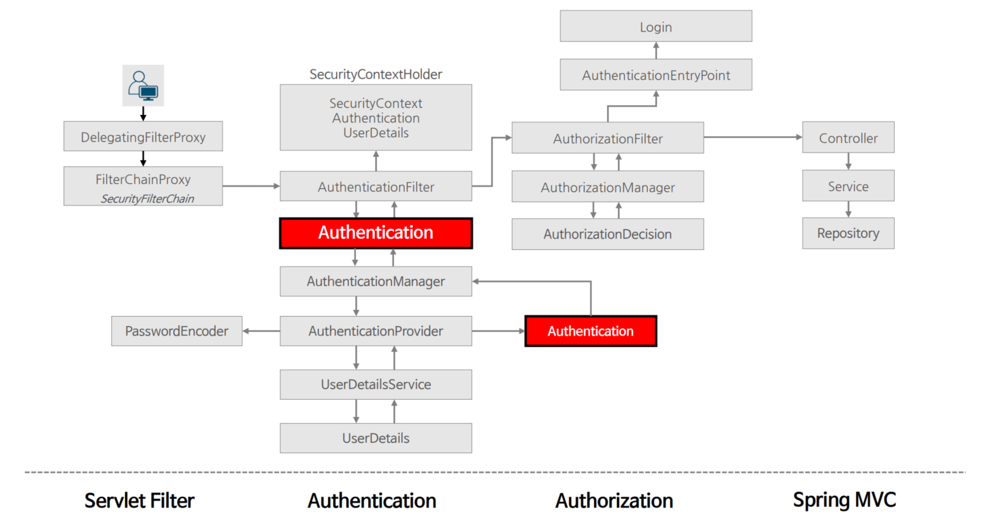

# **Authentication**

  - 인증은 특정 자원에 접근하려는 사람의 신원을 확인하는 방법을 의미한다 
  - 사용자 인증의 일반적인 방법은 사용자 이름과 비밀번호를 입력하게 하는 것으로서 인증이 수행되면 신원을 알고 권한 부여(인가)를 할 수 있다
  - Authentication은 사용자의 인증 정보를 저장하는 토큰 개념의 객체로 활용되며 인증 이후 `SecurityContext` 에 저장되어 전역적으로 참조가 가능하다 

# **구조**

**Principal(interface)**

  - package: `java.security`


                    ⬆️


**Authenticaion(interface)**

  - package: `org.springframework.security.core` 
  - extends Principal, Serializable
  - **getPrincipal()**
- 인증 주체를 의미하며 인증 요청의 경우 사용자 이름을, 인증 후에는 `UserDetails`  타입의 객체가 될 수 있다
  - **getCredentials()**
- 인증 주체가 올바른 것을 증명하는 자격 증명으로서 대개 비밀번호를 의미한다
  - **getAuthorities()**
- 인증 주체에게 부여된 권한을 나타낸다
  - **getDetails()**
- 인증 요청에 대한 세부적인 사항을 저장한다 
    - IP 주소, 인증서 일련 번호 등…
  - **isAuthenticated()**
- 인증 상태를 반환한다
  - **setAuthenticated(boolean)**
- 인증 상태를 설정한다

# **인증 절차 흐름**


# **시큐리티 인증 / 인가 흐름도**


# **SecurityContext**

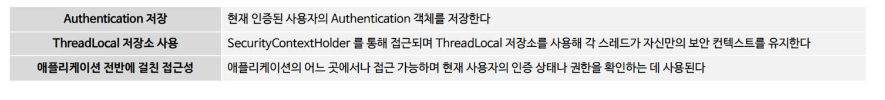

# SecurityContextHolder

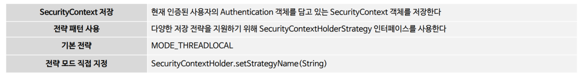

# **SecurityContextHolder 저장 모드**


# **구조**

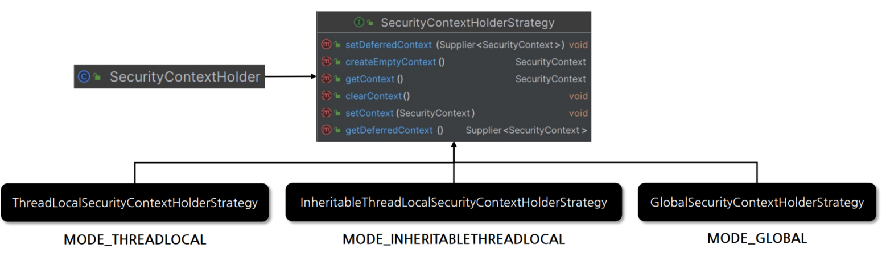

**SecurityContextHolderStrategy - 인터페이스** 

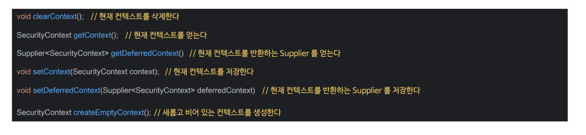

[디자인 패턴 - 전략 패턴 정리 ](https://20240228.tistory.com/425)

# **SecurityContext 참조 및 삭제**

  - **SecurityContext 참조 - SecurityContextHolder.getContextHolderStrategy().getContext()**
  - **SecurityContext 삭제 - SecurityContextHolder.getContextHolderStrategy().clearContext()**

# SecurityContextHolder & SecurityContext 구조


  - 스레드마다 할당되는 전용 저장소(ThreadLocal)에 SecurityContext를 저장하기 때문에 동시성 문제가 없다 
  - 스레드 풀에서 운용되는 스레드일 경우 새로운 요청이더라도 기존의 ThreadLocal이 재사용될 수 있기 때문에 클라이언트 응답 직전에 항상 SecurityContext를 삭제해 주고 있다 

# **SecurityContextHolderStrategy 사용하기**

**기존 방식**

```java
SecurityContext context = SecurityContextHolder.createEmptyContext(); 
context.setAuthentication(authentication); 
SecurityContextHolder.setContext(context);
```

위 코드는 SecurityContextHolder를 통해 SecurityContext에 접근할 때 여러 애플리케이션 컨텍스트가 SecurityContextHolderStrategy를 지정하려고 할 때 경쟁 조건(race condition)을 만들 수 있다 

**변경 방식**

```java
SecurityContextHolderStrategy securityContextHolderStrategy = SecurityContextHolder.getContextHolderStrategy();
SecurityContext context = securityContextHolderStrategy.createEmptyContext(); 
context.setAuthentication(authentication); 
securityContextHolderStrategy.setContext(context); 
```

애플리케이션이 SecurityContext를 정적으로 접근하는 대신 SecurityContextHolderStrategy를 자동 주입이 될 수 있도록 한다 각 애플리케이션 컨텍스트는 자신에게 가장 적합한 보안 전략을 사용할 수 있게 된다

# **메모**

  - **SecurityContextHolder**
  - **SecurityContextHolderStrategy - 전략 인터페이스** 
- **ThreadLocalSecurityContextHolderStrategy** 
- ThreadLocal 기반 
      - Supplier<SecurityContext> 사용
    - **InheritableThreadLocalSecurityContextHolderStrategy**

# **시큐리티 인증 / 인가 흐름도**

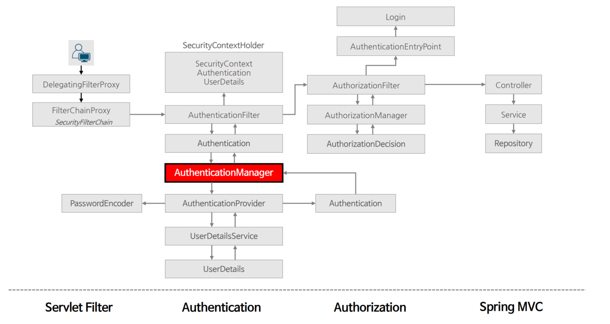

# **AuthenticationManager**

  - 인증 필터로부터 `Authentication` 객체를 전달 받아 인증을 시도하며 인증에 성공할 경우 사용자 정보, 권한 등을 포함한 완전히 채워진 `Authentication` 객체를 인증 필터로 반환한다
  - `AuthenticationManager` 는 여러 `AuthenticationProvider` 들을 관리하며 `AuthenticationProvider` 목록을 순차적으로 순회하며 인증 요청을 처리한다 
  - `AuthenticationProvider` 목록 중에 인증 처리 요건에 맞는 적절한 `AuthenticationProvider` 를 찾아 인증처리를 위임한다 
  - `AuthenticationManagerBuilder` 에 의해 객체가 생성되며 주로 사용하는 구현체로 `ProviderManager` 가 제공된다 

# **AuthenticationManagerBuilder**

  - `AuthenticationManager` 객체를 생성하며 `UserDetailsService` 및 `AuthenticationProvider` 를 추가할 수 있다
  - `HttpSecurity.getSharedObject(AuthenticationManagerBuilder.class)`를 통해 객체를 참조할 수 있다


**SecurityBuilder**

  - HttpSecurity
  - WebSecurity
  - AuthenticationManagerBuilder

# **AuthenticationManager 흐름도**


  - 선택적으로 부모 `AuthenticationManager`를 구현할 수 있으며 이 부모는 모든`AuthenticationProvider`가 인증을 수행할 수 없는 경우에 추가적으로 탐색할 수 있다 
  - 일반적으로 `AuthenticationProvider` 로 부터 null 이 아닌 응답을 받을 때 까지 차례대로 시도하며 응답을 받지 못하면 `ProviderNotFoundException`과 함께 인증이 실패한다 

# **AuthenticationManager 사용 방법­ - HttpSecurity 사용**

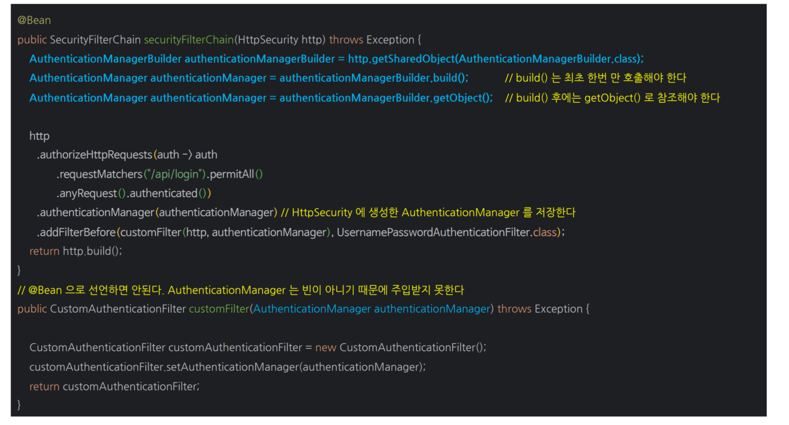

```java
@EnableWebSecurity
@Configuration
@Slf4j
public class SecurityConfig {
    @Bean
    public SecurityFilterChain securityFilterChain(HttpSecurity http) throws Exception{
        AuthenticationManagerBuilder authenticationManagerBuilder = http.getSharedObject(AuthenticationManagerBuilder.class);
        // build()는 최초 한번만 호출
        AuthenticationManager authenticationManager1 = authenticationManagerBuilder.build();
        // build()이후 getObject()로 참조해야 한다
        AuthenticationManager authenticationManager2 = authenticationManagerBuilder.getObject();

        http
                .authorizeHttpRequests(auth -> auth
                        .requestMatchers("/").permitAll()
                        .anyRequest().authenticated())
                .authenticationManager(authenticationManager1) // HttpSecurity 생성한 AuthenticationManager 저장
                .formLogin(Customizer.withDefaults());
        return  http.build();
    }
    @Bean
    public UserDetailsService userDetailsService(){
        UserDetails user = User.withUsername("user12")
                .password("{noop}1111")
                .roles("USER").build();
        return new InMemoryUserDetailsManager(user);
    }
}
```

# **AuthenticationManager 사용 방법­ - 직접 생성** 


# **실습1**

**CustomAuthenticationFilter** 

```java
public class CustomAuthenticationFilter extends AbstractAuthenticationProcessingFilter {
    public CustomAuthenticationFilter(HttpSecurity http) {
        super(new AntPathRequestMatcher("/api/login", "GET"));
        setSecurityContextRepository(getSecurityContextRepository(http));
    }
    private SecurityContextRepository getSecurityContextRepository(HttpSecurity http) {
        SecurityContextRepository securityContextRepository = http.getSharedObject(SecurityContextRepository.class);
        if (securityContextRepository == null) {
            securityContextRepository = new DelegatingSecurityContextRepository(
                    new RequestAttributeSecurityContextRepository(), new HttpSessionSecurityContextRepository());
        }
        return securityContextRepository;
    }
    @Override
    public Authentication attemptAuthentication(HttpServletRequest request, HttpServletResponse response) throws AuthenticationException, IOException, ServletException {
        String username = request.getParameter("username");
        String password = [REDACTED];
        UsernamePasswordAuthenticationToken token = [REDACTED], password);
        return this.getAuthenticationManager().authenticate(token);
    }
}

```

**SecurityConfig**

```java
@EnableWebSecurity
@Configuration
@Slf4j
public class SecurityConfig {
    @Bean
    public SecurityFilterChain securityFilterChain(HttpSecurity http) throws Exception{
        AuthenticationManagerBuilder authenticationManagerBuilder = http.getSharedObject(AuthenticationManagerBuilder.class);
        AuthenticationManager authenticationManager = authenticationManagerBuilder.build();
        http
                .authorizeHttpRequests(auth -> auth
                        .requestMatchers("/", "/api/login").permitAll()
                        .anyRequest().authenticated())
                .authenticationManager(authenticationManager) // HttpSecurity 생성한 AuthenticationManager 저장
                .addFilterBefore(customFilter(http, authenticationManager), UsernamePasswordAuthenticationFilter.class);
        return  http.build();
    }
    public CustomAuthenticationFilter customFilter(HttpSecurity http, AuthenticationManager authenticationManager){
        CustomAuthenticationFilter customAuthenticationFilter = new CustomAuthenticationFilter(http);
        customAuthenticationFilter.setAuthenticationManager(authenticationManager);
        return customAuthenticationFilter;
    }
    @Bean
    public UserDetailsService userDetailsService(){
        UserDetails user = User.withUsername("user12")
                .password("{noop}1111")
                .roles("USER").build();
        return new InMemoryUserDetailsManager(user);
    }
}
```

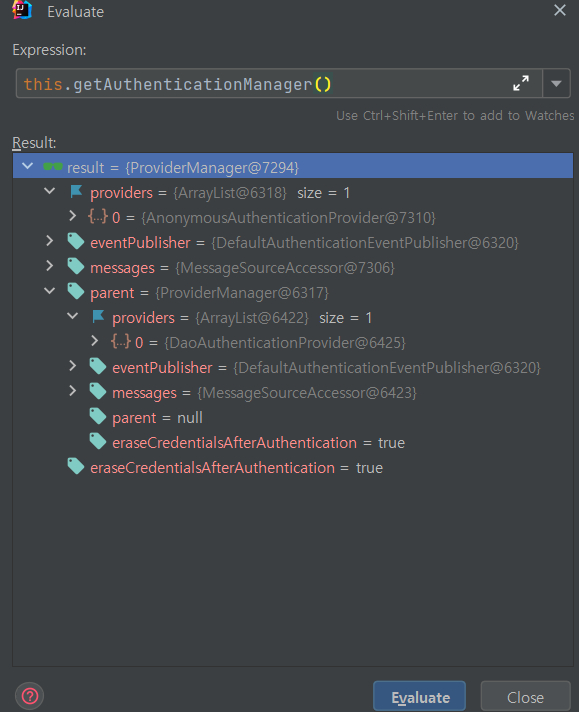

현재 디버깅 break point: `CustomAuthenticationFilter`

return this.getAuthenticationManager().authenticate(token);

`AuthenticationManager`에 있는 `ProviderManager`에 provider에 `AnonymousAuthenticationProvider`가 있고 parents ProviderManager에 `DaoAuthenticationProvider`가 존재한다. 

즉, HttpSecurity 초기화 과정에서 2개의 default `AuthenticationProvider` 가 `AuthenticationManager` 가 존재하게 된다. 

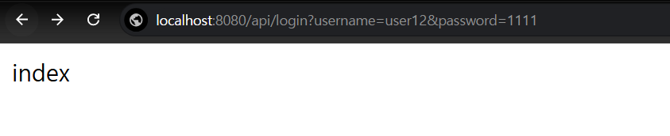

`GET /api/login` 하면 `CustomAuthenticationFilter` RequestMatcher 조건에 맞고 

parameter로 올바른 password, username을 쿼리 String 으로 보내면 `DaoAuthenticationProvider`

에서 `UsernamePaswordAuthenticationToken`을 반환한다. 

# **실습2**

**CustomAuthenticationProvider**

```java
public class CustomAuthenticationProvider implements AuthenticationProvider {
    @Override
    public Authentication authenticate(Authentication authentication) throws AuthenticationException {
        String loginId = authentication.getName();
        String password = [REDACTED];

        // 생략된 과정: UserDetailsService 통해서 UserDetails 받고 password 검증을 해야함
        return new UsernamePasswordAuthenticationToken(
                loginId, null, List.of(new SimpleGrantedAuthority("ROLE_USER")));
    }
    @Override
    public boolean supports(Class<?> authentication) {
        return authentication.isAssignableFrom(UsernamePasswordAuthenticationToken.class);
    }
}

```

**SecurityConfig**

```java
@EnableWebSecurity
@Configuration
@Slf4j
public class SecurityConfig2 {
    @Bean
    public SecurityFilterChain securityFilterChain(HttpSecurity http) throws Exception{
        http
                .authorizeHttpRequests(auth -> auth
                        .requestMatchers("/").permitAll()
                        .anyRequest().authenticated())
                .addFilterBefore(customFilter(http), UsernamePasswordAuthenticationFilter.class);

        return  http.build();
    }
    public CustomAuthenticationFilter customFilter(HttpSecurity http){
        CustomAuthenticationFilter customAuthenticationFilter = new CustomAuthenticationFilter(http);

        List<AuthenticationProvider> list1 = List.of(new DaoAuthenticationProvider());
        AuthenticationManager parent = new ProviderManager(list1);

        List<AuthenticationProvider> list2 = List.of(new AnonymousAuthenticationProvider("key"), new CustomAuthenticationProvider());
        AuthenticationManager providerManager = new ProviderManager(list2, parent);
        customAuthenticationFilter.setAuthenticationManager(providerManager);
        return customAuthenticationFilter;
    }
    @Bean
    public UserDetailsService userDetailsService(){
        UserDetails user = User.withUsername("user12")
                .password("{noop}1111")
                .roles("USER").build();
        return new InMemoryUserDetailsManager(user);
    }
}
```

CustomAuthenticaionFilter에 AuthenticationManager를 직접 만들어서 넣었다.

ProviderManager에는 부모 ProviderManager를 넣을 수 있다.

ProviderManager에 있는 AuthenticaionProviders 목록에서 모든 Provider가 정상적인 Authentication 을 반환하지 않으면 부모 ProviderManager에 있는 AuthenticaionProviders 에서 찾는다 

현재 CustomAuthenticationProvider는 어떤 아이디 비밀번호든 UsernamePasswordAuthenticationToken을 반환하고 있어서 무조건 인증에 성공한다

# **시큐리티 인증 / 인가 흐름도**


# **AuthenticationProvider**

  - 사용자의 자격 증명을 확인하고 인증 과정을 관리하는 클래스로서 사용자가 시스템에 엑세스하기 위해 제공한 정보(아이디/비빌번호)가 유효한지 검증하는 과정을 포함한다 
  - 다양한 유형의 인증 메커니즘을 지원할 수 있는데, 기본적인 사용자 이름과 비밀번호를 기반으로 한 인증, 토큰 기반 인증, 지문 인식 등을 처리할 수 있다 
  - 성공적인 인증 후에는 `Authentication` 객체를 반환하며 이 객체에는 사용자의 신원 정보와 인증된 자격 증명을 포함한다 
  - 인증 과정 중에 문제가 발생한 경우 `AuthenticatioException` 과 같은 예외를 발생시켜 문제를 알리는 역할을 한다 


  - `AuthenticationManager`로부터 `Authentication` 객체를 받아 인증을 수행한다 
  - 인증을 수행할 수 있는 조건인지를 `supports 메소드`를 통해 검사한다 

# **AuthenticationProvider 흐름도**


# **AuthenticationProvider사용 방법 ­- 일반 객체로 생성**


**HttpSecurity - addAuthenticationProvider 활용** 

`http.authenticationProvider(new CustomAuthenticationProvider()))`

**ManagerBuilder 활용** 

`AuthenticationManagerBuilder managerBuilder = http.getSharedObject(AuthenticationMnagerBuilder.class`

`managerBuilder.addAuthenticationProvider(new CustomAuthenticationProvider())`

**저장 위치** 


`AuthenticationManager`는 `AuthenticationProvider` 목록인 `providers`와 추가적으로 

`AuthenticationManager(parent)`를 가질 수 있다

일반 객체로 생성해서 추가되는 위치는 `providers`

`AnonymousAuthenticationProvider`, `DaoAuthenticationProvider` 2개의 `Provider`는 시큐리티가 기본적으로 넣어준다.

# **AuthenticationProvider 사용 방법 -­ 빈으로 생성**

## **빈을 한 개만 정의하는 경우** 

`AuthenticationProvider`를 빈으로 정의하면 `DaoAuthenticationProvider`를 자동으로 대체하게 된다

```java
@Bean
public AuthenticationProvider customAuthenticationProvider(){
	 return new CustomAuthenticationProvider();
}
```


하지만 상황에 따라서 내가 Custom한 `AuthenticationProvider` 뿐만 아니라 

`DaoAuthenticationProvider`도 필요할 수 있다. 

→ ex: 인증 방식이 (Custom한 방식 / 폼 로그인 방식) 2가지가 있는 경우 

```java
@Bean
public SecurityFilterChain securityFilterChain(HttpSecurity http, AuthenticationManagerBuilder builder, AuthenticationConfiguration configuration) 
throws Exception {
		 AuthenticationManagerBuilder managerBuilder = http.getSharedObject(AuthenticationManagerBuilder.class);
		 managerBuilder.authenticationProvider(customAuthenticationProvider());
		 ProviderManager providerManager = (ProviderManager)configuration.getAuthenticationManager();
		 providerManager.getProviders().remove(0);
		 builder.authenticationProvider(new DaoAuthenticationProvider());
		 http.authorizeHttpRequests(auth -> auth.anyRequest().authenticated());
		 return http.build();
}

@Bean
public AuthenticationProvider customAuthenticationProvider(){
		 return new CustomAuthenticationProvider();
}
```

**결과** 


```java
AuthenticationManagerBuilder managerBuilder = http.getSharedObject(AuthenticationManagerBuilder.class);
managerBuilder.authenticationProvider(customAuthenticationProvider());
```

`HttpSecurity` 객체를 통해 `getSharedObject(AuthenticationManagerBuilder.class)` ManagerBuilder 가져오기 

가져온 `builder.authenticationProvider(customAuthenticationProvider())` 

이렇게 하면 `AuthenticationManager providers` 목록에 `CustomAuthenticationProvider`가 들어간다.

`parent`에 있는 `ProviderManager`가 아니다!

```java
ProviderManager providerManager = (ProviderManager)configuration.getAuthenticationManager();
providerManager.getProviders().remove(0);
```

`AuthenticationConfiguration configuration` 주입 받았다.

configuration에서 `getAuthenticationManager`는 `parent`에 해당하는 `ProviderManager`이다 

여기서 첫 번째 인덱스에 해당하는 `AuthenticationProvider`를 삭제한다

삭제하는 `Provider`는 우리가 빈으로 등록한 `CustomAuthenticationProvider` 이다.

```java
 builder.authenticationProvider(new DaoAuthenticationProvider());
```

`AuthenticationManagerBuilder builder` 주입 받았다. 

`builder.authenticationProvider` 에 `DaoAuthenticationProvider`를 추가한다 

이때 `DaoAuthenticationProvider`가 추가되는 `AuthenticationManager`는 `patent`이다

그래서 최종적으로 아래 결과가 나온다 


## **빈을 두 개 이상 정의하는 경우** 


# **테스트1**

CustomAuthenticationProvider 일반 객체로 생성해서 사용하기 

```java
@EnableWebSecurity
@Configuration
@Slf4j
public class SecurityConfig {
    @Bean
    public SecurityFilterChain securityFilterChain(HttpSecurity http, AuthenticationConfiguration configuration) throws Exception{

        AuthenticationManagerBuilder managerBuilder = http.getSharedObject(AuthenticationManagerBuilder.class);
        managerBuilder.authenticationProvider(new CustomAuthenticationProvider());

        ProviderManager providerManager = (ProviderManager) configuration.getAuthenticationManager();
        providerManager.getProviders().add(new CustomAuthenticationProvider());

        http
            .authorizeHttpRequests(auth -> auth
                        .requestMatchers("/").permitAll()
                        .anyRequest().authenticated());

        //http.authenticationProvider(new CustomAuthenticationProvider2());

        http
            .formLogin(Customizer.withDefaults());

        return  http.build();
    }
    @Bean
    public UserDetailsService userDetailsService(){
        UserDetails user = User.withUsername("user12")
                .password("{noop}1111")
                .roles("USER").build();
        return new InMemoryUserDetailsManager(user);
    }
}
```

`AuthenticationConfiguration` 에서 가져온 `ProviderManager` 는 `Parent` 

`HttpSecurity.getSharedObject(AuthenticationManagerBuilder.class)` 를 통해서

가져온 `ProviderManager` 는 `Parent` 를 가지는 `ProviderManager` 이다.

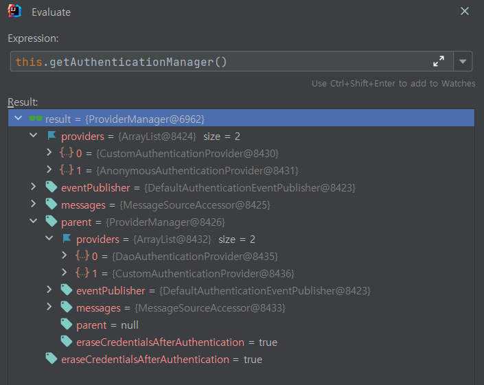

# **테스트2**

CustomAuthenticationProvider 빈으로만 등록 다른 설정 X

```java
@EnableWebSecurity
@Configuration
@Slf4j
public class SecurityConfig {
    @Bean
    public SecurityFilterChain securityFilterChain(HttpSecurity http) throws Exception{
        http
            .authorizeHttpRequests(auth -> auth
                        .anyRequest().authenticated());
        http
            .formLogin(Customizer.withDefaults());

        return  http.build();
    }
    @Bean
    public CustomAuthenticationProvider customAuthenticationProvider(){
        return new CustomAuthenticationProvider();
    }
    @Bean
    public UserDetailsService userDetailsService(){
        UserDetails user = User.withUsername("user12")
                .password("{noop}1111")
                .roles("USER").build();
        return new InMemoryUserDetailsManager(user);
    }
}
```


`CustomAuthenticationProvider`를 빈으로만 등록해도 `DaoAuthenticationProvider` 존재하지 않는다.

# **테스트3**

빈으로 등록하고 `HttpSecurity`를 통해서 추가하기 

```java
@EnableWebSecurity
@Configuration
@Slf4j
public class SecurityConfig {
    @Bean
    public SecurityFilterChain securityFilterChain(HttpSecurity http) throws Exception{
        AuthenticationManagerBuilder managerBuilder = http.getSharedObject(AuthenticationManagerBuilder.class);
        managerBuilder.authenticationProvider(customAuthenticationProvider());
        
        http
            .authorizeHttpRequests(auth -> auth
                        .anyRequest().authenticated());
        http
            .formLogin(Customizer.withDefaults());

        return  http.build();
    }
    @Bean
    public CustomAuthenticationProvider customAuthenticationProvider(){
        return new CustomAuthenticationProvider();
    }
    @Bean
    public UserDetailsService userDetailsService(){
        UserDetails user = User.withUsername("user12")
                .password("{noop}1111")
                .roles("USER").build();
        return new InMemoryUserDetailsManager(user);
    }
}
```

`CustomProviderManager`가 2곳에 들어간다.


역시 `DaoAuthenticationProvider` 존재하지 않는다.

# **테스트4**

CustomProviderManager를 빈으로 등록하면서 1개만 존재하게 하고 

`DaoAuthenticationProvider` 또한 등록하기

```java
@EnableWebSecurity
@Configuration
@Slf4j
public class SecurityConfig {
    @Bean
    public SecurityFilterChain securityFilterChain(HttpSecurity http, AuthenticationConfiguration configuration) throws Exception{

        ProviderManager providerManager = (ProviderManager) configuration.getAuthenticationManager();
        providerManager.getProviders().add(new DaoAuthenticationProvider());

        http
            .authorizeHttpRequests(auth -> auth
                        .anyRequest().authenticated());
        http
            .formLogin(Customizer.withDefaults());

        return  http.build();
    }
    @Bean
    public CustomAuthenticationProvider customAuthenticationProvider(){
        return new CustomAuthenticationProvider();
    }
    @Bean
    public UserDetailsService userDetailsService(){
        UserDetails user = User.withUsername("user12")
                .password("{noop}1111")
                .roles("USER").build();
        return new InMemoryUserDetailsManager(user);
    }
}
```


`DaoAuthenticationProvider` 를 `Parent ProviderManager` 에 등록 

등록 위치를 바꾸고 싶으면 `HttpSecurity`를 통해서 추가하면 된다

# **테스트5**

CustomProvider 2개 빈으로 등록만 하기 

```java
@EnableWebSecurity
@Configuration
@Slf4j
public class SecurityConfig {
    @Bean
    public SecurityFilterChain securityFilterChain(HttpSecurity http) throws Exception{
        http
            .authorizeHttpRequests(auth -> auth
                        .anyRequest().authenticated());
        http
            .formLogin(Customizer.withDefaults());

        return  http.build();
    }
    @Bean
    public CustomAuthenticationProvider customAuthenticationProvider(){
        return new CustomAuthenticationProvider();
    }
    @Bean
    public CustomAuthenticationProvider2 customAuthenticationProvider2(){
        return new CustomAuthenticationProvider2();
    }
    @Bean
    public UserDetailsService userDetailsService(){
        UserDetails user = User.withUsername("user12")
                .password("{noop}1111")
                .roles("USER").build();
        return new InMemoryUserDetailsManager(user);
    }
}
```


빈을 2개 등록하고 추가하지 않으면 기본 Provider만 존재한다 

# **테스트6**

CustomProvider 2개 빈으로 등록하고 HttpSecurity, AuthenticationConfiguration 통해서 

서로 다른 ProviderManager에 Provider 등록하기 

```java
@EnableWebSecurity
@Configuration
@Slf4j
public class SecurityConfig {
    @Bean
    public SecurityFilterChain securityFilterChain(HttpSecurity http, AuthenticationConfiguration configuration) throws Exception{

        AuthenticationManagerBuilder managerBuilder = http.getSharedObject(AuthenticationManagerBuilder.class);
        managerBuilder.authenticationProvider(customAuthenticationProvider());

        ProviderManager providerManager = (ProviderManager) configuration.getAuthenticationManager();
        providerManager.getProviders().add(customAuthenticationProvider2());

        http
            .authorizeHttpRequests(auth -> auth
                        .anyRequest().authenticated());
        http
            .formLogin(Customizer.withDefaults());

        return  http.build();
    }
    @Bean
    public CustomAuthenticationProvider customAuthenticationProvider(){
        return new CustomAuthenticationProvider();
    }
    @Bean
    public CustomAuthenticationProvider2 customAuthenticationProvider2(){
        return new CustomAuthenticationProvider2();
    }
    @Bean
    public UserDetailsService userDetailsService(){
        UserDetails user = User.withUsername("user12")
                .password("{noop}1111")
                .roles("USER").build();
        return new InMemoryUserDetailsManager(user);
    }
}
```


# **시큐리티 인증 / 인가 흐름도**


# **UserDetailsService**

  - `UserDetailsService`의 주요 기능은 사용자와 관련된 상세 데이터를 로드하는 것이며 사용자의 신원, 권한, 자격 증명 등과 같은 정보를 포함할 수 있다 
  - 이 인터페이스를 사용하는 클래스는 주로 `AuthenticationManager`이며 사용자가 시스템에 존재하는지 여부와 사용자 데이터를 검색하고 인증 과정을 수행한다 


  - 사용자의 이름을 통해 사용자 데이터를 검색하고, 해당 데이터를 `UsersDetails`객체로 반환한다

# **UserDetailsService 흐름도**

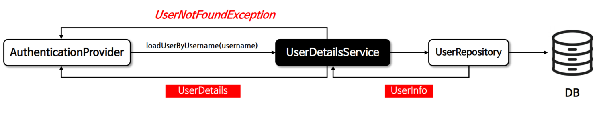

# **UserDetailsService 사용 방법**

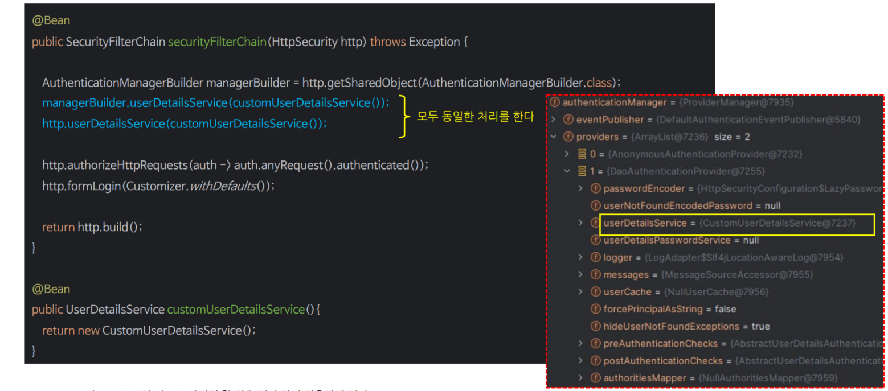

위 코드는 `HttpSecurity` 객체를 통해서 `UserDetailsService` 를 주입하는 2가지 방식을 보여준다

`UserDetailsService`를 하나의 빈으로 사용하면 굳이 

`HttpSecurity`객체를 통해 설정하지 않아도 자동으로 `AuthenticationProvider`에게 주입된다

하지만 `AuthenticationProvider` 를 커스터 마이징 한다고 하면 `AuthenticationProvider`에 직접 주입해서 사용한다 

# **CustomUserDetailsService 적용** 

**CustomUserDetailsService**

```java
public class CustomUserDetailsService implements UserDetailsService {
    @Override
    public UserDetails loadUserByUsername(String username) throws UsernameNotFoundException {
        return User.withUsername("user").password("{noop}1111").roles("USER").build();
    }
}
```

**SecurityConfig**

```java
@EnableWebSecurity
@Configuration
@Slf4j
public class SecurityConfig {
    @Bean
    public SecurityFilterChain securityFilterChain(HttpSecurity http, AuthenticationConfiguration configuration) throws Exception{
        http
            .authorizeHttpRequests(auth -> auth
                        .anyRequest().authenticated());
        http
            .formLogin(Customizer.withDefaults());

        return  http.build();
    }
    @Bean
    public UserDetailsService userDetailsService(){
        return new CustomUserDetailsService();
    }
}
```


빈으로 등록한 `CustomUserDetailsService`가 `DaoAuthenticationProvider`에 주입되어 있는 걸 확인할 수 있다. 

# **CustomAuthenticationProvider 적용** 

**SecurityConfig, CustomUserDetailsService 그대로 재사용** 

**CustomAuthenticationProvider**

```java
@Component
@RequiredArgsConstructor
public class CustomAuthenticationProvider implements AuthenticationProvider {
    private final UserDetailsService userDetailsService;
    @Override
    public Authentication authenticate(Authentication authentication) throws AuthenticationException {
        String username = authentication.getName();

        // 사용자 정보 조회
        UserDetails userDetails = userDetailsService.loadUserByUsername(username);

        // 비밀번호 검증 생략

        return new UsernamePasswordAuthenticationToken(
                userDetails.getUsername(), null, userDetails.getAuthorities());
    }
    @Override
    public boolean supports(Class<?> authentication) {
        return authentication.isAssignableFrom(UsernamePasswordAuthenticationToken.class);
    }
}
```

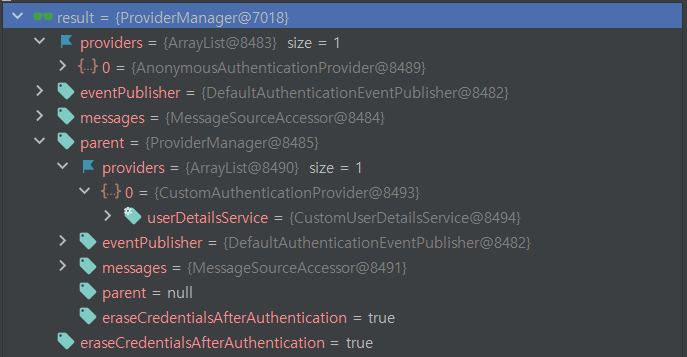

이전 `AuthenticationProvider`에서 알아봤던 동작 원리 그대로 

1개의 `CustomAuthenticationProvider`를 빈으로 등록하면 `DaoAuthenticationProvider`를 대체한다 

또한 스프링 DI를 통해서 커스터 마이징 한 `UserDetailsService`인 `CustomUserDetailsService`가 필드에 있는 걸 확인할 수 있었다

# **시큐리티 인증 / 인가 흐름도**

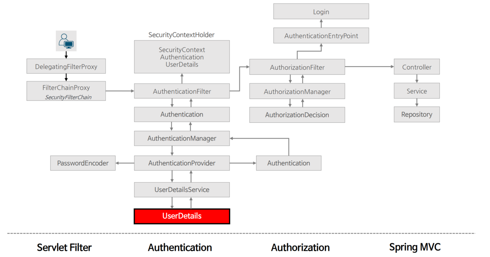

# **UserDetails**

  - 사용자의 기본 정보를 저장하는 인터페이스로서 Spring Security 에서 사용하는 사용자 타입이다 
  - 저장된 사용자 정보는 추후에 인증 절차에서 사용되기 위해 `Authentication`객체에 포함되며 구현체로 `User` 클래스가 제공된다 



