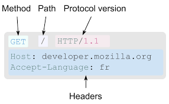
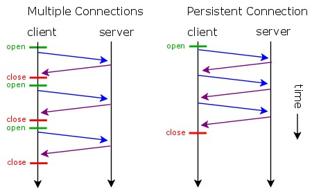
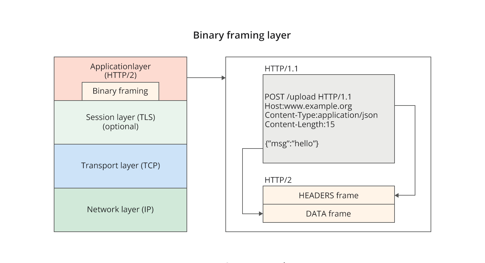

사용자가 웹 브라우저에 www.google.com을 입력하면 원하는 페이지가 나온다. 사용자는 단순히 URL을 입력하면 되지만 내부적으로는 많은 처리가 이루어진다. 사용자가 URL을 입력하는 행위를 요청(request)이라고 하며, 서버는 사용자의 요청에 응답(response)을 한다.

요청과 응답을 위해 HTTP 프로토콜을 사용하는데, **HTTP(HyperText Transfer Protocol)는 클라이언트와 서버가 어떻게 데이터를 교환할지 정해놓은 규칙으로, 80번 포트를 사용한다.**

HTTP는 문자 형태로 데이터가 전송되기 때문에 필요한 부분을 파싱(parsing) 해주어야 하므로 다음과 같은 구조를 사용한다.

**HTTP 구조** 

**그림과 같이 HTTP 구조는 Status Line(시작 라인), Headers(헤더), Empty Line(공백 1줄), Body(바디)로 구성된다.** 

**HTTP Status Line & Headers**

시작 라인은 HTTP 메서드, 경로, HTTP 버전으로 이루어져 있다.

HTTP 메서드는 데이터를 수신하는 서버에서 어떤 작업을 해야 하는지 알려주는 용도로 사용된다.

- **GET: 데이터 획득**
- **POST: 데이터 추가, 생성**
- **PUT: 서버의 데이터 갱신**
- **PATCH: PUT과 유사하게 요청된 데이터를 수정(update)할 때 사용하지만, PUT은 데이터 전체를 갱신하고 PATCH는 일부만 갱신한다.**
- **DELETE: 데이터 삭제**

HTTP 버전은 1.0, 1.1, 2.0 순서로 진화했다. HTTP 프로토콜에는 자체적으로 정의한 헤더가 있어서 HTTP 버전 정보, 상태 정보 등 여러 정보를 서버로 보낼 수 있게 되었다. 하지만 매 요청마다 연결을 수립하는 과정을 반복하다 보니 이것을 처리하는 서버의 성능이 저하되는 문제점이 있었다.

그래서 등장한 것이 HTTP 1.1이며 현재 가장 많이 사용하는 버전?이다.

**HTTP 1.1부터는 Keep-Alive 기능이 추가되어 연결이 한 번 수립되면 데이터 교환을 마칠 때까지 연결을 유지하고 데이터 교환이 끝나면 연결을 끊는 구조이다.**

**HTTP 1.0 vs HTTP 1.1의 연결 방식**

| **버전** | **연결 방식 설명** |
| --- | --- |
| HTTP 1.0 | 매 요청마다 새로운 TCP 연결을 맺고, 응답 후 연결을 끊음. |
| HTTP 1.1 | **Keep-Alive** 기능이 기본 적용. 한 번 연결을 맺으면 여러 요청/응답에 재사용. |

HTTP 1.1의 Keep-Alive 덕분에, 매번 3-way handshake를 반복하지 않아도 되어 서버와 네트워크의 부하가 크게 줄었다.

- open: 연결 수립 → 3-way handshake
- close: 연결 종료

**HTTP 2.0부터는 응용 계층에 바이너리 프레임(Binary Frame)을 추가하여 기존의 일반 텍스트 데이터를 바이너리로 변환한 후 데이터를 분할하여 보낸다.** 이렇게 하면 전송 속도가 빨라지고 오류 발생 가능성도 낮아진다.

여기까지가 클라이언트에서 서버로 HTTP 요청을 할 때 전달하는 정보였다.

서버에서도 응답을 해야 하는데, 응답에 대한 시작 라인은 간단하다.

HTTP 버전, 응답 메시지로 구성된다.

응답 메시지의 상태코드는 아래와 같다.

| 1xx | 정보 | 요청을 받았으며 처리가 되고 있음을 나타낸다. |
| --- | --- | --- |
| 2xx | 성공 | 요청이 성공했음을 나타낸다.  |
| 3xx | 리다이렉션 | 클라이언트가 요청한 컨텐츠가 다른 곳에 있다는 의미이다.  |
| 4xx | 클라이언트 오류 | 클라이언트가 잘못된 요청을 했음을 의미한다. |
| 5xx | 서버 오류 | 서버측 오류로 인해 요청이 실패했음을 의미한다. |

헤더에는 클라이언트와 서버가 통신하기 위한 다음과 같은 부가적인 정보가 포함된다.

- 호스트(Host): 서버의 도메인 이름과 포트 번호
- 연결(Connection): 현재의 작업이 끝난 후에도 네트워크를 연결 상태로 둘지 여부를 제어
- 언어(Language): 서버가 응답에 사용할 언어

---

