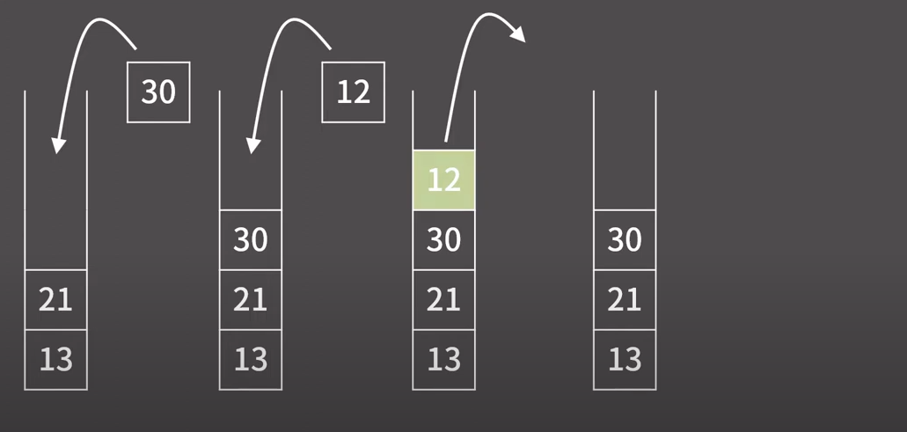



## 스택이란?

스택은 구조적으로 먼저 들어간 원소가 제일 나중에 나오게 되는데

이런 의미로 FILO(First In Last Out) 자료구조라고 부르기도 한다.

큐나 스택 덱도 스택처럼 특정 위치에서만 원소를 넣거나 뺄 수 있는 제한이 걸려 있다.

그래서 스택, 큐, 덱을 묶어서 Restricted Structure라고 부른다.

## 스택의 성질

1. 원소의 추가 O(1)
1. 원소의 제거 O(1)
1. 제일 상단의 원소 확인이 O(1)
1. 제일 상단이 아닌 나머지 원소들의 확인 / 변경이 원칙적으로 불가능

