***dependency***

```groovy
dependencies {
	 implementation 'org.springframework.boot:spring-boot-starter-jdbc'
	 compileOnly 'org.projectlombok:lombok'
	 runtimeOnly 'com.h2database:h2'
	 annotationProcessor 'org.projectlombok:lombok'
	 testImplementation 'org.springframework.boot:spring-boot-starter-test'
	 
	 //테스트에서 lombok 사용
	 testCompileOnly 'org.projectlombok:lombok'
	 testAnnotationProcessor 'org.projectlombok:lombok'
}
```

# ***H2 데이터베이스 설정***

***윈도우 실행: h2 database 설치경로 → bin 폴더 이동*** 

  - *./h2.bat*

***데이터베이스 생성 방법***

  - *사용자명, 비밀번호 입력* 
  - *jdbc:h2:~/db_name*
- *연결 시험: → 오류 발생* 
    - *연결을 직접 누른다*
  - *db_name.mv.db 파일 생성 확인*
  - 이후 접속 *jdbc:h2/tcp://localhost/~/db_name*

***참고: H2 데이터베이스가 정상 생성되지 않을 때***

  - *H2 데이터베이스 재실행*
  - *웹 브라우저가 자동 실행되면 주소창 앞 부분 localhost로 변경* 
  - *jdbc:h2:~/db_name*
  - 이후 접속 *jdbc:h2/tcp://localhost/~/db_name*

***연결 시험***

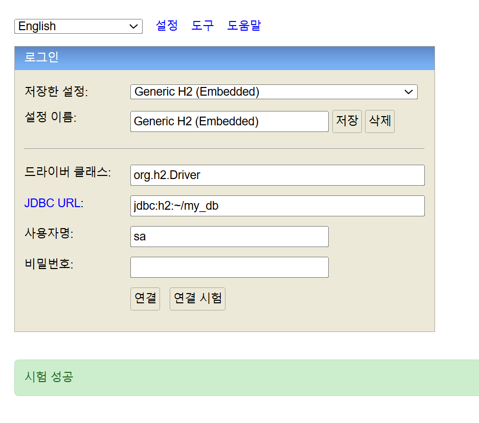

# ***JDBC 이해***

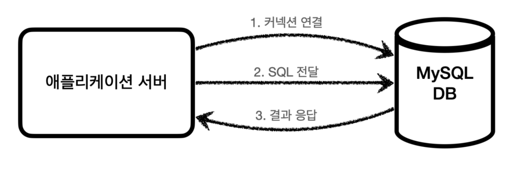

  - *커넥션 연결: TCP/IP를 사용하여 커넥션 연결* 
- *3-way-handshake*
  - *SQL 전달: 애플리케이션 서버는 DB가 이해할 수 있는 SQL을 연결된 커넥션을 통해 DB에 전달*
  - *결과 응답: DB는 전달된 SQL을 수행하고 그 결과를 응답*

***문제는 각 DB마다 커넥션을 연결하는 방법, SQL 전달하는 방법, 결과를 응답 받는 방법이 모두 다르다.***

  - *데이터베이스를 다른 종류의 데이터베이스로 변경하면 애플리케이션 서버에 개발된 데이터베이스 사용 코드도 함께 변경*
  - *개발자가 각각의 데이터베이스마다 커넥션 연결, SQL 전달, 그리고 그 결과를 응답 받는 방법을 새로 학습*

*→ 이런 문제를 해결하기 위해 JDBC 등장*

# ***JDBC 표준 인터페이스***

***JDBC(Java Database Connectivity)는*** *자바에서 데이터베이스에 접속할 수 있도록 하는 자바 API*

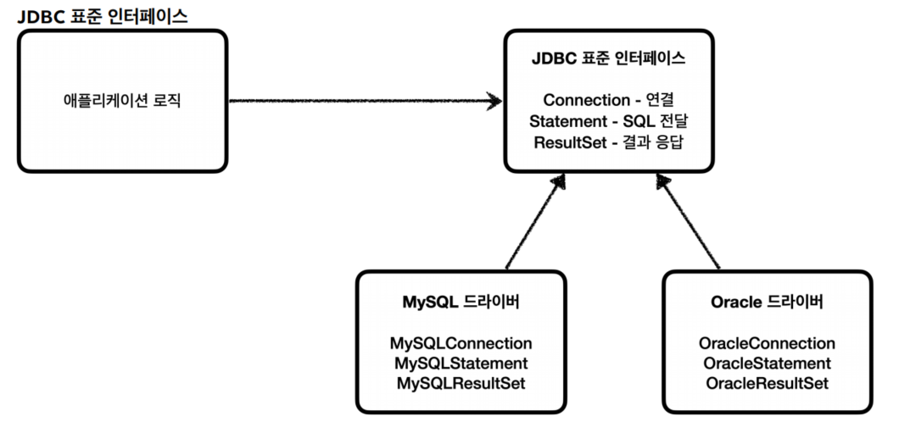

***JDBC 제공 인터페이스*** 

  - *java.sql.Connection* 
  - *java.sql.Statement*
  - *java.sql.ResultSet* 

***JDBC 드라이버?***

  - *해당 JDBC 인터페이스를 각각의 DB에 맞도록 구현해서 라이브러리로 제공, 이것을 JDBC 드라이버라 한다. (MySQL 드라이버, Oracle 드라이버)*

***표준화의 한계***

  - *각각의 데이터베이스마다 SQL, 데이터타입 등의 일부 사용법 다르다.*
  - *ANSI SQL이라는 표준이 있기는 하지만 일반적인 부분만 공통화했기 때문에 한계가 있다.*
  - *결국 데이터베이스를 변경하면 JDBC 코드는 변경하지 않아도 되지만 SQL은 해당 데이터베이스에 맞도록 변경해야한다.*
- *JPA(Java Persistence API)를 사용하면 각각의 데이터베이스마다 다른 SQL을 정의해야 하는 문제도 많은 부분 해결할 수 있다.*

# ***JDBC와 최신 데이터 접근 기술***

*JDBC 오래된 기술이고 사용하는 방법도 복잡하다.*

*최근에는 JDBC를 직접 사용하기 보다는 JDBC를 편리하게 사용하는 다양한 기술이 존재*

→ ***SQL Mapper, ORM*** 

***SQL Mapper(JdbcTemplate, MyBatis)***

  - *장점: JDBC를 편리하게 사용하도록 도와준다.*
- *SQL 응답 결과를 객체로 편리하게 변환*
    - *JDBC의 반복 코드를 제거*
  - *단점: 개발자가 SQL을 직접 작성*
- *이게 정말 단점일까?*

***ORM 기술(JPA, 하이버네이트, 이클립스링크)***

  - ORM은 객체를 관계형 데이터베이스 테이블과 매핑해주는 기술
  - *개발자는 반복적인 SQL을 직접 작성하지 않고, ORM 기술이 개발자 대신에 SQL을 동적으로 만들어 실행해준다*
  - *각각의 데이터베이스마다 다른 SQL을 사용하는 문제도 중간에서 해결해준다*
  - *JPA는 ORM 표준 인터페이스 구현체로 하이버네이트, 이클립스 링크 등이 있다.* 

# *JDBC DriverManager 연결 이해*

```java
Connection connection = DriverManager.getConnection(URL, USERNAME, PASSWORD);
```

  - *throws SQLException*

***JDBC 커넥션 인터페이스와 구현***

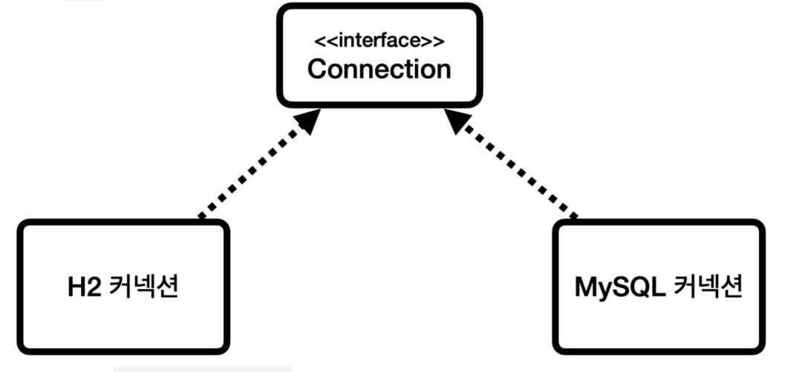

  - *JDBC는 java.sql.Connection 표준 커넥션 인터페이스를 정의*
  - *H2 데이터베이스 드라이버는 JDBC Connection 인터페이스를 구현한 org.h2.jdbc.JdbcConnection 구현체를 제공*

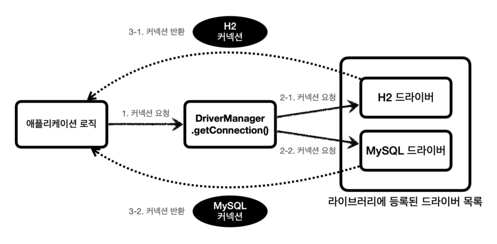

*JDBC가 제공하는 DriverManager는 라이브러리에 등록된 DB 드라이버들을 관리하고, 커넥션을 획득하는 기능을 제공한다.*

  1. *애플리케이션 로직에서 커넥션이 필요하면 DriverManager.getConnection()을 호출*
  1. *DriverManager는 라이브러리에 등록된 드라이버 목록을 자동으로 인식, 해당 드라이버들에게 순서대로 url, name, password 정보를 넘겨서 커넥션을 획득할 수 있는지 확인*
  1. *각각의 드라이버는 URL 정보를 체크해서 본인이 처리할 수 있는 요청인지 확인하고 처리할 수 있으면 DB에 커넥션을 요청하고 본인이 처리할 수 없으면 다음 드라이버에게 순서를 넘긴다.*
  1. *이렇게 찾은 커넥션 구현체가 클라이언트(애플리케이션 서버)에 반환된다.*

# ***JDBC 개발 - 등록***

***member.sql***

```sql
drop table member if exists cascade;
create table member (
		 member_id varchar(10),
		 money integer not null default 0,
		 primary key (member_id)
);
```

***Member***

```java
@Data
@NoArgsConstructor
@AllArgsConstructor
public class Member {
    private String memberId;
    private int money;
}
```

***MemberRepositoryV0 - 회원 등록***

```java
@Slf4j
public class MemberRepositoryV0 {
		private static Connection getConnection() {
        return DBConnectionUtil.getConnection();
    }
    public Member save(Member member) throws SQLException{
        String sql = "insert into member(member_id, money) values (?, ?)";

        Connection con = null;
        PreparedStatement pstmt = null;

        try {
            con = getConnection();
            pstmt = con.prepareStatement(sql);
            pstmt.setString(1, member.getMemberId());
            pstmt.setInt(2, member.getMoney());
            int count = pstmt.executeUpdate(); 

            return member;
        }
        catch (SQLException e){
            log.error("db error", e.getMessage());
            throw e;
        }
        finally {
             close(con, pstmt, null);
        }
    }
    private void close(Connection con, Statement stmt, ResultSet rs) throws SQLException{
        if(rs != null){
            try {
                rs.close();
            }
            catch (SQLException e){
                log.error("db error", e);
            }
        }
        if(stmt != null){
            try {
                stmt.close();
            }
            catch (SQLException e){
                log.error("db error", e);
            }
        }
        if(con != null){
            try {
                con.close();
            }
            catch (SQLException e){
                log.error("db error", e);
            }
        }
    }
}
```

***커넥션 획득***

  - *getConnection() DriverManager를 통해서 획득*

***save() 로직 정리*** 

  - *sql: 데이터베이스에 전달한 insert SQL 정의*
  - *pstmt = con.prepareStatement(sql)*
- *데이터베이스에 전달할 SQL과 파라미터로 전달할 데이터 준비*
- *pstmt.setString(1, member.getMemberId())* 
      - *pstmt.setInt(2, member.getMoney())*
  -  *int count = pstmt.executeUpdate();* 
- *Statement를 통해 준비된 SQL을 커넥션을 통해 실제 데이터베이스에 전달*
    - *executeUpdate()은 int를 반환하는데 영향받은 DB row 수를 반환*

***PrepareStatement extends Statemet <interface>***

  - *PreparedStatement는 Statement 의 자식 타입*
  - *? 와일드 카드를 통한 파라미터 바인딩을 가능하게 해준다.*
  - *파라미터 바인딩에서* ***SQL Injection 공격을 예방****한다.*
- *PrepareStatement가 아닌 Statement를 사용하고 파라미터 바인딩을 문자열 더하기를 통해서 하면 만약 공격자가 정상값이 아닌 추가 쿼리를 날렸을 때 그대로 subquery가 날라간다.*
  - ***성능 최적화***
- *동일한 쿼리를 여러 번 실행할 때 쿼리를 매번 파싱하지 않고, 미리 컴파일된 쿼리를 재사용하므로 성능이 향상*

***close()***

  - *close() 메소드를 보면 자원 획득 역순으로 정리를 하고있다.*
  - *각 자원에 대해 try catch를 하는 이유는 자원 정리 예외 발생에 대한 격리를 위함이다.*

***데이터 변경(추가): INSERT, DELETE, UPDATE***

  - *executeUpdate()*

***데이터 조회: SELECT*** 

  - *executeQuery()*
- *ResultSet 반환 next()로 iterator 같이 사용 가능* 
    - *Select 쿼리 결과랑 같은 순서대로 반환*

- *H2 Database 생성, 설정* 
- *PrepareStatement과 SQL Injection, Resource 해제 정리*

# ***커넥션 풀 이해***

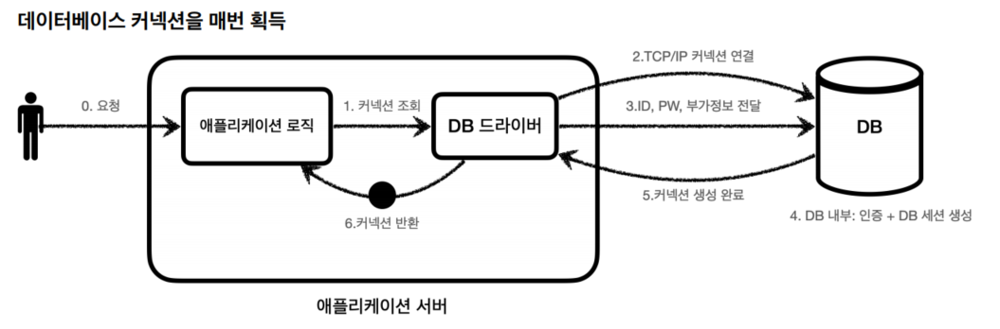

***커넥션 풀 없이 데이터베이스 커넥션 획득 과정*** 

  - *애플리케이션 로직 DB 드라이버를 통해 커넥션 조회*
- *DriverManager.getConnection(URL, USERNAME, PASSWORD)*
  - *DB 드라이버는 DB와 TCP/IP 커넥션 연결*
- *3 way handshake 같은 네트워크 동작 발생*
  - *DB 드라이버는 TPP/IP 커넥션 통해서 ID/PW 기타 부가정보를 DB에 전달* 
  - *DB는 ID,PW를 통해 내부 인증을 완료하고, 내부에 DB 세션을 생성*
  - *DB 커넥션 생성이 완료되었다는 응답을 보낸다.*
  - *DB 드라이버는 커넥션 객체를 생성해서 클라이언트: DriverManager.getConnection() 호출 스레드에게 반환*

***커넥션 풀 없이 데이터베이스 커넥션 획득 과정의 문제점*** 

  - *DB, 애플리케이션 서버에서도 매번 TCP/IP 커넥션을 새로 생성하기 위한 리소스 매번 사용* 

***커넥션 풀?***

  - *커넥션을 미리 생성하고 재사용하는 방식이 커넥션 풀이다.*
  - *스프링 애플리케이션 서버에서 스레드를 미리 생성하고 재사용하는 방식과 똑같다.*

***커넥션 풀 초기화***

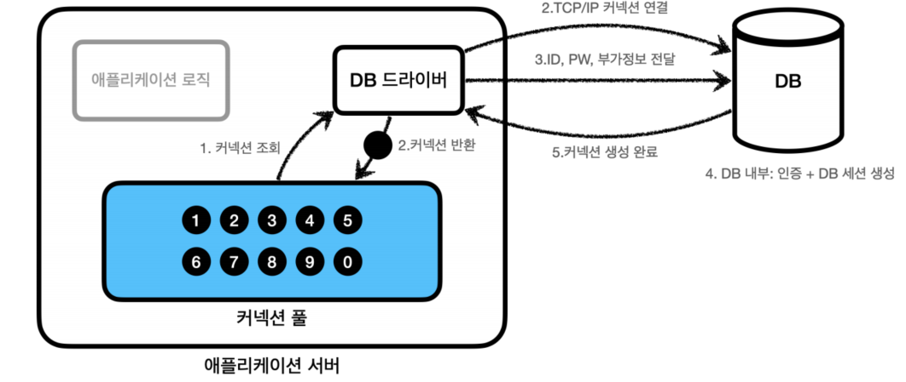

  - *애플리케이션을 시작하는 시점에 커넥션 풀은 설정해둔 커넥션 개수만큼 커넥션을 미리 확보해서 풀에 보관한다*
  - *커넥션 개수는 서비스 특징, 서버 스펙에 따라 다르지만 default: 10*

***커넥션 풀의 연결 상태***

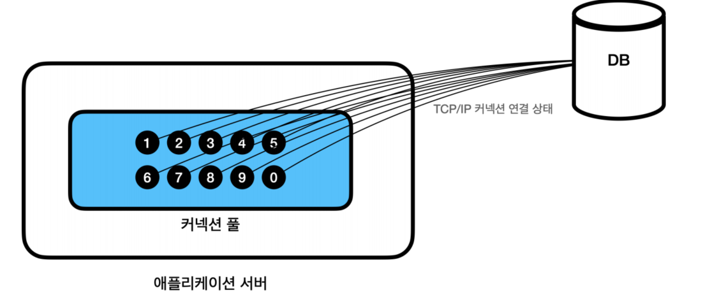

  - *커넥션 풀에 들어있는 커넥션은 TCP/IP로 DB와 커넥션이 연결되어 있는 상태이기 때문에 언제든지 SQL을 DB에 전달할 수 있다.*

***커넥션 풀 정리***

  - *커넥션 풀 숫자는 서비스의 특징과 애플리케이션 서버 스펙, DB 서버 스펙에 따라 다르다 → 성능 테스트를 통해서 최적의값을 정해야 한다.*
- *MySQL 유료 에디션에서는 스레드 풀 기능을 제공하는데 스레드 풀 도입이 무조건 성능 개선을 의미하지는 않는다는 내용이 있다. 너무 많은 스레드의 개수는 너무 많은 컨텍스트 스위칭을 발생시키고 CPU 친화도가 낮아진다. 즉, 언제나 성능 테스트를 통해서 맞춰야 한다.*
  - *커넥션 풀의 최대 커넥션 수를 제한할 수 있다.*
- *커넥션 수를 제한하지 않으면 DB에 무한정 연결이 생성되는 것을 막아주어서 DB를 보호하는 효과도 있다.*
    - *트랜잭션을 시작하고 종료하지 않으면 MySQL은 MVCC를 언두 로그를 통해서 제공하는데 언두 로그에 데이터가 무한정 쌓이게된다.*
  - *커넥션 풀 오픈소스* 
-  *commons-dbcp2 , tomcat-jdbc pool ,* ***HikariCP(스프링 부트 2.0부터 default)***

# *DataSource 이해* 

***여러가지 커넥션 획득 방법과 문제점*** 

*커넥션을 획득하는 방법은 다양하다.*

*→ DBCP2  조회, HikariCP 조회, DriverManger를 통한 신규 커넥션 생성 등등…*

*만약 애플레이션 로직이 DriverManger를 통해 신규 커넥션을 획득하다가, 커넥션 풀을 사용하는 방법으로 변경하면 어떻게 해야할까?*

*→ 애플리케이션 코드가 변경된다. 즉, 커넥션을 획득하는 클라이언트 코드가 변경된다.* 

***커넥션을 획득하는 방법을 추상화***

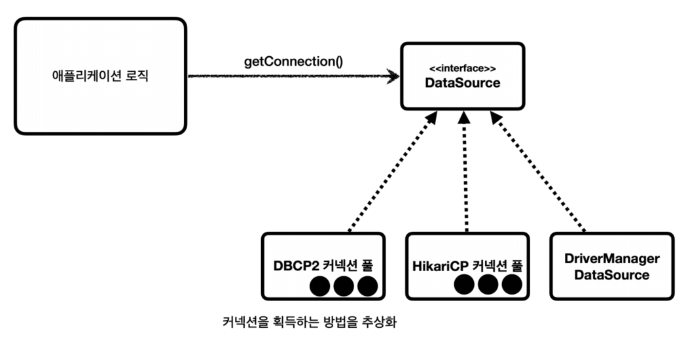

  - *javax.sql.DataSource 인터페이스를 제공 (커넥션 획득하는 방법 추상화)*

***DataSource 핵심 기능만 축약***

```java
public interface DataSource {
		 Connection getConnection() throws SQLException;
}
```

  - *커넥션 풀 implements DataSource*
  - *DriverManager: DriverManagerDataSource implments DataSource*  
- *항상 새로운 커넥션 획득*

# *DataSource 예제1 - DriverManager*

***DriverManager 사용 커넥션 획득***

```java
@Test
void driverManager() throws SQLException {
    Connection con1 = DriverManager.getConnection(URL, USERNAME, PASSWORD);
    Connection con2 = DriverManager.getConnection(URL, USERNAME, PASSWORD);
    assertThat(con1).isNotSameAs(con2);
}
```

***DataSourceDriverManager 사용 커넥션 획득*** 

```java
@Test
void dataSourceDriverManager() throws SQLException{
    DataSource datasource = new DriverManagerDataSource(URL, USERNAME, PASSWORD);
    useDataSource(datasource);
}
 private void useDataSource(DataSource dataSource) throws SQLException{
    Connection con1 = dataSource.getConnection();
    Connection con2 = dataSource.getConnection();
}
```

*2방식 모두 커넥션을 획득할 때마다 신규 TCP/IP 통신을 한다.*

*하지만 큰 차이점이 있다.*

*DriverManger 방식은 커넥션을 획득할 때마다 설정 정보(URL, USERNAME, PASSWORD)를 넘긴다.*

*하지만 DriverManagerDataSource 방식은 처음 DataSource 객체를 생성할 때 설정 정보를 넘기고 이후에 커넥션 획득할 때는 단순히 getConnection()을 호출해서 얻어온다.*

*즉, 설정과 사용이 분리되어 있다.*

# *DataSource 예제2 - Connection Pool*

 ***HikariDataSource 사용 커넥션 획득***

```java
@Test
void dataSourceConnectionPool() throws SQLException, InterruptedException{
    HikariDataSource dataSource = new HikariDataSource();
    dataSource.setJdbcUrl(URL);
    dataSource.setUsername(USERNAME);
    dataSource.setPassword(PASSWORD);
    dataSource.setMaximumPoolSize(10);
    dataSource.setPoolName("OceanWorld");

    useDataSource(dataSource);
    Thread.sleep(1000); 

private void useDataSource(DataSource dataSource) throws SQLException{
    Connection con1 = dataSource.getConnection();
    Connection con2 = dataSource.getConnection();
}
```

  - ***HikariCP 커넥션 풀을 사용***

***커넥션 생성 작업***

*커넥션 풀에서 커넥션을 생성하는 작업은 애플리케이션의 실행 속도에 영향을 주지 않기 위해 별도의 쓰레드에서 비동기적으로 동작한다.*

*그래서 테스트가 먼저 종료될 가능성이 존재한다. 그래서 커넥션 생성 작업 스레드의 작업 완료를 기다리기 위해 Thread.sleep이 필요하다.*

*테스트를 위해서 Future를 통한 블로킹 비동기 방식이나 CompletableFuture를 통한 논블로킹 비동기 방식을 적용해도 괜찮을듯하다*

***커넥션 획득*** 

*커넥션 풀에 사용 가능한 커넥션 풀이 없을 때는 블로킹 방식으로 동작한다.*

*즉, 다른 스레드가 커넥션 반납 전까지는 커넥션이 필요한 스레드는 대기 상태이다.*

*UX와 애플리케이션의 안정성을 위해서 커넥션 획득 타임아웃을 걸어야 한다.*

*→ ex: setConnectionTimeout(1000)* 

  - ***HikariCP 커넥션 풀***

# ***DataSource 적용***

```java
@RequiredArgsConstructor
public class MemberRepositoryV1 {
		 private final DataSource dataSource;
		 
		 // CRUD 생략 ..		 
		 
		 private void close(Connection con, Statement stmt, ResultSet rs) {
			  JdbcUtils.closeResultSet(rs);
			  JdbcUtils.closeStatement(stmt);
			  JdbcUtils.closeConnection(con);
     }
		 
		 private Connection getConnection() throws SQLException {
				 return dataSource.getConnection();
	   }
}		 
```

  - *resource 정리 → JdbcUtils.closeXXX*
  - *Connection 획득 → DataSource.getConnnection() is not static*
- *이제 DataSource를 주입받아서 사용해서 커넥션 획득 방식이 바뀌어도 클라이언트 코드 즉,*
*getConnnection() 메소드가 변경되지 않고, 외부 설정 코드만 바뀐다.*
    - *DI + OCP*

[Untitled](https://app.notion.com/p/16b7d6692ca8805faa5cdb501579c425) 

  - *트랜잭션 개념, MySQL 기반 트랜잭션 정리*

# ***트랜잭션 - 개념 이해***

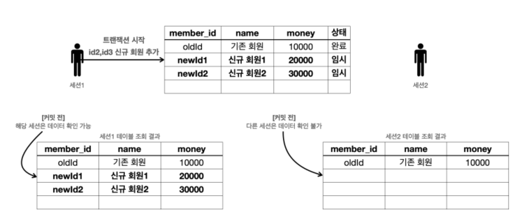

  - *격리 레벨 READ_COMMITED 이상, MySQL(InnoDB)기준*
  - *세션1은 트랜잭션을 시작하고 신규 회원1, 신규 회원2를 DB에 추가했다. 아직 커밋은 하지 않은 상태*
  - *새로운 데이터는 언두 로그에 기록된다.*
  - *세션1은 select 쿼리를 실행해서 본인이 입력한 신규 회원1, 신규 회원2를 조회할 수 있다.*
- *본인의 트랜잭션 번호(TxID)보다 같거나 낮은 번호 데이터까지 →  MVCC*
  - *세션2는 select 쿼리를 실행해도 신규 회원들을 조회할 수 없다. 왜냐하면 세션1이 아직 커밋을 하지 않았기 때문이다.*
- *MySQL 에서는 언두 로그를 통해 읽기 일관성(Read Consistency)를 보장하는 방식 때문*
    - *REPEATABLE_READ 레벨 같은 경우 잠금 읽기(Lock Read)는 버퍼 풀에 있는 데이터를 조회한다.*
  - *세션1이 데이터를 commit 한다면?*
- *먼저 리두 로그에 추가된(변경) 데이터를 기록 (시스템 장애 시 복구 가능성 보장)*
    - *언두 로그에 있는 데이터를 버퍼 풀(메모리 캐시)에 is Dirty Page저장, 변경 내용이 커밋 후 MVCC 스냅샷 용도로 더 이상 필요 없으면 삭제*
    - *인덱스 처리: 인덱스 관련(not unique)는 체인지 버퍼에서 지연 처리*
- *unique 인덱스는 바로 처리*
    - *버퍼 풀에 있는 Dirty Page 데이터는 추후에 백그라운드 스레드에 의해서 쓰기 버퍼를 통한 디스크 데이터 파일과의 동기화 → 플러시 작업*
    - ***리두 로그 기록 → 언두 로그 정리 → 인덱스 처리 → 플러시***

# ***DB 락*** 

*강의에서 설명하는 락 방식은 데이터베이스의 락을 활용하는 비관적 락 방식이다.*

*데이터베이스의 락은 요청 세션의 순서대로 처리하는 블로킹 동기적 공정 락 방식이다.*

*즉, 성능이 떨어진다, 락 타임아웃 오류 발생* 

*낙관적 락을 생각할 수 있지만, 낙관적 락은 마치 spin lock 처럼 재시도를 하면서 성공할 때까지 반복한다. 그리 좋지 않다.*

*그래서 사람들은 데이터베이스의 락으로는 데이터의 정합성을 맞추는 건 가능하지만 성능상 떨어진다고 평가한다.*

# *트랜잭션 적용1*

*트랜잭션 없이 로직을 구현하니까 원자성이 보장이 안된다.*

# *트랜잭션 적용2*

*커넥션을 유지하도록 코드를 변경하는 것이 쉬운 일이 아니다.* 

*서비스 계층이 매우 지저분해지고 복잡하다*

# ***문제점들***

*애플리케이션을 layer 관점으로 봤을 때 가장 중요한 계층은 어디일까?*

*바로 핵심 비즈니스 로직이 들어있는 서비스 계층이다.*

*UI(웹) 프레젠테이션 계층 관련된 부분이 변경되고 데이터 접근 계층이 다른 기술로 변경해도* 

*비즈니스 로직은 최대한 변경없이 다른 계층에 종속적이지 않게 유지되어야 한다.*

*서비스 계층이 특정 기술에 종속되지 않으면 비즈니스 로직을 유지보수 하기도 쉽고, 단위 테스트 하기도 쉽다.*

***MemberServiceV1, MemberServiceV2의 문제점 정리***

  - *트랜잭션을 사용하기 위해서 SQLException, DataSource, Connection 같은 JDBC 기술에 의존*
  - *비즈니스 로직보다 JDBC를 사용해서 트랜잭션을 처리하는 코드가 더 많다.*
  - *향후 JDBC에서 JPA 같은 기술로 바꾸어 사용하게 되면 서비스 코드를 모두 변경해야 한다.*
  - *정리하면 핵심 비즈니스 로직과 JDBC 기술이 섞여 있어서 유지보수 하기 어렵다.*

# ***트랜잭션 추상화***

***트랜잭션 구현 기술에 따른 트랜잭션 사용법이 다르다***

  - *JDBC : con.setAutoCommit(false)*
  - *JPA : transaction.begin()*

***트랜잭션 기능을 추상화*** 

```java
public interface TxManager {
		 begin();
		 commit();
		 rollback();
}
```

  - *트랜잭션은 단순하다. 트랜잭션을 시작하고, 비즈니스 로직의 수행이 끝나면 커밋하거나 롤백하면 된다.*
  - *TxManager 인터페이스를 기반으로 각각의 기술에 맞는 구현체를 만들면 된다.*
- *JdbcTxManager : JDBC 트랜잭션 기능을 제공하는 구현체*
    - *JpaTxManager : JPA 트랜잭션 기능을 제공하는 구현체*

# ***스프링의 트랜잭션 추상화***

*우리가 직접 트랜잭션 추상화를 위해 개발할 필요 없이 스프링은 이미 다 구현해두었다.* 

*우리는 스프링이 제공하는 트랜잭션 추상화 기술을 사용하면 된다.*

*각 데이터 접근 기술에 따른 트랜잭션 구현체도 대부분 만들어두었다.*

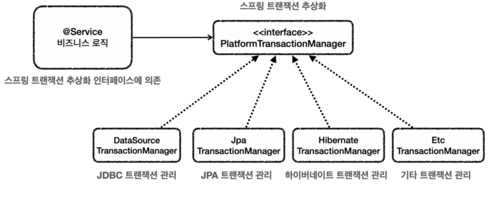

  - *org.springframework.transaction.PlatformTransactionManager*

***PlatformTransactionManager 인터페이스***

```java
public interface PlatformTransactionManager extends TransactionManager {
		
		TransactionStatus getTransaction(@Nullable TransactionDefinition definition) throws TransactionException;
		
		void commit(TransactionStatus status) throws TransactionException;
		
		void rollback(TransactionStatus status) throws TransactionException;
}
```

  - *getTransaction()*
- *트랜잭션 시작 또는 참여*
  - *commit(), rollback()*
- *트랜잭션 커밋, 롤백*

# ***트랜잭션 동기화***

***스프링이 제공하는 트랜잭션 매니저의 역할*** 

  - *트랜잭션 추상화*
  - *리소스 동기화* 

***리소스 동기화***

  - *트랜잭션을 유지하려면 트랜잭션의 시작부터 끝까지 같은 데이터베이스 커넥션을 유지해야한다.*
  - *결국 같은 커넥션을 사용하기 위해서 이전에는 파라미터로 커넥션을 전달하는 방법을 사용했다.* 
  - *파라미터로 커넥션을 전달하는 방법은 코드가 지저분해지고, 커넥션을 넘기는 메소드와 넘기지 않는 메소드를 중복해서 만들어야 하는 등 단점이 많았다.*

***트랜잭션 매니저와 트랜잭션 동기화 매니저***

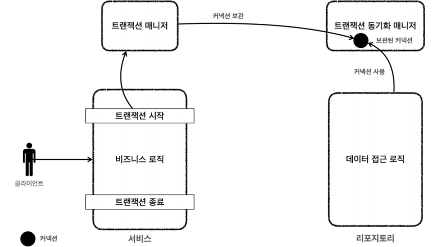

  - *스프링은 트랜잭션 동기화 매니저를 제공한다.*
  - *쓰레드 로컬(Thread Local)을 사용해서 커넥션을 동기화해준다.*
- *트랜잭션 동기화 매니저는 쓰레드 로컬을 사용하기 때문에 멀티쓰레드 환경에서도 안전하게 커넥션을 동기화 할 수 있다.* 
    - *따라서 커넥션이 필요하면 트랜잭션 동기화 매니저를 통해서 커넥션을 획득하면 된다.*
  - *트랜잭션 매니저는 내부에서 이 트랜잭션 동기화 매니저를 사용한다.*
  - *org.springframework.transaction.support.TransactionSynchronizationManager*

***트랜잭션 메니저 동작 흐름 정리***

  - *클라이언트 요청 → 서비스 계층 로직 실행* 
  - *트랜잭션 매니저 getTransaction()을 통해서 트랜잭션 시작*
  - *트랜잭션 매니저는 내부에서  DataSource를 활용해서 커넥션을 생성*
  - *커넥션의 세션을 수동 커밋 모드로 변경해서 실제 데이터베이스 트랜잭션을 시작* 
  - *획득한 커넥션을 트랜잭션 동기화 매니저(스레드 로컬)에 보관* 
  - *서비스는 비즈니스 로직을 실행하면서 리포지토리의 메소드를 호출*
- *리포지토리에서 커넥션이 필요하면 스레드 로컬에서 꺼내서 사용 → 트랜잭션 유지*
  - *예외가 터지면 트랜잭션 매니저는 롤백하고 예외가 없었다면 커밋* 
  - *DataSource의 커넥션 획득 방식에 따라 커넥션을 커넥션 풀에 반납 또는 소멸* 

# ***트랜잭션 문제 해결 - 트랜잭션 템플릿***

*트랜잭션을 사용하는 로직을 살펴보면 다음과 같은 패턴이 반복되는 것을 확인할 수 있다.*

***트랜잭션 사용 반복 코드*** 

```java
TransactionStatus status = transactionManager.getTransaction(new DefaultTransactionDefinition());
try {
		 bizLogic(fromId, toId, money);
		 transactionManager.commit(status); 
} 
catch (Exception e) {
		 transactionManager.rollback(status);
     throw new IllegalStateException(e);
}
```

  - *트랜잭션을 시작하고, 비즈니스 로직을 실행하고, 성공하면 커밋하고, 예외가 발생해서 실패하면 롤백*
  - *이런 형태는 각각의 서비스에서 반복된다. 달라지는 부분은 비즈니스 로직 뿐*
  - *이럴 때 템플릿 콜백 패턴을 활용하면 이런 반복 문제를 깔끔하게 해결할 수 있다*
- *템플릿 콜백 패턴: JdbcTemplate, RestTemplate,* ***TransactionTemplate****, Redis Template 등등..*

***TransactionTemplate***

```java
public class TransactionTemplate {
		 private PlatformTransactionManager transactionManager;
		 
		 public <T> T execute(TransactionCallback<T> action){..}
		 
		 void executeWithoutResult(Consumer<TransactionStatus> action){..}
}
```

***트랜잭션 템플릿 사용 로직***

```java
public void accountTransfer(String fromId, String toId, int money) throws SQLException{
    txTemplate.executeWithoutResult((status) -> {
        try {
            bizLogic(fromId, toId, money);
        }
        catch (SQLException e){
            throw new IllegalStateException(e);
        }
    });
}
```

  - *executeWithoutResult(Consumer<TransactionStatus> action)*
  - *TransactionCallback<TransactionStatus> action → Consumer 동작 정의* 
  - *TransactionTemplate execute(TransactionCallback<TransactionStatus> action)을 매개변수로 준다.*
- *action → Consumer action 동작*

*템플릿 콜백 패턴은 GoF 디자인 패턴의 정식 패턴은 아니다.* 

*전략 패턴의 확장 버전이다.*

***정리***

  - *트랜잭션 템플릿 덕분에, 트랜잭션을 사용할 때 반복하는 코드를 제거할 수 있었다*
  - *하지만 이곳은 서비스 로직인데 비즈니스 로직 뿐만 아니라 트랜잭션을 처리하는 기술 로직이 함께 포함되어 있다.*
  - *즉, 부가 기능인 트랜잭션 처리기능과 핵심 기능인 비즈니스 로직이 하나의 클래스에서 처리하게 된다.*

*→ Spring AOP (Dynamic Proxy) 통해서 해결하자*

# ***트랜잭션 문제 해결 - 트랜잭션 AOP*** 

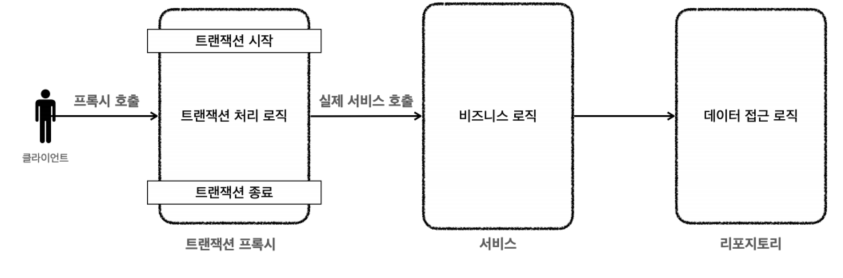

  - *프록시를 사용하면 트랜잭션을 처리하는 객체와 비즈니스 로직을 처리하는 서비스 객체를 명확하게 분리할 수 있다*

### ***스프링이 제공하는 트랜잭션 AOP***

  - *스프링은 트랜잭션 AOP를 처리하기 위한 모든 기능을 제공한다.*
  - *스프링 부트를 사용하면 트랜잭션 AOP를 처리하기 위해 필요한 스프링 빈들도 자동으로 등록해준다.*
- *Advisor: BeanFactoryTransactionAttributeSourceAdvisor*
    - *Pointcut: TransactionAttributeSourcePointcut*
    - *Advice: TransactionInterceptor*
  - *개발자는 트랜잭션 처리가 필요한 곳에 @Transactional 애노테이션만 붙여주면 된다.*

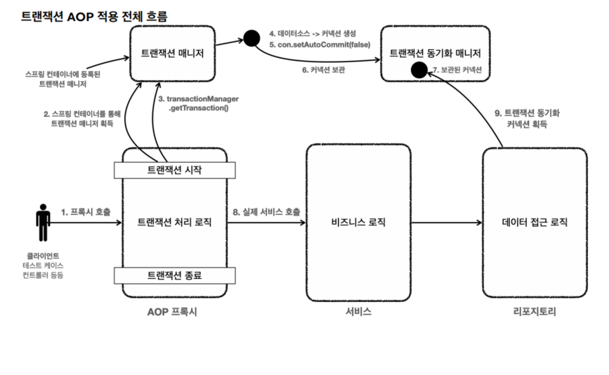

# *스프링 부트의 자동 리소스 등록* 

*DataSource, TransactionManager를 자동 등록*

***데이터소스 - 자동 등록***

  - *스프링 부트는 DataSource를 스프링 빈에 자동으로 등록*
  - *개발자가 직접 데이터소스를 빈으로 등록하면 스프링 부트는 데이터소스를 자동으로 등록하지 않는다.*

```java
spring.datasource.url=jdbc:h2:tcp://localhost/~/test
spring.datasource.username=sa
spring.datasource.password=
[REDACTED]

  - *스프링 부트가 기본으로 생성하는 데이터소스는 커넥션풀을 제공하는 HikariDataSource이다. 
커넥션풀과 관련된 설정도 application.properties를 통해서 지정할 수 있다*
  - *spring.datasource.url 속성이 없으면 내장 데이터베이스(메모리 DB)를 생성하려고 시도한다.*

***트랜잭션 매니저 - 자동 등록***

  - *개발자가 직접 트랜잭션 매니저를 빈으로 등록하면 스프링 부트는 트랜잭션 매니저를 자동으로 등록하지 않는다.*
  - *어떤 트랜잭션 매니저를 선택할지는 현재 등록된 라이브러리를 보고 판단하는데, JDBC를 기술을 사용하면 DataSourceTransactionManager를 빈으로 등록하고, JPA를 사용하면 JpaTransactionManager를 빈으로 등록한다. 둘다 사용하는 경우 JpaTransactionManager 를 등록한다. 
JpaTransactionManager는 DataSourceTransactionManager가 제공하는 기능도 대부분 지원한다.*

- *트랜잭션 매니저, 트랜잭션 동기화 매니저(Thread Local), 트랜잭션 템플릿(Templete CallBack Pattern), 트랜잭션 AOP (Dynamic Proxy)*

# ***자바 예외 계층*** 

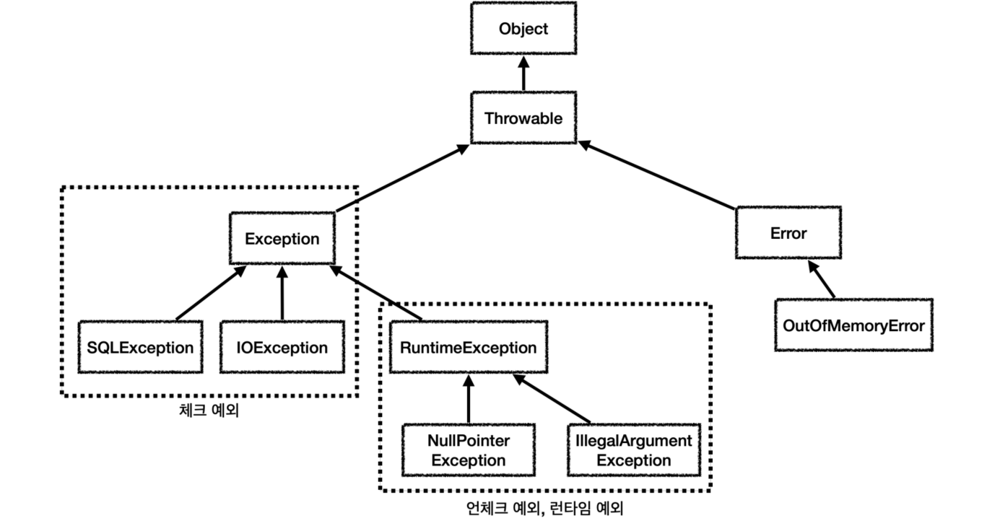

  - *Throwable: 최상위 예외, 하위에 Exception, Error가 존재* 
  - *Error: OutOfMemoryError(메모리 부족)같이 심각한 시스템 오류와 같이 애플리케이션에서 복구 불가능한 시스템 예외이다. 애플리케이션 개발자는 해당 예외를 잡으려고 해서는 안된다.*
- *Error is Unchecked Exception*
  - *Exception*
- *애플리케이션 로직에서 사용 가능한 실질적인 최상위 예외* 
    - *Excetpion과 그 하위 예외는 모두 컴파일러가 체크하는 Checked Excetpion*
  - *RuntimeExcetpion*
- *RuntimeException, 자식 예외 is Unchecked Exception*

# ***예외 기본 규칙***

*예외는 폭탄 돌리기와 같다. 잡아서 처리하거나, 처리할 수 없으면 밖으로 던져야한다.*

  - *catch or throw*

***예외에 대한 2가지 기본 규칙*** 

  - *예외는 잡아서 처리하거나 던져야 한다.*
  - *예외를 잡거나 던질 때 지정한 예외뿐만 아니라 그 예외의 자식들도 함께 처리된다.*
- *ex) Exception을 catch로 잡으면 그 하위 예외들도 모두 잡을 수 있다.*
    - *ex) Exception을 throws로 던지면 그 하위 예외들도 모두 던질 수 있다.*

***예외를 처리하지 못하고 계속 던진다면?***

  - *Java main() 쓰레드 경우 예외 로그를 출력하면서 시스템이 종료된다.*
  - *특별한 설정이 없다면 WAS는 해당 예외를 받아서 BasicErrorController를 내부 호출한다.*

# ***체크 예외 기본 이해***

  - *RuntimeException을 제외한 Exception과 그 하위 예외들* 
  - *체크 예외는 잡아서 처리하거나, 또는 밖으로 던지도록 명시적으로 선언해야한다. 런타임 예외와 다르게 명시적으로 선언하지 않으면 컴파일 오류가 발생한다.*

***체크 예외의 장단점***

  - *체크 예외는 예외를 잡아서 처리할 수 없을 때, 예외를 밖으로 던지는 throws 예외를 필수로 선언해야 한다. 그렇지 않으면 컴파일 오류가 발생한다. → 이것 때문에 장단점이 동시에 존재* 
- *장점: 개발자가 실수로 예외를 누락하지 않도록 컴파일러를 통해 문제를 잡아주는 훌륭한 안전 장치이다.*
    - *단점: 개발자가 모든 체크 예외를 반드시 잡거나 던지도록 처리해야 하기 때문에, 너무 번거로운 일이 된다. 쓸데없는 예외까지 모두 챙겨야 하고 특정 layer가 특정 기술에 종속된다.*

# ***언체크 예외 기본 이해***

  - *RuntimeException과 그 하위 예외는 언체크 예외로 분류된다.*
  - *언체크 예외는 체크 예외와 기본적으로 동일하다. 차이가 있다면 예외를 던지는 throws 를 선언하지 않고, 생략할 수 있다. 이 경우 자동으로 예외를 던진다.*

***체크 예외 VS 언체크 예외***

  - *체크 예외: 예외를 잡아서 처리하지 않으면 항상 throws 에 던지는 예외를 선언해야 한다.*
  - *언체크 예외: 예외를 잡아서 처리하지 않아도 throws를 생략할 수 있다.*

***언체크 예외의 장단점***

  - *언체크 예외는 예외를 잡아서 처리할 수 없을 때, 예외를 밖으로 던지는 throws 예외를 생략할 수 있다. → 장점과 단점이 동시에 존재한다.*
- *장점: 신경쓰고 싶지 않은 언체크 예외를 무시할 수 있다. 체크 예외의 경우 처리할 수 없는 예외를 밖으로 던지려면 항상 throws 예외를 선언해야 하지만, 언체크 예외는 이 부분을 생략할 수 있다. 체크 예외와 다르게 예외 때문에 의존성이 생기지 않는다.* 
    - *단점: 언체크 예외는 개발자가 실수로 예외를 누락할 수 있다. 반면에 체크 예외는 컴파일러를 통해 예외 누락을 잡아준다.*

# ***체크 예외 문제점*** 

*기본적으로 언체크(런타임) 예외를 사용하자*

*체크 예외는 비즈니스 로직상 의도적으로 던지는 예외에만 사용하자.*

***체크 예외의 문제점 - 던져도 어차피 복구 불가능한 예외*** 

*특정 layer에서 발생하는 예외는 다른 계층에서 처리할 방법이 거의 없다.*

*ex) SQLException는 데이터베이스에 무언가 문제가 있어서 발생하는 예외이다.* 

*원인은 다양하다. SQL 문법 오류, 데이터베이스 자체에 뭔가 문제가 발생했을 수도 있다.* 

*이런 문제들은 서비스, 컨트롤러 layer에서 해결 불가능하다.* 

***체크 예외의 문제점 - 의존 관계에 대한 문제***

*체크 예외의 또 다른 심각한 문제는 예외에 대한 의존 관계 문제이다.*

*앞서 대부분의 예외는 복구 불가능한 예외라고 했다. 
그런데 체크 예외이기 때문에 컨트롤러나 서비스 입장에서는 본인이 처리할 수 없어도 어쩔 수 없이 throws를 통해 던지는 예외를 선언해야 한다.*

*향후 다른 기술로 바뀐다고 하면 모든 서비스, 컨트롤러 코드의 의존성을 바꾸도록 고쳐야 한다.*

*서비스나 컨트롤러 입장에서는 어차피 본인이 처리할 수 도 없는 예외를 의존해야 하는 큰 단점이 발생하게 된다.*

*결과적으로 OCP, DI를 통해 클라이언트 코드의 변경 없이 대상 구현체를 변경할 수 있다는 장점이 체크 예외 때문에 발목을 잡게 된다.*

# 정리

*체크 예외의 단점들은 명확하다. 최근 라이브러리들은 대부분 런타임 예외를 기본으로 제공한다.*

*→ JPA, 스프링도 대부분 런타임 예외를 제공*

*런타임 예외도 필요하면 잡을 수 있기 때문에 필요한 경우에는 잡아서 처리하고, 그렇지 않으면 자연스럽게 던지도록 둔다. 그리고 예외를 공통으로 처리하는 부분을 앞에 만들어서 처리하면 된다.*

*→ Controller Advice*

*추가로 런타임 예외는 놓칠 수 있기 때문에 문서화가 중요하다*

***런타임 예외는 문서화***

  - *런타임 예외는 문서화를 잘해야 한다.*

***JPA EntityManager 문서화 예시*** 

```java
/**
 * Make an instance managed and persistent.
 * @param entity entity instance
 * @throws EntityExistsException if the entity already exists.
 * @throws IllegalArgumentException if the instance is not an
 * entity
 * @throws TransactionRequiredException if there is no transaction when
 * invoked on a container-managed entity manager of that is of type 
 * <code>PersistenceContextType.TRANSACTION</code>
 */
public void persist(Object entity);
```

# ***예외 포함과 스택 트레이스***

*예외를 전환할 때는 꼭! 기존 예외를 포함해야 한다. 
그렇지 않으면 스택 트레이스를 확인할 때 심각한 문제가 발생한다.*

*기존 예외를 포함하지 않고 예외를 던지면 예외가 어디서 시작했는지 정확하게 확인할 수 없다.*

# ***체크 예외와 인터페이스***

*서비스 계층은 가급적 특정 구현 기술에 의존하지 않고, 순수하게 유지하는 것이 좋다.* 

*이렇게 하려면 예외에 대한 의존도 함께 해결해야 한다.*

*예를 들어서 서비스가 처리할 수 없는 SQLException에 대한 의존을 제거하려면 어떻게 해야할까?*

*서비스가 처리할 수 없으므로 리포지토리가 던지는 SQLException 체크 예외를 런타임 예외로 전환해서 서비스 계층에 던지자. 이렇게 하면 서비스 계층이 해당 예외를 무시할 수 있기 때문에, 특정 구현 기술에 의존하는 부분을 제거하고 서비스 계층을 순수하게 유지할 수 있다.*

# ***스프링 예외 추상화 이해***

*데이터를 DB에 저장할 때 같은 ID가 이미 데이터베이스에 저장되어 있다면, 데이터베이스는 오류 코드를 반환하고, 이 오류 코드를 받은 JDBC 드라이버는 SQLException을 던진다. 
그리고 SQLException 에는 데이터베이스가 제공하는 errorCode 라는 것이 들어있다.*

*SQLException 내부에 들어있는 errorCode를 활용하면 데이터베이스에서 어떤 문제가 발생했는지 확인할 수 있다.*

*문제는 같은 오류여도 각각의 데이터베이스마다 정의된 오류 코드가 다르다. 
따라서 오류 코드를 사용할 때는 데이터베이스 메뉴얼을 확인해야 한다.*

*또한 데이터베이스가 전달하는 오류는 키 중복 뿐만 아니라 락이 걸린 경우, SQL 문법에 오류 있는 경우 등등 수십 수백가지 오류 코드가 있다.*

*스프링은 이런 문제를 해결하기 위해 데이터 접근과 관련된 예외를 추상화해서 제공한다.* 

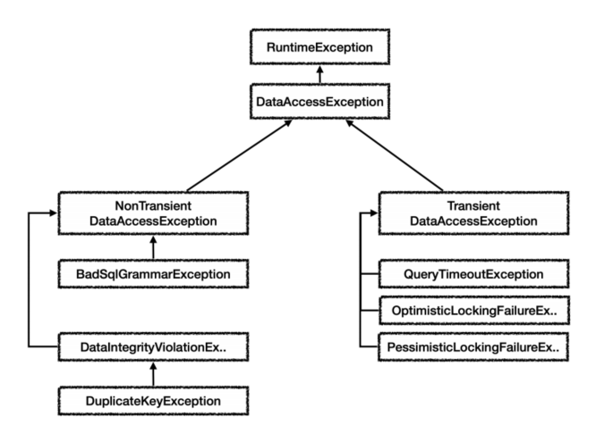

  - *각각의 예외는 특정 기술에 종속적이지 않게 설계되어 있다. 
따라서 서비스 계층에서도 스프링이 제공하는 예외를 사용하면 된다.* 
  - *JDBC나 JPA를 사용할 때 발생하는 예외를 스프링이 제공하는 예외로 변환해주는 역할도 스프링이 제공한다.*
  - *예외의 최고 상위는 org.springframework.dao.DataAccessException이다. 런타임 예외를 상속 받았기 때문에 스프링이 제공하는 데이터 접근 계층의 모든 예외는 런타임 예외이다.*
  - ***NonTransient 예외와 Transient 예외***
- *일시적인 - Transient 예외*
- *쿼리 타임아웃, 락과 관련된 오류들이다. 
이런 오류들은 데이터베이스 상태가 좋아지거나, 락이 풀렸을 때 다시 시도하면 성공할 수 도 있다.*
    - *일시적이지 않은 - NonTransient 예외*
- *SQL 문법 오류, 데이터베이스 제약조건 위배 등*

# ***스프링이 제공하는 예외 변환기***

*스프링은 데이터베이스에서 발생하는 오류 코드를 스프링이 정의한 예외로 자동으로 변환해주는 변환기를 제공한다*

```java
@Slf4j
public class SpringExceptionTranslatorTest{
    DataSource dataSource;
    
    @BeforeEach
    void init(){
       dataSource = new DriverManagerDataSource(URL, USERNAME, PASSWORD);
    }
    @Test
    void sqlExceptionErrorCode(){
        String sql = "select bad grammer";

        try {
            Connection con = dataSource.getConnection();
            PreparedStatement pstmt = con.prepareStatement(sql);
            pstmt.executeQuery();
        }
        catch (SQLException e){
            assertThat(e.getErrorCode()).isEqualTo(42122);
			      // 직접 예외 던지기?
        }
    }
}    
```

  -  *SQL ErrorCode를 직접 확인하는 방법: 직접 ErrorCode를 확인하고 스프링이 만들어준 예외(DataAccessException)로 변환하는 것은 현실성이 없다.*
- *데이터베이스마다 오류 코드가 모두 다르고 예외는 너무 많이 존재한다.*
  - *그래서 스프링은 예외 변환기를 제공한다.*

```java
@Slf4j
public class SpringExceptionTranslatorTest{
    DataSource dataSource;
    
    @BeforeEach
    void init(){
       dataSource = new DriverManagerDataSource(URL, USERNAME, PASSWORD);
    }
    
    @Test
    void exceptionTranslator(){
        String sql = "select bad grammar";

        try {
            Connection con = dataSource.getConnection();
            PreparedStatement pstmt = con.prepareStatement(sql);
            pstmt.executeQuery();
        }
        catch (SQLException e){
            assertThat(e.getErrorCode()).isEqualTo(42122);
          
            //org.springframework.jdbc.support.sql-error-codes.xml
            // 스프링이 제공하는 SQL 예외 변환기
            SQLExceptionTranslator exTranslator = 
				            new SQLErrorCodeSQLExceptionTranslator(dataSource);

            //org.springframework.jdbc.BadSqlGrammarException
            DataAccessException resultEx = exTranslator.translate("select", sql, e);
            log.info("resultEx", resultEx);

            assertThat(resultEx.getClass()).isSameAs(BadSqlGrammarException.class);
        }
    }
}    
```

  - *스프링이 제공하는 SQL 예외 변환기 → SQLExceptionTranslator* 
  - *translate() 파라미터: 설명, 실행한 sql, 발생된 SQLException*
  - *translate() 결과: 반환 타입은 최상위 타입인 DataAccessException이지만 실제 예외는 BadGrammerException 예외가 반환된다.*

*각각의 DB마다 SQL ErrorCode는 모두 다르다*

*그런데 스프링은 어떻게 각각의 DB가 제공하는 SQL ErrorCode를 고려해서 예외를 변환할 수 있을까?*

*→* ***sql-error-codes.xml*** 

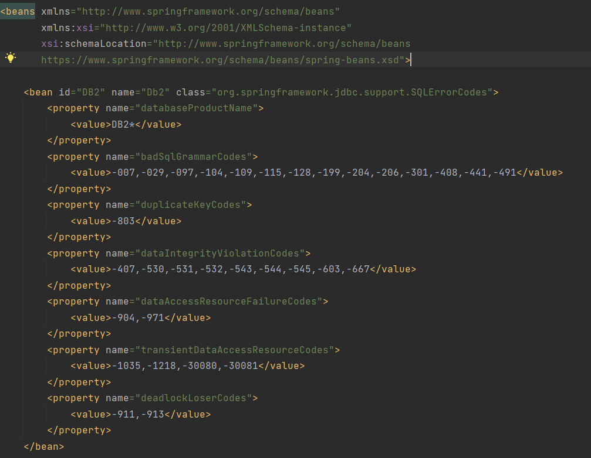

  - *스프링 예외 변환기는 SQL ErrorCode를 SQLException에서 꺼내서 이 파일에 대입해 어떤 예외로 전환해야 할지 찾아낸다.*
  - *해당 파일을 확인해보면 10개 이상의 우리가 사용하는 대부분의 관계형 데이터베이스를 지원하는 것을 확인할 수 있다.*

# *정리*

*스프링은 데이터 접근 계층에 대한 일관된 예외 추상화를 제공*

*스프링은 예외 변환기를 통해서 SQLException의 ErrorCode에 맞는 적절한 스프링 데이터 접근 예외로 변환해준다. (* ***sql-error-codes.xml )***

*만약 서비스, 컨트롤러 계층에서 예외 처리가 필요하면 특정 기술에 종속적인 SQLException 같은 예외를 직접 사용하는 것이 아니라, 스프링이 제공하는 데이터 접근 예외를 사용하면 된다.* 

*그리고 데이터 접근 예외는 런타임 예외이다.*

*향후 JDBC → JPA로 데이터 접근 기술을 변경하더라도 스프링은 JPA 예외를 적절한 스프링 데이터 접근 예외로 변경해준다.* 

# ***JDBC 반복 문제 해결 - JdbcTemplate***

***JDBC 반복 문제***

  - *커넥션 조회, 커넥션 동기화*
  - *PreparedStatement 생성 및 파라미터 바인딩*
  - *쿼리 실행*
  - *결과 바인딩*
  - *예외 발생시 스프링 예외 변환기 실행*
  - *리소스 종료*

Repository 각 메소드를 살펴보면 상당히 많은 부분이 반복된다.

*이런 반복을 효과적으로 처리하는 방법이 템플릿 콜백 패턴이다.*

*스프링은 JDBC의 반복 문제를 해결하기 위해* ***JdbcTemplate****이라는 템플릿을 제공한다.*

```java
@Slf4j
public class MemberRepositoryV5 implements MemberRepository{
    private final JdbcTemplate template;
    public MemberRepositoryV5(DataSource dataSource) {
         this.template = new JdbcTemplate(dataSource);
    }
    @Override
    public Member save(Member member){
        String sql = "insert into member(member_id, money) values (?, ?)";

        template.update(sql, member.getMemberId(), member.getMoney());
        return member;
    }
    @Override
    public Member findById(String memberId){
        String sql = "select * from member where member_id = ?";
        return template.queryForObject(sql, memberRowMapper(), memberId);
    }
    @Override
    public void update(String memberId, int money){
        String sql = "update member set money=? where member_id = ?";
        template.update(sql, money, memberId);
    }
    @Override
    public void delete(String memberId){
        String sql = "delete member where member_id = ?";
        template.update(sql, memberId);
    }
    public RowMapper<Member> memberRowMapper(){
       return (rs, rowNum) -> {
           Member member = new Member();
           member.setMemberId(rs.getString("member_id"));
           member.setMoney(rs.getInt("money"));
           return member;
       };
   }
}
```

  - *JdbcTemplate은 JDBC로 개발할 때 발생하는 반복을 대부분 해결해준다. 트랜잭션을 위한 커넥션 동기화는 물론이고, 예외 발생시 스프링 예외 변환기도 자동으로 실행해준다*

